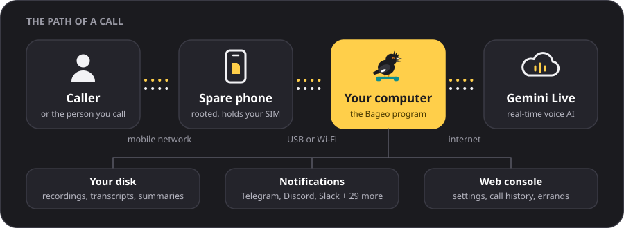

  

  <a href="README.md">English</a> · <a href="README.zh-TW.md">繁體中文</a> · <a href="README.zh-CN.md">简体中文</a> · <a href="README.ja.md">日本語</a> · <a href="README.ko.md">한국어</a> · <a href="README.es.md">Español</a> · <a href="README.fr.md">Français</a> · <strong>Deutsch</strong> · <a href="README.pt.md">Português</a>

  <strong>KI-Telefonassistent für deine echte Telefonnummer: Gemini Live nimmt deine Anrufe an und ruft für dich an.</strong> 
  Selbst gehostet und Open Source. Ein übriges, gerootetes Android-Telefon mit deiner SIM-Karte, ein Programm auf deinem Computer, dein eigener Gemini-Schlüssel.

  
  
  
  

<table>
  <tr>
    <td width="25%" align="center" valign="top">
       
      <strong>Nimmt deine Anrufe an</strong> 
      Hebt nach einmal Klingeln ab, spricht wie ein Mensch und wartet, bis der Anrufer sich verabschiedet.
    </td>
    <td width="25%" align="center" valign="top">
       
      <strong>Hält Betrüger hin</strong> 
      Erkennt Werbe- und Betrugsanrufe und spielt dann bis zu 30 Minuten lang einen langsamen, neugierigen Kunden.
    </td>
    <td width="25%" align="center" valign="top">
       
      <strong>Erledigt deine Anrufe</strong> 
      Schreib eine Zeile, und es ruft für dich an. Wenn es unsicher ist, fragt es dich zuerst.
    </td>
    <td width="25%" align="center" valign="top">
       
      <strong>Spricht neun Sprachen</strong> 
      Englisch, Traditionelles Chinesisch, Vereinfachtes Chinesisch, Japanisch, Koreanisch, Spanisch, Französisch, Deutsch und Portugiesisch. Es wechselt mit, wenn der Anrufer die Sprache wechselt.
    </td>
  </tr>
</table>

Der Name kommt von bāgē (八哥), dem Haubenmaina, einem Vogel, der lernt, so zu sprechen wie die Menschen, bei denen er lebt.

## Probier es aus: Rate, was Bageo sagt

Öffne einen Anruf und klick dich Zeile für Zeile durch. Vorgeschriebene Beispiele, keine echten Gesprächsaufnahmen.

<strong>Paketlieferung</strong> — Ein Paket kommt an, während du beschäftigt bist.

 

> <strong>Anrufer</strong>: Ihr Paket ist da.

Was sagt Bageo?

 

> <strong>Bageo</strong>: Guten Tag, ich bin ein KI-Assistent und nehme diesen Anruf entgegen. Muss das Paket persönlich quittiert werden?
>
> <strong>Anrufer</strong>: Ja. Wir können heute Nachmittag vor fünf Uhr noch einmal zustellen.

Und dann?

 

> <strong>Bageo</strong>: Ich gebe das weiter und bitte den Empfänger, eine Uhrzeit zu bestätigen.

<strong>Das bekommst du:</strong> Unterschrift nötig; eine weitere Zustellung vor 17 Uhr ist möglich. Du bestätigst die Uhrzeit.

<strong>Werbeanruf</strong> — Ein „Sonderangebot“ ruft an.

 

> <strong>Anrufer</strong>: Sie sind heute für einen zinsgünstigen Kredit zugelassen!

Legt Bageo auf?

 

> <strong>Bageo</strong>: Ist das ein monatlicher oder ein jährlicher Zinssatz?
>
> <strong>Anrufer</strong>: Nennen Sie mir zuerst Ihre persönlichen Daten.

Gibt Bageo sie heraus?

 

> <strong>Bageo</strong>: Wie berechnen Sie die Gebühren? Wie hoch ist die monatliche Rate?

<strong>Das bekommst du:</strong> Keine persönlichen Daten preisgegeben, und die Fragen hören nicht auf. Bageo kann einen solchen Anrufer bis zu 30 Minuten beschäftigen.

<strong>Tisch reservieren</strong> — Eine Anweisung. Ein Anruf weniger.

 

> <strong>Du</strong>: Reserviere morgen um 19 Uhr vier Plätze. 19:30 Uhr geht auch.

Wie beginnt Bageo?

 

> <strong>Bageo</strong>: Guten Tag, ich bin ein KI-Assistent und rufe an, um für morgen um sieben Uhr abends einen Tisch für vier zu reservieren.
>
> <strong>Restaurant</strong>: Um sieben ist alles voll. Um halb acht haben wir einen Tisch.

Nimmt Bageo an?

 

> <strong>Bageo</strong>: Halb acht passt. Bitte reservieren Sie für vier, danke.
>
> <strong>Restaurant</strong>: Bestätigt: morgen um halb acht, vier Personen.

<strong>Das bekommst du:</strong> Morgen, 19:30 Uhr, vier Personen, innerhalb dessen, was du erlaubt hast. Bei allem, was nicht in deiner Anweisung steht, fragt Bageo dich zuerst.

## Ein Betrüger ruft an. Bageo hält ihn hin.

  

Sobald ein Anruf eindeutig Werbung oder Betrug ist, wird die KI zu einem interessierten, langsamen, leicht abgelenkten Kunden. Sie fragt nach jedem Detail, versteht Zahlen falsch und nennt nie eine echte. Das geht bis zu 30 Minuten, und du bekommst die Aufnahme, das Transkript und eine kurze Zusammenfassung. Ehrliche Anrufe lässt sie in Ruhe: eine Bank, die eine Kartenzahlung prüft, eine Praxis, ein Paketbote, die Familie. „Anrufer hinhalten“ ist standardmäßig eingeschaltet, und ein Schalter schaltet es aus. [So funktioniert die Erkennung](docs/en/FEATURES.md#spam-and-scam-call-blocker-with-stall-mode)

## Keine Lust zu telefonieren? Schreib eine Zeile.

  

Einen Tisch reservieren, einen Termin verschieben, in einem Geschäft nach Vorrat oder Öffnungszeiten fragen. Spricht die Gegenseite etwas an, das du nicht vorgesehen hast, fragt dich die KI auf dem Bildschirm, bevor sie antwortet. Sie sagt von sich aus nie etwas zu: Antwortest du nicht rechtzeitig, sagt sie, dass du dich meldest, und beendet den Anruf höflich. [Mehr zu KI-Anrufen](docs/en/FEATURES.md#ai-errands-it-makes-calls-for-you)

## Ein Anrufer aus dem Ausland? Bageo spricht neun Sprachen.

  

Die Stimme der KI, die eingebauten Prompts (eine kurze, allgemeine Grundlage, die du an deine Situation und deinen Stil anpassen kannst), die Webkonsole, die Telefon-App und die Benachrichtigungen gibt es alle in neun Sprachen. Auf einem Dual-SIM-Telefon eröffnet jede SIM-Karte Anrufe in ihrer eigenen Sprache, ein Anrufer aus dem Ausland hört die Sprache seines Landes, und wenn ein Anrufer mitten im Gespräch die Sprache wechselt, folgt ihm die KI. Transkripte behalten die Originalworte, jede Zeile mit einer Übersetzung in deine Benachrichtigungssprache. [Mehr zu Sprachen und Dual-SIM](docs/en/FEATURES.md#nine-languages-dual-sim-translated-transcripts)

## So funktioniert es

  

Das Telefon trägt nur den Anruf; alles andere läuft auf deinem eigenen Computer. Die KI verbindet sich, solange das Telefon noch klingelt, deshalb kommt ihr erstes Wort etwa **0.43 s** nach dem Abheben (gemessener Median). Ein Anruf, Schritt für Schritt: [Architektur](docs/en/ARCHITECTURE.md).

## Warum Bageo

| | KI-Telefondienste über SIP-Trunks oder virtuelle Nummern | Bageo |
|---|---|---|
| **Nummer** | Eine Nummer vom Dienst oder deine dorthin weitergeleiteten Anrufe | Die Nummer, die du schon hast. Auch ausgehende Anrufe zeigen sie an. |
| **Kosten** | Ein Abo oder ein Minutenpreis | Keine Plattformgebühr. Du zahlst Google für die Gemini-Nutzung und deinen Anbieter für die SIM-Karte. |
| **Deine Daten** | Auf den Servern des Dienstes | Einfache Dateien in einem Ordner `data/` auf deiner eigenen Festplatte |
| **Der Haken** | Anmelden und loslegen | Du brauchst ein übriges, gerootetes Android-Telefon und einen Computer, der eingeschaltet bleibt |

## Und es gibt noch mehr

<table>
  <tr>
    <td width="33%" align="center" valign="top">
       
      <strong>Termine warten auf dich</strong> 
      Ist „Termine“ eingeschaltet, landet ein Anrufer, der einen Zeitpunkt ausmachen will, auf deiner Liste „Zu erledigen“. Du sagst zu oder ab; die KI schickt ihm eine SMS oder ruft zurück.
    </td>
    <td width="33%" align="center" valign="top">
       
      <strong>Weiß, wer anruft</strong> 
      Importiere Kontakte aus vCard, Excel, PDF oder einem Foto einer Visitenkarte. Ordne jede Person einer von vier Listen zu: Kontakt, Whitelist, Sperrliste oder Hinhalteliste.
    </td>
    <td width="33%" align="center" valign="top">
       
      <strong>Ein Schalter zurück zum normalen Telefon</strong> 
      Mach das übrige Telefon zu einem gewöhnlichen Telefon und wieder zurück, über die Konsole oder die App.
    </td>
  </tr>
  <tr>
    <td width="33%" align="center" valign="top">
       
      <strong>Klingt wie ein echter Anruf</strong> 
      Optionales Hintergrundgeräusch: Zuhause, Büro, Straße, Nachtmarkt und acht weitere.
    </td>
    <td width="33%" align="center" valign="top">
       
      <strong>32 Benachrichtigungskanäle</strong> 
      Nach jedem Anruf eine Zusammenfassung auf Telegram, Discord, Slack, LINE und mehr. Handle mit einem Tipp in der Benachrichtigung oder schick Befehle aus dem Chat.
    </td>
    <td width="33%" align="center" valign="top">
       
      <strong>Deine Daten bleiben deine</strong> 
      Aufnahmen und Transkripte sind einfache Dateien auf deiner eigenen Festplatte. Kein Konto bei uns.
    </td>
  </tr>
</table>

Alle Funktionen im Detail: [Funktionen](docs/en/FEATURES.md).

## Was du brauchst

1. **Ein übriges Android-Telefon** mit deiner SIM-Karte, gerootet mit Magisk oder KernelSU, Android 10 oder neuer. Getestet: Google Pixel 7, 7a, 8 und 9.
2. **Einen Computer**, der läuft, solange Anrufe angenommen werden sollen: Windows 10/11, macOS, Linux oder Docker.
3. **Ein USB-Kabel** (WLAN geht auch).
4. **Einen Gemini-API-Schlüssel** von [Google AI Studio](https://aistudio.google.com/apikey). Google rechnet nach Nutzung ab.

## Schnellstart

Ist das Telefon schon gerootet, dauert es vom Download bis zum ersten Anruf, den die KI annimmt, etwa 3 Minuten.

1. **Lade** die Datei für dein System von [Releases](https://github.com/h4lo-void/bageo-call/releases) herunter: `bageo-call-<version>-windows-x64-setup.exe` für Windows, `bageo-call-<version>-macos-arm64.dmg` (Apple-Chip) oder `bageo-call-<version>-macos-x64.dmg` (Intel) für macOS, `bageo-call-<version>-linux-x64.tar.gz` für Linux. Für Docker gibt es fertige Images auf `bageo/bageo-call` und `ghcr.io/h4lo-void/bageo-call`. In Docker koppelst du das Telefon per IP-Adresse mit einem Code aus der Webkonsole, siehe [Phone setup → Wi-Fi](docs/en/PHONE.md#wi-fi).
2. **Installiere und starte es.** Windows: Doppelklick auf `setup.exe`, dann auf die Verknüpfung **Bageo** auf dem Desktop. macOS: Öffne die `.dmg`, zieh Bageo in *Programme* und klick darauf. Linux: entpacken und `./start.sh` ausführen. Die Konsole öffnet sich unter <http://localhost:8787/>; sobald ein Konsolenpasswort gesetzt ist, funktioniert <http://bageo.local/> ebenfalls auf diesem Computer und im selben WLAN.
3. **Trag die Grundlagen ein** unter **Einstellungen**: dein Gemini-API-Schlüssel, dein Name und die Sprache. Drück auf ▶, um die Stimmen anzuhören und eine auszuwählen.
4. **Bereite das Telefon vor**, einmalig: Installiere `bageo-phone-module-<version>.zip` als Modul in Magisk oder KernelSU, starte neu, öffne die App **Bageo**, arbeite ihre Einrichtungsschritte ab und steck das Telefon an.
5. **Ruf es an** von einem anderen Telefon: einmal klingeln, und die KI nimmt ab.

Hängst du fest? Jeder Schritt im Detail: [Erste Schritte](docs/en/GETTING_STARTED.md) · [Telefon einrichten](docs/en/PHONE.md).

## Dokumentation

Die ausführlichen Dokumente gibt es derzeit nur auf Englisch.

| | |
|---|---|
| **Einstieg** | [Erste Schritte](docs/en/GETTING_STARTED.md) · [Telefon einrichten](docs/en/PHONE.md) · [Fehlerbehebung und FAQ](docs/en/TROUBLESHOOTING.md) |
| **Nutzen** | [Funktionen](docs/en/FEATURES.md) · [Chat-Befehle und Steuerung der Benachrichtigungen](docs/en/CHAT_COMMANDS.md) · [Den Prompt schreiben](docs/en/PROMPTS.md) · [Einstellungen im Überblick](docs/en/SETTINGS.md) · [Benachrichtigungen](docs/en/NOTIFICATIONS.md) |
| **Mehr erfahren** | [Architektur](docs/en/ARCHITECTURE.md) · [API](docs/en/API.md) · [MCP](docs/en/MCP.md) · [Roadmap](docs/en/ROADMAP.md) · [Änderungsprotokoll](CHANGELOG.md) · [`android/` (Englisch)](android/README.md) · [`tools/sms_forward/` (Englisch)](tools/sms_forward/README.md) |
| **Rechtliches** | [Datenschutz, Sicherheit und Recht](docs/en/PRIVACY_AND_LEGAL.md) · [Rechtlicher Hinweis und Betreiberbedingungen](LEGAL.md) · [Duale und kommerzielle Lizenz](COMMERCIAL_LICENSE.md) · [Sicherheits- und Compliance-Prüfung des Projekts](AUDIT_REPORT.md) |

**Teststatus:** mehr als 1.400 automatisierte Tests in der CI, 234 simulierte Anrufe in 28 Sprachen und echte Anrufe auf Pixel 7, 7a und 9. [Details](docs/en/FEATURES.md#test-status). Rückmeldungen zu anderen Telefonen und Sprachen helfen am meisten: [CONTRIBUTING.md](CONTRIBUTING.md) (Englisch).

## FAQ

<strong>Kann eine KI Anrufe auf meiner bestehenden Telefonnummer annehmen?</strong>

Ja, dafür ist Bageo da. Steck deine SIM-Karte in ein übriges, gerootetes
Android-Telefon, dann nimmt die KI Anrufe an deine Nummer an und ruft von ihr
aus an. Willst du die SIM-Karte in deinem Haupttelefon lassen, leite stattdessen
unbeantwortete Anrufe auf die Nummer des übrigen Telefons weiter: Dein Telefon
klingelt zuerst, und verpasste Anrufe gehen an die KI (KI-Anrufe im Auftrag
und Rückrufe zeigen dann die Nummer des übrigen Telefons an).

<strong>Funktioniert es ohne Root oder auf einem iPhone?</strong>

Nein. Android erlaubt nur privilegierten System-Apps, ein Gespräch aufzunehmen
und Ton hineinzuspielen. Deshalb braucht das Telefon Magisk oder KernelSU, um
das Bageo-Modul zu installieren. iOS erlaubt es gar nicht.

<strong>Welche Telefone werden unterstützt?</strong>

Getestet sind Google Pixel 7, 7a, 8 und 9 mit Android 10 oder neuer. Andere
gerootete Telefone funktionieren nur, wenn ihre Audio-Hardwareschicht einer App
erlaubt, das Gespräch aufzunehmen und hineinzuspielen; sonst wird der Anruf
angenommen, aber eine Seite hört nichts. Siehe
[Welche Telefone](docs/en/PHONE.md#which-phones).

<strong>Was kostet der Betrieb?</strong>

Bageo ist für den privaten und den Open-Source-Gebrauch unter `AGPL-3.0-only` kostenlos (Betreiber mit Closed Source oder kommerziellem Hosting brauchen eine [Kommerzielle Lizenz](COMMERCIAL_LICENSE.md)). Google rechnet das Gemini-Live-Audio für
jeden Anruf, den die KI führt, nach Nutzung ab, ob eingehend oder ausgehend;
Zusammenfassungen sind kleine Textanfragen an das günstigste Gemini-Modell.
Stimmproben und die Ansage für gesperrte Nummern sind vorab aufgenommen und
kosten nichts. Dazu kommen dein Handytarif und der Strom für den Computer;
setz in deinem Google-Konto ein Budget, wenn du eine Obergrenze willst.

<strong>Ist es legal, eine KI meine Anrufe annehmen zu lassen?</strong>

Das hängt davon ab, wo du und die Gegenseite seid. Für Gesprächsaufzeichnung,
KI-Kennzeichnung und automatisierte ausgehende Anrufe gelten jeweils eigene
Regeln. Die Art *KI-Assistent* sagt schon im ersten Satz, dass sie eine KI ist;
*Als ich selbst* spricht als du, ohne zu sagen, dass sie eine KI ist. Lies
[Datenschutz, Sicherheit und Recht](docs/en/PRIVACY_AND_LEGAL.md), bevor du es
einschaltest.

<strong>Funktioniert es offline oder ohne Google?</strong>

Nein. Die Live-Stimme ist Gemini Live, das eine Internetverbindung und einen
Gemini-Schlüssel braucht. Zusammenfassungen können über Ollama auf einem lokalen
Modell laufen (siehe
[Zusammenfassung und Kalender](docs/en/SETTINGS.md#summary--calendar)); ein
vollständig lokaler Sprach-Stack gehört nicht zur unterstützten Einrichtung
([Roadmap](docs/en/ROADMAP.md)).

## Verantwortungsvoll nutzen

- **Gesetze unterscheiden sich.** Gespräche aufzunehmen und eine KI mit Menschen
  sprechen zu lassen, ohne es ihnen zu sagen, ist vielerorts eingeschränkt. Die
  Annahmeart *KI-Assistent* sagt gleich zu Beginn, dass sie eine KI ist; Anrufe
  im Auftrag als **Deine Assistenz** stellen die KI als deine Assistenz vor;
  *Als ich selbst* und **Du persönlich** sprechen als du ohne Hinweis. Informiere dich, was
  dort gilt, wo du und die Gegenseite seid.
- **Die KI geht keine Verpflichtungen ein.** Sie sagt nie Zahlungen, Anzahlungen,
  Verträge, Passwörter oder Codes zu, und Termine warten auf deine Entscheidung.
  Es bleibt trotzdem eine KI: Lies die Zusammenfassungen und Ergebnisse.
- **Verlass dich im Notfall nicht darauf.** KI-Anrufe im Auftrag wählen nie
  Notrufnummern.
- **Rooten lässt die Garantie erlöschen und kann schiefgehen.** Nimm ein übriges Telefon.

## Lizenz und rechtlicher Hinweis

**Doppelt lizenziert** von **h4lo-void** (siehe [LICENSING.md](LICENSING.md)):

- **Lizenz für die Open-Source-Community:** [GNU Affero General Public License v3.0 only (`AGPL-3.0-only`)](LICENSE), mit den zusätzlichen Bedingungen nach Abschnitt 7 in [LICENSING.md](LICENSING.md) – kostenlos für private, akademische und Open-Source-Nutzung. Wer Bageo verändert und anderen erlaubt, über ein Netzwerk oder eine Telefonleitung damit zu interagieren, muss den vollständigen zugehörigen Quellcode unter `AGPL-3.0-only` veröffentlichen.
- **Kommerzielle Lizenz erwerben:** Betreiber, Unternehmen, SaaS- und Callcenter-Anbieter oder Hardwarehersteller, die Bageo ohne die Offenlegung des Quellcodes nach `AGPL-3.0-only` einsetzen, einbetten oder hosten wollen, können eine gesonderte schriftliche proprietäre Lizenz erhalten – siehe [**Bedingungen der kommerziellen Lizenz**](COMMERCIAL_LICENSE.md).

**Haftungsausschluss und lokales Recht:** Bageo ist selbst gehostete Software, die „WIE BESEHEN“ („AS IS“) ohne Gewährleistung bereitgestellt wird; der Autor betreibt keinen Dienst und erhält keine Nutzerdaten. Wer die Software einsetzt, ist selbst dafür verantwortlich, die örtlichen Gesetze zu Gesprächsaufzeichnung, KI-Kennzeichnung und automatisiertem Wählen einzuhalten, und trägt die Verantwortung für das Rooten der Hardware sowie für Anbieter- und API-Gebühren. Lies vor der Nutzung [**LEGAL.md**](LEGAL.md), [Datenschutz, Sicherheit und Recht](docs/en/PRIVACY_AND_LEGAL.md) und den [KI-gestützten internen Prüfhinweis zu v1.0](AUDIT_REPORT.md) (`gemini-4-carbon`, keine Prüfung durch Dritte). Hinweise zu Drittsoftware (darunter OpenCC-Wörterbücher unter `Apache-2.0`) stehen in [NOTICE.md](NOTICE.md). Nicht mit Google LLC verbunden; Pixel, Android und Gemini sind Marken von Google LLC.

<!-- SPDX-FileCopyrightText: h4lo-void <https://github.com/h4lo-void/bageo-call> -->
