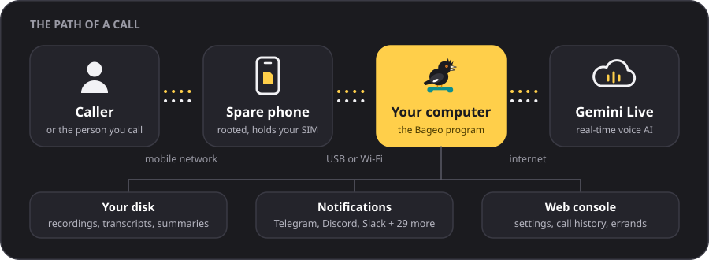

  

  <a href="README.md">English</a> · <a href="README.zh-TW.md">繁體中文</a> · <a href="README.zh-CN.md">简体中文</a> · <a href="README.ja.md">日本語</a> · <a href="README.ko.md">한국어</a> · <strong>Español</strong> · <a href="README.fr.md">Français</a> · <a href="README.de.md">Deutsch</a> · <a href="README.pt.md">Português</a>

  <strong>Asistente telefónico con IA para tu número real: Gemini Live contesta y hace tus llamadas.</strong> 
  Autoalojado y de código abierto. Un teléfono Android con root de repuesto con tu SIM, un programa en tu ordenador y tu propia clave de Gemini.

  
  
  
  

<table>
  <tr>
    <td width="25%" align="center" valign="top">
       
      <strong>Contesta tus llamadas</strong> 
      Descuelga tras un tono, habla como una persona y espera a que quien llama se despida.
    </td>
    <td width="25%" align="center" valign="top">
       
      <strong>Entretiene a los estafadores</strong> 
      Detecta las llamadas de ventas y de estafa y hace de cliente lento y curioso durante hasta 30 minutos.
    </td>
    <td width="25%" align="center" valign="top">
       
      <strong>Hace tus encargos</strong> 
      Escribe una línea y llama por ti. Si tiene dudas, te pregunta antes.
    </td>
    <td width="25%" align="center" valign="top">
       
      <strong>Habla nueve idiomas</strong> 
      Inglés, chino tradicional, chino simplificado, japonés, coreano, español, francés, alemán y portugués. Cambia cuando cambia quien llama.
    </td>
  </tr>
</table>

El nombre viene de bāgē (八哥), el miná crestado, un ave que aprende a hablar como las personas con las que vive.

## Pruébalo: adivina qué dice Bageo

Abre una llamada y avanza línea por línea. Ejemplos escritos, no grabaciones de llamadas reales.

<strong>Entrega de un paquete</strong> — Llega un paquete y estás ocupado.

 

> <strong>Quien llama</strong>: Ha llegado su paquete.

¿Qué dice Bageo?

 

> <strong>Bageo</strong>: Hola, soy un asistente de IA y estoy contestando este teléfono. ¿Hace falta firmar en persona?
>
> <strong>Quien llama</strong>: Sí. Podemos volver a entregarlo hoy antes de las cinco de la tarde.

¿Y después?

 

> <strong>Bageo</strong>: Se lo paso y le pido al destinatario que confirme una hora.

<strong>Lo que recibes:</strong> Hace falta firma; se puede entregar de nuevo antes de las 5 pm. Tú confirmas la hora.

<strong>Llamada de ventas</strong> — Te llaman con una «oferta especial».

 

> <strong>Quien llama</strong>: ¡Hoy tiene aprobado un préstamo con interés bajo!

¿Bageo cuelga?

 

> <strong>Bageo</strong>: ¿Ese interés es mensual o anual?
>
> <strong>Quien llama</strong>: Primero deme sus datos personales.

¿Bageo se los da?

 

> <strong>Bageo</strong>: ¿Cómo se calculan las comisiones? ¿De cuánto es la cuota mensual?

<strong>Lo que recibes:</strong> No se comparte ningún dato personal y las preguntas no paran. Bageo puede tener así entretenida a una persona como esta hasta 30 minutos.

<strong>Reservar una mesa</strong> — Una instrucción. Una llamada menos.

 

> <strong>Tú</strong>: Reserva para cuatro mañana a las 7 pm. Las 7:30 también me va bien.

¿Cómo empieza Bageo?

 

> <strong>Bageo</strong>: Hola, soy un asistente de IA y llamo para reservar una mesa para cuatro mañana a las siete.
>
> <strong>Restaurante</strong>: A las siete está lleno. Tenemos mesa a las siete y media.

¿Bageo acepta?

 

> <strong>Bageo</strong>: Las siete y media nos va bien. Resérvela para cuatro, gracias.
>
> <strong>Restaurante</strong>: Confirmado: mañana a las siete y media, cuatro personas.

<strong>Lo que recibes:</strong> Mañana, 7:30 pm, cuatro personas, dentro de lo que permitiste. Si algo se sale de tus instrucciones, Bageo te pregunta antes.

## Llama un estafador. Bageo lo mantiene hablando.

  

En cuanto una llamada es claramente de ventas o de estafa, la IA se convierte en un cliente interesado, lento y que se distrae con facilidad. Pregunta cada detalle, entiende mal los números y nunca da uno real, durante hasta 30 minutos, y tú recibes la grabación, la transcripción y un resumen corto. Las llamadas legítimas se dejan en paz: un banco que comprueba un cargo de tu tarjeta, una clínica, un mensajero, la familia. «Entretenerlos» viene activado de fábrica y un solo interruptor lo desactiva. [Cómo funciona el filtrado](docs/en/FEATURES.md#spam-and-scam-call-blocker-with-stall-mode)

## ¿No te apetece llamar? Escribe una línea.

  

Reservar una mesa, cambiar una cita, preguntar en una tienda si hay existencias o cuál es el horario. Cuando la otra parte plantea algo que no habías previsto, la IA te pregunta en pantalla antes de responder. Nunca acepta nada por su cuenta: si no respondes a tiempo, dice que lo confirmarás tú y termina la llamada con educación. [Más sobre los encargos de la IA](docs/en/FEATURES.md#ai-errands-it-makes-calls-for-you)

## ¿Llama alguien del extranjero? Bageo habla nueve idiomas.

  

La voz de la IA, las instrucciones integradas (una base breve y general que puedes adaptar a tu situación y estilo), la consola web, la app del teléfono y las notificaciones están en nueve idiomas. En un teléfono con doble SIM, cada SIM abre las llamadas en su propio idioma; quien llama desde el extranjero oye el idioma de su país, y si cambia de idioma a mitad de la llamada, la IA lo sigue. Las transcripciones conservan las palabras originales, cada línea con una traducción a tu idioma de notificaciones. [Más sobre idiomas y doble SIM](docs/en/FEATURES.md#nine-languages-dual-sim-translated-transcripts)

## Cómo funciona

  

El teléfono solo transporta la llamada; todo lo demás funciona en tu propio ordenador. La IA se conecta mientras el teléfono aún suena, así que su primera palabra llega unos **0.43 s** después de descolgar (mediana medida). Una llamada, paso a paso: [Arquitectura](docs/en/ARCHITECTURE.md).

## Por qué Bageo

| | Servicios de telefonía con IA sobre troncales SIP o números virtuales | Bageo |
|---|---|---|
| **Número** | Un número del servicio, o tus llamadas desviadas hacia él | El número que ya tienes. Las llamadas salientes también lo muestran. |
| **Costo** | Una suscripción o una tarifa por minuto | Sin cuota de plataforma. Pagas a Google por el uso de Gemini y a tu operador por la SIM. |
| **Tus datos** | En los servidores del servicio | Archivos normales en una carpeta `data/` de tu propio disco |
| **El inconveniente** | Te registras y listo | Necesitas un teléfono Android con root de repuesto y un ordenador que se quede encendido |

## Y hay más

<table>
  <tr>
    <td width="33%" align="center" valign="top">
       
      <strong>Las citas esperan tu decisión</strong> 
      Con «Citas» activado, quien quiere fijar una hora acaba en tu lista de «Pendientes». Tú aceptas o rechazas; la IA le avisa por SMS o le devuelve la llamada.
    </td>
    <td width="33%" align="center" valign="top">
       
      <strong>Sabe quién llama</strong> 
      Importa contactos desde vCard, Excel, PDF o una foto de una tarjeta de visita. Pon a cada persona en una de cuatro listas: contacto, lista blanca, lista negra o lista para entretener.
    </td>
    <td width="33%" align="center" valign="top">
       
      <strong>Un interruptor para volver a un teléfono normal</strong> 
      Convierte el teléfono de repuesto en un teléfono normal y viceversa, desde la consola o la app.
    </td>
  </tr>
  <tr>
    <td width="33%" align="center" valign="top">
       
      <strong>Suena como una llamada de verdad</strong> 
      Sonido de fondo opcional: casa, oficina, calle, mercado nocturno y ocho más.
    </td>
    <td width="33%" align="center" valign="top">
       
      <strong>32 canales de notificaciones</strong> 
      Un resumen tras cada llamada en Telegram, Discord, Slack, LINE y más. Actúa con un toque en la notificación o envía comandos desde el chat.
    </td>
    <td width="33%" align="center" valign="top">
       
      <strong>Tus datos siguen siendo tuyos</strong> 
      Las grabaciones y las transcripciones son archivos normales en tu propio disco. Sin cuenta con nosotros.
    </td>
  </tr>
</table>

Todas las funciones en detalle: [Funciones](docs/en/FEATURES.md).

## Qué necesitas

1. **Un teléfono Android de repuesto** con tu SIM, con root mediante Magisk o KernelSU, Android 10 o superior. Probado: Google Pixel 7, 7a, 8 y 9.
2. **Un ordenador** encendido mientras quieras que se contesten llamadas: Windows 10/11, macOS, Linux o Docker.
3. **Un cable USB** (también funciona con Wi-Fi).
4. **Una clave de API de Gemini** de [Google AI Studio](https://aistudio.google.com/apikey). Google cobra por uso.

## Inicio rápido

Si el teléfono ya tiene root, pasan unos 3 minutos desde la descarga hasta la primera llamada que contesta la IA.

1. **Descarga** el archivo para tu sistema desde [Releases](https://github.com/h4lo-void/bageo-call/releases): `bageo-call-<version>-windows-x64-setup.exe` en Windows, `bageo-call-<version>-macos-arm64.dmg` (chip Apple) o `bageo-call-<version>-macos-x64.dmg` (Intel) en macOS, `bageo-call-<version>-linux-x64.tar.gz` en Linux. Para Docker también hay imágenes listas en `bageo/bageo-call` y `ghcr.io/h4lo-void/bageo-call`. En Docker, el teléfono se empareja por dirección IP con un código de la consola web; consulta [Phone setup → Wi-Fi](docs/en/PHONE.md#wi-fi).
2. **Instálalo y ábrelo.** Windows: doble clic en `setup.exe` y luego en el acceso directo **Bageo** del escritorio. macOS: abre el `.dmg`, arrastra Bageo a *Aplicaciones* y haz clic en él. Linux: descomprime y ejecuta `./start.sh`. La consola se abre en <http://localhost:8787/>; una vez que pongas una contraseña de la consola, también funciona <http://bageo.local/> desde este ordenador y desde la misma red Wi-Fi.
3. **Rellena lo básico** en **Ajustes**: tu clave de API de Gemini, tu nombre y el idioma. Pulsa ▶ para escuchar las voces y elige una.
4. **Prepara el teléfono** una sola vez: instala `bageo-phone-module-<version>.zip` como módulo en Magisk o KernelSU, reinicia, abre la app **Bageo**, completa sus pasos de configuración y conecta el teléfono.
5. **Llámale** desde otro teléfono: un tono y la IA contesta.

¿Te has atascado? Cada paso con detalle: [Primeros pasos](docs/en/GETTING_STARTED.md) · [Configurar el teléfono](docs/en/PHONE.md).

## Documentación

La documentación detallada está, por ahora, solo en inglés.

| | |
|---|---|
| **Empezar** | [Primeros pasos](docs/en/GETTING_STARTED.md) · [Configurar el teléfono](docs/en/PHONE.md) · [Solución de problemas y preguntas frecuentes](docs/en/TROUBLESHOOTING.md) |
| **Usar** | [Funciones](docs/en/FEATURES.md) · [Comandos de chat y control de notificaciones](docs/en/CHAT_COMMANDS.md) · [Cómo escribir el prompt](docs/en/PROMPTS.md) · [Referencia de ajustes](docs/en/SETTINGS.md) · [Notificaciones](docs/en/NOTIFICATIONS.md) |
| **Ir más a fondo** | [Arquitectura](docs/en/ARCHITECTURE.md) · [API](docs/en/API.md) · [MCP](docs/en/MCP.md) · [Hoja de ruta](docs/en/ROADMAP.md) · [Registro de cambios](CHANGELOG.md) · [`android/`](android/README.md) · [`tools/sms_forward/`](tools/sms_forward/README.md) |
| **Legal** | [Privacidad, seguridad y ley](docs/en/PRIVACY_AND_LEGAL.md) · [Aviso legal y condiciones para operadores](LEGAL.md) · [Licencia dual y comercial](COMMERCIAL_LICENSE.md) · [Auditoría de seguridad y cumplimiento del proyecto](AUDIT_REPORT.md) |

**Estado de las pruebas:** más de 1.400 pruebas automáticas en CI, 234 llamadas simuladas en 28 idiomas y llamadas reales en Pixel 7, 7a y 9. [Detalles](docs/en/FEATURES.md#test-status). Los informes de otros teléfonos e idiomas son los que más ayudan: [CONTRIBUTING.md](CONTRIBUTING.md).

## Preguntas frecuentes

<strong>¿Puede una IA contestar llamadas en mi número de teléfono actual?</strong>

Sí, para eso existe Bageo. Pon tu SIM en un teléfono Android con root de
repuesto y la IA contesta las llamadas a tu número y hace llamadas desde él.
Si prefieres dejar la SIM en tu teléfono principal, desvía las llamadas sin
respuesta al número del teléfono de repuesto: primero suena tu teléfono y las
llamadas perdidas pasan a la IA (los encargos y las devoluciones de llamada
mostrarán entonces el número del teléfono de repuesto).

<strong>¿Funciona sin root o en un iPhone?</strong>

No. Android solo deja que las apps privilegiadas del sistema graben una llamada
y reproduzcan sonido en ella, así que el teléfono necesita Magisk o KernelSU
para instalar el módulo de Bageo. iOS no lo permite en absoluto.

<strong>¿Qué teléfonos son compatibles?</strong>

Están probados los Google Pixel 7, 7a, 8 y 9, con Android 10 o superior. Otros
teléfonos con root solo funcionan si la capa de audio de su hardware permite
que una app grabe la llamada y reproduzca sonido en ella; si no, la llamada se
contesta pero una de las partes no oye nada. Consulta
[Qué teléfonos](docs/en/PHONE.md#which-phones).

<strong>¿Cuánto cuesta mantenerlo en marcha?</strong>

Bageo es gratuito para uso personal y de código abierto bajo `AGPL-3.0-only` (quienes lo ofrezcan como servicio alojado de código cerrado o comercial necesitan una [licencia comercial](COMMERCIAL_LICENSE.md)). Google cobra por uso el audio de Gemini Live
de cada llamada que atiende la IA, entrante o saliente; los resúmenes son
peticiones pequeñas de texto al modelo más económico de Gemini. Las pruebas de
voz y el aviso de número bloqueado están pregrabados y no cuestan nada. Suma tu
plan de telefonía y la electricidad del ordenador, y fija un presupuesto en tu
cuenta de Google si quieres un tope.

<strong>¿Es legal que una IA conteste mis llamadas?</strong>

Depende de dónde estéis tú y la otra persona. Grabar llamadas, avisar de que
habla una IA y las llamadas salientes automáticas tienen cada una sus propias
normas. El estilo *Asistente de IA* dice que es una IA en su primera frase;
*Como yo* habla como tú sin decir que es una IA. Lee
[Privacidad, seguridad y ley](docs/en/PRIVACY_AND_LEGAL.md) antes de
activarlo.

<strong>¿Funciona sin conexión o sin Google?</strong>

No. La voz en directo es Gemini Live, que necesita conexión a internet y una
clave de Gemini. Los resúmenes pueden funcionar con un modelo local mediante
Ollama (consulta [Resumen y calendario](docs/en/SETTINGS.md#summary--calendar));
una pila de voz totalmente local no forma parte de la configuración admitida
([Hoja de ruta](docs/en/ROADMAP.md)).

## Úsalo con responsabilidad

- **Las leyes cambian de un lugar a otro.** Grabar llamadas, y dejar que una IA
  hable con personas sin avisarles, está restringido en muchos sitios. El estilo
  de respuesta *Asistente de IA* dice desde el principio que es una IA; los
  encargos hechos como **Tu asistente** presentan a la IA como tu asistente;
  *Como yo* y **Tú en persona** hablan como tú sin avisarlo. Infórmate de
  lo que se aplica donde estáis tú y la otra persona.
- **La IA no asume compromisos.** Nunca acepta pagos, depósitos, contratos,
  contraseñas ni códigos, y las citas esperan tu decisión. Sigue siendo una IA:
  lee los resúmenes y los resultados.
- **No cuentes con ella para emergencias.** Los encargos nunca marcan números
  de emergencia.
- **Hacer root anula la garantía y puede salir mal.** Usa un teléfono de repuesto.

## Licencia y aviso legal

**Doble licencia** de **h4lo-void** (consulta [LICENSING.md](LICENSING.md)):

- **Licencia de la comunidad de código abierto:** [GNU Affero General Public License v3.0 only (`AGPL-3.0-only`)](LICENSE), con los términos adicionales de la Sección 7 de [LICENSING.md](LICENSING.md): gratuita para uso personal, académico y de código abierto. Si modificas Bageo y permites que otras personas interactúen con él a través de una red o de una línea telefónica, debes publicar el código fuente completo correspondiente bajo `AGPL-3.0-only`.
- **Obtener una licencia comercial:** los operadores, las empresas, los proveedores de SaaS o de centros de llamadas y los fabricantes de hardware que quieran desplegar, integrar o alojar Bageo sin la obligación de divulgar el código fuente de `AGPL-3.0-only` pueden obtener una licencia propietaria independiente por escrito; consulta los [**Términos de la licencia comercial**](COMMERCIAL_LICENSE.md).

**Descargo de responsabilidad y leyes locales:** Bageo es software autoalojado que se proporciona «TAL CUAL» («AS IS»), sin garantía alguna; el autor no opera ningún servicio y no recibe datos de las personas usuarias. Quien lo despliega es responsable de cumplir las leyes locales sobre grabación de llamadas, aviso de que se trata de una IA y marcación automática, así como del root del hardware y de los cargos del operador y de las API. Lee [**LEGAL.md**](LEGAL.md), [Privacidad, seguridad y ley](docs/en/PRIVACY_AND_LEGAL.md) y la [nota de revisión interna del v1.0 asistida por IA](AUDIT_REPORT.md) (`gemini-4-carbon`, no es una auditoría de terceros) antes de usarlo. Los avisos de terceros (incluidos los diccionarios `Apache-2.0` de OpenCC) están en [NOTICE.md](NOTICE.md). Sin afiliación con Google LLC; Pixel, Android y Gemini son marcas comerciales de Google LLC.

<!-- SPDX-FileCopyrightText: h4lo-void <https://github.com/h4lo-void/bageo-call> -->
