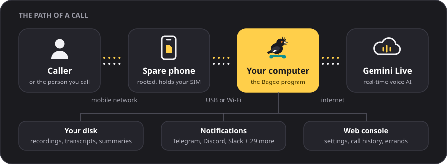

  

  <a href="README.md">English</a> · <a href="README.zh-TW.md">繁體中文</a> · <a href="README.zh-CN.md">简体中文</a> · <strong>日本語</strong> · <a href="README.ko.md">한국어</a> · <a href="README.es.md">Español</a> · <a href="README.fr.md">Français</a> · <a href="README.de.md">Deutsch</a> · <a href="README.pt.md">Português</a>

  <strong>あなたの電話番号に出る AI 電話アシスタント。Gemini Live が着信に出て、発信もします。</strong> 
  セルフホスト型のオープンソース。SIM を入れた root 化済みの予備の Android スマホ、パソコン上のプログラム 1 つ、自分の Gemini キーがあれば動きます。

  
  
  
  

<table>
  <tr>
    <td width="25%" align="center" valign="top">
       
      <strong>電話に出る</strong> 
      1 回鳴ったら出て、人と同じように話し、相手がさよならを言うまで待ちます。
    </td>
    <td width="25%" align="center" valign="top">
       
      <strong>詐欺を引き延ばす</strong> 
      営業電話や詐欺電話を見分け、のんびり質問ばかりする客を演じて、最長 30 分つなぎ止めます。
    </td>
    <td width="25%" align="center" valign="top">
       
      <strong>用事の電話を代行</strong> 
      一行書くだけで、代わりに電話します。迷ったときは先にあなたに聞きます。
    </td>
    <td width="25%" align="center" valign="top">
       
      <strong>9 つの言語を話す</strong> 
      英語、繁体字中国語、簡体字中国語、日本語、韓国語、スペイン語、フランス語、ドイツ語、ポルトガル語。相手が言語を変えれば、AI も合わせます。
    </td>
  </tr>
</table>

名前の由来は bāgē (八哥)。ハッカチョウという鳥で、一緒に暮らす人の話し方を覚えて真似します。

## 試してみよう：Bageo は何と言う？

通話を開いて、1 行ずつクリックして進めてください。台本のある例で、実際の通話録音ではありません。

<strong>宅配便</strong> — 手が離せないときに荷物が届きます。

 

> <strong>相手</strong>：お荷物をお届けに来ました。

Bageo は何と言う？

 

> <strong>Bageo</strong>：こんにちは、この電話に出ている AI アシスタントです。直接お会いして受け取りのサインが必要ですか？
>
> <strong>相手</strong>：はい。今日の午後 5 時までなら、もう一度お届けできます。

それで？

 

> <strong>Bageo</strong>：伝えておきます。受取人に時間を確認してもらいますね。

<strong>あなたに届く内容：</strong>サインが必要。午後 5 時までなら再配達できます。時間はあなたが決めます。

<strong>営業電話</strong> — 「特別なご案内」の電話です。

 

> <strong>相手</strong>：今日、低金利のローンの審査に通りましたよ！

Bageo は電話を切る？

 

> <strong>Bageo</strong>：その金利は月利ですか、それとも年利ですか？
>
> <strong>相手</strong>：まず、あなたの個人情報を教えてください。

Bageo は教える？

 

> <strong>Bageo</strong>：手数料はどう計算するんですか？ 毎月の返済額はいくらになりますか？

<strong>あなたに届く内容：</strong>個人情報は何も渡さず、質問は続きます。Bageo は、こうした相手を最長 30 分つなぎ止められます。

<strong>レストランの予約</strong> — 指示は一つだけ。電話は一本減ります。

 

> <strong>あなた</strong>：明日の午後 7 時に 4 席予約して。7 時半でも大丈夫。

Bageo はどう切り出す？

 

> <strong>Bageo</strong>：こんにちは、AI アシスタントです。明日の 7 時に 4 名で席を予約したくお電話しました。
>
> <strong>レストラン</strong>：7 時は満席です。7 時半ならお席をご用意できます。

Bageo は受ける？

 

> <strong>Bageo</strong>：7 時半で大丈夫です。4 名でお願いします。ありがとうございます。
>
> <strong>レストラン</strong>：承りました。明日の 7 時半、4 名様ですね。

<strong>あなたに届く内容：</strong>明日の午後 7 時 30 分、4 名。あなたが許可した範囲内で決まっています。指示にないことは、Bageo が先にあなたに聞きます。

## 詐欺電話が来ても、Bageo は話をつなぎ続けます。

  

営業や詐欺の電話だとはっきり分かると、AI は興味津々で、のんびりしていて、すぐ気が散る客になります。細かいことまで質問し、数字は聞き間違えたふりをして、本物の情報は一切渡さないまま、最長 30 分つなぎ止めます。あなたには録音、文字起こし、短い要約が届きます。まともな電話には手を出しません。カード利用を確認する銀行、クリニック、宅配業者、家族などです。「話を引き延ばす」は初期設定でオンで、スイッチ 1 つでオフにできます。[見分け方の仕組み](docs/en/FEATURES.md#spam-and-scam-call-blocker-with-stall-mode)

## 電話するのは面倒？ 一行書くだけです。

  

レストランの予約、診察の日程変更、お店への在庫や営業時間の問い合わせ。あなたが決めていないことを相手が持ち出したら、AI は答える前に画面であなたに聞きます。AI が自分だけで何かを承諾することはありません。間に合うように返事がなければ、「確認して連絡します」と伝えて、丁寧に電話を終えます。[AI の代理電話について](docs/en/FEATURES.md#ai-errands-it-makes-calls-for-you)

## 海外からの電話でも大丈夫。Bageo は 9 つの言語を話します。

  

AI の声、内蔵のプロンプト（ご自身の状況や話し方に合わせて書き換えられる、短い一般的な基本設定）、コンソール、スマホアプリ、通知は、すべて 9 つの言語に対応しています。デュアル SIM のスマホなら、SIM ごとに決めた言語で電話に出ます。海外からの相手には、その国の言語で話します。通話の途中で相手が言語を変えれば、AI もそれについていきます。文字起こしは相手の言葉のまま残り、各行にあなたの通知言語の訳が付きます。[言語とデュアル SIM について](docs/en/FEATURES.md#nine-languages-dual-sim-translated-transcripts)

## 仕組み

  

スマホは通話を運ぶだけで、ほかの処理はすべて自分のパソコンで動きます。スマホがまだ鳴っている間に AI がつながるので、最初のひとことは、電話に出てから約 **0.43 s** で出ます（実測の中央値）。1 本の通話を順に追った説明は [アーキテクチャ](docs/en/ARCHITECTURE.md) をご覧ください。

## Bageo を選ぶ理由

| | SIP トランクや仮想番号を使う AI 電話サービス | Bageo |
|---|---|---|
| **電話番号** | サービスが用意する番号、またはそこへの転送 | いま使っている番号そのまま。発信でもその番号が表示されます。 |
| **料金** | 月額課金か、1 分ごとの従量課金 | プラットフォーム料金はありません。Gemini の利用料は Google に、SIM の料金は携帯会社に払います。 |
| **データ** | サービスのサーバーに保存 | 自分のディスクの `data/` フォルダにあるふつうのファイル |
| **注意点** | 登録してすぐ使える | root 化済みの予備の Android スマホと、つけっぱなしにするパソコンが必要 |

## ほかにもできること

<table>
  <tr>
    <td width="33%" align="center" valign="top">
       
      <strong>予約はあなたの返事を待つ</strong> 
      「予約の受付」をオンにすると、日時を決めたい相手が「対応待ち」に載ります。承諾かお断りを選ぶと、AI が SMS か折り返し電話で相手に伝えます。
    </td>
    <td width="33%" align="center" valign="top">
       
      <strong>誰からの電話か分かる</strong> 
      vCard、Excel、PDF、名刺の写真から連絡先を取り込めます。一人ひとりを、通常の連絡先、ホワイトリスト、着信拒否、引き延ばしリストの 4 つのどれかに入れられます。
    </td>
    <td width="33%" align="center" valign="top">
       
      <strong>スイッチ 1 つで通常のスマホに戻せる</strong> 
      予備のスマホを普通のスマホにして、また元に戻せます。コンソールでもアプリでもできます。
    </td>
  </tr>
  <tr>
    <td width="33%" align="center" valign="top">
       
      <strong>本物の通話らしい音</strong> 
      背景音は好みでオンにできます。自宅、オフィス、街角、夜市ほか 8 種類。
    </td>
    <td width="33%" align="center" valign="top">
       
      <strong>32 の通知先</strong> 
      通話のたびに、Telegram、Discord、Slack、LINE などに要約が届きます。通知のワンタップで対応でき、チャットからコマンドも送れます。
    </td>
    <td width="33%" align="center" valign="top">
       
      <strong>データは自分のもの</strong> 
      録音と文字起こしは、自分のディスクにあるふつうのファイルです。当方のアカウントは要りません。
    </td>
  </tr>
</table>

すべての機能の詳細：[機能一覧](docs/en/FEATURES.md)。

## 必要なもの

1. **予備の Android スマホ**：自分の SIM を入れ、Magisk か KernelSU で root 化した Android 10 以上のもの。動作確認済み：Google Pixel 7、7a、8、9。
2. **パソコン**：電話に出てほしい間、電源が入っているもの。Windows 10/11、macOS、Linux、または Docker。
3. **USB ケーブル**（Wi-Fi でも使えます）。
4. **Gemini API キー**：[Google AI Studio](https://aistudio.google.com/apikey) で取得します。料金は、使った分だけ Google から請求されます。

## クイックスタート

スマホが root 化済みなら、ダウンロードから AI が最初の電話に出るまで約 3 分です。

1. **ダウンロード**：お使いの OS 用のファイルを [Releases](https://github.com/h4lo-void/bageo-call/releases) から入手します。Windows は `bageo-call-<version>-windows-x64-setup.exe`、macOS は `bageo-call-<version>-macos-arm64.dmg`（Apple シリコン）または `bageo-call-<version>-macos-x64.dmg`（Intel）、Linux は `bageo-call-<version>-linux-x64.tar.gz` です。Docker 用の既製イメージ（`bageo/bageo-call`・`ghcr.io/h4lo-void/bageo-call`）もあります。Docker の場合、スマホは Web コンソールで表示したペアリングコードを使い、IP アドレスで接続します（[Phone setup → Wi-Fi](docs/en/PHONE.md#wi-fi)）。
2. **インストールして起動**：Windows は `setup.exe` をダブルクリックしてインストールし、デスクトップの「Bageo」ショートカットをクリックします。macOS は `.dmg` を開き、Bageo を「アプリケーション」にドラッグして、クリックします。Linux は展開して `./start.sh` を実行します。コンソールが <http://localhost:8787/> で開きます。コンソールパスワードを設定すれば、このパソコンや同じ Wi-Fi 内の端末から <http://bageo.local/> でも開けます。
3. **基本を入力**：**設定**で、Gemini API キー、あなたの名前、言語を入れます。▶ を押すと声を聞けるので、好きな声を選びます。
4. **スマホを準備**（最初の 1 回だけ）：`bageo-phone-module-<version>.zip` を Magisk か KernelSU のモジュールとしてインストールし、再起動して、**Bageo** アプリを開きます。チェックリストを順に進めたら、スマホをつなぎます。
5. **ほかのスマホからかけてみる**：1 回鳴ると、AI が出ます。

うまくいかないときは、各手順の詳細をご覧ください：[はじめに](docs/en/GETTING_STARTED.md) · [スマホのセットアップ](docs/en/PHONE.md)。

## ドキュメント

詳しいドキュメントは、今のところ英語版のみです。

| | |
|---|---|
| **はじめる** | [はじめに](docs/en/GETTING_STARTED.md) · [スマホのセットアップ](docs/en/PHONE.md) · [トラブルシューティングと FAQ](docs/en/TROUBLESHOOTING.md) |
| **使う** | [機能一覧](docs/en/FEATURES.md) · [チャットコマンドと通知の操作](docs/en/CHAT_COMMANDS.md) · [プロンプトの書き方](docs/en/PROMPTS.md) · [設定リファレンス](docs/en/SETTINGS.md) · [通知](docs/en/NOTIFICATIONS.md) |
| **さらに深く** | [アーキテクチャ](docs/en/ARCHITECTURE.md) · [API](docs/en/API.md) · [MCP](docs/en/MCP.md) · [ロードマップ](docs/en/ROADMAP.md) · [変更履歴](CHANGELOG.md) · [`android/`](android/README.md) · [`tools/sms_forward/`](tools/sms_forward/README.md) |
| **法務** | [プライバシー・安全・法律](docs/en/PRIVACY_AND_LEGAL.md) · [免責事項と運用者向け規約](LEGAL.md) · [デュアルライセンスと商用ライセンス](COMMERCIAL_LICENSE.md) · [プロジェクトのセキュリティ・コンプライアンス監査](AUDIT_REPORT.md) |

**テスト状況：** CI で 1,400 件を超える自動テスト、28 言語・234 通の模擬通話、Pixel 7、7a、9 での実際の通話。[詳細](docs/en/FEATURES.md#test-status)。ほかのスマホや言語での報告がいちばん助かります：[CONTRIBUTING.md](CONTRIBUTING.md)。

## FAQ

<strong>いま使っている電話番号に、AI を出させられますか？</strong>

はい。そのための Bageo です。
SIM を root 化した予備の Android スマホに入れると、
AI があなたの番号への着信に出て、その番号から発信もします。
SIM をメインのスマホに入れたままにしたいときは、
出られなかった着信を予備スマホの番号に転送してください。
まずメインのスマホが鳴り、不在着信が AI に回ります
（その場合、代理電話や折り返しには予備スマホの番号が表示されます）。

<strong>root なしや iPhone でも使えますか？</strong>

いいえ。Android では、特権を持つシステムアプリだけが
通話を録音し、通話に音を流せます。
そのため、Bageo モジュールを入れるには Magisk か KernelSU が必要です。
iOS では、そもそもできません。

<strong>どのスマホに対応していますか？</strong>

動作確認済みなのは、Android 10 以上の Google Pixel 7、7a、8、9 です。
ほかの root 化したスマホは、オーディオのハードウェア層が、アプリによる通話の録音と
通話への再生を許す場合だけ動きます。
そうでないと、電話には出られても、片方に何も聞こえません。
[対応機種](docs/en/PHONE.md#which-phones) をご覧ください。

<strong>運用にいくらかかりますか？</strong>

Bageo は、個人利用とオープンソースでの利用なら `AGPL-3.0-only` で無料です（ソース非公開での利用や、商用のホスティング事業者には [商用ライセンス](COMMERCIAL_LICENSE.md) が必要です）。
AI が応対した通話は、着信でも発信でも、Gemini Live の音声の分を、
使った分だけ Google が請求します。要約は、Gemini のいちばん安いモデルに
小さなテキストを送るだけです。声の試聴と、着信拒否のアナウンスは
録音済みなので、費用はかかりません。これに回線の料金と、
パソコンの電気代が加わります。上限が欲しいときは、
Google アカウントで予算を設定してください。

<strong>AI に電話に出させるのは合法ですか？</strong>

あなたと相手がどこにいるかによります。
通話の録音、AI であることの開示、自動発信には、それぞれ別のルールがあります。
*AI アシスタント*スタイルは、最初のひとことで AI だと名乗ります。
*本人*スタイルは、AI だと名乗らずにあなたとして話します。
オンにする前に、[プライバシー・安全・法律](docs/en/PRIVACY_AND_LEGAL.md) を
お読みください。

<strong>オフラインや、Google なしでも使えますか？</strong>

いいえ。リアルタイムの音声は Gemini Live で、
インターネット接続と Gemini キーが必要です。
要約は、Ollama 経由のローカルモデルでも動かせます
（[要約とカレンダー](docs/en/SETTINGS.md#summary--calendar) を参照）。
音声まで完全にローカルで動かす構成は、サポート対象に入っていません
（[ロードマップ](docs/en/ROADMAP.md)）。

## 責任をもってお使いください

- **法律は地域によって違います。** 通話の録音や、相手に知らせずに
  AI を人と話させることは、多くの地域で制限されています。
  *AI アシスタント*の応答スタイルは、最初に AI だと名乗ります。
  **アシスタント**として発信する代理電話では、AI があなたのアシスタントだと名乗ります。
  *本人*として応答・発信するときは、AI だと名乗りません。
  あなたと相手がいる地域のルールを確認してください。
- **AI は何も約束しません。** 支払い、手付金、契約、パスワード、
  コードには決して同意せず、予約はあなたの判断を待ちます。
  それでも相手は AI です。要約と結果は必ず目を通してください。
- **緊急時の頼りにしないでください。** 代理電話が緊急通報の番号にかけることはありません。
- **root 化は保証が無効になり、失敗することもあります。** 予備のスマホを使ってください。

## ライセンスと免責事項

**デュアルライセンス**（提供：**h4lo-void**、[LICENSING.md](LICENSING.md) を参照）：

- **オープンソース コミュニティ ライセンス：** [GNU Affero General Public License v3.0 only (`AGPL-3.0-only`)](LICENSE)。[LICENSING.md](LICENSING.md) の第 7 条の追加条項付きです。個人、学術、オープンソースでの利用は無料です。Bageo を改変し、他の人がネットワークや電話回線を通じてそれを利用できるようにする場合は、対応する完全なソースコードを `AGPL-3.0-only` で公開する必要があります。
- **商用ライセンスの取得：** 事業者、企業、SaaS／コールセンター事業者、ハードウェアベンダーが、`AGPL-3.0-only` によるソースコード開示なしに Bageo を導入、組み込み、またはホスティングしたい場合は、別途、書面によるプロプライエタリライセンスを取得できます。[**商用ライセンス条件**](COMMERCIAL_LICENSE.md) をご覧ください。

**免責事項と各地の法律：** Bageo はセルフホスト型のソフトウェアで、「現状有姿（AS IS）」で、いかなる保証もなく提供されます。作者はサービスを運営せず、利用者のデータも受け取りません。導入した人が、通話録音、AI であることの開示、自動発信に関する各地の法律の遵守、端末の root 化、携帯会社や API の料金について責任を負います。ご利用の前に、[**LEGAL.md**](LEGAL.md)、[プライバシー・安全・法律](docs/en/PRIVACY_AND_LEGAL.md)、および [v1.0 AI 支援による社内レビューの注記](AUDIT_REPORT.md)（`gemini-4-carbon`。第三者による監査ではありません）をお読みください。サードパーティの表示（OpenCC の `Apache-2.0` 辞書を含む）は [NOTICE.md](NOTICE.md) にあります。Google LLC とは無関係です。Pixel、Android、Gemini は Google LLC の商標です。

<!-- SPDX-FileCopyrightText: h4lo-void <https://github.com/h4lo-void/bageo-call> -->
