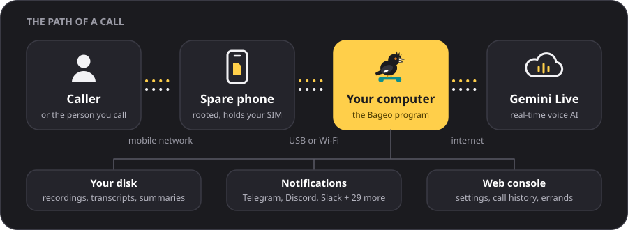

  

  <a href="README.md">English</a> · <a href="README.zh-TW.md">繁體中文</a> · <a href="README.zh-CN.md">简体中文</a> · <a href="README.ja.md">日本語</a> · <strong>한국어</strong> · <a href="README.es.md">Español</a> · <a href="README.fr.md">Français</a> · <a href="README.de.md">Deutsch</a> · <a href="README.pt.md">Português</a>

  <strong>내 전화번호로 오는 전화를 받는 AI 전화 비서. Gemini Live가 전화를 받고, 대신 걸어 줍니다.</strong> 
  직접 설치해서 쓰는 오픈소스입니다. SIM을 넣은 root 된 여분의 Android 폰, 컴퓨터에서 돌리는 프로그램 하나, 내 Gemini 키만 있으면 됩니다.

  
  
  
  

<table>
  <tr>
    <td width="25%" align="center" valign="top">
       
      <strong>전화 받기</strong> 
      벨이 한 번 울리면 받고, 사람처럼 말하고, 상대가 작별 인사를 할 때까지 기다립니다.
    </td>
    <td width="25%" align="center" valign="top">
       
      <strong>사기 전화 붙잡기</strong> 
      영업 전화와 사기 전화를 알아채고, 질문이 끝없는 느긋한 손님인 척하며 최대 30분까지 붙잡아 둡니다.
    </td>
    <td width="25%" align="center" valign="top">
       
      <strong>심부름 전화 대행</strong> 
      한 줄만 적으면 대신 전화를 겁니다. 확신이 없을 때는 먼저 나에게 물어봅니다.
    </td>
    <td width="25%" align="center" valign="top">
       
      <strong>9개 언어로 대화</strong> 
      영어, 중국어 번체, 중국어 간체, 일본어, 한국어, 스페인어, 프랑스어, 독일어, 포르투갈어. 상대가 언어를 바꾸면 AI도 따라 바꿉니다.
    </td>
  </tr>
</table>

이름은 bāgē (八哥)에서 따왔습니다. 뿔찌르레기라는 새로, 함께 사는 사람들의 말투를 배워 따라 합니다.

## 시험해 보기: Bageo는 뭐라고 말할까요?

통화를 하나 열고 한 줄씩 눌러 가며 확인해 보시기 바랍니다. 대본으로 만든 예시이며, 실제 통화 녹음이 아닙니다.

<strong>택배</strong> — 바쁠 때 택배가 옵니다.

 

> <strong>상대</strong>: 택배 왔습니다.

Bageo는 뭐라고 말할까요?

 

> <strong>Bageo</strong>: 안녕하세요, 이 전화를 받고 있는 AI 비서입니다. 직접 만나서 서명해야 합니까?
>
> <strong>상대</strong>: 네. 오늘 오후 5시 전에 다시 배달할 수 있습니다.

그다음은요?

 

> <strong>Bageo</strong>: 전달해 두겠습니다. 받으실 분께 시간을 확인해 달라고 하겠습니다.

<strong>내가 받는 내용:</strong> 서명이 필요합니다. 오후 5시 전에 재배달이 가능합니다. 시간은 내가 정합니다.

<strong>영업 전화</strong> — '특별 혜택' 전화가 걸려 왔습니다.

 

> <strong>상대</strong>: 오늘 저금리 대출이 승인되셨습니다!

Bageo는 전화를 끊을까요?

 

> <strong>Bageo</strong>: 그 금리는 월 이율입니까, 연 이율입니까?
>
> <strong>상대</strong>: 먼저 개인 정보부터 알려 주십시오.

Bageo는 알려 줄까요?

 

> <strong>Bageo</strong>: 수수료는 어떻게 계산합니까? 매달 얼마씩 내야 합니까?

<strong>내가 받는 내용:</strong> 개인 정보는 하나도 넘기지 않고, 질문은 계속 이어집니다. Bageo는 이런 상대를 최대 30분까지 붙잡아 둘 수 있습니다.

<strong>식당 예약</strong> — 지시는 한 번. 전화는 한 통 줄어듭니다.

 

> <strong>나</strong>: 내일 저녁 7시에 4명 예약해 주세요. 7시 반도 괜찮습니다.

Bageo는 어떻게 말을 꺼낼까요?

 

> <strong>Bageo</strong>: 안녕하세요, AI 비서입니다. 내일 7시에 4명 자리를 예약하려고 전화드렸습니다.
>
> <strong>식당</strong>: 7시는 만석입니다. 7시 반에는 자리가 있습니다.

Bageo는 받아들일까요?

 

> <strong>Bageo</strong>: 7시 반으로 괜찮습니다. 4명으로 예약해 주십시오. 감사합니다.
>
> <strong>식당</strong>: 확인했습니다. 내일 7시 반, 4명입니다.

<strong>내가 받는 내용:</strong> 내일 저녁 7시 30분, 4명. 내가 허락한 범위 안에서 정해졌습니다. 지시에 없는 일은 Bageo가 먼저 나에게 물어봅니다.

## 사기 전화가 와도 Bageo는 계속 말을 이어 갑니다.

  

영업이나 사기 전화가 분명해지면, AI는 관심이 많고 느긋하며 쉽게 딴생각을 하는 손님으로 바뀝니다. 세세한 것까지 묻고, 숫자는 잘못 알아들은 척하며, 진짜 정보는 절대 주지 않은 채 최대 30분까지 붙잡아 둡니다. 녹음, 대화 기록, 짧은 요약은 나에게 도착합니다. 정상적인 전화는 건드리지 않습니다. 카드 결제를 확인하는 은행, 병원, 택배 기사, 가족이 그렇습니다. '통화 길게 끌기'는 기본으로 켜져 있고, 스위치 하나로 끌 수 있습니다. [선별 방식 자세히 보기](docs/en/FEATURES.md#spam-and-scam-call-blocker-with-stall-mode)

## 전화하기 귀찮다면 한 줄만 적으세요.

  

식당 예약, 진료 일정 변경, 가게에 재고나 영업시간 문의. 내가 정해 두지 않은 이야기를 상대가 꺼내면, AI는 대답하기 전에 화면에서 나에게 먼저 묻습니다. AI는 혼자서 무엇도 승낙하지 않습니다. 제때 답하지 않으면 확인 후 연락하겠다고 말하고 정중하게 통화를 끝냅니다. [AI 심부름 전화 더 알아보기](docs/en/FEATURES.md#ai-errands-it-makes-calls-for-you)

## 해외에서 전화가 와도 Bageo는 9개 언어로 말합니다.

  

AI의 목소리, 기본 프롬프트(내 상황과 말투에 맞게 직접 고쳐 쓸 수 있는 짧은 일반 기본값), 콘솔, 휴대폰 앱, 알림이 모두 9개 언어를 지원합니다. 듀얼 SIM 폰에서는 SIM마다 정해 둔 언어로 전화를 받고, 해외에서 건 상대에게는 그 나라 언어로 말하며, 통화 중에 상대가 언어를 바꾸면 AI도 따라갑니다. 대화 기록에는 상대가 한 말이 그대로 남고, 각 줄에 내 알림 언어로 된 번역이 붙습니다. [언어와 듀얼 SIM 자세히 보기](docs/en/FEATURES.md#nine-languages-dual-sim-translated-transcripts)

## 작동 방식

  

폰은 통화만 전달하고, 나머지는 모두 내 컴퓨터에서 돌아갑니다. 벨이 울리는 동안 AI가 미리 연결되므로, 전화를 받고 약 **0.43 s** 뒤에 첫마디가 나옵니다(실측 중앙값). 통화 한 건의 흐름은 [아키텍처](docs/en/ARCHITECTURE.md)에서 단계별로 볼 수 있습니다.

## Bageo를 쓰는 이유

| | SIP 트렁크나 가상 번호를 쓰는 AI 전화 서비스 | Bageo |
|---|---|---|
| **번호** | 서비스가 주는 번호, 또는 내 전화를 그쪽으로 착신 전환 | 지금 쓰는 번호 그대로. 거는 전화에도 그 번호가 표시됩니다. |
| **비용** | 구독료 또는 분당 요금 | 플랫폼 이용료는 없습니다. Gemini 사용료는 Google에, SIM 요금은 통신사에 냅니다. |
| **내 데이터** | 서비스 서버에 저장 | 내 디스크의 `data/` 폴더에 있는 일반 파일 |
| **단점** | 가입하면 바로 사용 | root 된 여분의 Android 폰과, 계속 켜 둘 컴퓨터가 필요 |

## 그 밖의 기능

<table>
  <tr>
    <td width="33%" align="center" valign="top">
       
      <strong>일정 약속은 내 답을 기다립니다</strong> 
      '일정 예약'을 켜면, 시간을 잡으려는 상대가 '처리할 일'에 올라옵니다. 수락하거나 거절하면 AI가 문자를 보내거나 다시 전화해 상대에게 알립니다.
    </td>
    <td width="33%" align="center" valign="top">
       
      <strong>누가 거는 전화인지 압니다</strong> 
      vCard, Excel, PDF, 명함 사진에서 연락처를 가져올 수 있습니다. 사람마다 일반 연락처, 화이트리스트, 차단 목록, 시간 끌기 목록 중 하나에 넣을 수 있습니다.
    </td>
    <td width="33%" align="center" valign="top">
       
      <strong>스위치 하나로 일반 휴대전화로</strong> 
      여분의 폰을 평범한 휴대전화로 바꿨다가 다시 되돌릴 수 있습니다. 콘솔이나 앱에서 할 수 있습니다.
    </td>
  </tr>
  <tr>
    <td width="33%" align="center" valign="top">
       
      <strong>실제 통화 같은 소리</strong> 
      배경음은 선택 사항입니다. 집, 사무실, 길거리, 야시장 외에 8가지가 더 있습니다.
    </td>
    <td width="33%" align="center" valign="top">
       
      <strong>알림 채널 32개</strong> 
      통화가 끝날 때마다 Telegram, Discord, Slack, LINE 등으로 요약이 옵니다. 알림에서 한 번 눌러 처리하거나, 채팅에서 명령을 보낼 수 있습니다.
    </td>
    <td width="33%" align="center" valign="top">
       
      <strong>내 데이터는 내 것</strong> 
      녹음과 대화 기록은 내 디스크에 있는 일반 파일입니다. 우리 쪽 계정은 필요 없습니다.
    </td>
  </tr>
</table>

모든 기능 자세히 보기: [기능](docs/en/FEATURES.md).

## 필요한 것

1. **여분의 Android 폰**: 내 SIM을 넣고 Magisk나 KernelSU로 root 한 Android 10 이상 기기. 테스트한 기기: Google Pixel 7, 7a, 8, 9.
2. **컴퓨터**: 전화를 받아야 하는 동안 켜져 있는 컴퓨터. Windows 10/11, macOS, Linux 또는 Docker.
3. **USB 케이블** (Wi-Fi로도 됩니다).
4. **Gemini API 키**: [Google AI Studio](https://aistudio.google.com/apikey)에서 받습니다. 사용한 만큼 Google이 청구합니다.

## 빠른 시작

폰이 이미 root 되어 있다면, 다운로드부터 AI가 첫 전화를 받기까지 3분 정도면 됩니다.

1. **다운로드**: [Releases](https://github.com/h4lo-void/bageo-call/releases)에서 내 운영체제용 파일을 받습니다. Windows는 `bageo-call-<version>-windows-x64-setup.exe`, macOS는 `bageo-call-<version>-macos-arm64.dmg`(Apple 칩) 또는 `bageo-call-<version>-macos-x64.dmg`(Intel), Linux는 `bageo-call-<version>-linux-x64.tar.gz`입니다. Docker를 쓴다면 `bageo/bageo-call` 및 `ghcr.io/h4lo-void/bageo-call`의 완성된 이미지도 이용할 수 있습니다. Docker에서는 웹 콘솔에서 받은 페어링 코드로 휴대폰을 IP 주소로 연결합니다([Phone setup → Wi-Fi](docs/en/PHONE.md#wi-fi)).
2. **설치하고 실행**: Windows는 `setup.exe`를 더블클릭해 설치한 뒤 바탕화면의 "Bageo" 바로가기를 클릭합니다. macOS는 `.dmg`를 열어 Bageo를 "응용 프로그램"으로 끌어다 놓고 클릭합니다. Linux는 압축을 풀고 `./start.sh`를 실행합니다. 콘솔이 <http://localhost:8787/>에서 열리며, 콘솔 비밀번호를 설정하면 이 컴퓨터와 같은 Wi-Fi의 다른 기기에서도 <http://bageo.local/>로 열 수 있습니다.
3. **기본 정보 입력**: **설정**에서 Gemini API 키, 내 이름, 언어를 입력합니다. ▶를 눌러 목소리를 들어 보고 하나를 고릅니다.
4. **폰 준비** (처음 한 번만): `bageo-phone-module-<version>.zip`을 Magisk나 KernelSU의 모듈로 설치하고, 재부팅한 뒤 **Bageo** 앱을 열어 체크리스트를 끝까지 진행하고 폰을 연결합니다.
5. **다른 폰으로 걸어 보기**: 벨이 한 번 울리면 AI가 받습니다.

막히셨다면 단계별 자세한 설명을 참고하시기 바랍니다: [시작하기](docs/en/GETTING_STARTED.md) · [폰 설정](docs/en/PHONE.md).

## 문서

자세한 문서는 현재 영어로만 제공됩니다.

| | |
|---|---|
| **시작하기** | [시작하기](docs/en/GETTING_STARTED.md) · [폰 설정](docs/en/PHONE.md) · [문제 해결과 FAQ](docs/en/TROUBLESHOOTING.md) |
| **사용하기** | [기능](docs/en/FEATURES.md) · [채팅 명령과 알림 제어](docs/en/CHAT_COMMANDS.md) · [프롬프트 작성법](docs/en/PROMPTS.md) · [설정 레퍼런스](docs/en/SETTINGS.md) · [알림](docs/en/NOTIFICATIONS.md) |
| **더 깊이** | [아키텍처](docs/en/ARCHITECTURE.md) · [API](docs/en/API.md) · [MCP](docs/en/MCP.md) · [로드맵](docs/en/ROADMAP.md) · [변경 이력](CHANGELOG.md) · [`android/`](android/README.md) · [`tools/sms_forward/`](tools/sms_forward/README.md) |
| **법률** | [개인정보, 안전, 법률](docs/en/PRIVACY_AND_LEGAL.md) · [법적 고지와 운영자 약관](LEGAL.md) · [이중 라이선스와 상용 라이선스](COMMERCIAL_LICENSE.md) · [프로젝트 보안·규정 준수 감사](AUDIT_REPORT.md) |

**테스트 현황:** CI에서 1,400개가 넘는 자동 테스트, 28개 언어로 234건의 모의 통화, Pixel 7, 7a, 9의 실제 통화. [자세히 보기](docs/en/FEATURES.md#test-status). 다른 폰과 언어에서 보내 주시는 제보가 가장 큰 도움이 됩니다: [CONTRIBUTING.md](CONTRIBUTING.md).

## FAQ

<strong>지금 쓰는 전화번호로 오는 전화를 AI가 받을 수 있습니까?</strong>

네, 그것이 Bageo의 목적입니다. SIM을 root 된 여분의 Android 폰에 넣으면
AI가 내 번호로 오는 전화를 받고, 그 번호로 전화도 겁니다.
SIM을 메인 폰에 그대로 두고 싶다면, 받지 못한 전화를
여분 폰의 번호로 착신 전환하면 됩니다.
그러면 메인 폰이 먼저 울리고, 놓친 전화는 AI에게 넘어갑니다
(이 경우 심부름 전화와 다시 걸기에는 여분 폰의 번호가 표시됩니다).

<strong>root 없이도, iPhone에서도 쓸 수 있습니까?</strong>

아니요. Android에서는 권한이 있는 시스템 앱만 통화를 녹음하고
통화에 소리를 넣을 수 있습니다. 그래서 Bageo 모듈을 설치하려면
폰에 Magisk나 KernelSU가 필요합니다. iOS는 아예 허용하지 않습니다.

<strong>어떤 폰을 지원합니까?</strong>

Google Pixel 7, 7a, 8, 9에서 테스트했고, Android 10 이상이 필요합니다.
다른 root 폰은 오디오 하드웨어 계층이 앱의 통화 녹음과
통화 속 소리 재생을 허용할 때만 동작합니다.
그렇지 않으면 전화는 받아도 한쪽에서 아무 소리도 들리지 않습니다.
[지원 기기](docs/en/PHONE.md#which-phones)를 참고하시기 바랍니다.

<strong>운영 비용은 얼마입니까?</strong>

Bageo는 개인 및 오픈소스 용도라면 `AGPL-3.0-only`로 무료입니다(비공개 소스나 상용 호스팅 사업자는 [상용 라이선스](COMMERCIAL_LICENSE.md)가 필요합니다). AI가 처리하는
모든 통화는, 받은 전화든 건 전화든, Gemini Live 음성 사용량만큼
Google이 청구합니다. 요약은 Gemini의 가장 저렴한 모델에 보내는
작은 텍스트 요청입니다. 목소리 미리 듣기와 차단 번호 안내는
미리 녹음된 것이라 비용이 들지 않습니다. 여기에 통신 요금과
컴퓨터 전기료가 더해지며, 상한을 두고 싶다면
Google 계정에서 예산을 설정하시기 바랍니다.

<strong>AI가 전화를 받게 하는 것은 합법입니까?</strong>

나와 상대방이 어디에 있는지에 따라 다릅니다.
통화 녹음, AI 사실 고지, 자동 발신에는 각각 별도의 규정이 있습니다.
*AI 비서* 방식은 첫마디에서 AI라고 밝히고,
*본인* 방식은 AI라고 밝히지 않고 본인처럼 말합니다.
켜기 전에 [개인정보, 안전, 법률](docs/en/PRIVACY_AND_LEGAL.md)을
읽어 보시기 바랍니다.

<strong>오프라인이나 Google 없이도 쓸 수 있습니까?</strong>

아니요. 실시간 음성은 Gemini Live이며, 인터넷 연결과
Gemini 키가 필요합니다. 요약은 Ollama를 통한 로컬 모델로 돌릴 수 있습니다
([요약과 캘린더](docs/en/SETTINGS.md#summary--calendar) 참고).
음성까지 전부 로컬로 돌리는 구성은 지원 대상이 아닙니다
([로드맵](docs/en/ROADMAP.md)).

## 책임 있는 사용

- **법은 나라마다 다릅니다.** 통화 녹음, 그리고 AI가 사람에게 알리지 않고
  대화하게 하는 일은 많은 곳에서 제한됩니다. *AI 비서* 응답 방식은
  처음부터 AI라고 밝힙니다. **비서**로 거는 심부름 전화는 AI를
  내 비서라고 소개합니다. *본인* 방식으로 받거나 걸 때는
  AI임을 밝히지 않습니다. 나와 상대방이 있는 곳에 어떤 규정이
  적용되는지 확인해야 합니다.
- **AI는 아무것도 약속하지 않습니다.** 결제, 보증금, 계약, 비밀번호,
  인증 코드에는 절대 동의하지 않으며, 일정 약속은 내 결정을 기다립니다.
  그래도 AI입니다. 요약과 결과는 직접 읽어 확인해야 합니다.
- **긴급 상황에서는 의존하지 마십시오.** 심부름 전화는 긴급 번호에 절대 걸지 않습니다.
- **root 하면 보증이 무효가 될 수 있고, 문제가 생길 수도 있습니다.** 여분의 폰을 사용해야 합니다.

## 라이선스 및 법적 고지

**이중 라이선스**, 제공: **h4lo-void** ([LICENSING.md](LICENSING.md) 참조):

- **오픈소스 커뮤니티 라이선스:** [GNU Affero General Public License v3.0 only (`AGPL-3.0-only`)](LICENSE)이며, [LICENSING.md](LICENSING.md)의 제7조 추가 조건이 붙습니다. 개인, 학술, 오픈소스 용도로는 무료입니다. Bageo를 수정하여 다른 사람이 네트워크나 전화 회선을 통해 이용하게 하려면, 그에 해당하는 전체 소스 코드를 `AGPL-3.0-only`로 공개해야 합니다.
- **상용 라이선스 취득:** 사업자, 기업, SaaS·콜센터 사업자, 하드웨어 제조사가 `AGPL-3.0-only`에 따른 소스 코드 공개 없이 Bageo를 배포, 내장 또는 호스팅하려는 경우, 별도의 서면 독점(proprietary) 라이선스를 취득할 수 있습니다. [**상용 라이선스 약관**](COMMERCIAL_LICENSE.md)을 참조하시기 바랍니다.

**면책 및 현지 법률:** Bageo는 직접 설치해서 쓰는 소프트웨어이며, 어떠한 보증도 없이 “있는 그대로(AS IS)” 제공됩니다. 작성자는 서비스를 운영하지 않으며 사용자 데이터를 받지 않습니다. 이를 설치해 운영하는 사람은 통화 녹음, AI 사실 고지, 자동 발신에 관한 현지 법률을 준수할 책임과, 기기 root 화 및 통신사·API 요금에 대한 책임을 집니다. 사용하기 전에 [**LEGAL.md**](LEGAL.md), [개인정보, 안전, 법률](docs/en/PRIVACY_AND_LEGAL.md), [v1.0 AI 지원 내부 검토 노트](AUDIT_REPORT.md)(`gemini-4-carbon`, 제3자 감사가 아님)를 읽어 보시기 바랍니다. 서드파티 고지(OpenCC `Apache-2.0` 사전 포함)는 [NOTICE.md](NOTICE.md)에 있습니다. Google LLC와는 제휴 관계가 없습니다. Pixel, Android, Gemini는 Google LLC의 상표입니다.

<!-- SPDX-FileCopyrightText: h4lo-void <https://github.com/h4lo-void/bageo-call> -->
