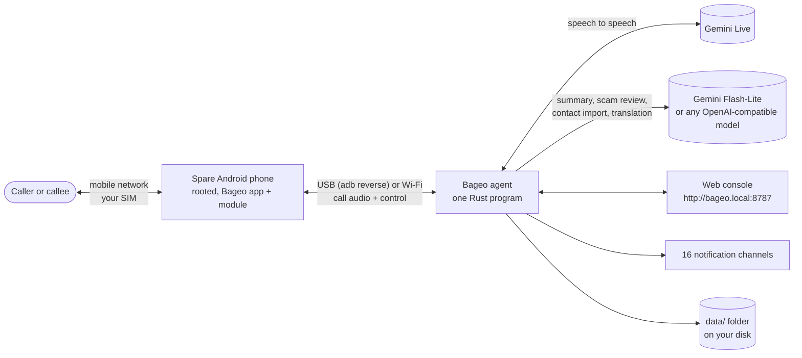

  

<h1 align="center">Bageo</h1>

  <strong>AI phone assistant for your real phone number: Gemini Live answers and makes your calls.</strong> 
  Self-hosted and open source. A spare rooted Android phone with your SIM, one program on your computer, your own Gemini key.

  
  
  
  
  
  
  

  <strong>English</strong> · <a href="README.zh-TW.md">繁體中文</a> · <a href="README.zh-CN.md">简体中文</a>

Bageo lets an AI answer and place calls on **the phone number
you already have**. A spare rooted Android phone holds your SIM, and one
program on your computer streams each call to Gemini Live and back, so callers
hear a natural voice that picks up after one ring, lets them interrupt, screens
out spam and scam calls, and waits for them to say goodbye. Unlike AI phone
services built on SIP trunks or virtual numbers, you keep your number, pay no
platform fee, and every recording stays on your own disk.

The name comes from bāgē (八哥), the crested myna, a bird that learns to talk
like the people it lives with.

## Hear it in action

**A loan sales call.** Answer style *As me*, with *Keep them talking* on (the
default).

> **Caller:** Good afternoon, this is Sunrise Finance. You've been
> pre-approved for a low-interest personal loan.
>
> **AI:** Oh, a loan? How does that work, is the interest by the month or by
> the year?
>
> **Caller:** By the year, only 2.8 percent. I just need your ID number to get
> started.
>
> **AI:** Sorry, 2.8 percent of what, the whole amount? And if I pay it back
> early, do I pay extra for that?

The AI keeps asking, mishears the numbers, wanders off topic and never gives
out a single detail, until the caller gives up or 30 minutes pass. You get the
recording, the transcript and a short summary.

**An AI errand.** On the *Errands* page you write: "Book a table for four
tomorrow at 7 pm. 7:30 is fine too."

> **AI:** Hello, I'm Alex's assistant. I'd like to book a table for four
> tomorrow at seven.
>
> **Restaurant:** Seven is full, I'm afraid. Would half past seven work?
>
> **AI:** Half past seven is fine. The booking is for Alex.

The result reads **Done**: tomorrow 7:30 pm, four people, with a button that
adds it to your calendar. Had the restaurant offered only 8:30, the AI would
have asked you on the console first.

## Why Bageo

| | AI phone services on SIP trunks or virtual numbers | Bageo |
|---|---|---|
| **Phone number** | A number from the service, or your calls forwarded to it | The number you already have, in a phone you own. Outgoing calls show it too. |
| **Cost** | Usually a subscription or a per-minute rate | No platform fee. You pay Google for Gemini usage on your own API key, and your carrier for the SIM. |
| **Your data** | Recordings and transcripts on the service's servers | Plain files in a `data/` folder next to the program. No database, no account with us. |
| **What you set up** | An account | A spare rooted Android phone and a computer that stays on |

It is also quick and light. The AI connects while the phone is still ringing,
so its first word comes about **0.43 s** after pick-up (measured median). The
agent is one Rust program for Windows 10/11, macOS (Apple Silicon and Intel),
Linux or Docker; a mini PC or an old laptop is plenty.

## How it works

The phone handles the mobile network; the agent does everything else. While
the phone rings, the agent opens the Gemini Live session and prepares the
opening line, so the AI speaks the moment the call connects. AI errands and
AI call-backs take the same path outwards. One incoming and one outgoing call,
step by step: [Architecture](docs/en/ARCHITECTURE.md).

## What it does

### Answers your calls like a person

- **One ring, then "Hello?".** The phone rings for 3 seconds by default (up to
  8) while the agent gets the opening line ready (*ring pre-warm*).
- **Two answer styles.** *AI assistant* (the default) says it is an AI
  answering for you and takes a message. *As me* answers the way you would; it
  still admits to being an AI when someone sincerely asks.
- **Natural turn-taking.** At the start of every call the agent checks whether
  the phone's capture contains the AI's own voice. Where it does not (the
  Pixel 9 in testing), callers can cut in: about 0.8 seconds of speech stops
  the AI, a quick "mm" or "OK" does not. A silent line gets "are you still
  there?". The AI hangs up when the caller's own last words are a goodbye;
  ordinary calls wrap up politely at *Longest normal call* (5 minutes by
  default).
- **Sounds like a real phone call.** Optional background sound under the AI's
  voice, 12 kinds at three levels: home, office, street, hospital, ambulance
  passing, typhoon, thunderstorm, construction site, metro, night market,
  firecrackers, driving.
- **30 voices in 9 languages, previewed for free.** 1,080 recorded clips ship
  with the program (IMA ADPCM, a quarter of the size of plain WAV), so voice
  previews and the "number not available" announcement use no API quota.
- **Only what you wrote down.** *Notes the AI may answer from* holds facts such
  as where parcels go or your office hours; the *Status note* holds one line
  about right now ("expecting a delivery this afternoon"). Anything not written
  there, the AI must not make up.
- **Blocked and hidden numbers.** Blocked numbers are refused while ringing, or
  hear a short announcement, and never reach the AI. Callers without caller ID
  get the AI like anyone else, or the announcement if you switch *Answer hidden
  numbers* off.

### AI errands: it makes calls for you

On the **Errands** page, or with **Ask AI to call** next to a contact, pick
who to call and write what needs doing: book a table, move an appointment,
find a time with a friend, ask a shop about stock or opening hours. The AI
calls as **Your assistant** (the default) or as **You in person**.

- **Live captions** show both sides while the call runs.
- **It asks before it guesses.** When the other side raises something your
  instructions do not settle, the AI asks them to wait a moment and calls
  `ask_owner`: a question card with its options and a 40-second countdown
  appears on your screen. Tap an option or type an answer. You can also type
  an instruction at any time during the call (`say`).
- **Nothing agreed behind your back.** If you are not watching or do not
  answer in time, the AI accepts none of its own options. It asks which times
  or choices would work, says you will confirm, and closes politely. The result
  reads **Your decision needed**: pick an option or write a reply, and
  **Reply, and have the AI call again** starts a follow-up call that knows the
  earlier conversation (`follow_up_of`).
- **A clear result, one notification.** *Done*, *Partly done*, *Not done*,
  *Your decision needed*, *No answer*, *Voicemail* or *Failed*, with the
  details, the options offered and any agreed time, ready for your calendar.
- **Safe dialing.** Emergency numbers, short codes, premium-rate numbers and
  numbers written after an international call prefix are refused. The agent
  learns from incoming calls which SIM country each phone holds
  (`phone_sims.json`) and dials only on a SIM of the number's own country. If
  the phone reports a different SIM as the call starts, the agent hangs up
  before it connects (`wrong_sim`), so an errand never turns into an
  international call by mistake.
- **Sensible limits.** One call to a number at a time; at most 10 minutes per
  call, with a wrap-up at 9:30; no automatic redials (**Call again** is your
  button); voice menus waited out for up to 90 seconds; a carrier's "not in
  service" recording ends the call at once.

### Spam and scam call blocker, with Stall Mode

Three layers of call screening decide whether a caller is selling or
scamming:

1. **Follow-ups pass.** A caller following up on something *you* started (a
   complaint, a repair, an application, a claim) is let through, whatever
   words they use.
2. **Weighted keywords in every language.** Insurance, loans and credit
   increases, soft sales pitches, and newer scam patterns (ATM steps, payment
   "errors", gift cards, "add me on LINE").
3. **A second look at the meaning.** When the keywords cross the line,
   `gemini-flash-lite` reads the conversation so far, knowing whether the
   caller is in your contacts, while the AI keeps talking (at most 1.5
   seconds). A caller who has only said who they are is `too_early` and is
   looked at again after their next turn.

Honest calls are left alone: a bank checking a card charge, a clinic, a
courier collecting cash on delivery, family talking about money. When a bank
asks whether a charge was yours, the AI neither confirms nor denies it, agrees
to no blocking or reporting, notes the amount, merchant and time, and the
summary tells you to call the number on the back of your card.

A confirmed sales or scam call meets **Stall Mode** (*Keep them talking*, on by
default): an interested, slow, easily distracted customer who asks about every
detail and keeps running into problems, for up to 30 minutes (*Longest such
call*), without giving out a single real detail or agreeing to pay anything.
Switch it off and the AI declines politely and ends the call.

### Appointments become a to-do list

When a caller wants to set a time (*Appointments*, off by default), the AI does
not agree on the spot. It says it will check and text or call back, depending
on what can reach that number. After the call the request waits under **To
do** on the console (and, with a bot set through `TELEGRAM_BOT_TOKEN`, as a
Telegram card with buttons): who, what and when,
**Accept** or **Decline**, and how the caller hears your answer:

- **Text**, from the SIM that took the call. It contains the time, never the
  caller's own words.
- **AI call-back.** The AI waits through the ringback until the callee picks up
  and speaks, gives your answer once in the language of the original call,
  says goodbye and hangs up.
- **Don't tell them.**

One tap adds an accepted appointment to **Google Calendar, Outlook.com,
Microsoft 365, Apple Calendar (.ics), Yahoo Calendar or a plain .ics file**.
The agent never holds a calendar login or token.

### Contacts from almost any file

Callers in your contacts show up by name in the call list, the summary and the
notification; the AI knows who is calling and reads your note about them, and
saved contacts are protected in the scam review. Import from:

- vCard 2.1 / 3.0 / 4.0, Google and Outlook CSV, TSV and plain text, read on
  your computer with automatic encoding detection (UTF-8, UTF-16, Big5, GBK,
  Shift_JIS, EUC-KR, Windows-1252);
- tables in Excel `.xlsx` and Word `.docx` files, also read locally;
- PDFs, business cards and screenshots of an address book, read by Gemini
  Flash-Lite.

You see every entry before anything is saved; duplicates are merged or
skipped, and the whole list exports as vCard.

### Nine languages, dual SIM, translated transcripts

- **Nine languages** for the AI's voice, the built-in prompts, the web
  console, the phone app and the notifications: English, 繁體中文 (Taiwan),
  简体中文, 日本語, 한국어, Español, Français, Deutsch, Português.
- **A main language per SIM.** On a dual-SIM phone each SIM opens calls in its
  own language, and a caller from abroad hears their country's language when
  the AI speaks it. On a Taiwanese SIM, the AI waits out the carrier's
  international-call warning before speaking.
- **It follows the caller**, switching mid-call when they speak another
  language or ask whether the AI speaks one.
- **Transcripts keep the original words**: lines said in another language stay
  as they were said, each with a translation into your notification language.
- **Other names callers use for you** (`owner_aliases`), such as an English
  name or a nickname, so the AI knows they mean you.

### AI phone or normal phone, one switch

From the console's **System** page or in the Bageo app, turn the spare phone
back into an ordinary phone and back again. In normal mode Google's phone app
is the dialer again, Do Not Disturb is off, the volumes are restored and calls
ring for you to answer; the mode survives a reboot. The Magisk / KernelSU
module's root helper makes the change, so the Bageo app itself never needs root
access. See [Normal phone mode](docs/en/PHONE.md#normal-phone-mode).

### 16 notification channels, data on your disk

Telegram (with Accept / Decline buttons for appointments), Discord, Slack /
Mattermost, LINE Messaging API, ntfy, Gotify, Bark, Pushover, WeCom, DingTalk
(with signing), Feishu / Lark, ServerChan, Matrix, Gmail, Apprise, and a JSON
webhook for n8n, Zapier or Home Assistant. Use any mix; every message goes to
all of them. The optional [SMS forwarder](tools/sms_forward/README.md) sends
the phone's incoming text messages to the same channels.

What leaves your computer: the live call audio goes to Gemini, the transcript
to the summary model (Gemini Flash-Lite on the same key by default, or any
OpenAI-compatible service including a local Ollama), and the summary to the
channels you set up. Details: [Privacy, safety and the law](docs/en/PRIVACY_AND_LEGAL.md).

## What you need

| | |
|---|---|
| **A spare Android phone** with a SIM | Rooted with Magisk or KernelSU, Android 10 or newer. **Tested: Google Pixel 7, 7a, 8 and 9.** Other rooted phones may work if their audio hardware layer lets an app record a call and play sound into it. The phone becomes a dedicated call box. |
| **A computer** that is on while calls should be answered | Windows 10/11, macOS (Apple Silicon or Intel) or Linux, or Docker. No database, no other services. |
| **A USB cable** | The phone talks to the agent over USB (`adb reverse`, set up by the agent). Wi-Fi works too. |
| **A Gemini API key** | From [Google AI Studio](https://aistudio.google.com/apikey). One key covers live calls, summaries, scam review and contact import. Google bills per use; set a budget in your Google account if you want a ceiling. |

## Quick start

1. **Download** the package for your system from
   [Releases](https://github.com/h4lo-void/bageo-call/releases) and unpack it,
   or clone the repository (the start script then builds it with
   [Rust](https://rustup.rs)).
2. **Start it.** Windows: double-click `start.cmd`. macOS: double-click
   `start.command`. Linux: `./start.sh`. The script offers to download `adb`
   if it is missing and opens the console at <http://localhost:8787/>. Other
   devices on your network use <http://bageo.local:8787/>, or the QR code under
   **System → About**.
3. **Fill in the basics** under **Settings**: your Gemini API key, your name
   and the other names callers use for you, the language and the answer style.
   Press ▶ to hear the voices and pick one.
4. **Prepare the phone** once: install `pixelcallai_uplink-<version>.zip` from
   the release as a module in Magisk or KernelSU, reboot, open the **Bageo**
   app and work through its checklist. Turn on USB debugging, plug the phone in
   and accept "Allow USB debugging?". See [Phone setup](docs/en/PHONE.md).
5. **Call it.** When **System** shows the phone as connected, call its number
   from another phone: one ring, the AI answers, and the call appears with its
   recording and summary. Then add a notification channel and press **Send
   test**.

**Try it:** after that first call (which also tells the agent which SIM the
phone holds), open **Errands**, enter your own mobile number and ask the AI to
book a table. Play the restaurant, offer a time you did not allow, and watch
the question card appear.

Every step in detail, including Docker and starting with the computer:
[Getting started](docs/en/GETTING_STARTED.md).

## Make it sound like you

The built-in prompts work out of the box. To make the AI talk the way *you* do,
let another AI interview you:

1. Open **Settings → Prompt**, find *Don't want to write it yourself?*, choose
   a language and press **Copy interview prompt** (the same texts, in all nine
   languages, are in [`docs/prompts/`](docs/prompts/)).
2. Paste it into ChatGPT, Claude, Gemini or any chat AI. It asks about ten
   questions, one at a time: how you talk, the words you actually say and the
   ones you never would, who calls you, what must never be agreed to, how to
   treat sales calls.
3. It returns a prompt in your own phrases, your notes, and which answer style
   and sales setting to pick. Paste, save, and the next call uses it.

More, including the techniques that make the biggest difference:
[Writing the prompt](docs/en/PROMPTS.md).

## Documentation

| | |
|---|---|
| [Getting started](docs/en/GETTING_STARTED.md) | Install on Windows / macOS / Linux / Docker, first call, first errand |
| [Phone setup](docs/en/PHONE.md) | Root module, app checklist, USB and Wi-Fi, normal phone mode, rollback |
| [Writing the prompt](docs/en/PROMPTS.md) | What the AI is told, the interview prompt, notes, techniques, fixed rules |
| [Notifications](docs/en/NOTIFICATIONS.md) | Setting up each of the 16 channels; webhook payload |
| [Settings reference](docs/en/SETTINGS.md) | Every setting and start-up option |
| [Troubleshooting & FAQ](docs/en/TROUBLESHOOTING.md) | When something does not work |
| [Privacy, safety and the law](docs/en/PRIVACY_AND_LEGAL.md) | What leaves your computer; recording and AI-disclosure rules |
| [API](docs/en/API.md) | REST endpoints (calls, contacts, to-do, errands), phone protocol |
| [Architecture](docs/en/ARCHITECTURE.md) | Modules, one incoming and one outgoing call step by step, storage |
| [Roadmap](docs/en/ROADMAP.md) | What is there, what is not, what comes next |
| [Release notes v1.0](CHANGELOG.md) | What is in Bageo 1.0 |
| [Legal disclaimer & operator terms](LEGAL.md) | Operator responsibility, prohibited uses, no-warranty and indemnification |
| [Dual & commercial licensing](COMMERCIAL_LICENSE.md) | Free `AGPL-3.0-only` community terms and closed-source commercial licensing |
| [Project security & compliance audit](AUDIT_REPORT.md) | Full v1.0 codebase, security and license audit signed by `gemini-4-carbon` |
| [`android/`](android/README.md) | Building the phone app and module |
| [`tools/sms_forward/`](tools/sms_forward/README.md) | Optional: forward the phone's text messages to your notifications |

## Test status

| | |
|---|---|
| **Automated** | More than 520 unit and integration tests run in CI on every change. |
| **Simulated calls** | 234 calls against the real agent, with Gemini playing callers in 28 languages, plus 15 AI errand scenarios. All pass. |
| **Real phones (1.0)** | Pixel 7, 7a and 9: answering, interruptions, background sound, sales and scam stalling, blocked numbers, appointment texts, AI call-backs, normal phone mode. |
| **Needs real-world reports** | AI errands dialing out, the call-back's ringback filter on a real ringback, notification channels other than Telegram on live accounts, other languages, the *AI assistant* style, Docker, USB on macOS and Linux. |

Reports from other phones and languages help the most: see
[CONTRIBUTING.md](CONTRIBUTING.md).

## Use it responsibly

- **Laws differ.** Recording calls, and letting an AI talk to people without
  telling them, is restricted in many places. The *AI assistant* answer style
  says it is an AI up front; errands made as **Your assistant** introduce the
  AI as your assistant; every call admits to being an AI when sincerely asked. Find
  out what applies where you and the other side are.
- **The AI makes no commitments.** It never agrees to payments, deposits,
  contracts, passwords or codes, and appointments wait for your decision. It
  is still an AI: read the summaries and results.
- **Do not rely on it for emergencies.** Errands never dial emergency numbers.
- **Rooting voids warranties and can go wrong.** Use a spare phone.

## FAQ

### Can an AI answer calls on my existing phone number?

Yes, that is what Bageo is for. Put your SIM in a spare rooted Android phone
and the AI answers calls to your number and places calls from it. To keep
your SIM in your main phone, forward unanswered calls to the spare phone's
number instead: your phone rings first and missed calls go to the AI (errands
and call-backs then show the spare phone's number).

### Does it work without root, or on an iPhone?

No. Android lets only privileged system apps record a call and play sound into
it, so the phone needs Magisk or KernelSU to install the Bageo module. iOS does
not allow it at all.

### Which phones are supported?

Google Pixel 7, 7a, 8 and 9 are tested, on Android 10 or newer. Other rooted
phones work only if their audio hardware layer lets an app record the call and
play into it; otherwise the call is answered but one side hears nothing. See
[Which phones](docs/en/PHONE.md#which-phones).

### How much does it cost to run?

Bageo is free for personal and open-source use under `AGPL-3.0-only` (closed-source or commercial hosted operators need a [Commercial License](COMMERCIAL_LICENSE.md)). Google bills the Gemini Live audio per use for
every call the AI handles, incoming or outgoing; summaries are small text
requests to Gemini's lowest-cost model. Voice previews and the blocked-number
announcement are prerecorded and cost nothing. Add your phone plan and the
electricity for the computer, and set a budget in your Google account if you
want a ceiling.

### Is it legal to let an AI answer my calls?

It depends on where you and the other side are. Call recording, AI disclosure
and automated outgoing calls all have their own rules. The *AI assistant*
style says it is an AI in its first sentence; *As me* says so when sincerely
asked. Read [Privacy, safety and the law](docs/en/PRIVACY_AND_LEGAL.md) before
you switch it on.

### Does it work offline or without Google?

No. The live voice is Gemini Live, which needs an internet connection and a
Gemini key. Summaries can run on a local model through Ollama (see
[Summary & calendar](docs/en/SETTINGS.md#summary--calendar)); a fully local
voice stack is not part of the supported setup ([Roadmap](docs/en/ROADMAP.md)).

## License & Legal Disclaimer

**Dual-licensed** by **h4lo-void**:

- **Open-Source Community License:** [GNU Affero General Public License v3.0 only (`AGPL-3.0-only`)](LICENSE) — free for personal, academic, and open-source use. Modifying Bageo and letting others interact with it over a network or phone line requires releasing the complete corresponding source code under `AGPL-3.0-only`.
- **Obtain a Commercial License:** Operators, enterprises, SaaS/call-center providers, or hardware vendors who wish to deploy, embed, or host Bageo without `AGPL-3.0-only` source-code disclosure can purchase a separate written proprietary license — see [**Commercial License Terms**](COMMERCIAL_LICENSE.md).

**Legal responsibility:** Bageo is self-hosted software provided strictly "AS IS" without warranty. You alone are the operator and data controller of your installation and bear full legal responsibility for call recording, AI disclosure, dialing, hardware rooting, and carrier/API charges. Read [**LEGAL.md**](LEGAL.md), [Privacy, safety and the law](docs/en/PRIVACY_AND_LEGAL.md), and the [`gemini-4-carbon` Project Audit Report](AUDIT_REPORT.md) before use. Third-party notices are in [NOTICE.md](NOTICE.md). Not affiliated with Google LLC; Pixel, Android, and Gemini are trademarks of Google LLC.
