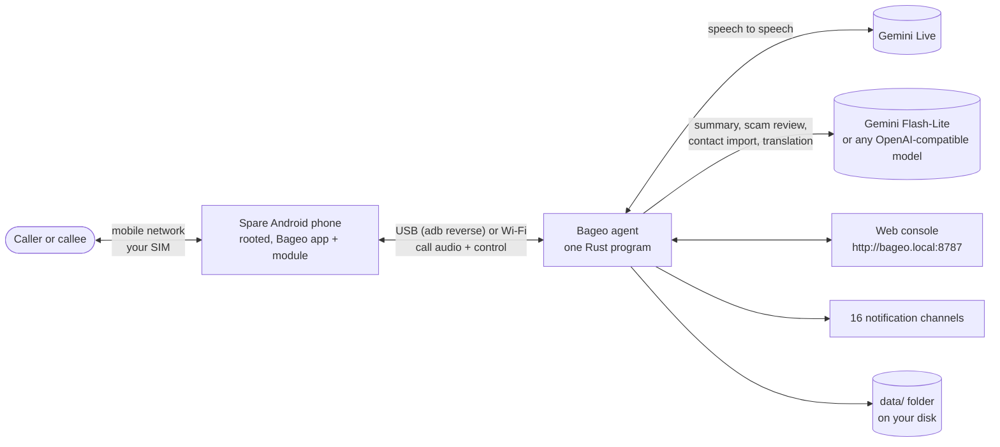
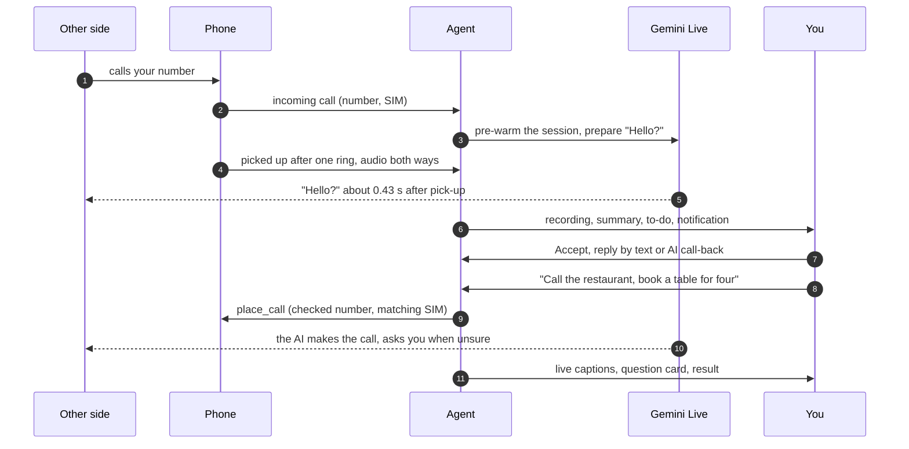

  

<h1 align="center">Bageo</h1>

  <strong>Your own phone number, answered and dialed by a real-time AI voice.</strong> 
  A spare rooted Android phone, your own SIM, one program on your computer, Gemini Live.

  
  
  
  
  
  

  <strong>English</strong> · <a href="README.zh-TW.md">繁體中文</a> · <a href="README.zh-CN.md">简体中文</a>

Bageo puts a speech-to-speech AI on **the phone number you already have**. A
spare Android phone with your SIM picks up the call; the Bageo agent on your
computer streams the call audio to Gemini Live and back, so the caller talks to
a voice that answers in about 0.4 seconds, lets itself be interrupted, switches
to the caller's language and hangs up only when the caller is done. Afterwards
you get the recording, the transcript, a four-line summary and anything you
need to decide, on the web console and in the chat app you use.

Version 1.0 works in both directions. Bageo still answers your calls, and now
it also **makes calls for you**: tell it "book a table for four tomorrow at
seven, half past seven is fine too", and the AI dials the restaurant, handles
the conversation, asks you on the web console when something comes up that you
did not cover, and reports the result. When a caller wants to fix a time with
you, it notes the request; you press Accept or Decline, and the caller hears
your answer by text message or by an AI call-back.

The name comes from bāgē (八哥), the Chinese name of the crested myna, a bird
that learns to talk like the people it lives with. Earlier versions were called
Myna.

## Why Bageo

| | |
|---|---|
| **Your real number** | No SIP trunk, no rented virtual number, no call forwarding. Callers dial the number they always had; the AI calls out from that number too. |
| **No platform fee** | No subscription and no per-minute markup. You pay Google for the Gemini usage on your own API key, and your carrier for the SIM, nothing else. |
| **Your data stays home** | One Rust program, no database, no cloud account of ours. Recordings, transcripts, contacts and settings are plain files in a folder next to the program. |
| **Fast** | The AI connects while the phone is still ringing and has its first words ready. Measured median from pick-up to the AI's voice: **about 0.43 s**. |
| **Runs anywhere** | Windows 10/11, macOS (Apple Silicon and Intel), Linux, or Docker. A mini PC or an old laptop is plenty. |

## How it fits together

Calls in and calls out run through the same pieces:

## What it does

### Answers your calls like a person would

- **One ring, then a natural "Hello?".** The phone rings for 3 seconds by
  default (up to 8). During that time the agent opens the Gemini Live session
  and has the opening line generated (*ring pre-warm*), so the AI speaks the
  moment the call connects.
- **Two answer styles.** *AI assistant* says it is an AI answering for you and
  takes a message. *As me* answers the way you would and talks as you; it still
  admits to being an AI when someone sincerely asks.
- **Real conversation.** The agent checks in the first seconds of every call
  whether the phone's capture contains the AI's own voice. On phones without
  that echo (the Pixel 9 in our use) the caller can cut in: about 0.8 seconds of
  speech stops the AI, while a quick "mm" or "OK" does not. Pauses are
  handled, a quiet line gets "are you still there?", and the call ends when the
  caller's own last words are a goodbye, not on a timer.
- **It sounds like a phone call.** Twelve background sounds can sit under the
  AI's voice at three levels: home, office, street, hospital, ambulance passing,
  typhoon, thunderstorm, construction site, metro, night market, firecrackers
  and driving.
- **30 voices in 9 languages, previewed for free.** Every voice comes with
  recorded samples and "number not available" announcements in every
  language, **1,080 clips** bundled with the program (IMA ADPCM, a quarter of
  the size of plain WAV). Previewing voices and turning callers away costs no
  API quota.
- **Notes and a status line.** Give it facts it may answer from (where parcels
  go, office hours) and one line about today ("expecting a delivery this
  afternoon"). Anything not written there it must not make up.
- **Blocked and hidden numbers.** Numbers on your block list are hung up on
  while ringing, or hear a short announcement, and never reach the AI. Calls
  without caller ID can be answered like any other or turned away.

### AI errands: it makes calls for you

New in 1.0. On the console's **Errands** page, or with **Ask AI to call** next
to a contact, pick a contact or type a number and write what needs doing:
reserve a table, move an appointment, find a time with a friend, ask a shop
whether something is in stock or when it opens. Each errand goes out as *your
assistant* (the default) or *as you*.

- **Live captions while it talks.** The errand page shows both sides of the
  call as it happens.
- **It asks before it guesses.** When the other side raises something the
  errand does not settle ("seven is full, would half past work?"), the AI asks
  them to hold on a moment and calls `ask_owner`. If you have the page open,
  a question card with the AI's options and a 40-second countdown appears; tap
  an option or type an answer. You can also type an instruction at any time
  during the call (`say`).
- **Nothing agreed behind your back.** If you are not watching, or do not
  answer in time, the AI does not accept any of its own options. It asks which
  times or choices would work, says you will confirm, and closes politely. The
  result comes back as **Your decision needed**: pick one of the other side's
  options or write a reply, and **Reply, and have the AI call again** starts a
  follow-up call that carries the earlier conversation (`follow_up_of`).
- **A structured result.** After the call the summary model reads the
  transcript against the errand and returns the outcome (done, partial, not
  done, your decision needed, no answer, voicemail, failed), the details, the options
  offered and any agreed time, which you can add to your calendar. You get one
  notification.
- **Guard rails on every number.** Emergency numbers, short codes,
  premium-rate numbers and numbers written after an international call prefix
  are refused. The agent learns from incoming calls which SIM country each
  phone holds (`phone_sims.json`) and dials only on a SIM of the number's own
  country. If the phone reports a different SIM at the moment the call starts,
  the agent hangs up before it connects (`wrong_sim`), so an errand never
  turns into an international call by mistake.
- **Sensible limits.** One call to a number at a time, at most 10 minutes per
  call with a wrap-up at 9:30, no automatic redials (**Call again** is yours), a
  voice menu waited out for up to 90 seconds, a carrier's "not in service"
  recording hung up on at once.

### Three layers against sales and scam calls, plus Stall Mode

1. **Never a sales call:** a caller following up on something *you* started (a
   complaint, a repair, an application, a claim) is let through whatever words
   they use.
2. **Weighted keywords in every language:** insurance, loans and credit
   increases, soft sales pitches, and the newer scam patterns (ATM steps,
   payment "errors", gift cards, "add me on LINE").
3. **A semantic second look:** when the keywords cross the line,
   `gemini-flash-lite` reads the conversation so far, together with whether
   the caller is in your contacts, while the AI keeps talking (capped at
   1.5 seconds). A caller who has only said who they are is `too_early` and
   is looked at again after their next turn.

Honest calls are left alone: a bank checking a card charge, a clinic, a
courier collecting cash on delivery, family talking about money. When a bank
asks whether a charge was yours, the AI neither confirms nor denies it, agrees
to no blocking or reporting, writes down amount, merchant and time, and the
summary tells you to call the number on the back of your card.

A confirmed sales or scam call is declined politely, or, if you switch on
**Keep them talking**, met by **Stall Mode**: an interested, slow,
easily-distracted customer who keeps asking for details, keeps running into
problems and keeps the caller busy for up to 30 minutes, without giving out a
single real detail or agreeing to pay anything.

### Appointments as a to-do list, with any calendar

When a caller wants to set a time (off by default), the AI does not agree on
the spot. It says "let me check and I'll text you back" or "I'll call you
back", depending on what can reach that number. After the call the request
waits under **To do** on the console, and as a Telegram card with buttons:
who, what and when, **Accept** or **Decline**, and how the caller hears your
answer:

- **Text** from the SIM that took the call. It contains only the time,
  never the caller's own words.
- **AI call-back.** The AI waits through the ringback until the callee picks up
  and speaks, gives your answer once in the language of the original call, says
  goodbye and hangs up.
- **Don't tell them.**

An accepted appointment goes into your calendar with one tap: **Google
Calendar, Outlook.com, Microsoft 365, Apple Calendar (.ics), Yahoo Calendar or
a plain .ics download**. The agent never holds a calendar login or token.

### Contacts that import from anything

Callers in your contacts show up by name in the call list, the summary and the
notification, and the AI knows who is calling and reads your note about them.
Saved contacts are also protected in the scam review. Import from:

- vCard 2.1 / 3.0 / 4.0, Google and Outlook CSV, TSV and plain text, read on
  your computer with automatic encoding detection (UTF-8, UTF-16, Big5, GBK,
  Shift_JIS, EUC-KR, Windows-1252);
- the tables in Excel `.xlsx` and Word `.docx` files, also read locally;
- **PDFs, business cards and screenshots of an address book**, read by Gemini
  Flash-Lite.

You see every entry before anything is saved; duplicates are merged or
skipped, and the whole list exports as vCard.

### Languages, dual SIM and translated transcripts

- **Nine full languages** for the AI's voice, the built-in prompts, the web
  console, the phone app and the notifications: English, 繁體中文 (Taiwan),
  简体中文, 日本語, 한국어, Español, Français, Deutsch, Português.
- **A main language per SIM.** A dual-SIM phone with, say, a Taiwanese and a
  US SIM opens calls on each in the right language. A caller from abroad hears
  their country's language when the AI speaks it. On a Taiwanese SIM, the AI
  waits out the carrier's international-call warning before speaking.
- **It follows the caller.** When a caller speaks another language or asks
  whether the AI speaks one, it switches mid-call.
- **Transcripts keep the original language.** Lines said in another language
  stay as they were said, each with a translation into your notification
  language underneath.
- **Other names people use for you** (`owner_aliases`): an English name, a
  nickname. When a caller asks for one, the AI knows they mean you.

### One switch: AI phone or normal phone

From the console's *System* page or in the Bageo app, turn the spare phone back
into an ordinary phone and back again. In normal mode Google Phone is the
dialer again, Do Not Disturb is off, the volumes are restored and calls ring
for you to answer; the mode survives a reboot. The Magisk / KernelSU module's
root helper makes the change, so **the Bageo app itself never needs root
access**.

### Notifications in 16 channels, data on your disk

Telegram (with Accept / Decline buttons for appointments), Discord, Slack /
Mattermost, LINE Messaging API, ntfy, Gotify, Bark, Pushover, WeCom, DingTalk
(with signing), Feishu / Lark, ServerChan, Matrix, Gmail, Apprise, and a
custom JSON webhook for n8n, Zapier or Home Assistant. Use any mix; every
message goes to all of them. The optional
[SMS forwarder](tools/sms_forward/README.md) sends the phone's incoming text
messages to the same channels.

What leaves your computer: the live call audio goes to Gemini, the transcript
to the summary model (by default Gemini Flash-Lite on the same key, or any
OpenAI-compatible service including a local Ollama), and the summary to the
channels you set up.

## What you need

| | |
|---|---|
| **A spare Android phone** with a SIM | Rooted with Magisk or KernelSU, Android 10 or newer. **Tested: Google Pixel 7, 7a, 8 and 9.** Other rooted phones may work; it depends on whether their audio hardware layer lets an app record and play into a call. The phone becomes a dedicated call box. |
| **A computer** that is on while calls should be answered | Windows 10/11, macOS (Apple Silicon or Intel) or Linux; or Docker. No database, no other services. |
| **A USB cable** | The phone talks to the agent over USB (`adb reverse`, set up by the agent). Wi-Fi works too. |
| **A Gemini API key** | From [Google AI Studio](https://aistudio.google.com/apikey). The same key covers live calls, summaries, scam review and contact import. Google bills per use; set a budget in your Google account if you want a ceiling. |

## Five-minute quick start

1. **Download** the package for your system from
   [Releases](https://github.com/h4lo-void/bageo-call/releases) and unpack it,
   or clone the repository (the start script then builds it with
   [Rust](https://rustup.rs)).
2. **Start it.** Windows: double-click `start.cmd`. macOS: double-click
   `start.command`. Linux: `./start.sh`. The script offers to download
   `adb` if it is missing and opens the console at <http://localhost:8787/>.
   Other devices on your network reach it at <http://bageo.local:8787/>, or
   with the QR code under *System → About*.
3. **Fill in the basics** under *Settings*: your Gemini API key, your name and
   the other names people use for you, the language, the answer style. Press ▶
   to hear the voices and pick one.
4. **Prepare the phone** once: install `pixelcallai_uplink-<version>.zip`
   from the release as a module in Magisk or KernelSU, reboot, open the
   **Bageo** app and work through its checklist. Turn on USB debugging, plug
   the phone in and accept "Allow USB debugging?". →
   [Phone setup](docs/en/PHONE.md)
5. **Call it.** *System* shows the phone as connected. Call its number from
   another phone: one ring, the AI answers, and the call appears with its
   recording and summary. Then add a notification channel and press
   *Send test*.

Every step in detail, including Docker and running at start-up:
[Getting started](docs/en/GETTING_STARTED.md).

## Make it sound like you

The built-in prompts work out of the box. To make the AI talk the way *you*
do, let another AI interview you:

1. Open *Settings → Prompt*, find *Don't want to write it yourself?*, choose a
   language and press **Copy interview prompt** (the same texts are in
   [`docs/prompts/`](docs/prompts/), in all nine languages).
2. Paste it into ChatGPT, Claude, Gemini or any chat AI. It asks you ten
   questions, one at a time: how you talk, the words you actually say and the
   ones you never would, who calls you, what must never be agreed to, how to
   treat sales calls.
3. It returns a prompt that keeps your phrases and boundaries, your notes, and
   which answer style and sales setting to pick. Paste, save, and the next call
   uses it.

More, with techniques that make a real difference:
[Writing the prompt](docs/en/PROMPTS.md).

## Documentation

| | |
|---|---|
| [Getting started](docs/en/GETTING_STARTED.md) | Install on Windows / macOS / Linux / Docker, first call, first errand |
| [Phone setup](docs/en/PHONE.md) | Root module, app checklist, USB and Wi-Fi, normal phone mode, rollback |
| [Writing the prompt](docs/en/PROMPTS.md) | What the AI is told, the interview prompt, notes, techniques, fixed rules |
| [Notifications](docs/en/NOTIFICATIONS.md) | Setting up each of the 16 channels; webhook payload |
| [Settings reference](docs/en/SETTINGS.md) | Every setting and start-up option |
| [Troubleshooting & FAQ](docs/en/TROUBLESHOOTING.md) | When something does not work |
| [Privacy, safety and the law](docs/en/PRIVACY_AND_LEGAL.md) | What leaves your computer; recording and AI-disclosure rules |
| [API](docs/en/API.md) | REST endpoints (calls, contacts, to-do, errands), phone protocol |
| [Architecture](docs/en/ARCHITECTURE.md) | Modules, one incoming call and one outgoing call step by step, storage |
| [Roadmap](docs/en/ROADMAP.md) | What is there, what is not, what comes next |
| [Release notes v1.0](CHANGELOG.md) | What is new in 1.0 and how to upgrade |
| [`android/`](android/README.md) | Building the phone app and module |
| [`tools/sms_forward/`](tools/sms_forward/README.md) | Optional: forward the phone's text messages to your notifications |

## Where v1.0 stands

This project ran for months as one person's own phone line before it was
opened up. Here is what has been proven and how.

**Automated tests.** More than 520 unit and integration tests run on every
change in CI (agent, phone app build, SMS forwarder).

**Simulated calls.** A test harness lets Gemini play the caller against the
real agent: 234 simulated calls with callers speaking 28 languages, covering
greetings, goodbyes, language switching, card checks, sales and scam calls,
voice menus and appointments. AI errands were run through 15 simulated
scenarios (a booking, a full restaurant, a friend, a deposit request, an
English-speaking shop on a US SIM, voicemail, no answer, a key-press menu, a
number not in service, "are you a robot?", a failed dial, owner answers, owner
away, a follow-up, an instruction mid-call), all passing.

**Real phones, real calls.**

- Daily use in Traditional Chinese (Taiwan) in the *As me* style on Pixel 7,
  7a and 9 (Android 16, KernelSU-Next); the Pixel 8 ran earlier releases.
  Covered: answering, interruption, background sound, sales and scam stalling,
  blocked numbers, recordings, summaries, Telegram.
- Appointment replies by text: a reply sent from a US SIM was delivered to a US
  number. Texts from a Taiwanese prepaid SIM were refused only because that
  line had no credit.
- Normal phone mode on a Pixel 7a: real calls rang and were answered, the mode
  survived a reboot, and the AI answered again after switching back.
- The AI call-back has connected and given its answer on a real call; the
  ringback filter added for 1.0 has been tested with synthetic ringback.

**Waiting for more reports.** AI errands have not yet dialed out on a real
phone. The notification channels other than Telegram are tested against each
service's documented format, not live accounts. Languages other than
Traditional Chinese, the *AI assistant* style, setting up a phone from scratch,
USB management on macOS and Linux, and the Docker image have seen less real
use. Reports from other phones and languages are the most valuable thing you
can send: see [CONTRIBUTING.md](CONTRIBUTING.md).

## Use it responsibly

- **Laws differ.** Recording calls, and letting an AI talk to people without
  telling them, is restricted in many places. The *AI assistant* style and AI
  errands as your assistant say they are an AI. Find out what applies where you
  and the people you call are.
- **The AI makes no commitments.** It never agrees to payments, deposits,
  contracts, passwords or codes, and appointments wait for your decision. It is
  still an AI: read the summaries and results.
- **Do not rely on it for emergencies.** Errands never dial emergency numbers.
- **Rooting voids warranties and can go wrong.** Use a spare phone.

See [Privacy, safety and the law](docs/en/PRIVACY_AND_LEGAL.md).

## License

[MIT](LICENSE). Bundled sounds are CC0; one installer script is GPL-3.0; see
[NOTICE.md](NOTICE.md). Not affiliated with Google; Pixel and Gemini are
trademarks of Google LLC.
