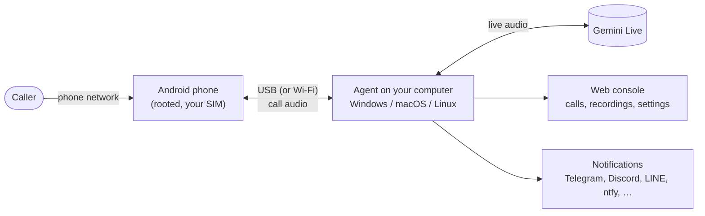

  

# Bageo

**An AI voice that answers your real phone number, built for Google Pixel
phones.** A spare Android phone with
your SIM picks up incoming calls; a small program on your computer lets a
Gemini Live voice talk to the caller, records the call, writes a short summary
and sends it to you (Telegram, Discord, LINE, ntfy and more).

No SIP trunk, no phone-number rental, no monthly platform fee: it is your own
SIM, your own computer and your own API key.

The name comes from bāgē (八哥), the Chinese name of a bird that learns to talk
like the people it lives with. This one sits on your phone line and answers
the way you would. Earlier versions were called Myna.

**English** · [繁體中文](README.zh-TW.md) · [简体中文](README.zh-CN.md)

## What it does

- **Answers every call** after one ring, in a natural voice, with almost no delay
  (the AI is prepared while the phone still rings).
- **Two answer styles**: as *your AI assistant* (says it is an AI and takes a
  message) or *as you* (talks the way you do; still admits to being an AI when
  someone sincerely asks).
- **Real conversation**: the caller can interrupt, pauses are handled, the call
  ends when the caller is done — not on a timer.
- **Sales and scam calls**: politely declined, or — if you like — kept talking
  for as long as possible to waste their time.
- **Blocked numbers**: those callers hear a short "not available" announcement
  and the AI is never used.
- **After each call**: recording, full transcript, a four-line summary (who,
  what, what the AI said, what you need to do), and a calendar suggestion when
  the call fixed a date (one tap adds it to Google Calendar, or download `.ics`).
- **Notifications** to any mix of Telegram, Discord, Slack / Mattermost, LINE,
  ntfy, Gotify, Bark, Pushover, WeCom, DingTalk, Feishu / Lark, ServerChan,
  Matrix, e-mail (Gmail), Apprise, or your own webhook (n8n, Zapier, Home
  Assistant…).
- **Your notes**: facts the AI may answer from (where to leave parcels, opening
  hours); anything not written there it must not make up.
- **Languages**: the AI can speak English, Traditional Chinese (Taiwan),
  Simplified Chinese, Japanese, Korean, Spanish, French, German and Portuguese;
  the web console and the phone app are translated into the same nine.
- **Background sound** under the AI's voice (home, office, street, …) so it does
  not sound like a studio.
- **Everything stays on your computer**: recordings, transcripts and settings
  live in a folder next to the program. Only the live audio goes to Gemini, the
  transcript to the summary model, and the summary to the notification services
  you set up.

## What you need

| | |
|---|---|
| **A spare Android phone** with a SIM | Rooted (Magisk or KernelSU). **Tested: Pixel 7, 7a, 8, 9.** Other rooted phones may work — it depends on the phone's audio hardware layer; try at your own risk. The phone becomes a dedicated call box (its ringer and dialer are taken over). |
| **A computer** that is on while calls should be answered | Windows 10/11, macOS or Linux. A mini-PC or an old laptop is plenty. |
| **A USB cable** | The phone talks to the computer through USB (Wi-Fi is possible too). |
| **A Google Gemini API key** | From [Google AI Studio](https://aistudio.google.com/apikey). Live audio is billed by Google per use; check their current pricing. |

## Quick start

1. **Get the program.** Download the package for your system from the
   [Releases](https://github.com/h4lo-void/bageo-call/releases) page and unpack it — or clone this repository
   (you then need [Rust](https://rustup.rs); the start script builds it).
2. **Start it.** Windows: double-click `start.cmd`. macOS: double-click
   `start.command`. Linux: `./start.sh`. The script offers to download `adb`
   (Google's Android platform-tools) if it is missing, then opens the web
   console at <http://localhost:8787/>. Next time, open it with the
   *Bageo Console* shortcut the script puts on your desktop. Once the console
   is open to your network, phones and other computers reach it at
   <http://bageo.local:8787/> when the agent can answer that name; otherwise
   use the address or the QR code under *System → About*, where you can also
   add it to a phone's home screen. → [Settings](docs/en/SETTINGS.md#using-the-console-from-other-devices)
3. **Fill in the basics** in the web console: your Gemini API key, your name,
   the language, the answer style. Press ▶ to hear the voices and pick one.
4. **Prepare the phone** (once): install the module from the release
   (`pixelcallai_uplink-<version>.zip`) in Magisk / KernelSU, reboot, open the
   **Bageo** app and work through its checklist. Turn on USB debugging,
   plug the phone into the computer and accept the "Allow USB debugging?"
   prompt. → [Phone setup](docs/en/PHONE.md)
5. **Check and call.** The *System* page of the web console shows the phone as
   connected. Call the phone's number from another phone: it rings once, the AI
   answers, and the call shows up in the console with its recording and summary.
6. **Add notifications** (*Settings → Notifications*), press *Send test*.

Every step in detail: [Getting started](docs/en/GETTING_STARTED.md).

## Make it sound like you

The built-in prompt works out of the box. To make the AI talk the way *you* do,
you do not have to write a prompt yourself:

1. Open *Settings → Prompt*, find *Don't want to write it yourself?* and press
   **Copy interview prompt**
   (or take it from [`docs/prompts/`](docs/prompts/)).
2. Paste it into ChatGPT, Claude, Gemini or any other chat AI. It asks you about
   ten questions — how you talk, who calls you, what must never be agreed to.
3. Paste the prompt it writes into *Your own prompt*, and its "Notes" into
   *Notes the AI may answer from*. Save. The next call uses it.

More: [Writing the prompt](docs/en/PROMPTS.md).

## Documentation

| | |
|---|---|
| [Getting started](docs/en/GETTING_STARTED.md) | Install on Windows / macOS / Linux, first call |
| [Phone setup](docs/en/PHONE.md) | Root module, app checklist, USB and Wi-Fi, rollback |
| [Writing the prompt](docs/en/PROMPTS.md) | Answer styles, the interview prompt, notes, examples |
| [Notifications](docs/en/NOTIFICATIONS.md) | How to set up each service; webhook payload |
| [Settings reference](docs/en/SETTINGS.md) | Every setting and start-up option |
| [Troubleshooting & FAQ](docs/en/TROUBLESHOOTING.md) | When something does not work |
| [Privacy, safety and the law](docs/en/PRIVACY_AND_LEGAL.md) | What leaves your computer; recording and AI-disclosure rules |
| [API](docs/en/API.md) | REST endpoints of the web console, phone protocol |
| [Architecture](docs/en/ARCHITECTURE.md) | How the pieces fit together |
| [Roadmap](docs/en/ROADMAP.md) | What is there, what is not, what the community asked for |
| [`android/`](android/README.md) | Building the phone app and module |
| [`tools/sms_forward/`](tools/sms_forward/README.md) | Optional: forward the phone's text messages to your notifications |

## Project status — please read

This project ran for months as one person's own system and was then opened up.
Be aware of what has and has not been proven:

- **Used daily on real calls:** Traditional Chinese (Taiwan), the *as you*
  answer style, Pixel 7 / 7a / 8 / 9, sales / scam stalling, blocked numbers,
  recordings and summaries, Telegram notifications.
- **New in the open-source version and not yet tried on real calls:** every
  other language, the *AI assistant* answer style, the agent managing USB by
  itself on macOS and Linux, the notification services other than Telegram
  (their requests are unit-tested against each service's documented format,
  not against live accounts), the calendar suggestion, version 0.2 of the phone
  app's setup screen, the Docker image, and the desktop downloads from the
  Releases page.
- **Phone app 0.2.4 answers real calls** on the Pixel 7, 7a and 9 in daily use
  (Android 16, KernelSU-Next), and SMS forwarding works with it. Those phones
  were updated from earlier versions, so setting up a phone from scratch has
  not been done yet.
- **AI phone or normal phone (new in 0.2.3).** In the web console (*System*)
  or in the app you can turn a phone back into an ordinary phone: calls ring
  and you answer them yourself. Switch back and the AI answers again. The
  module does this as root, so you do not have to give the Bageo app root
  access in Magisk or KernelSU. Tried on a Pixel 7a: in normal mode a real
  call rang and was answered, the mode stayed after a reboot, and after
  switching back the AI answered.
- **Appointments (new in 0.2.4, off by default).** When a caller asks for a
  time, the AI says it will check and get back to them by text or by phone;
  under *To do* in the web console you pick how they hear it (a text, a
  call-back from the AI, or nothing) and accept or decline (also on a Telegram
  card if a bot is set up), and one tap adds an accepted one to the calendar
  you chose. No calendar account is connected to the agent. Tried with a
  simulated caller in nine languages. Texting the caller back: the phone hands
  the text to the network, but on our two test SIMs the carriers refused it,
  so a delivered reply has not been seen yet; the AI call-back has not been
  tried on a real call yet.
- **The phone module is signed with the project's own key**, so later releases
  install over it. If you installed the module from the first v0.2.0 download,
  which was signed with a temporary key, you can install the current one over
  it: on our phones Android accepted the new key and kept the app's data.

Bug reports with the agent's log and what you expected are very welcome. See
[CONTRIBUTING.md](CONTRIBUTING.md).

## Use it responsibly

- **Laws differ.** Recording calls, and letting an AI talk to people without
  telling them, is restricted in many places. The default answer style says it
  is an AI. Find out what applies where you and your callers are.
- **The AI makes no commitments.** It is instructed never to agree to payments,
  contracts, passwords or appointments — but it is an AI: read the summaries.
- **Emergency calls and anything that matters** should not depend on this.
- **Rooting a phone** voids warranties and can go wrong. Use a spare phone.

See [Privacy, safety and the law](docs/en/PRIVACY_AND_LEGAL.md).

## License

[MIT](LICENSE). Bundled sounds are CC0; one installer script is GPL-3.0 — see
[NOTICE.md](NOTICE.md). Not affiliated with Google; Pixel is a trademark of
Google LLC.
