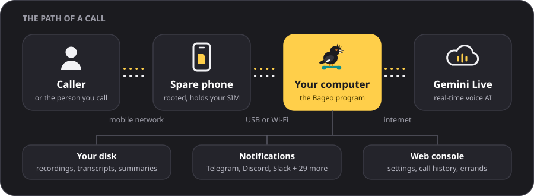

  

  <a href="README.md">English</a> · <a href="README.zh-TW.md">繁體中文</a> · <a href="README.zh-CN.md">简体中文</a> · <a href="README.ja.md">日本語</a> · <a href="README.ko.md">한국어</a> · <a href="README.es.md">Español</a> · <a href="README.fr.md">Français</a> · <a href="README.de.md">Deutsch</a> · <strong>Português</strong>

  <strong>Assistente de telefone com IA para o seu número de verdade: o Gemini Live atende e faz as suas ligações.</strong> 
  Hospedado por você e de código aberto. Um celular Android com root que estava sobrando, com o seu SIM, um programa no seu computador e a sua própria chave do Gemini.

  
  
  
  

<table>
  <tr>
    <td width="25%" align="center" valign="top">
       
      <strong>Atende suas ligações</strong> 
      Atende depois de um toque, fala como uma pessoa e espera quem ligou se despedir.
    </td>
    <td width="25%" align="center" valign="top">
       
      <strong>Enrola os golpistas</strong> 
      Percebe ligações de vendas e de golpe e vira um cliente lento e curioso por até 30 minutos.
    </td>
    <td width="25%" align="center" valign="top">
       
      <strong>Faz ligações por você</strong> 
      Escreva uma linha e ele liga por você. Na dúvida, pergunta antes.
    </td>
    <td width="25%" align="center" valign="top">
       
      <strong>Fala nove idiomas</strong> 
      Inglês, chinês tradicional, chinês simplificado, japonês, coreano, espanhol, francês, alemão e português. Troca de idioma quando quem liga troca.
    </td>
  </tr>
</table>

O nome vem de bāgē (八哥), o mainá-de-crista, uma ave que aprende a falar como as pessoas com quem convive.

## Teste: adivinhe o que o Bageo diz

Abra uma ligação e avance linha por linha. Exemplos de roteiro, não gravações de ligações reais.

<strong>Entrega de pacote</strong> — Chega um pacote e você está ocupado.

 

> <strong>Quem liga</strong>: Seu pacote chegou.

O que o Bageo diz?

 

> <strong>Bageo</strong>: Olá, sou o assistente de IA que está atendendo este telefone. Precisa assinar pessoalmente?
>
> <strong>Quem liga</strong>: Sim. Podemos entregar de novo hoje, antes das cinco da tarde.

E depois?

 

> <strong>Bageo</strong>: Vou repassar e pedir que o destinatário confirme um horário.

<strong>O que você recebe:</strong> Precisa de assinatura; dá para entregar de novo antes das 17h. Você confirma o horário.

<strong>Ligação de vendas</strong> — Uma “oferta especial” está ligando.

 

> <strong>Quem liga</strong>: Você foi aprovado hoje para um empréstimo com juros baixos!

O Bageo desliga?

 

> <strong>Bageo</strong>: Esses juros são ao mês ou ao ano?
>
> <strong>Quem liga</strong>: Primeiro me passe seus dados pessoais.

O Bageo passa os dados?

 

> <strong>Bageo</strong>: Como as taxas são calculadas? De quanto é a parcela mensal?

<strong>O que você recebe:</strong> Nenhum dado pessoal é passado e as perguntas não param. O Bageo consegue manter alguém assim ocupado por até 30 minutos.

<strong>Reservar uma mesa</strong> — Uma instrução. Uma ligação a menos.

 

> <strong>Você</strong>: Reserve para quatro amanhã às 19h. Às 19h30 também serve.

Como o Bageo começa?

 

> <strong>Bageo</strong>: Olá, sou um assistente de IA e estou ligando para reservar uma mesa para quatro amanhã às sete.
>
> <strong>Restaurante</strong>: Às sete está lotado. Temos mesa às sete e meia.

O Bageo aceita?

 

> <strong>Bageo</strong>: Sete e meia serve. Pode reservar para quatro, obrigado.
>
> <strong>Restaurante</strong>: Confirmado: amanhã às sete e meia, quatro pessoas.

<strong>O que você recebe:</strong> Amanhã, 19h30, quatro pessoas, dentro do que você permitiu. Se algo sair das suas instruções, o Bageo pergunta a você antes.

## Um golpista liga. O Bageo o mantém falando.

  

Quando uma ligação é claramente de vendas ou de golpe, a IA vira um cliente interessado, lento e fácil de distrair. Pergunta cada detalhe, entende os números errado e nunca passa um número verdadeiro, por até 30 minutos, e você recebe a gravação, a transcrição e um resumo curto. Ligações honestas ficam em paz: um banco conferindo uma compra no cartão, uma clínica, um entregador, a família. “Manter a pessoa falando” vem ligado por padrão e um único botão desliga. [Como funciona a triagem](docs/en/FEATURES.md#spam-and-scam-call-blocker-with-stall-mode)

## Sem vontade de ligar? Escreva uma linha.

  

Reservar uma mesa, remarcar um horário, perguntar a uma loja sobre estoque ou horário de funcionamento. Quando o outro lado traz algo que você não previu, a IA pergunta a você na tela antes de responder. Ela nunca concorda com nada por conta própria: se você não responder a tempo, diz que você vai confirmar e encerra a ligação com educação. [Mais sobre as ligações da IA](docs/en/FEATURES.md#ai-errands-it-makes-calls-for-you)

## Ligação do exterior? O Bageo fala nove idiomas.

  

A voz da IA, as instruções embutidas (uma base curta e geral que você pode adaptar à sua situação e ao seu estilo), o console web, o app do celular e as notificações existem em nove idiomas. Em um celular com dois SIMs, cada SIM abre as ligações no seu próprio idioma; quem liga do exterior ouve o idioma do seu país e, se a pessoa trocar de idioma no meio da ligação, a IA acompanha. As transcrições guardam as palavras originais, cada linha com uma tradução para o idioma das suas notificações. [Mais sobre idiomas e dois SIMs](docs/en/FEATURES.md#nine-languages-dual-sim-translated-transcripts)

## Como funciona

  

O celular só leva a ligação; todo o resto roda no seu próprio computador. A IA se conecta enquanto o celular ainda está tocando, então a primeira palavra dela sai cerca de **0.43 s** depois do atendimento (mediana medida). Uma ligação, passo a passo: [Arquitetura](docs/en/ARCHITECTURE.md).

## Por que o Bageo

| | Serviços de telefone com IA em troncos SIP ou números virtuais | Bageo |
|---|---|---|
| **Número** | Um número do serviço, ou as suas ligações redirecionadas para ele | O número que você já tem. As ligações que você faz também mostram esse número. |
| **Custo** | Uma assinatura ou um valor por minuto | Sem taxa de plataforma. Você paga ao Google pelo uso do Gemini e à operadora pelo SIM. |
| **Seus dados** | Nos servidores do serviço | Arquivos comuns em uma pasta `data/` no seu próprio disco |
| **O porém** | Cadastrar e usar | Você precisa de um celular Android com root sobrando e de um computador que fique ligado |

## E tem mais

<table>
  <tr>
    <td width="33%" align="center" valign="top">
       
      <strong>Os compromissos esperam por você</strong> 
      Com “Compromissos” ligado, quem quer marcar um horário cai na sua lista de “Pendências”. Você aceita ou recusa; a IA avisa por SMS ou liga de volta.
    </td>
    <td width="33%" align="center" valign="top">
       
      <strong>Sabe quem está ligando</strong> 
      Importe contatos de vCard, Excel, PDF ou de uma foto de cartão de visita. Coloque cada pessoa em uma de quatro listas: contato, lista branca, lista de bloqueio ou lista para manter falando.
    </td>
    <td width="33%" align="center" valign="top">
       
      <strong>Um botão para voltar a ser um telefone normal</strong> 
      Transforme o celular reserva em um telefone comum e volte, pelo console ou pelo app.
    </td>
  </tr>
  <tr>
    <td width="33%" align="center" valign="top">
       
      <strong>Soa como uma ligação de verdade</strong> 
      Som de fundo opcional: casa, escritório, rua, feira noturna e mais oito.
    </td>
    <td width="33%" align="center" valign="top">
       
      <strong>32 canais de notificação</strong> 
      Um resumo depois de cada ligação no Telegram, Discord, Slack, LINE e mais. Resolva com um toque na notificação ou mande comandos pelo chat.
    </td>
    <td width="33%" align="center" valign="top">
       
      <strong>Seus dados continuam seus</strong> 
      As gravações e as transcrições são arquivos comuns no seu próprio disco. Sem conta conosco.
    </td>
  </tr>
</table>

Todos os recursos em detalhes: [Recursos](docs/en/FEATURES.md).

## O que você precisa

1. **Um celular Android reserva** com o seu SIM, com root pelo Magisk ou KernelSU, Android 10 ou mais novo. Testado: Google Pixel 7, 7a, 8 e 9.
2. **Um computador** ligado enquanto as ligações devem ser atendidas: Windows 10/11, macOS, Linux ou Docker.
3. **Um cabo USB** (Wi-Fi também funciona).
4. **Uma chave de API do Gemini** do [Google AI Studio](https://aistudio.google.com/apikey). O Google cobra por uso.

## Início rápido

Se o celular já tem root, são cerca de 3 minutos do download até a primeira chamada atendida pela IA.

1. **Baixe** o arquivo para o seu sistema em [Releases](https://github.com/h4lo-void/bageo-call/releases): `bageo-call-<version>-windows-x64-setup.exe` no Windows, `bageo-call-<version>-macos-arm64.dmg` (chip Apple) ou `bageo-call-<version>-macos-x64.dmg` (Intel) no macOS, `bageo-call-<version>-linux-x64.tar.gz` no Linux. Para Docker, há imagens prontas em `bageo/bageo-call` e `ghcr.io/h4lo-void/bageo-call`. No Docker, o celular pareia pelo endereço IP com um código do console web; veja [Phone setup → Wi-Fi](docs/en/PHONE.md#wi-fi).
2. **Instale e inicie.** Windows: clique duas vezes em `setup.exe` e depois no atalho **Bageo** da área de trabalho. macOS: abra o `.dmg`, arraste o Bageo para *Aplicativos* e clique nele. Linux: descompacte e execute `./start.sh`. O console abre em <http://localhost:8787/>; depois de definir uma senha do console, <http://bageo.local/> também funciona neste computador e na mesma rede Wi-Fi.
3. **Preencha o básico** em **Configurações**: sua chave de API do Gemini, seu nome e o idioma. Toque em ▶ para ouvir as vozes e escolha uma.
4. **Prepare o celular** uma única vez: instale `bageo-phone-module-<version>.zip` como módulo no Magisk ou KernelSU, reinicie, abra o app **Bageo**, siga as etapas de configuração dele e conecte o celular.
5. **Ligue para ele** de outro telefone: um toque e a IA atende.

Travou? Cada passo em detalhes: [Primeiros passos](docs/en/GETTING_STARTED.md) · [Configurar o celular](docs/en/PHONE.md).

## Documentação

A documentação detalhada ainda está só em inglês.

| | |
|---|---|
| **Começar** | [Primeiros passos](docs/en/GETTING_STARTED.md) · [Configurar o celular](docs/en/PHONE.md) · [Solução de problemas e perguntas frequentes](docs/en/TROUBLESHOOTING.md) |
| **Usar** | [Recursos](docs/en/FEATURES.md) · [Comandos de chat e controle das notificações](docs/en/CHAT_COMMANDS.md) · [Como escrever o prompt](docs/en/PROMPTS.md) · [Referência das configurações](docs/en/SETTINGS.md) · [Notificações](docs/en/NOTIFICATIONS.md) |
| **Ir mais fundo** | [Arquitetura](docs/en/ARCHITECTURE.md) · [API](docs/en/API.md) · [MCP](docs/en/MCP.md) · [Roteiro](docs/en/ROADMAP.md) · [Registro de alterações](CHANGELOG.md) · [`android/`](android/README.md) · [`tools/sms_forward/`](tools/sms_forward/README.md) |
| **Jurídico** | [Privacidade, segurança e a lei](docs/en/PRIVACY_AND_LEGAL.md) · [Aviso legal e termos para operadores](LEGAL.md) · [Licença dupla e comercial](COMMERCIAL_LICENSE.md) · [Auditoria de segurança e conformidade do projeto](AUDIT_REPORT.md) |

**Estado dos testes:** mais de 1.400 testes automáticos no CI, 234 ligações simuladas em 28 idiomas e ligações reais em Pixel 7, 7a e 9. [Detalhes](docs/en/FEATURES.md#test-status). Relatos de outros celulares e idiomas são os que mais ajudam: [CONTRIBUTING.md](CONTRIBUTING.md).

## Perguntas frequentes

<strong>Uma IA pode atender ligações no meu número de telefone atual?</strong>

Sim, é para isso que o Bageo existe. Coloque o seu SIM em um celular Android
com root que esteja sobrando, e a IA atende as ligações para o seu número e
faz ligações a partir dele. Para manter o SIM no seu celular principal,
redirecione as ligações não atendidas para o número do celular reserva: o seu
celular toca primeiro e as ligações perdidas vão para a IA (as ligações feitas
a seu pedido e os retornos vão então mostrar o número do celular reserva).

<strong>Funciona sem root ou em um iPhone?</strong>

Não. O Android só deixa apps privilegiados do sistema gravarem uma ligação e
tocarem som nela, por isso o celular precisa de Magisk ou KernelSU para
instalar o módulo do Bageo. O iOS não permite isso de jeito nenhum.

<strong>Quais celulares são compatíveis?</strong>

Os Google Pixel 7, 7a, 8 e 9 foram testados, com Android 10 ou mais novo. Outros
celulares com root só funcionam se a camada de áudio do hardware deixar um app
gravar a ligação e tocar som nela; se não, a ligação é atendida, mas um dos
lados não ouve nada. Veja
[Quais celulares](docs/en/PHONE.md#which-phones).

<strong>Quanto custa manter funcionando?</strong>

O Bageo é gratuito para uso pessoal e de código aberto sob `AGPL-3.0-only` (quem o operar como serviço hospedado de código fechado ou comercial precisa de uma [Licença Comercial](COMMERCIAL_LICENSE.md)). O Google cobra por uso o áudio do Gemini Live
de cada ligação que a IA atende, recebida ou feita; os resumos são pedidos
pequenos de texto ao modelo mais barato do Gemini. As prévias de voz e o aviso
de número bloqueado são pré-gravados e não custam nada. Some o seu plano de
celular e a energia do computador, e defina um orçamento na sua conta do Google
se quiser um limite.

<strong>É legal deixar uma IA atender minhas ligações?</strong>

Depende de onde você e a outra pessoa estão. Gravação de ligações, aviso de que
é uma IA e ligações automáticas têm cada uma as suas regras. O estilo
*Assistente de IA* diz que é uma IA já na primeira frase; *Como se fosse eu*
fala como você sem dizer que é uma IA. Leia
[Privacidade, segurança e a lei](docs/en/PRIVACY_AND_LEGAL.md) antes de
ligá-lo.

<strong>Funciona offline ou sem o Google?</strong>

Não. A voz ao vivo é o Gemini Live, que precisa de conexão com a internet e de
uma chave do Gemini. Os resumos podem rodar em um modelo local pelo Ollama
(veja [Resumo e agenda](docs/en/SETTINGS.md#summary--calendar)); uma pilha de
voz totalmente local não faz parte da configuração com suporte
([Roteiro](docs/en/ROADMAP.md)).

## Use com responsabilidade

- **As leis variam.** Gravar ligações, e deixar uma IA falar com pessoas sem
  avisar, é restrito em muitos lugares. O estilo de atendimento *Assistente de
  IA* diz de cara que é uma IA; as ligações feitas a seu pedido como **Seu
  assistente** apresentam a IA como seu assistente; *Como se fosse eu* e **Você
  em pessoa** falam como você sem avisar. Descubra o que vale onde você e a outra
  pessoa estão.
- **A IA não assume compromissos.** Nunca concorda com pagamentos, depósitos,
  contratos, senhas ou códigos, e os compromissos esperam a sua decisão. Ainda
  assim é uma IA: leia os resumos e os resultados.
- **Não conte com ela em emergências.** As ligações da IA nunca discam para
  números de emergência.
- **O root anula a garantia e pode dar errado.** Use um celular reserva.

## Licença e aviso legal

**Licença dupla** de **h4lo-void** (veja [LICENSING.md](LICENSING.md)):

- **Licença da comunidade de código aberto:** [GNU Affero General Public License v3.0 only (`AGPL-3.0-only`)](LICENSE), com os termos adicionais da Seção 7 em [LICENSING.md](LICENSING.md) — gratuita para uso pessoal, acadêmico e de código aberto. Quem modificar o Bageo e deixar outras pessoas interagirem com ele por uma rede ou por uma linha telefônica precisa publicar todo o código-fonte correspondente sob `AGPL-3.0-only`.
- **Obter uma Licença Comercial:** operadores, empresas, provedores de SaaS ou de call center e fabricantes de hardware que queiram implantar, incorporar ou hospedar o Bageo sem a divulgação de código-fonte exigida pela `AGPL-3.0-only` podem obter uma licença proprietária separada, por escrito — veja os [**Termos da Licença Comercial**](COMMERCIAL_LICENSE.md).

**Isenção de responsabilidade e leis locais:** o Bageo é um software hospedado por quem o usa, fornecido “NO ESTADO EM QUE SE ENCONTRA” (“AS IS”), sem garantia; o autor não opera nenhum serviço e não recebe dados de usuários. Quem o implanta é responsável por cumprir as leis locais sobre gravação de ligações, aviso de que se trata de uma IA e discagem automática, e também pelo root do aparelho e pelas cobranças da operadora e das APIs. Leia [**LEGAL.md**](LEGAL.md), [Privacidade, segurança e a lei](docs/en/PRIVACY_AND_LEGAL.md) e a [nota de revisão interna da v1.0 assistida por IA](AUDIT_REPORT.md) (`gemini-4-carbon`, não é uma auditoria de terceiros) antes de usar. Os avisos de terceiros (incluindo os dicionários `Apache-2.0` do OpenCC) estão em [NOTICE.md](NOTICE.md). Sem afiliação com a Google LLC; Pixel, Android e Gemini são marcas comerciais da Google LLC.

<!-- SPDX-FileCopyrightText: h4lo-void <https://github.com/h4lo-void/bageo-call> -->
