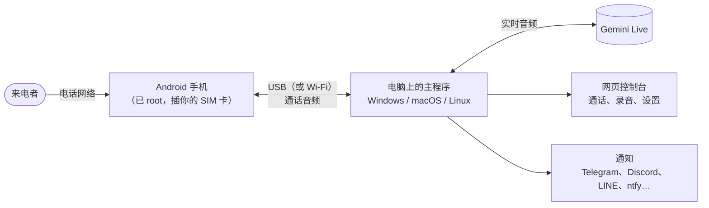

  

# Bageo

**让 AI 语音接听你真实的手机号码，专为 Google Pixel 手机开发。** 一部插着你 SIM 卡的备用 Android 手机负责接起来电；电脑上的一个小程序让 Gemini Live 的语音和对方通话、把通话录下来、写一段简短的摘要，再发给你（Telegram、Discord、LINE、ntfy 等）。

不需要 SIP 中继，不用租号码，也没有平台月费：用的是你自己的 SIM 卡、你自己的电脑和你自己的 API 密钥。

Bageo 取自“八哥”（bāgē）的拼音。八哥是一种会学主人说话的鸟。这一只住在你的电话线上，用你的方式替你接电话。旧版叫 Myna。

[English](README.md) · [繁體中文](README.zh-TW.md) · **简体中文**

## 功能

- **每个来电都接**：响一声就接，声音自然，几乎没有延迟（手机还在响的时候，AI 就已经准备好了）。
- **两种接听方式**：“AI 助理”（表明自己是 AI，帮你记下留言），或“本人”（按你平时的方式说话；有人认真问起时，仍会承认自己是 AI）。
- **真正的对话**：对方可以插话，停顿也能应对；对方说完了通话才结束，而不是到时间就挂。
- **推销和诈骗电话**：礼貌地拒绝；或者——如果你愿意——尽量陪他聊下去，浪费他的时间。
- **拦截号码**：这些号码打来只会听到一小段“无法接通”的语音，完全不会用到 AI。
- **每通电话结束后**：录音、完整的文字记录、四行摘要（谁打来的、什么事、AI 怎么回的、你需要做什么）；如果通话中约定了日期，还会附上日历建议（点一下就添加到 Google 日历，或下载 `.ics`）。
- **通知**：可以同时发到 Telegram、Discord、Slack / Mattermost、LINE、ntfy、Gotify、Bark、Pushover、WeCom、DingTalk、Feishu / Lark、ServerChan、Matrix、电子邮件（Gmail）、Apprise，或你自己的 webhook（n8n、Zapier、Home Assistant…），任意组合。
- **你的资料**：AI 可以用来回答的事实（快递放哪里、营业时间）；没写在里面的，它不可以自己编。
- **语言**：AI 会说英语、繁体中文（台湾）、简体中文、日语、韩语、西班牙语、法语、德语和葡萄牙语；网页控制台和手机应用也翻译成了同样这九种语言。
- **背景音**：垫在 AI 的声音后面（家里、办公室、街边…），听起来不会像在录音棚里。
- **所有东西都留在你的电脑上**：录音、文字记录和设置都保存在程序旁边的文件夹里。只有实时音频会发给 Gemini，文字记录会发给摘要模型，摘要会发给你配置的通知服务。

## 需要准备什么

| | |
|---|---|
| **一部备用的 Android 手机**，带 SIM 卡 | 已 root（Magisk 或 KernelSU）。**实测过：Pixel 7、7a、8、9。** 其他已 root 的手机也许能用——取决于手机的音频硬件层；风险自负。这部手机会变成一台专门接电话的机器（铃声和拨号应用都会被接管）。 |
| **一台电脑**，需要接电话的时段要一直开着 | Windows 10/11、macOS 或 Linux。一台迷你主机或旧笔记本就足够了。 |
| **一根 USB 线** | 手机通过 USB 和电脑通信（也可以用 Wi-Fi）。 |
| **一个 Google Gemini API 密钥** | 在 [Google AI Studio](https://aistudio.google.com/apikey) 获取。Live 音频由 Google 按用量计费；请查看他们当前的价格。 |

## 快速开始

1. **获取程序。** 从 [Releases](https://github.com/h4lo-void/bageo-call/releases) 页面下载适合你系统的安装包并解压——或者克隆这个仓库（这样需要安装 [Rust](https://rustup.rs)；启动脚本会自动构建）。
2. **启动。** Windows：双击 `start.cmd`。macOS：双击 `start.command`。Linux：`./start.sh`。如果没有 `adb`（Google 的 Android platform-tools），脚本会询问是否下载，然后打开网页控制台 <http://localhost:8787/>。以后用脚本放在桌面的“Bageo 控制台”快捷方式打开就行。控制台对局域网开放后，主程序能响应局域网名称时，手机和其他电脑可以用 <http://bageo.local:8787/> 打开；不行的话，请用“系统 → 关于”里的地址或二维码，也可以从那里把控制台添加到手机主屏幕。→ [设置参考](docs/zh-CN/SETTINGS.md#从其他设备使用控制台)
3. **填写基本设置**：在网页控制台里填上你的 Gemini API 密钥、你的名字、语言和接听身份（AI 助理或本人）。按 ▶ 试听各个声音，选一个。
4. **准备手机**（只需一次）：在 Magisk / KernelSU 里安装发行版附带的模块（`pixelcallai_uplink-<version>.zip`），重启，打开 **Bageo** 应用，把检查清单逐项完成。开启 USB 调试，把手机插到电脑上，并在“允许 USB 调试吗？”的弹窗里点允许。→ [手机设置](docs/zh-CN/PHONE.md)
5. **检查，然后打一通。** 网页控制台的“系统”页会显示手机“已连接主程序”。用另一部手机拨打这部手机的号码：响一声后 AI 接听，通话会连同录音和摘要出现在控制台里。
6. **添加通知**（“设置 → 通知”），按“发送测试”。

每一步的详细说明：[开始使用](docs/zh-CN/GETTING_STARTED.md)。

## 让它说话像你

内置的提示词开箱即用。想让 AI 按**你**的方式说话，也不必自己动手写提示词：

1. 打开“设置 → 提示词”，找到“不想自己写？”，按“**复制访谈提示词**”（也可以从 [`docs/prompts/`](docs/prompts/) 里取）。
2. 粘贴到 ChatGPT、Claude、Gemini 或其他任何聊天 AI 里。它会问你大约十个问题——你怎么说话、谁会给你打电话、哪些事绝对不能答应。
3. 把它写好的提示词粘贴到“自定义提示词”，把它给出的“资料”粘贴到“AI 可以回答的资料”。保存。下一通电话就会用上。

更多说明：[编写提示词](docs/zh-CN/PROMPTS.md)。

## 文档

| | |
|---|---|
| [开始使用](docs/zh-CN/GETTING_STARTED.md) | 在 Windows / macOS / Linux 上安装、第一通电话 |
| [手机设置](docs/zh-CN/PHONE.md) | Root 模块、应用检查清单、USB 与 Wi-Fi、还原 |
| [编写提示词](docs/zh-CN/PROMPTS.md) | 接听方式、访谈提示词、资料、示例 |
| [通知](docs/zh-CN/NOTIFICATIONS.md) | 每种服务怎么配置；webhook 的内容格式 |
| [设置参考](docs/zh-CN/SETTINGS.md) | 每一项设置和启动选项 |
| [故障排查与常见问题](docs/zh-CN/TROUBLESHOOTING.md) | 遇到问题的时候 |
| [隐私、安全与法律](docs/zh-CN/PRIVACY_AND_LEGAL.md) | 哪些东西会离开你的电脑；录音和披露 AI 身份的规定 |
| [API](docs/zh-CN/API.md) | 网页控制台的 REST 接口、手机通信协议 |
| [架构](docs/zh-CN/ARCHITECTURE.md) | 各个部分如何组合在一起 |
| [路线图](docs/zh-CN/ROADMAP.md) | 已经有的、还没有的、社区想要的 |
| [`android/`](android/README.md) | 构建手机应用和模块（英文） |
| [`tools/sms_forward/`](tools/sms_forward/README.md) | 可选：把手机收到的短信转发到你的通知（英文） |

## 项目现状——请务必阅读

这个项目原本是一个人自用的系统，运行了好几个月之后才开源。请注意哪些部分经过了实际验证，哪些还没有：

- **每天在真实通话中使用：** 繁体中文（台湾）、“本人”接听方式、Pixel 7 / 7a / 8 / 9、对推销／诈骗电话陪聊拖时间、拦截号码、录音与摘要、Telegram 通知。
- **开源版新增、尚未在真实通话中试过：** 其他所有语言、“AI 助理”接听方式、主程序在 macOS 和 Linux 上自行管理 USB、Telegram 以外的通知服务（它们的请求只按各服务文档记载的格式做过单元测试，没有用真实账号测过）、日历建议、手机应用 0.2 版的设置界面、Docker 镜像，以及 Releases 页面上的桌面版下载包。
- **手机应用 0.2.4 已经在接真实来电**：每天在用的 Pixel 7、7a、9（Android 16、KernelSU-Next）装的都是它，短信转发也正常。这几部是从前几版升级上来的，所以“从头设置一部新手机”还没有人做过。
- **AI 接听／普通手机（0.2.3 新增）**：在网页控制台的“系统”或手机应用里，可以把手机切回普通手机：来电会响，由你自己接；切回来就又由 AI 接听。切换由模块以 root 身份执行，**不用在 Magisk 或 KernelSU 里另外给 Bageo 应用 root 权限**。在 Pixel 7a 上实测过：普通模式下真实来电会响、接得起来，重启后模式不变，切回后 AI 照常接听。
- **行程预约（0.2.4 新增，默认关闭）**：来电者想约时间时，AI 会说确认一下再用短信或电话回复；你在网页控制台的“待处理事项”选好怎么告诉对方（发短信、AI 回拨或不通知），再按同意或不同意（设置了 Telegram Bot 的话，卡片上也能按），同意的一键添加到你选的日历。主程序不连接任何日历账号。用模拟来电者在九种语言测过。发短信回复来电者：手机会把短信交给电信网络，但我们的两张测试 SIM 都被运营商退回，所以还没看过真正送达；AI 回拨还没用真实电话试过。
- **手机模块用项目自己的固定密钥签名**，之后的发布版可以直接覆盖安装。如果你装过最早那份 v0.2.0 下载包（当时用临时密钥签名），也可以直接把现在这份装上去：在我们的手机上，Android 接受了新密钥并保留了应用的数据。

非常欢迎反馈问题，请附上主程序的日志，并说明你原本预期的结果。详见 [CONTRIBUTING.md](CONTRIBUTING.md)（英文）。

## 请负责任地使用

- **各地法律不同。** 通话录音，以及让 AI 在不告知对方的情况下与人通话，在很多地方都受到限制。默认的接听方式会表明自己是 AI。请先弄清楚你和来电者所在地适用哪些规定。
- **AI 不做任何承诺。** 它被要求绝不答应付款、合同、密码或约定时间——但它毕竟是 AI：摘要一定要看。
- **紧急电话和任何要紧的事**，都不应该依赖这套系统。
- **给手机 root** 会使保修失效，也可能出问题。请用备用手机。

详见[隐私、安全与法律](docs/zh-CN/PRIVACY_AND_LEGAL.md)。

## 许可证

[MIT](LICENSE)。附带的音效为 CC0；有一个安装脚本采用 GPL-3.0——详见 [NOTICE.md](NOTICE.md)（英文）。本项目与 Google 没有关联；Pixel 是 Google LLC 的商标。
