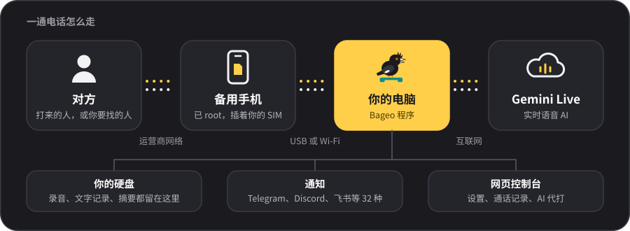

  

  <a href="README.md">English</a> · <a href="README.zh-TW.md">繁體中文</a> · <strong>简体中文</strong> · <a href="README.ja.md">日本語</a> · <a href="README.ko.md">한국어</a> · <a href="README.es.md">Español</a> · <a href="README.fr.md">Français</a> · <a href="README.de.md">Deutsch</a> · <a href="README.pt.md">Português</a>

  <strong>AI 接电话、替你打电话的 AI 电话助理（Gemini Live＋你自己的手机号）</strong> 
  自托管、开源。一部插着你 SIM 卡、已 root 的备用 Android 手机，电脑上的一个程序，再加上你自己的 Gemini 密钥。

  
  
  
  

<table>
  <tr>
    <td width="25%" align="center" valign="top">
       
      <strong>接电话</strong> 
      响一声就接，说话像真人，等对方说再见才挂。
    </td>
    <td width="25%" align="center" valign="top">
       
      <strong>拦诈骗</strong> 
      认出推销和诈骗电话，装成问题特别多的客户，最长缠住对方 30 分钟。
    </td>
    <td width="25%" align="center" valign="top">
       
      <strong>代打电话</strong> 
      写一句话交代，它就替你打；拿不准会先问你。
    </td>
    <td width="25%" align="center" valign="top">
       
      <strong>会说九种语言</strong> 
      简中、繁中、英、日、韩、西、法、德、葡语都行；对方换语言，它就跟着换。
    </td>
  </tr>
</table>

名字取自八哥（bāgē）：一种会学身边的人说话的鸟。

## 玩玩看：猜猜八哥怎么回

点开一通电话，再一句一句点下去。 演示对话，不是真实通话录音。

<strong>包裹来电</strong>　包裹到了，但你正忙。

 

> <strong>对方</strong>：你的包裹到了。

八哥怎么回？

 

> <strong>八哥</strong>：你好，我是 AI 助理，帮忙接电话。包裹需要本人签收吗？
>
> <strong>对方</strong>：需要，今天下午五点前都能再配送。

然后呢？

 

> <strong>八哥</strong>：我会转告，请本人再跟你确认时间。

<strong>你收到的重点：</strong> 包裹需本人签收，下午五点前可再配送；等你确认时间。

<strong>推销电话</strong>　“有个超优惠方案”打来了。

 

> <strong>对方</strong>：有一笔低息贷款，今天就能办！

八哥会挂掉吗？

 

> <strong>八哥</strong>：利息是月息还是年息？
>
> <strong>对方</strong>：先提供你的身份信息。

八哥会给吗？

 

> <strong>八哥</strong>：先说说手续费怎么算？每个月要付多少？

<strong>你收到的重点：</strong> 一项个人信息都没给，问题倒是越问越多。这样最长可以缠住对方 30 分钟。

<strong>代打订位</strong>　交代一句，少打一通。

 

> <strong>你交代</strong>：帮我订明晚四位，七点或七点半都可以。

八哥怎么开口？

 

> <strong>八哥</strong>：你好，我是 AI 助理，想订明晚七点四位。
>
> <strong>餐厅</strong>：七点满了，七点半可以。

八哥会答应吗？

 

> <strong>八哥</strong>：七点半也可以，麻烦订四位，谢谢。
>
> <strong>餐厅</strong>：好的，明晚七点半四位。

<strong>你收到的重点：</strong> 明晚 19:30、四位，在你交代的范围内。超出范围的事，它会先问你。

## 诈骗电话打来？八哥陪他慢慢聊

  

AI 一确定对方是推销或诈骗，就变成一个有兴趣、反应慢、爱问细节的客户：一直问、故意把数字听错，最长缠住对方 30 分钟，一项真实信息都不给。你会收到录音、文字记录和一段摘要。正常电话不会被误伤：银行核对刷卡、诊所、快递、家人。陪聊模式默认开启，一个开关就能关掉。[三道防线怎么判断](docs/zh-CN/FEATURES.md#拦截骚扰与诈骗电话加上陪聊模式)

## 懒得打电话？写一句话就行

  

订位、改期、问店家有没有货或几点开门，都可以交代。对方提到你没交代的事，AI 会先在屏幕上问你；它绝不自己答应任何事：你来不及回，它就说会跟你确认，然后客气收尾。[AI 代打的完整说明](docs/zh-CN/FEATURES.md#ai-代打替你打电话)

## 外国人打来？八哥会说九种语言

  

AI 的语音、内置提示词（简短通用的基本写法，可按自己的情况与风格自定义）、网页控制台、手机应用和通知，九种语言都有。双卡手机每张 SIM 卡可以各设主要语言；国外号码打来，就用那个国家的语言开场；对方中途改说别的语言，AI 也跟着换。文字记录保留原文，每句附上翻译成你通知语言的对照。[语言与双卡的完整说明](docs/zh-CN/FEATURES.md#九种语言双卡文字记录附翻译)

## 工作原理

  

手机只负责接通电话，其他事都在你自己的电脑上处理。手机还在响，AI 就已经连上，所以接起后约 **0.43 秒**开口（实测中位数）。一通电话的完整过程：[架构](docs/zh-CN/ARCHITECTURE.md)。

## 为什么选 Bageo

| | 架在 SIP 线路或虚拟号码上的 AI 电话服务 | Bageo |
|---|---|---|
| **号码** | 服务商提供的号码，或把你的来电转移过去 | 你原来的手机号，AI 拨出时显示的也是它 |
| **费用** | 月费或按分钟计费 | 没有平台月费，只付 Gemini 用量和运营商的号码费用 |
| **数据** | 存在服务商的服务器上 | 你硬盘上 `data/` 文件夹里的普通文件 |
| **代价** | 注册账号就能用 | 要一部已 root 的备用 Android 手机，和一台一直开着的电脑 |

## 还能做这些

<table>
  <tr>
    <td width="33%" align="center" valign="top">
       
      <strong>预约等你点头</strong> 
      开启日程预约后，对方想约时间会先进待处理事项，等你决定，AI 再发短信或回拨通知对方。
    </td>
    <td width="33%" align="center" valign="top">
       
      <strong>认得谁打来</strong> 
      通讯录可以从 vCard、Excel、PDF、名片照片导入。每个人可以分成普通联系人、白名单、黑名单或陪聊名单。
    </td>
    <td width="33%" align="center" valign="top">
       
      <strong>一键切回普通手机</strong> 
      备用机随时可以切回普通手机自己接，再切回 AI 接听。
    </td>
  </tr>
  <tr>
    <td width="33%" align="center" valign="top">
       
      <strong>听起来像真的在打电话</strong> 
      可以垫背景音：居家、办公室、街边、夜市等 12 种。
    </td>
    <td width="33%" align="center" valign="top">
       
      <strong>32 种通知渠道</strong> 
      每通电话结束，摘要会发到 Telegram、飞书、企业微信、钉钉等渠道。可以直接在通知里点按钮处理，也能在聊天室下指令。
    </td>
    <td width="33%" align="center" valign="top">
       
      <strong>数据留在自己手里</strong> 
      录音和文字记录都是你硬盘上的普通文件，不用在我们这里注册账号。
    </td>
  </tr>
</table>

每一项的完整说明：[功能总览](docs/zh-CN/FEATURES.md)。

## 需要准备什么

1. **一部备用 Android 手机**，插着你的 SIM 卡，用 Magisk 或 KernelSU root，Android 10 及以上。实测过 Google Pixel 7、7a、8、9。
2. **一台电脑**，需要接电话的时段开着：Windows 10/11、macOS、Linux 或 Docker。
3. **一根 USB 线**（也可以用 Wi-Fi）。
4. **一个 Gemini API 密钥**，在 [Google AI Studio](https://aistudio.google.com/apikey) 获取，Google 按用量计费。

## 快速开始

手机已经 root 好的话，从下载到 AI 接起第一通电话，大约 3 分钟。

1. **下载**：从 [Releases](https://github.com/h4lo-void/bageo-call/releases) 下载适合你系统的文件：Windows 用 `bageo-call-<version>-windows-x64-setup.exe`，macOS 用 `bageo-call-<version>-macos-arm64.dmg`（Apple 芯片）或 `bageo-call-<version>-macos-x64.dmg`（Intel），Linux 用 `bageo-call-<version>-linux-x64.tar.gz`。使用 Docker 也可直接拉取现成镜像 `bageo/bageo-call` 或 `ghcr.io/h4lo-void/bageo-call`。使用 Docker 时，手机用控制台生成的配对码、按 IP 地址连接，见[手机设置 → Wi-Fi](docs/zh-CN/PHONE.md#wi-fi)。
2. **安装并启动**：Windows 双击 `setup.exe` 安装，再点桌面上的“Bageo”快捷方式。macOS 打开 `.dmg`，把 Bageo 拖进“应用程序”，再点一下它。Linux 解压后运行 `./start.sh`。控制台会在 <http://localhost:8787/> 打开；设好控制台密码后，这台电脑和同一 Wi-Fi 下的设备也可以用 <http://bageo.local/> 打开。
3. **填写基本设置**：在“**设置**”里填上 Gemini API 密钥、你的名字和语言，按 ▶ 试听各个声音，选一个。
4. **准备手机**（只需一次）：在 Magisk 或 KernelSU 里安装模块 `bageo-phone-module-<version>.zip`，重启，打开 **Bageo** 应用把检查清单做完，插上 USB。
5. **打一通试试**：用另一部手机拨打它的号码，响一声，AI 就接了。

卡住了？每一步的详细说明：[开始使用](docs/zh-CN/GETTING_STARTED.md) · [手机设置](docs/zh-CN/PHONE.md)。

## 文档

| | |
|---|---|
| **上手** | [开始使用](docs/zh-CN/GETTING_STARTED.md) · [手机设置](docs/zh-CN/PHONE.md) · [故障排查与常见问题](docs/zh-CN/TROUBLESHOOTING.md) |
| **使用** | [功能总览](docs/zh-CN/FEATURES.md) · [聊天室指令与通知交互](docs/zh-CN/CHAT_COMMANDS.md) · [编写提示词](docs/zh-CN/PROMPTS.md) · [设置参考](docs/zh-CN/SETTINGS.md) · [通知](docs/zh-CN/NOTIFICATIONS.md) |
| **深入** | [架构](docs/zh-CN/ARCHITECTURE.md) · [API](docs/zh-CN/API.md) · [MCP](docs/zh-CN/MCP.md) · [路线图](docs/zh-CN/ROADMAP.md) · [更新日志](CHANGELOG.md) · [`android/`（英文）](android/README.md) · [`tools/sms_forward/`（英文）](tools/sms_forward/README.md) |
| **法律** | [隐私、安全与法律](docs/zh-CN/PRIVACY_AND_LEGAL.md) · [法律免责声明与使用限制](LEGAL.md) · [双重授权与商业授权](COMMERCIAL_LICENSE.md) · [全项目技术与安全审计报告](AUDIT_REPORT.md) |

**测试状态**：超过 1,400 个自动化测试、234 通模拟通话（28 种语言），并在 Pixel 7、7a、9 上实机测过。[详细状态](docs/zh-CN/FEATURES.md#测试状态)。其他手机和语言的使用反馈最有帮助，请见 [CONTRIBUTING.md](CONTRIBUTING.md)（英文）。

## 常见问题

<strong>AI 可以用我原来的手机号接电话吗？</strong>

可以，这正是 Bageo 的用途。把 SIM 卡放进一部已 root 的备用 Android 手机，AI 就用你的号码接电话，也从这个号码拨出。想让 SIM 卡留在主力手机里，也可以把未接来电转移到备用机的号码：你的手机先响，没接的才交给 AI（这时 AI 代打和回拨显示的是备用机的号码）。

<strong>一定要 root 吗？iPhone 能用吗？</strong>

必须 root，iPhone 不行。Android 只允许有特权的系统应用录下通话并把声音播进通话，所以手机需要 Magisk 或 KernelSU 才能安装 Bageo 模块；iOS 完全不允许。

<strong>支持哪些手机？</strong>

实测过 Google Pixel 7、7a、8、9，需要 Android 10 及以上。其他已 root 的手机，要它的音频硬件层允许应用录下通话并把声音播进通话才能用；不允许的话，电话会接起来，但有一方听不到声音。见[支持哪些手机](docs/zh-CN/PHONE.md#支持哪些手机)。

<strong>要花多少钱？</strong>

个人与开源社区免费使用（`AGPL-3.0-only`；如需闭源商用或商业托管请[取得商业授权](COMMERCIAL_LICENSE.md)）。AI 处理的每通电话（不论来电还是拨出），Google 都会按用量收取 Gemini Live 的语音费用；摘要只是发给 Gemini 最便宜模型的一小段文字。试听声音和拒接语音都是预录的，不花钱。另外就是运营商的号码费用和电脑的电费；想设上限，可以在 Google 账号里设置预算。

<strong>让 AI 接电话合法吗？</strong>

要看你和通话对象在哪里。通话录音、披露 AI 身份、自动拨出的电话，各有各的规定。“AI 助理”身份第一句话就会表明是 AI；“本人”身份则直接以你的身份说话、不会表明是 AI。开始使用前，请先读[隐私、安全与法律](docs/zh-CN/PRIVACY_AND_LEGAL.md)。

<strong>能离线、不用 Google 吗？</strong>

不能。实时语音用的是 Gemini Live，需要网络和 Gemini 密钥。摘要可以通过 Ollama 使用本地模型（见[摘要与日历](docs/zh-CN/SETTINGS.md#摘要与日历)）；完全本地的语音流程不在支持的配置里（见[路线图](docs/zh-CN/ROADMAP.md)）。

## 请负责任地使用

- **各地法律不同。** 通话录音，以及让 AI 在不告知对方的情况下与人通话，在很多地方都受到限制。“AI 助理”接听身份一开口就表明是 AI；以助理身份代打时，AI 会自称是你的助理；选“本人”时则直接以你的身份说话、不主动或被问时表明是 AI。请先弄清楚你和通话对象所在地的规定。
- **AI 不做任何承诺。** 它绝不答应付款、定金、合同、密码或验证码，预约也要等你决定。但它毕竟是 AI：摘要和代打结果一定要看。
- **紧急情况不要依赖它。** AI 代打绝不会拨打紧急电话。
- **Root 会使保修失效，也可能出问题。** 请用备用手机。

## 许可证与法律责任声明

本项目采用<strong>双重授权（Dual Licensing）</strong>模式发布（版权所有 © 2026 **h4lo-void**，见 [LICENSING.md](LICENSING.md)）：

- **社区开源授权：** [GNU Affero 通用公共许可证第 3.0 版（仅限 `AGPL-3.0-only`）](LICENSE) 及 [LICENSING.md](LICENSING.md) 所列第 7 条附加条款——个人与开源社区免费使用；任何修改版本只要允许他人通过网络或电话线路交互，即须按第 13 条免费公开完整衍生源代码。
- **取得商业授权：** 若企业、电信／云总机运营商、呼叫中心或硬件厂商不愿按 `AGPL-3.0-only` 开源，可向原作者洽购书面商业授权，详见 [**双重授权与商业授权条款（COMMERCIAL_LICENSE.md）**](COMMERCIAL_LICENSE.md)。

**免责声明与使用须知：** 本项目为自托管软件，按“现状（AS IS）”提供且不附任何担保；作者不运维任何服务，软件也不会把数据传回给作者。部署者须自行负责遵守当地通话录音、AI 披露与自动拨号相关法律，并自负手机 Root 与资费账单风险。使用前请详阅 [**法律免责声明与使用须知（LEGAL.md）**](LEGAL.md)、[隐私、安全与法律](docs/zh-CN/PRIVACY_AND_LEGAL.md) 及 [v1.0 AI 辅助内部审查笔记](AUDIT_REPORT.md)（`gemini-4-carbon`，非第三方审计）。第三方声明（含 OpenCC `Apache-2.0` 字典）见 [NOTICE.md](NOTICE.md)。本项目与 Google LLC 无关；Pixel、Android 与 Gemini 是 Google LLC 的商标。

<!-- SPDX-FileCopyrightText: h4lo-void <https://github.com/h4lo-void/bageo-call> -->
