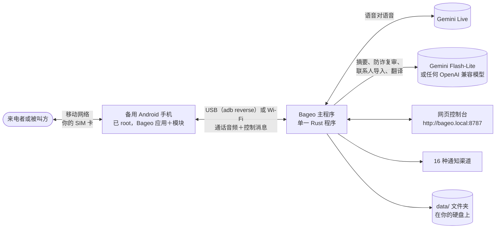

  

<h1 align="center">Bageo（八哥）</h1>

  <strong>AI 接电话、替你打电话的 AI 电话助理（Gemini Live＋你自己的手机号）</strong> 
  自托管、开源。一部插着你 SIM 卡、已 root 的备用 Android 手机，电脑上的一个程序，再加上你自己的 Gemini 密钥。

  
  
  
  
  
  
  

  <a href="README.md">English</a> · <a href="README.zh-TW.md">繁體中文</a> · <strong>简体中文</strong>

Bageo（八哥）让 AI 用**你原来的手机号**接电话，也替你打电话。插着你 SIM 卡的备用 Android 手机（已 root）负责接通，电脑上的程序把每通电话实时发给 Gemini Live 再传回来：对方听到的是响一声就接、可以插话、会筛掉骚扰和诈骗电话、等对方说再见才挂的自然声音。和架在 SIP 线路或虚拟号码上的 AI 电话服务不同，你不用换号、不用付平台月费，每一段录音都留在你自己的硬盘上。

名字取自八哥（bāgē）：一种会学身边的人说话的鸟。

## 实际通话听起来是这样

**一通贷款推销电话。** 接听身份是“本人”，“陪他聊、拖时间”开着（默认）。

> **对方：** 您好，这里是旭日金融，您有一笔低息信用贷款额度已经批下来了。
>
> **AI：** 哦？贷款啊？那利息怎么算，按月还是按年？
>
> **对方：** 按年，才 2.8%。我先跟您核对一下身份证号就能办。
>
> **AI：** 诶，2.8% 是整笔算的吗？那我要是提前还，要不要另外交钱？

AI 会一直问、故意把数字听错、聊着聊着就跑题，就是不给任何一项信息，直到对方放弃或满 30 分钟。你会收到录音、文字记录和一段简短摘要。

**一次 AI 代打。** 你在“AI 代打”页面写下：“订明天晚上 7 点 4 位，7 点半也行。”

> **AI：** 您好，我是小明的助理，想订明天晚上 7 点 4 位。
>
> **餐厅：** 不好意思，7 点满了，7 点半可以吗？
>
> **AI：** 7 点半可以，订位名字是小明。

结果标为“**办好了**”：明天晚上 7 点半、4 位，附一个添加到日历的按钮。如果餐厅只给 8 点半，AI 会先在控制台问你。

## 为什么选 Bageo

| | 架在 SIP 线路或虚拟号码上的 AI 电话服务 | Bageo |
|---|---|---|
| **电话号码** | 服务商提供的号码，或把你的来电转移过去 | 你原来的手机号，插在你自己的手机里；AI 拨出时显示的也是它 |
| **费用** | 通常是月费或按分钟计费 | 没有平台月费：只付 Google 的 Gemini 用量（用你自己的 API 密钥）和运营商的号码费用 |
| **你的数据** | 录音和文字记录存在服务商的服务器上 | 程序旁边 `data/` 文件夹里的普通文件；不需要数据库，也没有我们的账号 |
| **要准备什么** | 一个账号 | 一部已 root 的备用 Android 手机，和一台一直开着的电脑 |

它也又快又轻。手机还在响，AI 就已经连上，接起后约 **0.43 秒**开口（实测中位数）。主程序是单一 Rust 程序，可以运行在 Windows 10/11、macOS（Apple Silicon 与 Intel）、Linux 或 Docker 上，一台迷你主机或旧笔记本就足够了。

## 工作原理

手机只负责移动网络，其他事都由主程序处理。手机还在响的时候，主程序就建好 Gemini Live 连接、准备好第一句话，所以电话一接通 AI 就开口。AI 代打和 AI 回拨走同一条路往外拨。一通来电与一通拨出的完整过程：[架构](docs/zh-CN/ARCHITECTURE.md)。

## 功能

### 像真人一样接你的电话

- **响一声，再说“喂？”** 手机默认响 3 秒（最长 8 秒），主程序利用这段时间把开场白准备好（**响铃预热**）。
- **两种接听身份。** “AI 助理”（默认）会说明自己是替你接电话的 AI，帮你记下留言；“本人”按你平时的方式说话，有人认真问起时仍会承认自己是 AI。
- **自然的一来一往。** 每通电话开头，主程序会检查手机收音里有没有 AI 自己的声音；没有的手机（测试中是 Pixel 9）可以让对方插话：对方说满约 0.8 秒 AI 就停，“嗯”“好”这种短回应不会打断。线路安静时会问“还在吗？”。对方自己最后一句是道别，AI 才挂断；普通电话到了“普通电话最长”（默认 5 分钟）会礼貌收尾。
- **听起来就像在打电话。** AI 声音后面可以垫背景音，12 种、三档音量：家里、办公室、街边、医院、救护车经过、台风天、雷雨、工地、地铁、夜市、鞭炮、开车中。
- **30 种声音 × 9 种语言，试听免费。** 程序内置 1,080 个预录音频（IMA ADPCM，只有普通 WAV 的四分之一大小），试听声音和“无法接通”语音都不消耗 API 额度。
- **只说你写下来的事。** “AI 可以回答的资料”放快递放哪里、上班时间这类事实；“状态留言”写一行眼下的情况（“今天下午在等送货”）。没写在里面的事，AI 不可以自己编。
- **拦截号码与未显示号码。** 拦截列表里的号码会在响铃时直接拒接，或播一小段语音再挂，完全碰不到 AI。未显示号码默认照常交给 AI；关掉“未显示号码也接听”，就改为播语音后挂断。

### AI 代打：替你打电话

在“**AI 代打**”页面，或联系人旁边点“**请 AI 打**”，选好打给谁、写下要办的事：订位、改期、跟朋友约时间、问商家有没有货或几点开门。再选“**以你的助理身份打**”（默认）或“**以你本人身份打**”。

- **实时字幕**：通话中实时显示双方说的话。
- **拿不准先问你。** 对方提到你没交代清楚的事，AI 会请对方稍等，然后调用 `ask_owner`：你的屏幕上会弹出一张带 AI 选项、40 秒倒计时的提问卡，点选项或打字回答都行。通话中也能随时打字交代 AI（`say`）。
- **绝不背着你答应。** 你不在线或时间到了没回答，AI 不会自己挑任何一个选项；它会问清楚对方哪些时间或选择可以、说会跟你确认，然后礼貌收尾。结果标为“**要你决定**”：挑一个选项或写回复，点“**回复后请 AI 再打**”，AI 会带着上一通的内容再打一次（`follow_up_of`）。
- **结果清楚，只发一条通知。** “办好了”“办好一部分”“没办成”“要你决定”“没接”“语音信箱”或“失败”，附细节、对方给的选项和谈定的时间，可以直接添加到日历。
- **安全拨号。** 紧急电话、短号码、高额付费电话，以及写在国际冠码后面的号码一律拒拨。主程序会从来电中学到每部手机插着哪个国家的 SIM 卡（`phone_sims.json`），只用和号码同一国家的 SIM 卡拨出；拨号瞬间手机报告的 SIM 卡不对，就在接通前挂断（`wrong_sim`），代打绝不会不小心变成国际电话。
- **合理的上限。** 同一个号码一次只打一通；每通最长 10 分钟，9 分 30 秒开始收尾；不会自动重拨（要不要“**再打一次**”由你决定）；遇到语音菜单最多等 90 秒；运营商“空号”录音一听到就挂。

### 拦截骚扰与诈骗电话，加上陪聊模式

三道防线做来电筛选，判断对方是不是推销或诈骗：

1. **回复你的事直接放行。** 对方是回复**你**主动提出的事（投诉、报修、业务办理、理赔），不管用了什么字眼都放行。
2. **多语言加权关键词。** 保险、贷款与提额、软性电销，以及新型诈骗手法（ATM 操作、扣款设置错误、充值卡、“加我 LINE”）。
3. **再看一次语义。** 关键词分数过线时，`gemini-flash-lite` 会阅读目前为止的对话，并参考对方是不是你通讯录里的联系人；这段时间 AI 照常说话（最多 1.5 秒）。对方只报了单位名称、还没说要做什么，会判为 `too_early`，等他下一句说完再看一次。

正常电话不会被误伤：银行核对刷卡、医院诊所、货到付款的快递、家人谈钱。银行问某笔刷卡是不是你刷的，AI 不替你承认也不否认，不答应停卡或挂失，只记下金额、商户和时间，摘要会提醒你自己拨打卡片背面的电话确认。

确认是推销或诈骗，就切换成**陪聊模式**（Stall Mode，设置“陪他聊、拖时间”，默认开启）：AI 化身一个有兴趣、反应慢、爱问细节、又总出状况的客户，最长缠住对方 30 分钟（“这类电话最长”），绝不透露任何真实信息，也绝不答应付款。关掉的话，AI 会礼貌拒绝并结束通话。

### 日程预约变成待处理事项

来电的人想约时间时（“日程预约”，默认关闭），AI 不会当场答应，而是根据这个号码能收到什么，说会确认后再发短信或回拨。通话结束后，这条请求会出现在控制台的“**待处理事项**”里（用 `TELEGRAM_BOT_TOKEN` 指定 Telegram Bot 时，也会变成一张带按钮的 Telegram 卡片）：谁、什么事、什么时间，“**同意**”或“**不同意**”，以及怎么让对方知道你的答复：

- **发短信**：从接这通电话的 SIM 卡发出，内容只有时间，绝不夹带对方说的话。
- **AI 回拨**：AI 等过回铃音，直到对方接起并开口，用原来那通电话的语言把你的答复说一次，道别后挂断。
- **不通知对方**。

同意的预约一键就能添加到 **Google 日历、Outlook.com、Microsoft 365、Apple 日历（.ics）、Yahoo 日历，或直接下载 .ics**。主程序不需要你的日历账号或令牌。

### 几乎什么文件都能导入的通讯录

通讯录里的人打来，通话记录、摘要和通知都会显示名字；AI 知道是谁打来的，也能看到你写的备注；保存的联系人在防诈复审中也受到保护。可以从这些格式导入：

- vCard 2.1／3.0／4.0、Google 与 Outlook 的 CSV、TSV 和纯文本，在你的电脑上解析，自动识别编码（UTF-8、UTF-16、Big5、GBK、Shift_JIS、EUC-KR、Windows-1252）；
- Excel `.xlsx` 和 Word `.docx` 里的表格，同样在本机解析；
- PDF、名片照片、通讯录截图，交给 Gemini Flash-Lite 识别。

保存前每一条都会先给你看；重复的可以合并或跳过，整个通讯录也能导出为 vCard。

### 九种语言、双卡、文字记录附翻译

- **九种语言**覆盖 AI 的语音、内置提示词、网页控制台、手机应用和通知：English、繁體中文（台湾）、简体中文、日本語、한국어、Español、Français、Deutsch、Português。
- **每张 SIM 卡各有主要语言。** 双卡手机打进哪张卡，就用那张卡的语言开场；国外号码打来，AI 会说那国语言就用那国语言。台湾 SIM 卡接到境外来电时，AI 会等运营商的国际来电防诈提示音播完才开口。
- **跟着对方换语言**：对方改说别的语言、或问 AI 会不会说某种语言，通话中就切换过去。
- **文字记录保留原文**：用其他语言说的句子保持原样，每句下面附上翻译成你通知语言的对照。
- **其他人怎么叫你**（`owner_aliases`）：英文名、昵称；对方找这些名字时，AI 知道是在找你。

### 一键切换“AI 接听 ↔ 普通手机”

在控制台“**系统**”页或 Bageo 应用里，随时把备用机切回普通手机、再切回来。普通手机模式下，Google 电话恢复为拨号应用、勿扰模式关闭、音量还原，来电正常响铃、由你自己接；重启后模式不变。切换由 Magisk／KernelSU 模块的 root 小程序执行，所以 Bageo 应用本身完全不需要 root 权限。详见[普通手机模式](docs/zh-CN/PHONE.md#普通手机模式)。

### 16 种通知渠道，数据存在自己的硬盘

Telegram（预约卡片带“同意／不同意”按钮）、Discord、Slack／Mattermost、LINE Messaging API、ntfy、Gotify、Bark、Pushover、企业微信、钉钉（支持加签）、飞书／Lark、Server酱、Matrix、Gmail、Apprise，以及给 n8n、Zapier、Home Assistant 用的 JSON Webhook。可以任意组合，每条消息都会发到所有渠道。可选的[短信转发器](tools/sms_forward/README.md)会把手机收到的短信也转到同样的渠道。

会离开你电脑的有：实时通话音频发给 Gemini，文字记录发给摘要模型（默认是同一个密钥的 Gemini Flash-Lite，也可以换成任何 OpenAI 兼容服务，包括本机的 Ollama），摘要发给你配置的通知渠道。详见[隐私、安全与法律](docs/zh-CN/PRIVACY_AND_LEGAL.md)。

## 需要准备什么

| | |
|---|---|
| **一部备用 Android 手机**，带 SIM 卡 | 用 Magisk 或 KernelSU root，Android 10 及以上。**实测过：Google Pixel 7、7a、8、9。** 其他已 root 的手机也许能用，取决于它的音频硬件层是否允许应用录下通话并把声音播进通话。这部手机会变成专门接电话的设备。 |
| **一台电脑**，需要接电话的时段要一直开着 | Windows 10/11、macOS（Apple Silicon 或 Intel）或 Linux；也可以用 Docker。不需要数据库，也不需要其他服务。 |
| **一根 USB 线** | 手机通过 USB 和主程序连接（`adb reverse`，由主程序自动配置）。也可以用 Wi-Fi。 |
| **一个 Gemini API 密钥** | 在 [Google AI Studio](https://aistudio.google.com/apikey) 获取。同一个密钥覆盖实时通话、摘要、防诈复审和联系人导入。Google 按用量计费；想设上限，可以在 Google 账号里设置预算。 |

## 快速开始

1. **下载**：从 [Releases](https://github.com/h4lo-void/bageo-call/releases) 下载适合你系统的安装包并解压；或克隆这个仓库（启动脚本会用 [Rust](https://rustup.rs) 自动构建）。
2. **启动**：Windows 双击 `start.cmd`，macOS 双击 `start.command`，Linux 运行 `./start.sh`。没有 `adb` 的话，脚本会询问是否下载，然后打开控制台 <http://localhost:8787/>。同一网络里的其他设备可以用 <http://bageo.local:8787/>，或扫“**系统 → 关于**”里的二维码打开。
3. **填写基本设置**：在“**设置**”里填上 Gemini API 密钥、你的名字和其他人怎么叫你、语言、接听身份。按 ▶ 试听各个声音，选一个。
4. **准备手机**（只需一次）：在 Magisk 或 KernelSU 里安装发布版附带的模块 `pixelcallai_uplink-<version>.zip`，重启，打开 **Bageo** 应用把检查清单做完。开启 USB 调试、插到电脑上，在“允许 USB 调试吗？”里点允许。见[手机设置](docs/zh-CN/PHONE.md)。
5. **打一通试试**：“**系统**”页显示手机已连接后，用另一部手机拨打它的号码：响一声、AI 接听，通话连同录音和摘要出现在控制台里。再添加一个通知渠道，按“**发送测试**”。

**试试看：** 第一通来电结束后（主程序也因此知道手机插着哪张 SIM 卡），打开“**AI 代打**”，输入你自己的手机号，请 AI 订位。你来扮演餐厅，故意给一个它没被授权的时间，看提问卡弹出来。

每一步的详细说明（含 Docker 与开机自启）：[开始使用](docs/zh-CN/GETTING_STARTED.md)。

## 让它说话像你

内置提示词开箱即用。想让 AI 按**你**的方式说话，让另一个 AI 采访你就行：

1. 打开“**设置 → 提示词**”，找到“不想自己写？”，选好语言后按“**复制访谈提示词**”（九种语言的原文也放在 [`docs/prompts/`](docs/prompts/)）。
2. 粘贴到 ChatGPT、Claude、Gemini 或任何聊天 AI 里。它会一题一题问你大约十个问题：你怎么说话、你真的会说的话和绝对不会用的词、谁会给你打电话、哪些事绝不能答应、推销电话怎么处理。
3. 它会生成一份用你自己说话方式写的提示词、你的资料，以及接听身份和推销设置该怎么选。粘贴、保存，下一通电话就会用上。

更多说明，包括最有效的写法：[编写提示词](docs/zh-CN/PROMPTS.md)。

## 文档

| | |
|---|---|
| [开始使用](docs/zh-CN/GETTING_STARTED.md) | 在 Windows／macOS／Linux／Docker 上安装、第一通电话、第一次 AI 代打 |
| [手机设置](docs/zh-CN/PHONE.md) | Root 模块、应用检查清单、USB 与 Wi-Fi、普通手机模式、还原 |
| [编写提示词](docs/zh-CN/PROMPTS.md) | AI 每通电话收到什么、访谈提示词、资料、写法技巧、固定底线 |
| [通知](docs/zh-CN/NOTIFICATIONS.md) | 16 种渠道各自怎么配置；webhook 内容格式 |
| [设置参考](docs/zh-CN/SETTINGS.md) | 每一项设置和启动选项 |
| [故障排查与常见问题](docs/zh-CN/TROUBLESHOOTING.md) | 遇到问题的时候 |
| [隐私、安全与法律](docs/zh-CN/PRIVACY_AND_LEGAL.md) | 哪些东西会离开你的电脑；录音和披露 AI 身份的规定 |
| [API](docs/zh-CN/API.md) | REST 接口（通话、联系人、待处理事项、AI 代打）、手机通信协议 |
| [架构](docs/zh-CN/ARCHITECTURE.md) | 模块、一通来电与一通拨出的完整过程、数据存放 |
| [路线图](docs/zh-CN/ROADMAP.md) | 已经有的、还没有的、接下来要做的 |
| [v1.0 发布说明](CHANGELOG.md) | 1.0 正式版完整功能亮点 |
| [法律免责声明与使用限制](LEGAL.md) | 部署者独立责任、严禁违法用途、风险自负与抗辩赔偿条款 |
| [双重授权与商业授权](COMMERCIAL_LICENSE.md) | 免费 `AGPL-3.0-only` 社区授权与闭源商业授权洽询 |
| [全项目技术与安全审计报告](AUDIT_REPORT.md) | 由 `gemini-4-carbon` 模型实际具名签署的完整项目审计报告 |
| [`android/`](android/README.md) | 构建手机应用和模块（英文） |
| [`tools/sms_forward/`](tools/sms_forward/README.md) | 可选：把手机收到的短信转发到你的通知（英文） |

## 测试状态

| | |
|---|---|
| **自动化测试** | 每次改动都会在 CI 中运行超过 520 个单元与集成测试。 |
| **模拟通话** | 对真实主程序跑了 234 通模拟通话，由 Gemini 扮演说 28 种语言的来电者，另有 15 种 AI 代打场景，全部通过。 |
| **实机通话（1.0）** | Pixel 7、7a、9：接听、打断、背景音、推销与诈骗陪聊、拦截号码、预约短信、AI 回拨、普通手机模式。 |
| **还需要实测反馈** | AI 代打实际拨出、AI 回拨遇到真实回铃音、Telegram 以外的通知渠道用真实账号、其他语言、“AI 助理”身份、Docker、macOS 与 Linux 的 USB。 |

其他手机和语言的使用反馈最有帮助，请见 [CONTRIBUTING.md](CONTRIBUTING.md)（英文）。

## 请负责任地使用

- **各地法律不同。** 通话录音，以及让 AI 在不告知对方的情况下与人通话，在很多地方都受到限制。“AI 助理”接听身份一开口就表明是 AI；以助理身份代打时，AI 会自称是你的助理；任何通话被认真问到时都会承认是 AI。请先弄清楚你和通话对象所在地的规定。
- **AI 不做任何承诺。** 它绝不答应付款、定金、合同、密码或验证码，预约也要等你决定。但它毕竟是 AI：摘要和代打结果一定要看。
- **紧急情况不要依赖它。** AI 代打绝不会拨打紧急电话。
- **Root 会使保修失效，也可能出问题。** 请用备用手机。

## 常见问题

### AI 可以用我原来的手机号接电话吗？

可以，这正是 Bageo 的用途。把 SIM 卡放进一部已 root 的备用 Android 手机，AI 就用你的号码接电话，也从这个号码拨出。想让 SIM 卡留在主力手机里，也可以把未接来电转移到备用机的号码：你的手机先响，没接的才交给 AI（这时 AI 代打和回拨显示的是备用机的号码）。

### 一定要 root 吗？iPhone 能用吗？

必须 root，iPhone 不行。Android 只允许有特权的系统应用录下通话并把声音播进通话，所以手机需要 Magisk 或 KernelSU 才能安装 Bageo 模块；iOS 完全不允许。

### 支持哪些手机？

实测过 Google Pixel 7、7a、8、9，需要 Android 10 及以上。其他已 root 的手机，要它的音频硬件层允许应用录下通话并把声音播进通话才能用；不允许的话，电话会接起来，但有一方听不到声音。见[支持哪些手机](docs/zh-CN/PHONE.md#支持哪些手机)。

### 要花多少钱？

个人与开源社区免费使用（`AGPL-3.0-only`；如需闭源商用或商业托管请[取得商业授权](COMMERCIAL_LICENSE.md)）。AI 处理的每通电话（不论来电还是拨出），Google 都会按用量收取 Gemini Live 的语音费用；摘要只是发给 Gemini 最便宜模型的一小段文字。试听声音和拒接语音都是预录的，不花钱。另外就是运营商的号码费用和电脑的电费；想设上限，可以在 Google 账号里设置预算。

### 让 AI 接电话合法吗？

要看你和通话对象在哪里。通话录音、披露 AI 身份、自动拨出的电话，各有各的规定。“AI 助理”身份第一句话就会表明是 AI；“本人”身份在被认真问到时才会说。开始使用前，请先读[隐私、安全与法律](docs/zh-CN/PRIVACY_AND_LEGAL.md)。

### 能离线、不用 Google 吗？

不能。实时语音用的是 Gemini Live，需要网络和 Gemini 密钥。摘要可以通过 Ollama 使用本地模型（见[摘要与日历](docs/zh-CN/SETTINGS.md#摘要与日历)）；完全本地的语音流程不在支持的配置里（见[路线图](docs/zh-CN/ROADMAP.md)）。

## 许可证与法律责任声明

本项目采用**双重授权（Dual Licensing）**模式发布（版权所有 © 2026 **h4lo-void**）：

- **社区开源授权：** [GNU Affero 通用公共许可证第 3.0 版（仅限 `AGPL-3.0-only`）](LICENSE)——个人与开源社区免费使用；任何修改版本只要允许他人通过网络或电话线路交互，即须按第 13 条免费公开完整衍生源代码。
- **取得商业授权：** 若企业、电信／云总机运营商、呼叫中心或硬件厂商不愿按 `AGPL-3.0-only` 开源，可向原作者购买专有／商业授权，详见 [**双重授权与商业授权条款（COMMERCIAL_LICENSE.md）**](COMMERCIAL_LICENSE.md)。

**法律责任隔离与风险自负：** 本项目仅为纯自托管开源代码，按“现状（AS IS）”提供且不附带任何担保。部署者本人为唯一的实际行为人与数据控制者，须完全独立承担当地通话录音、AI 身份披露、自动拨号、手机 Root 失去保修及资费账单的一切民刑事与行政责任，严禁任何违法诈骗、窃听或骚扰用途。使用前请务必详阅 [**法律免责声明（LEGAL.md）**](LEGAL.md)、[隐私、安全与法律](docs/zh-CN/PRIVACY_AND_LEGAL.md) 及 [`gemini-4-carbon` 具名全项目审计报告](AUDIT_REPORT.md)。第三方声明见 [NOTICE.md](NOTICE.md)。本项目与 Google LLC 无关；Pixel、Android 与 Gemini 是 Google LLC 的商标。
