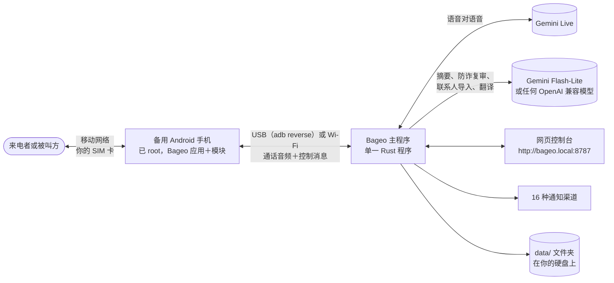
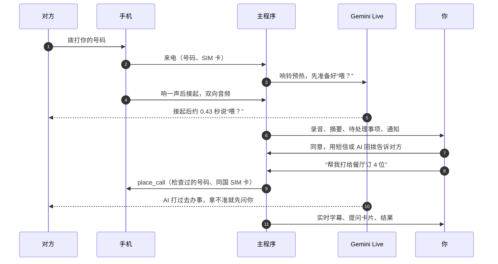

  

<h1 align="center">Bageo（八哥）</h1>

  <strong>让实时 AI 语音替你接听、也替你拨出你自己的电话号码。</strong> 
  一部已 root 的备用 Android 手机、你自己的 SIM 卡、电脑上的一个程序，再加上 Gemini Live。

  
  
  
  
  
  

  <a href="README.md">English</a> · <a href="README.zh-TW.md">繁體中文</a> · <strong>简体中文</strong>

Bageo 把语音对语音（Speech-to-Speech）的 AI 接到**你本来就在用的电话号码**上。插着你 SIM 卡的备用 Android 手机负责接起电话，电脑上的 Bageo 主程序把通话声音实时发给 Gemini Live 再传回来：对方听到的是一个大约 0.4 秒就开口、可以被插话、会跟着对方换语言、等对方说完才挂断的声音。通话结束后，录音、文字记录、四行摘要和需要你决定的事情，会出现在网页控制台，也会推送到你常用的聊天软件。

1.0 版是双向的。Bageo 照样帮你接电话，现在还能**替你打电话**：跟它说“订明天晚上 7 点 4 位，7 点半也行”，AI 就会打给餐厅、把事情谈完，遇到你没交代的情况先在网页上问你，最后汇报结果。来电的人想跟你约时间时，它会先记下来；你按“同意”或“不同意”，对方再通过短信或 AI 回拨收到你的答复。

Bageo 取自“八哥”（bāgē）的拼音。八哥是一种会学主人说话的鸟。旧版叫 Myna。

## 为什么选 Bageo

| | |
|---|---|
| **用你真正的号码** | 不需要 SIP 中继、不用租虚拟号码、不用设置呼叫转移。对方拨的就是你一直在用的号码；AI 拨出去时，显示的也是这个号码。 |
| **零平台月费** | 没有订阅费，也没有每分钟加价。你只付 Google 的 Gemini 用量（用你自己的 API 密钥）和运营商的号码费用，没有别的。 |
| **数据留在家里** | 单一 Rust 可执行文件，不需要数据库，也没有我们的云端账号。录音、文字记录、联系人和设置都是放在程序旁边文件夹里的普通文件。 |
| **快** | 手机还在响的时候，AI 就已经连上、把第一句话准备好。实测从接起到 AI 出声的中位数：**约 0.43 秒**。 |
| **到处都能跑** | Windows 10/11、macOS（Apple Silicon 与 Intel）、Linux，或 Docker。一台迷你主机或旧笔记本就足够了。 |

## 整体架构

接听和拨出走的是同一套组件：

## 功能

### 像真人一样接你的电话

- **响一声，再自然地说“喂？”** 手机默认响 3 秒（最长 8 秒）。这段时间主程序就先建好 Gemini Live 连接、把开场白生成好（**响铃预热**，Ring Pre-warm），电话一接通 AI 就开口。
- **两种接听身份。** “AI 助理”会说明自己是替你接电话的 AI，帮你记下留言；“本人”按你平时的方式、以你的身份说话，有人认真问起时仍会承认自己是 AI。
- **真正的对话。** 每通电话的头几秒，主程序会检查手机收音里有没有 AI 自己的声音。没有回声的手机（我们用的 Pixel 9）可以让对方插话：对方说满约 0.8 秒 AI 就停下来，“嗯”“好”这种短回应则不会打断。停顿应付得来，线路安静会问“还在吗？”，要等对方自己最后一句是道别才挂断，而不是到时间就挂。
- **听起来就像在打电话。** AI 声音后面可以垫 12 种背景音、三档音量：家里、办公室、街边、医院、救护车经过、台风天、雷雨、工地、地铁、夜市、鞭炮、开车中。
- **30 种声音 × 9 种语言，试听免费。** 每个声音在每种语言都内置了试听语句和“无法接通”语音，共 **1,080 个音频文件**随程序附带（IMA ADPCM 格式，只有普通 WAV 的四分之一大小）。试听声音、拒接来电都不消耗任何 API 额度。
- **资料与状态留言。** 给它可以用来回答的事实（快递放哪里、上班时间），再加一行今天的情况（“今天下午在等送货”）。没写在里面的事，它不可以自己编。
- **拦截号码与未显示号码。** 拦截列表里的号码会在响铃时直接挂断，或播一小段语音再挂，完全碰不到 AI。未显示号码可以照常接听，也可以拒接。

### AI 代打：替你打电话

1.0 新功能。在控制台的“**AI 代打**”页面，或联系人旁边按“**请 AI 打**”，选联系人或输入号码，写下要处理的事：订位、改期、跟朋友约时间、问商家有没有货或几点开门。每一条都可以选用“你的助理”（默认）或“你本人”的身份拨打。

- **实时字幕。** AI 通话时，交办页面会实时显示双方说的话。
- **拿不准就先问你。** 对方提到交办里没涵盖的事（“7 点满了，7 点半可以吗？”），AI 会请对方稍等，然后调用 `ask_owner`。你开着网页的话，会弹出一张带 AI 选项、40 秒倒计时的提问卡，点一个选项或自己打字回答都行。通话中你也可以随时打字交代 AI（`say`）。
- **绝不背着你答应。** 你不在线、或时间到了没回答，AI 不会自己挑任何一个选项。它会问清楚对方哪些时间或选择可以、说会跟你确认后再回复，然后礼貌收尾。结果会标成“**要你决定**”：从对方给的选项里挑一个或自己写回复，按“**回复后请 AI 再打**”，AI 会带着上一通的内容再打一次（`follow_up_of`）。
- **结构化的结果。** 通话结束后，摘要模型会对照交办内容阅读文字记录，返回结果（办好了、办好一部分、没办成、要你决定、没接、语音信箱、失败）、细节、对方给的选项和谈定的时间（可以一键添加到日历），并只发一条通知。
- **每个号码都有安全网。** 紧急电话、短号码、高额付费电话，以及写在国际冠码后面的号码一律拒拨。主程序会从来电中学到每部手机插着哪些国家的 SIM 卡（`phone_sims.json`），只用和号码同一国家的 SIM 卡拨出。拨号瞬间手机报告的 SIM 卡如果不对，主程序会在接通前立即挂断（`wrong_sim`），代打绝不会不小心变成国际电话。
- **合理的上限。** 同一个号码一次只打一通；每通最长 10 分钟，9 分 30 秒开始收尾；不会自动重拨（要不要“**再打一次**”由你决定）；遇到语音菜单最多等 90 秒找人工；运营商“空号”录音一听到就挂。

### 三道防线挡推销与诈骗，再加“陪聊拖时间”

1. **免审白名单：** 对方是回复**你**主动提出的事（投诉、报修、业务办理、理赔），不管说了什么字眼都直接放行。
2. **多语言加权关键词：** 保险、贷款与提额、软性电销，以及新型诈骗手法（ATM 操作、扣款设置错误、充值卡、“加我 LINE”）。
3. **语义复审：** 关键词分数过线时，`gemini-flash-lite` 会阅读目前为止的对话，并参考对方是不是你的通讯录联系人；这段时间 AI 照常说话（最多 1.5 秒）。对方只报了单位名称、还没说要做什么，会判为 `too_early`，等他下一句说完再审一次。

正常电话不会被误伤：银行核对刷卡、医院诊所、快递货到付款、家人谈钱。银行问某笔刷卡是不是你刷的时候，AI 不替你承认也不否认，不答应停卡或挂失，只记下金额、商户和时间，摘要会提醒你自己拨打卡片背面的电话确认。

确认是推销或诈骗的电话，可以礼貌拒绝；或者打开“**陪他聊、拖时间**”，切换成**陪聊模式**（Stall Mode）：AI 化身一个有兴趣、反应慢、爱问细节、又总出状况的客户，最长缠住对方 30 分钟，绝不透露任何真实信息，也绝不答应付款。

### 日程预约变成待处理事项，添加到你用的任何日历

来电的人想约时间时（默认关闭），AI 不会当场答应，而是根据这个号码能收到什么，自然地说“我确认一下，晚点发短信回你”或“晚点打给你”。通话结束后，这条预约会出现在控制台的“**待处理事项**”里，也会变成一张带按钮的 Telegram 卡片：谁、什么事、什么时间，“**同意**”或“**不同意**”，以及怎么让对方知道你的答复：

- **发短信**：从接这通电话的 SIM 卡发出，内容只有时间，绝不夹带对方说的话。
- **AI 回拨**：AI 会等过回铃音，直到对方接起并开口，用原来那通电话的语言把你的答复清楚说一次，道别后挂断。
- **不通知对方**。

同意的预约一键就能添加到日历：**Google 日历、Outlook.com、Microsoft 365、Apple 日历（.ics）、Yahoo 日历，或直接下载 .ics**。主程序完全不需要你的日历账号或令牌。

### 什么格式都能导入的通讯录

通讯录里的人打来，通话记录、摘要和通知都会显示名字；AI 也知道是谁打来的，并能看到你写的备注。保存的联系人在防诈复审中也受到保护。可以从这些地方导入：

- vCard 2.1／3.0／4.0、Google 与 Outlook 的 CSV、TSV 和纯文本，在你的电脑上解析，自动识别编码（UTF-8、UTF-16、Big5、GBK、Shift_JIS、EUC-KR、Windows-1252）；
- Excel `.xlsx` 和 Word `.docx` 里的表格，同样在本机解析；
- **PDF、名片照片、通讯录截图**，交给 Gemini Flash-Lite 识别。

保存前每一条都会先给你看；重复的可以合并或跳过，整个通讯录也能导出为 vCard。

### 多国语言、双卡分流、文字记录翻译

- **九种完整语言**，覆盖 AI 的语音、内置提示词、网页控制台、手机应用和通知：English、繁體中文（台湾）、简体中文、日本語、한국어、Español、Français、Deutsch、Português。
- **每张 SIM 卡各有主要语言。** 双卡手机插台湾卡加美国卡，打进哪张卡就用哪种语言开场。国外号码打来，AI 会说那个国家的语言的话就用那国语言。台湾 SIM 卡接到国际来电时，AI 会等运营商的防诈提示音播完才开口。
- **跟着对方换语言。** 对方说别的语言、或问 AI 会不会说某种语言，通话中就会切换过去。
- **文字记录保留原文。** 用其他语言说的句子保持原样，每句下面附上翻译成你通知语言的对照。
- **其他人怎么叫你**（`owner_aliases`）：英文名、昵称。对方找的是这些名字时，AI 知道是在找你。

### 一键切换“AI 接听 ↔ 普通手机”

在控制台“系统”页或 Bageo 应用里，随时把备用机切回普通手机、再切回来。普通手机模式下，Google 电话恢复为默认拨号应用、勿扰模式关闭、音量还原，来电正常响铃、由你自己接；重启后模式不变。切换由 Magisk／KernelSU 模块的 root 小程序执行，所以 **Bageo 应用本身完全不需要 root 权限**。

### 16 种通知渠道，数据存在你自己的硬盘

Telegram（预约卡片带“同意／不同意”按钮）、Discord、Slack／Mattermost、LINE Messaging API、ntfy、Gotify、Bark、Pushover、企业微信、钉钉（支持加签）、飞书／Lark、Server酱、Matrix、Gmail、Apprise，以及自定义 JSON Webhook（n8n、Zapier、Home Assistant）。任意组合，每条消息都会发到所有渠道。可选的[短信转发器](tools/sms_forward/README.md)会把手机收到的短信也转到同样的渠道。

会离开你电脑的只有：实时通话音频发给 Gemini、文字记录发给摘要模型（默认是同一个密钥的 Gemini Flash-Lite，也可以换成任何 OpenAI 兼容服务，包括本机的 Ollama）、摘要发给你配置的通知渠道。

## 需要准备什么

| | |
|---|---|
| **一部备用 Android 手机**，带 SIM 卡 | 用 Magisk 或 KernelSU root，Android 10 及以上。**实测过：Google Pixel 7、7a、8、9。** 其他已 root 的手机也许能用，取决于它的音频硬件层是否允许应用录下通话并把声音播进通话。这部手机会变成专门接电话的设备。 |
| **一台电脑**，需要接电话的时段要一直开着 | Windows 10/11、macOS（Apple Silicon 或 Intel）或 Linux；也可以用 Docker。不需要数据库，也不需要其他服务。 |
| **一根 USB 线** | 手机通过 USB 和主程序连接（`adb reverse`，由主程序自动配置）。也可以用 Wi-Fi。 |
| **一个 Gemini API 密钥** | 在 [Google AI Studio](https://aistudio.google.com/apikey) 获取。同一个密钥覆盖实时通话、摘要、防诈复审和联系人导入。Google 按用量计费；想设上限可以在 Google 账号里设置预算。 |

## 5 分钟快速开始

1. **下载**：从 [Releases](https://github.com/h4lo-void/bageo-call/releases) 下载适合你系统的安装包并解压；或克隆这个仓库（启动脚本会用 [Rust](https://rustup.rs) 自动构建）。
2. **启动**：Windows 双击 `start.cmd`，macOS 双击 `start.command`，Linux 运行 `./start.sh`。没有 `adb` 的话脚本会询问是否下载，然后打开控制台 <http://localhost:8787/>。同一网络里的其他设备可以用 <http://bageo.local:8787/>，或扫“系统 → 关于”里的二维码打开。
3. **填写基本设置**：在“设置”里填上 Gemini API 密钥、你的名字和别人怎么称呼你、语言、接听身份。按 ▶ 试听各个声音，选一个。
4. **准备手机**（只需一次）：在 Magisk 或 KernelSU 里安装发布版附带的模块 `pixelcallai_uplink-<version>.zip`，重启，打开 **Bageo** 应用把检查清单做完。开启 USB 调试、插到电脑上，在“允许 USB 调试吗？”里点允许。→ [手机设置](docs/zh-CN/PHONE.md)
5. **打一通试试**：“系统”页显示手机已连接。用另一部手机拨打它的号码：响一声、AI 接听，通话连同录音和摘要出现在控制台里。再添加一个通知渠道，按“发送测试”。

每一步的详细说明（含 Docker 与开机自启）：[开始使用](docs/zh-CN/GETTING_STARTED.md)。

## 让它说话像你

内置提示词开箱即用。想让 AI 按**你**的方式说话，让另一个 AI 采访你就行：

1. 打开“设置 → 提示词”，找到“不想自己写？”，选好语言后按“**复制访谈提示词**”（九种语言的原文也放在 [`docs/prompts/`](docs/prompts/)）。
2. 粘贴到 ChatGPT、Claude、Gemini 或任何聊天 AI 里。它会一题一题问你十个问题：你怎么说话、你真的会说的话和绝对不会用的词、谁会给你打电话、哪些事绝不能答应、推销电话怎么处理。
3. 它会生成一份保留你口头禅和底线的提示词、你的资料，以及接听身份和推销设置该怎么选。粘贴、保存，下一通电话就会用上。

更多说明与真正有效的写法：[编写提示词](docs/zh-CN/PROMPTS.md)。

## 文档

| | |
|---|---|
| [开始使用](docs/zh-CN/GETTING_STARTED.md) | 在 Windows／macOS／Linux／Docker 上安装、第一通电话、第一次 AI 代打 |
| [手机设置](docs/zh-CN/PHONE.md) | Root 模块、应用检查清单、USB 与 Wi-Fi、普通手机模式、还原 |
| [编写提示词](docs/zh-CN/PROMPTS.md) | AI 每通电话收到什么、访谈提示词、资料、写法技巧、固定底线 |
| [通知](docs/zh-CN/NOTIFICATIONS.md) | 16 种渠道各自怎么配置；webhook 内容格式 |
| [设置参考](docs/zh-CN/SETTINGS.md) | 每一项设置和启动选项 |
| [故障排查与常见问题](docs/zh-CN/TROUBLESHOOTING.md) | 遇到问题的时候 |
| [隐私、安全与法律](docs/zh-CN/PRIVACY_AND_LEGAL.md) | 哪些东西会离开你的电脑；录音和披露 AI 身份的规定 |
| [API](docs/zh-CN/API.md) | REST 接口（通话、联系人、待处理事项、AI 代打）、手机通信协议 |
| [架构](docs/zh-CN/ARCHITECTURE.md) | 模块、一通来电与一通拨出的完整过程、数据存放 |
| [路线图](docs/zh-CN/ROADMAP.md) | 已经有的、还没有的、接下来要做的 |
| [v1.0 发布说明](CHANGELOG.md) | 1.0 有什么新东西、怎么升级 |
| [`android/`](android/README.md) | 构建手机应用和模块（英文） |
| [`tools/sms_forward/`](tools/sms_forward/README.md) | 可选：把手机收到的短信转发到你的通知（英文） |

## v1.0 验证现状

这个项目原本是一个人自用的电话线，运行了好几个月才开源。以下是哪些部分验证过、怎么验证的。

**自动化测试。** 每次改动都会在 CI 中运行超过 520 个单元与集成测试（主程序、手机应用构建、短信转发器）。

**模拟通话。** 测试工具让 Gemini 扮演来电者，给真正的主程序打电话：共 234 通模拟通话、来电者说 28 种语言，覆盖打招呼、道别、换语言、银行核对刷卡、推销与诈骗、语音菜单和日程预约。AI 代打跑过 15 种模拟场景（订位、满座、约朋友、要求付定金、用美国卡打英语商家、语音信箱、没接、按键菜单、空号、“你是机器人吗？”、拨不出去、主人回答、主人不在、接续上一通、通话中主人交代），全部通过。

**真手机、真电话。**

- 每天在 Pixel 7、7a、9（Android 16、KernelSU-Next）上用繁体中文（台湾）、“本人”身份接听真实来电；Pixel 8 跑过较早的版本。覆盖接听、插话、背景音、推销与诈骗陪聊、拦截号码、录音、摘要、Telegram。
- 预约短信回复：从美国 SIM 卡发出的回复已确认送达美国号码。台湾预付卡发的短信被退回，原因只是那张卡没有余额。
- 普通手机模式在 Pixel 7a 上：真实来电会响、接得起来，重启后模式不变，切回后 AI 照常接听。
- AI 回拨已经在真实电话上接通并说出答复；1.0 新加的回铃音过滤目前用合成的回铃音测试过。

**还需要更多反馈。** AI 代打还没有在真手机上实际拨出过。Telegram 以外的通知渠道是按各服务文档记载的格式测试的，没有用真实账号测过。繁体中文以外的语言、“AI 助理”身份、从头设置一部新手机、macOS 与 Linux 上的 USB 管理、Docker 镜像，实际使用都比较少。其他手机和语言的使用反馈是最有价值的贡献，请见 [CONTRIBUTING.md](CONTRIBUTING.md)（英文）。

## 请负责任地使用

- **各地法律不同。** 通话录音，以及让 AI 在不告知对方的情况下与人通话，在很多地方都受到限制。“AI 助理”身份和以助理身份代打时，AI 都会表明自己是 AI。请先弄清楚你和通话对象所在地的规定。
- **AI 不做任何承诺。** 它绝不答应付款、定金、合同、密码或验证码，预约也要等你决定。但它毕竟是 AI：摘要和代打结果一定要看。
- **紧急情况不要依赖它。** AI 代打绝不会拨打紧急电话。
- **Root 会使保修失效，也可能出问题。** 请用备用手机。

详见[隐私、安全与法律](docs/zh-CN/PRIVACY_AND_LEGAL.md)。

## 许可证

[MIT](LICENSE)。附带的音效为 CC0；有一个安装脚本采用 GPL-3.0，详见 [NOTICE.md](NOTICE.md)（英文）。本项目与 Google 没有关联；Pixel 和 Gemini 是 Google LLC 的商标。
