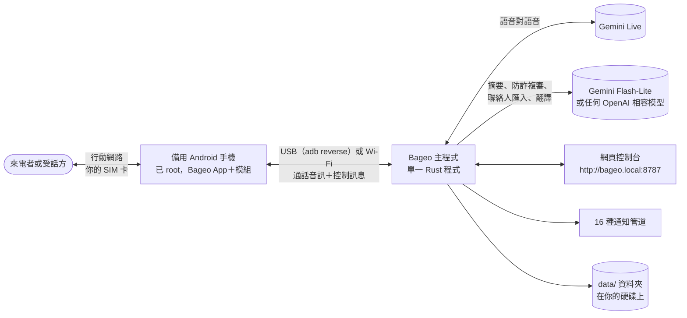

  

<h1 align="center">Bageo（八哥）</h1>

  <strong>AI 接電話、替你打電話的 AI 電話助理（Gemini Live＋你自己的門號）</strong> 
  自架、開源。一支插著你 SIM 卡、已 root 的備用 Android 手機，電腦上的一個程式，加上你自己的 Gemini 金鑰。

  
  
  
  
  
  

  <a href="README.md">English</a> · <strong>繁體中文</strong> · <a href="README.zh-CN.md">简体中文</a>

Bageo（八哥，舊名 Myna）讓 AI 用**你原本的電話號碼**接電話，也替你打電話。插著你 SIM 卡的備用 Android 手機（已 root）負責接通，電腦上的程式把每通電話即時送到 Gemini Live 再送回來：對方聽到的是響一聲就接、可以插話、會過濾推銷與詐騙電話、等對方說再見才掛的自然聲音。跟架在 SIP 線路或虛擬號碼上的 AI 電話服務不同，你不用換門號、不用付平台月費，每一段錄音都留在你自己的硬碟。

名字取自八哥（bāgē）：一種會學身邊的人講話的鳥。

## 實際通話聽起來像這樣

**一通信貸推銷電話。** 接聽身分是「本人」，「陪他聊、拖時間」開著（預設）。

> **對方：** 您好，這裡是旭日財務，您有一筆低利信貸額度已經核准了。
>
> **AI：** 喔？信貸喔？那利息怎麼算，是月息還是年息？
>
> **對方：** 年息，只要 2.8%。我先跟您核對一下身分證字號就可以辦了。
>
> **AI：** 欸，2.8% 是整筆算的嗎？那我如果提早還，要不要另外付錢？

AI 會一直問、故意把數字聽錯、聊一聊就岔題，就是不給任何一項資料，直到對方放棄或滿 30 分鐘。你會收到錄音、逐字稿和一段簡短摘要。

**一次 AI 代打。** 你在「AI 代打」頁寫下：「訂明天晚上 7 點 4 位，7 點半也可以。」

> **AI：** 您好，我是小明的助理，想訂明天晚上 7 點 4 位。
>
> **餐廳：** 不好意思，7 點客滿了，7 點半可以嗎？
>
> **AI：** 7 點半可以，訂位名字是小明。

結果標成「**辦好了**」：明天晚上 7 點半、4 位，附一個加入行事曆的按鈕。如果餐廳只給 8 點半，AI 會先在控制台問你。

## 為什麼選 Bageo

| | 架在 SIP 線路或虛擬號碼上的 AI 電話服務 | Bageo |
|---|---|---|
| **電話號碼** | 服務商給的號碼，或把你的來電轉接過去 | 你原本的門號，插在你自己的手機裡；AI 撥出時顯示的也是它 |
| **費用** | 通常是月費或按分鐘計費 | 沒有平台月費：只付 Google 的 Gemini 用量（用你自己的 API 金鑰）和電信門號費 |
| **你的資料** | 錄音和逐字稿放在服務商的伺服器 | 程式旁邊 `data/` 資料夾裡的一般檔案；不需要資料庫，也沒有我們的帳號 |
| **要準備什麼** | 一個帳號 | 一支已 root 的備用 Android 手機，和一台一直開著的電腦 |

它也又快又輕。手機還在響，AI 就已經連上，接起後約 **0.43 秒**開口（實測中位數）。主程式是單一 Rust 程式，可以跑在 Windows 10/11、macOS（Apple Silicon 與 Intel）、Linux 或 Docker，一台迷你電腦或舊筆電就綽綽有餘。

## 運作方式

手機只負責行動網路，其他事都由主程式處理。手機還在響的時候，主程式就開好 Gemini Live 連線、準備好第一句話，所以電話一接通 AI 就開口。AI 代打和 AI 回電走同一條路往外撥。一通來電與一通撥出的完整過程：[架構](docs/zh-TW/ARCHITECTURE.md)。

## 功能

### 像真人一樣接你的電話

- **響一聲，再說「喂？」** 手機預設響 3 秒（最長 8 秒），主程式利用這段時間把開場白準備好（**響鈴預熱**）。
- **兩種接聽身分。** 「AI 助理」（預設）會說自己是替你接電話的 AI，幫你記下留言；「本人」照你平常的方式講話，有人認真問起時仍會承認自己是 AI。
- **自然的一來一往。** 每通電話開頭，主程式會檢查手機收音裡有沒有 AI 自己的聲音；沒有的手機（測試中是 Pixel 9）可以讓對方插話：對方講滿約 0.8 秒 AI 就停，「嗯」「好」這種短回應不會打斷。線上安靜時會問「還在嗎？」。對方自己最後一句是道別，AI 才掛斷；一般電話到了「一般電話最長」（預設 5 分鐘）會客氣收尾。
- **聽起來就像在講電話。** AI 聲音後面可以墊背景音，12 種、三段音量：居家、辦公室、街邊、醫院、救護車經過、颱風天、大雷雨、工地、捷運、夜市、鞭炮、開車中。
- **30 種聲音 × 9 種語言，試聽免費。** 程式內附 1,080 個預錄音檔（IMA ADPCM，只有一般 WAV 的四分之一大小），試聽聲音和「無法接通」語音都不花 API 額度。
- **只講你寫下來的事。** 「AI 可以回答的資料」放包裹放哪裡、上班時間這類事實；「狀態留言」寫一行現在的狀況（「今天下午在等送貨」）。沒寫在裡面的事，AI 不可以自己編。
- **拒接號碼與未顯示號碼。** 拒接名單上的號碼會在響鈴時直接拒接，或播一小段語音再掛，完全碰不到 AI。未顯示號碼預設照常交給 AI；關掉「未顯示號碼也接聽」，就改成播語音後掛斷。

### AI 代打：替你打電話

在「**AI 代打**」頁，或聯絡人旁邊按「**請 AI 打**」，選要打給誰、寫下要辦的事：訂位、改期、跟朋友約時間、問店家有沒有貨或幾點開門。再選「**以你的助理身分打**」（預設）或「**以你本人身分打**」。

- **即時字幕**：通話中即時顯示雙方說的話。
- **拿不準先問你。** 對方提到你沒交代清楚的事，AI 會請對方稍等，然後呼叫 `ask_owner`：你的畫面會跳出一張附 AI 選項、40 秒倒數的提問卡，點選項或打字回答都可以。通話中也能隨時打字交代 AI（`say`）。
- **絕不背著你答應。** 你不在線上或時間到沒回答，AI 不會自己挑任何一個選項；它會問清楚對方哪些時間或選擇可以、說會跟你確認，然後禮貌收尾。結果標成「**要你決定**」：挑一個選項或寫回覆，按「**回覆後請 AI 再打**」，AI 會帶著上一通的內容再打一次（`follow_up_of`）。
- **結果清楚，只發一則通知。** 「辦好了」「辦好一部分」「沒辦成」「要你決定」「沒接」「語音信箱」或「失敗」，附細節、對方給的選項和講定的時間，可以直接加入行事曆。
- **安全撥號。** 緊急電話、短碼、高額付費電話，以及寫在國際冠碼後面的號碼一律拒撥。主程式會從來電學到每支手機插著哪國的 SIM 卡（`phone_sims.json`），只用跟號碼同一國的 SIM 卡撥出；撥號瞬間手機回報的 SIM 卡不對，就在接通前掛斷（`wrong_sim`），代打絕不會不小心變成國際電話。
- **合理的上限。** 同一個號碼一次只打一通；每通最長 10 分鐘，9 分 30 秒開始收尾；不會自動重撥（要不要「**再打一次**」由你決定）；碰到語音選單最多等 90 秒；電信「空號」錄音一聽到就掛。

### 擋推銷與詐騙電話，加上陪聊模式

三道防線做來電過濾，判斷對方是不是推銷或詐騙：

1. **回覆你的事直接放行。** 對方是回覆**你**主動提出的事（客訴、報修、申辦、理賠），不管用了什麼字眼都放行。
2. **多語加權關鍵字。** 保險、貸款與增貸、軟性電銷，以及新型詐騙手法（ATM 操作、扣款設定錯誤、點數卡、「加我 LINE」）。
3. **再看一次語意。** 關鍵字分數過線時，`gemini-flash-lite` 會讀目前為止的對話，並參考對方在不在你的通訊錄；這段時間 AI 照常講話（最多 1.5 秒）。對方只報了單位名稱、還沒說要做什麼，會判成 `too_early`，等他下一句講完再看一次。

正常電話不會被誤傷：銀行核對刷卡、醫院診所、貨到付款的快遞、家人談錢。銀行問某筆刷卡是不是你刷的，AI 不替你承認也不否認，不答應停卡或掛失，只記下金額、商家和時間，摘要會提醒你自己撥卡片背面的電話確認。

確定是推銷或詐騙，就切換成**陪聊模式**（Stall Mode，設定「陪他聊、拖時間」，預設開啟）：AI 化身一個有興趣、反應慢、愛問細節、又一直出狀況的客人，最長纏住對方 30 分鐘（「這類電話最長」），絕不透露任何真實資料，也絕不答應付款。關掉的話，AI 會客氣婉拒並結束通話。

### 行程預約變成待處理事項

來電的人想約時間時（「行程預約」，預設關閉），AI 不會當場答應，而是依這個號碼收得到什麼，說會確認後再傳簡訊或回電。通話結束後，這筆請求會出現在控制台的「**待處理事項**」（用 `TELEGRAM_BOT_TOKEN` 指定 Telegram Bot 時，也會變成一張有按鈕的 Telegram 卡片）：誰、什麼事、什麼時間，「**同意**」或「**不同意**」，以及怎麼讓對方知道你的答覆：

- **傳簡訊**：從接這通電話的 SIM 卡發出，內容只有時間，絕不夾帶對方講的話。
- **AI 回電**：AI 等過回鈴音，直到對方接起並開口，用原本那通電話的語言把你的答覆講一次，道別後掛斷。
- **不通知對方**。

同意的預約一鍵就能加入 **Google 日曆、Outlook.com、Microsoft 365、Apple 日曆（.ics）、Yahoo 日曆，或直接下載 .ics**。主程式不需要你的行事曆帳號或權杖。

### 幾乎什麼檔案都能匯入的通訊錄

通訊錄裡的人打來，通話紀錄、摘要和通知都會顯示名字；AI 知道是誰打來，也看得到你寫的備註；存起來的聯絡人在防詐複審裡也受到保護。可以從這些格式匯入：

- vCard 2.1／3.0／4.0、Google 與 Outlook 的 CSV、TSV 和純文字，在你的電腦上解析，自動判斷編碼（UTF-8、UTF-16、Big5、GBK、Shift_JIS、EUC-KR、Windows-1252）；
- Excel `.xlsx` 和 Word `.docx` 裡的表格，同樣在本機解析；
- PDF、名片照片、通訊錄截圖，交給 Gemini Flash-Lite 辨識。

存檔前每一筆都會先給你看；重複的可以合併或略過，整份通訊錄也能匯出成 vCard。

### 九種語言、雙卡、逐字稿附翻譯

- **九種語言**涵蓋 AI 的語音、內建提示詞、網頁控制台、手機 App 和通知：English、繁體中文（台灣）、简体中文、日本語、한국어、Español、Français、Deutsch、Português。
- **每張 SIM 卡各有主要語言。** 雙卡手機打進哪張卡，就用那張卡的語言開場；國外號碼打來，AI 會講那國語言就用那國語言。台灣 SIM 卡接到國外來電，AI 會等電信的國際電話防詐提示音播完才開口。
- **跟著對方換語言**：對方改講別的語言、或問 AI 會不會講某種語言，通話中就切過去。
- **逐字稿保留原文**：用其他語言講的句子保持原樣，每句下面附上翻成你通知語言的對照。
- **其他人怎麼叫你**（`owner_aliases`）：英文名、綽號；對方找這些名字時，AI 知道是在找你。

### 一鍵切換「AI 接聽 ↔ 一般手機」

在控制台「**系統**」頁或 Bageo App 裡，隨時把備用機切回普通手機、再切回來。一般手機模式下，Google 電話恢復成撥號程式、勿擾模式關閉、音量還原，來電照常響、由你自己接；重開機後模式不變。切換由 Magisk／KernelSU 模組的 root 小程式執行，所以 Bageo App 本身完全不需要 root 權限。詳見[一般手機模式](docs/zh-TW/PHONE.md#一般手機模式)。

### 16 種通知管道，資料存在自己的硬碟

Telegram（預約卡片附「同意／不同意」按鈕）、Discord、Slack／Mattermost、LINE Messaging API、ntfy、Gotify、Bark、Pushover、企業微信、釘釘（支援加簽）、飛書／Lark、Server醬、Matrix、Gmail、Apprise，以及給 n8n、Zapier、Home Assistant 用的 JSON Webhook。可以任意搭配，每則訊息都會送到全部管道。選用的[簡訊轉發器](tools/sms_forward/README.md)會把手機收到的簡訊也轉到同樣的管道。

會離開你電腦的有：即時通話音訊送到 Gemini，逐字稿送到摘要模型（預設是同一把金鑰的 Gemini Flash-Lite，也可以換成任何 OpenAI 相容服務，包括本機的 Ollama），摘要送到你設定的通知管道。詳見[隱私、安全與法律](docs/zh-TW/PRIVACY_AND_LEGAL.md)。

## 需要準備什麼

| | |
|---|---|
| **一支備用 Android 手機**，有 SIM 卡 | 用 Magisk 或 KernelSU root，Android 10 以上。**實測過：Google Pixel 7、7a、8、9。** 其他已 root 的手機也許能用，要看它的音訊硬體層是否允許 App 錄下通話並把聲音播進通話。這支手機會變成專門接電話的機器。 |
| **一台電腦**，需要接電話的時段要一直開著 | Windows 10/11、macOS（Apple Silicon 或 Intel）或 Linux；也可以用 Docker。不需要資料庫，也不需要其他服務。 |
| **一條 USB 線** | 手機透過 USB 跟主程式連線（`adb reverse`，主程式自己設定）。也可以用 Wi-Fi。 |
| **一把 Gemini API 金鑰** | 到 [Google AI Studio](https://aistudio.google.com/apikey) 取得。同一把金鑰涵蓋即時通話、摘要、防詐複審與聯絡人匯入。Google 依用量計費；想設上限，可以在 Google 帳號裡設預算。 |

## 快速開始

1. **下載**：從 [Releases](https://github.com/h4lo-void/bageo-call/releases) 下載適合你系統的套件並解壓縮；或 clone 這個 repository（啟動腳本會用 [Rust](https://rustup.rs) 自己建置）。
2. **啟動**：Windows 按兩下 `start.cmd`，macOS 按兩下 `start.command`，Linux 執行 `./start.sh`。沒有 `adb` 的話，腳本會問你要不要下載，接著打開控制台 <http://localhost:8787/>。同一個網路裡的其他裝置可以用 <http://bageo.local:8787/>，或掃「**系統 → 關於**」裡的 QR code 打開。
3. **填好基本設定**：在「**設定**」填入 Gemini API 金鑰、你的名字和其他人怎麼叫你、語言、接聽身分。按 ▶ 試聽各個聲音，挑一個。
4. **準備手機**（只要一次）：在 Magisk 或 KernelSU 安裝發行版附的模組 `pixelcallai_uplink-<version>.zip`，重新開機，打開 **Bageo** App 把檢查清單做完。開啟 USB 偵錯、接上電腦，在「允許 USB 偵錯嗎？」按允許。見[手機設定](docs/zh-TW/PHONE.md)。
5. **打一通試試**：「**系統**」頁顯示手機已連上後，用另一支手機撥它的號碼：響一聲、AI 接聽，通話連同錄音和摘要出現在控制台。再加一個通知管道，按「**傳送測試**」。

**試試看：** 第一通來電結束後（主程式也因此知道手機插著哪張 SIM 卡），打開「**AI 代打**」，輸入你自己的手機號碼，請 AI 訂位。你來扮演餐廳，故意給一個它沒被授權的時間，看提問卡跳出來。

每個步驟的詳細說明（含 Docker 與開機自動啟動）：[開始使用](docs/zh-TW/GETTING_STARTED.md)。

## 讓它講話像你

內建提示詞不用調整就能用。想讓 AI 照**你**的方式講話，讓另一個 AI 訪談你就好：

1. 打開「**設定 → 提示詞**」，找到「不想自己寫？」，選語言後按「**複製訪談提示詞**」（九種語言的原文也放在 [`docs/prompts/`](docs/prompts/)）。
2. 貼到 ChatGPT、Claude、Gemini 或任何聊天 AI。它會一題一題問你大約十個問題：你怎麼講話、你真的會說的話和絕對不會說的詞、誰會打給你、哪些事絕不能答應、推銷電話要怎麼處理。
3. 它會產出一份用你自己說話方式寫的提示詞、你的資料，以及接聽身分和推銷設定該怎麼選。貼上、儲存，下一通電話就會用上。

更多說明，包括最有效的寫法：[撰寫提示詞](docs/zh-TW/PROMPTS.md)。

## 文件

| | |
|---|---|
| [開始使用](docs/zh-TW/GETTING_STARTED.md) | 在 Windows／macOS／Linux／Docker 安裝、第一通電話、第一次 AI 代打 |
| [手機設定](docs/zh-TW/PHONE.md) | Root 模組、App 檢查清單、USB 與 Wi-Fi、一般手機模式、還原 |
| [撰寫提示詞](docs/zh-TW/PROMPTS.md) | AI 每通電話收到什麼、訪談提示詞、資料、寫法技巧、固定底線 |
| [通知](docs/zh-TW/NOTIFICATIONS.md) | 16 種管道各自怎麼設定；webhook 內容格式 |
| [設定參考](docs/zh-TW/SETTINGS.md) | 每一項設定與啟動選項 |
| [疑難排解與常見問題](docs/zh-TW/TROUBLESHOOTING.md) | 遇到問題的時候 |
| [隱私、安全與法律](docs/zh-TW/PRIVACY_AND_LEGAL.md) | 哪些東西會離開你的電腦；錄音與揭露 AI 身分的規定 |
| [API](docs/zh-TW/API.md) | REST 端點（通話、聯絡人、待處理事項、AI 代打）、手機通訊協定 |
| [架構](docs/zh-TW/ARCHITECTURE.md) | 模組、一通來電與一通撥出的完整過程、資料存放 |
| [發展藍圖](docs/zh-TW/ROADMAP.md) | 已經有的、還沒有的、接下來要做的 |
| [v1.0 發行說明](CHANGELOG.md) | 1.0 有什麼新東西、怎麼升級 |
| [`android/`](android/README.md) | 建置手機 App 與模組（英文） |
| [`tools/sms_forward/`](tools/sms_forward/README.md) | 選用：把手機收到的簡訊轉到你的通知（英文） |

## 測試狀態

| | |
|---|---|
| **自動化測試** | 每次改動都會在 CI 跑超過 520 個單元與整合測試。 |
| **模擬通話** | 對真正的主程式跑了 234 通模擬通話，由 Gemini 扮演講 28 種語言的來電者，另有 15 種 AI 代打情境，全部通過。 |
| **實機通話（1.0）** | Pixel 7、7a、9：接聽、插話、背景音、推銷與詐騙陪聊、拒接號碼、預約簡訊、AI 回電、一般手機模式。 |
| **還需要實測回報** | AI 代打實際撥出、AI 回電碰到真實回鈴音、Telegram 以外的通知管道用真實帳號、其他語言、「AI 助理」身分、Docker、macOS 與 Linux 的 USB。 |

其他手機和語言的使用回報最有幫助，請見 [CONTRIBUTING.md](CONTRIBUTING.md)（英文）。

## 請負責任地使用

- **各地法律不同。** 通話錄音、以及讓 AI 在沒有告知的情況下跟人講話，在很多地方都受到限制。「AI 助理」接聽身分一開口就表明是 AI；以助理身分代打時，AI 會自稱是你的助理；任何通話被認真問到時都會承認是 AI。請先弄清楚你和通話對象所在地的規定。
- **AI 不做任何承諾。** 它絕不答應付款、訂金、合約、密碼或驗證碼，預約也要等你決定。但它畢竟是 AI：摘要和代打結果請務必看過。
- **緊急狀況不要依賴它。** AI 代打絕不會撥緊急電話。
- **Root 會讓保固失效，也可能出問題。** 請用備用手機。

## 常見問題

### AI 可以用我原本的門號接電話嗎？

可以，這正是 Bageo 的用途。把 SIM 卡放進一支已 root 的備用 Android 手機，AI 就用你的號碼接電話、也從這個號碼撥出。想讓 SIM 卡留在主力手機，也可以把沒接的來電轉接到備用機的號碼：你的手機先響，沒接的才交給 AI（這時 AI 代打和回電顯示的是備用機的號碼）。

### 一定要 root 嗎？iPhone 可以用嗎？

一定要 root，iPhone 不行。Android 只允許有特權的系統 App 錄下通話並把聲音播進通話，所以手機需要 Magisk 或 KernelSU 才能安裝 Bageo 模組；iOS 完全不允許。

### 支援哪些手機？

實測過 Google Pixel 7、7a、8、9，需要 Android 10 以上。其他已 root 的手機，要它的音訊硬體層允許 App 錄下通話並把聲音播進通話才能用；不允許的話，電話會接起來，但有一方聽不到聲音。見[支援哪些手機](docs/zh-TW/PHONE.md#支援哪些手機)。

### 要花多少錢？

軟體免費（MIT 授權）。AI 處理的每通電話（不論來電或撥出），Google 都會依用量收 Gemini Live 的語音費用；摘要只是送到 Gemini 最便宜模型的一小段文字。試聽聲音和拒接語音都是預錄的，不花錢。另外就是電信門號費和電腦的電費；想設上限，可以在 Google 帳號裡設預算。

### 讓 AI 接電話合法嗎？

要看你和通話對象在哪裡。通話錄音、揭露 AI 身分、自動撥出的電話，各有各的規定。「AI 助理」身分第一句話就會表明是 AI；「本人」身分在被認真問到時才會說。開始使用前，請先讀[隱私、安全與法律](docs/zh-TW/PRIVACY_AND_LEGAL.md)。

### 可以離線、不用 Google 嗎？

不行。即時語音用的是 Gemini Live，需要網路和 Gemini 金鑰。摘要可以透過 Ollama 用本機模型（見[摘要與行事曆](docs/zh-TW/SETTINGS.md#摘要與行事曆)）；完全本機的語音流程不在支援的設定裡（見[發展藍圖](docs/zh-TW/ROADMAP.md)）。

## 授權

[MIT](LICENSE)。內附的音效為 CC0；有一支安裝腳本採用 GPL-3.0，詳見 [NOTICE.md](NOTICE.md)（英文）。本專案與 Google 沒有關聯；Pixel 和 Gemini 是 Google LLC 的商標。
