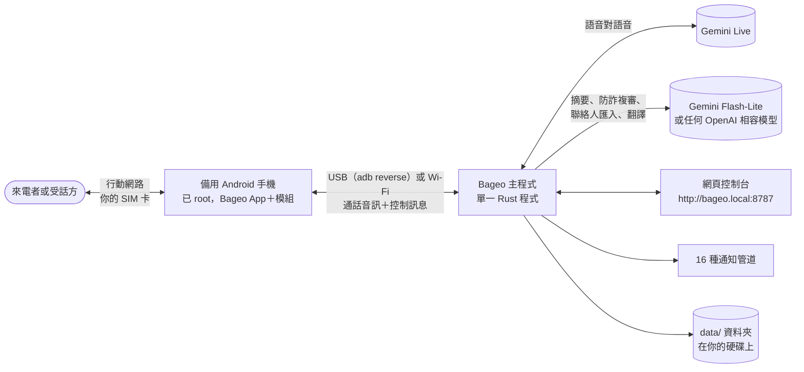
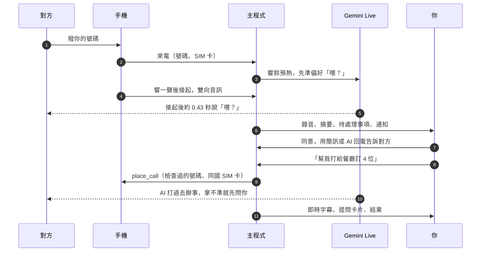

  

<h1 align="center">Bageo（八哥）</h1>

  <strong>讓即時 AI 語音替你接聽、也替你撥出你自己的電話號碼。</strong> 
  一支已 root 的備用 Android 手機、你自己的 SIM 卡、電腦上的一個程式，再加上 Gemini Live。

  
  
  
  
  
  

  <a href="README.md">English</a> · <strong>繁體中文</strong> · <a href="README.zh-CN.md">简体中文</a>

Bageo 把語音對語音（Speech-to-Speech）的 AI 接到**你本來就在用的電話號碼**上。插著你 SIM 卡的備用 Android 手機負責接起電話，電腦上的 Bageo 主程式把通話聲音即時送到 Gemini Live 再送回來：對方聽到的是一個大約 0.4 秒就開口、可以被插話、會跟著對方換語言、等對方講完才掛斷的聲音。通話結束後，錄音、逐字稿、四行摘要和需要你決定的事情，會出現在網頁控制台，也會傳到你常用的通訊軟體。

1.0 版是雙向的。Bageo 照樣幫你接電話，現在還能**替你打電話**：跟它說「訂明天晚上 7 點 4 位，7 點半也可以」，AI 就會打給餐廳、把話講完，遇到你沒交代的狀況先在網頁上問你，最後回報結果。來電的人想跟你約時間時，它會先記下來；你按「同意」或「不同意」，對方再透過簡訊或 AI 回電收到你的答覆。

Bageo 取自「八哥」（bāgē）的拼音。八哥是一種會學主人講話的鳥，台灣也有原生的八哥。舊版叫 Myna。

## 為什麼選 Bageo

| | |
|---|---|
| **用你真正的號碼** | 不需要 SIP 線路、不用租虛擬號碼、不用設定轉接。對方撥的就是你一直在用的號碼；AI 撥出去時，顯示的也是這個號碼。 |
| **零平台月費** | 沒有訂閱費，也沒有每分鐘加價。你只付 Google 的 Gemini 用量（用你自己的 API 金鑰）和電信的門號費，沒有別的。 |
| **資料留在家裡** | 單一 Rust 執行檔，不需要資料庫，也沒有我們的雲端帳號。錄音、逐字稿、聯絡人和設定都是放在程式旁邊資料夾裡的一般檔案。 |
| **快** | 手機還在響的時候，AI 就已經連上、把第一句話準備好。實測從接起到 AI 出聲的中位數：**約 0.43 秒**。 |
| **到處都能跑** | Windows 10/11、macOS（Apple Silicon 與 Intel）、Linux，或 Docker。一台迷你電腦或舊筆電就綽綽有餘。 |

## 整體架構

接聽和撥出走的是同一套元件：

## 功能

### 像真人一樣接你的電話

- **響一聲，再自然地說「喂？」** 手機預設響 3 秒（最長 8 秒）。這段時間主程式就先開好 Gemini Live 連線、把開場白生成好（**響鈴預熱**，Ring Pre-warm），電話一接通 AI 就開口。
- **兩種接聽身分。** 「AI 助理」會說自己是替你接電話的 AI，幫你記下留言；「本人」照你平常的方式、以你的身分講話，有人認真問起時仍會承認自己是 AI。
- **真正的對話。** 每通電話的頭幾秒，主程式會檢查手機收音裡有沒有 AI 自己的聲音。沒有回音的手機（我們用的 Pixel 9）可以讓對方插話：對方講滿約 0.8 秒 AI 就停下來，「嗯」「好」這種短回應則不會打斷。停頓應付得來，線上安靜會問「還在嗎？」，要等對方自己最後一句是道別才掛斷，不是時間到就掛。
- **聽起來就像在講電話。** AI 聲音後面可以墊 12 種背景音、三段音量：居家、辦公室、街邊、醫院、救護車經過、颱風天、大雷雨、工地、捷運、夜市、鞭炮、開車中。
- **30 種聲音 × 9 種語言，試聽免費。** 每個聲音在每種語言都內建了試聽語句和「無法接通」語音，共 **1,080 個音檔**隨程式附上（IMA ADPCM 格式，只有一般 WAV 的四分之一大小）。試聽聲音、拒接來電都不花任何 API 額度。
- **資料與狀態留言。** 給它可以拿來回答的事實（包裹放哪裡、上班時間），再加一行今天的狀況（「今天下午在等送貨」）。沒寫在裡面的事，它不可以自己編。
- **拒接號碼與未顯示號碼。** 拒接名單上的號碼會在響鈴時直接掛斷，或播一小段語音再掛，完全碰不到 AI。未顯示號碼可以照常接聽，也可以拒接。

### AI 代打：替你打電話

1.0 新功能。在控制台的「**AI 代打**」分頁，或聯絡人旁邊按「**請 AI 打**」，選聯絡人或輸入號碼，寫下要處理的事：訂位、改期、跟朋友約時間、問店家有沒有貨或幾點開門。每一筆可以選用「你的助理」（預設）或「你本人」的身分打。

- **即時字幕。** AI 在講的時候，交辦頁面會即時顯示雙方說的話。
- **拿不準就先問你。** 對方提到交辦裡沒涵蓋的事（「7 點客滿，7 點半可以嗎？」），AI 會請對方稍等，然後呼叫 `ask_owner`。你開著網頁的話，會跳出一張附 AI 選項、40 秒倒數的提問卡，點一個選項或自己打字回答都可以。通話中你也可以隨時打字交代 AI（`say`）。
- **絕不背著你答應。** 你不在線上、或時間到沒回答，AI 不會自己挑任何一個選項。它會問清楚對方哪些時間或選擇可以、說會跟你確認再回覆，然後禮貌收尾。結果會標成「**要你決定**」：從對方給的選項挑一個或自己寫回覆，按「**回覆後請 AI 再打**」，AI 會帶著上一通的內容再打一次（`follow_up_of`）。
- **結構化的結果。** 通話結束後，摘要模型會對照交辦內容讀逐字稿，回報結果（辦好了、辦好一部分、沒辦成、要你決定、沒接、語音信箱、失敗）、細節、對方給的選項和講定的時間（可以一鍵加入行事曆），並只發一則通知。
- **每個號碼都有安全網。** 緊急電話、短碼、高額付費電話，以及寫在國際冠碼後面的號碼一律拒撥。主程式會從來電學到每支手機插著哪些國家的 SIM 卡（`phone_sims.json`），只用跟號碼同一國的 SIM 卡撥出。撥號瞬間手機回報的 SIM 卡如果不對，主程式會在接通前立刻掛斷（`wrong_sim`），代打絕不會不小心變成國際電話。
- **合理的上限。** 同一個號碼一次只打一通；每通最長 10 分鐘，9 分 30 秒開始收尾；不會自動重撥（要不要「**再打一次**」由你決定）；碰到語音選單最多等 90 秒找真人；電信「空號」錄音一聽到就掛。

### 三道防線擋推銷與詐騙，再加「陪聊拖時間」

1. **免審白名單：** 對方是回覆**你**主動提出的事（客訴、報修、申辦、理賠），不管講了什麼字眼都直接放行。
2. **多語加權關鍵字：** 保險、貸款與增貸、軟性電銷，以及新型詐騙手法（ATM 操作、扣款設定錯誤、點數卡、「加我 LINE」）。
3. **語意複審：** 關鍵字分數過線時，`gemini-flash-lite` 會讀目前為止的對話，並參考對方是不是你的通訊錄聯絡人；這段時間 AI 照常講話（最多 1.5 秒）。對方只報了單位名稱、還沒講要做什麼，會判成 `too_early`，等他下一句講完再審一次。

正常電話不會被誤傷：銀行核對刷卡、醫院診所、快遞貨到付款、家人談錢。銀行問某筆刷卡是不是你刷的時候，AI 不替你承認也不否認，不答應停卡或掛失，只記下金額、商家和時間，摘要會提醒你自己撥卡片背面的電話確認。

確定是推銷或詐騙的電話，可以客氣婉拒；或者打開「**陪他聊、拖時間**」，切換成**陪聊模式**（Stall Mode）：AI 化身一個有興趣、反應慢、愛問細節、又一直出狀況的客人，最長纏住對方 30 分鐘，絕不透露任何真實資料，也絕不答應付款。

### 行程預約變成待處理事項，加入你用的任何行事曆

來電的人想約時間時（預設關閉），AI 不會當場答應，而是依照這個號碼收得到什麼，自然地說「我確認一下，晚點用簡訊回你」或「晚點打給你」。通話結束後，這筆預約會出現在控制台的「**待處理事項**」，也會變成一張有按鈕的 Telegram 卡片：誰、什麼事、什麼時間，「**同意**」或「**不同意**」，以及怎麼讓對方知道你的答覆：

- **傳簡訊**：從接這通電話的 SIM 卡發出，內容只有時間，絕不夾帶對方講的話。
- **AI 回電**：AI 會等過回鈴音，直到對方接起並開口，用原本那通電話的語言把你的答覆清楚講一次，道別後掛斷。
- **不通知對方**。

同意的預約一鍵就能加入行事曆：**Google 日曆、Outlook.com、Microsoft 365、Apple 日曆（.ics）、Yahoo 日曆，或直接下載 .ics**。主程式完全不需要你的行事曆帳號或權杖。

### 什麼格式都能匯入的通訊錄

通訊錄裡的人打來，通話紀錄、摘要和通知都會顯示名字；AI 也知道是誰打來，並看得到你寫的備註。存起來的聯絡人在防詐複審裡也受到保護。可以從這些地方匯入：

- vCard 2.1／3.0／4.0、Google 與 Outlook 的 CSV、TSV 和純文字，在你的電腦上解析，自動判斷編碼（UTF-8、UTF-16、Big5、GBK、Shift_JIS、EUC-KR、Windows-1252）；
- Excel `.xlsx` 和 Word `.docx` 裡的表格，也在本機解析；
- **PDF、名片照片、通訊錄截圖**，交給 Gemini Flash-Lite 辨識。

存檔前每一筆都會先給你看；重複的可以合併或略過，整份通訊錄也能匯出成 vCard。

### 多國語言、雙卡分流、逐字稿翻譯

- **九種完整語言**，涵蓋 AI 的語音、內建提示詞、網頁控制台、手機 App 和通知：English、繁體中文（台灣）、简体中文、日本語、한국어、Español、Français、Deutsch、Português。
- **每張 SIM 卡各有主要語言。** 雙卡手機插台灣卡加美國卡，打進哪張卡就用哪種語言開場。國外號碼打來，AI 會講那個國家的語言的話就用那國語言。台灣 SIM 卡接到國外來電，AI 會等電信的防詐提示音播完才開口。
- **跟著對方換語言。** 對方講別的語言、或問 AI 會不會講某種語言，通話中就會切換過去。
- **逐字稿保留原文。** 用其他語言講的句子保持原樣，每句下面附上翻成你通知語言的對照。
- **其他人怎麼叫你**（`owner_aliases`）：英文名、綽號。對方找的是這些名字時，AI 知道是在找你。

### 一鍵切換「AI 接聽 ↔ 一般手機」

在控制台「系統」頁或 Bageo App 裡，隨時把備用機切回普通手機、再切回來。一般手機模式下，Google 電話恢復成預設撥號程式、勿擾模式解除、音量還原，來電照常響、由你自己接；重開機後模式不變。切換由 Magisk／KernelSU 模組的 root 小程式執行，所以 **Bageo App 本身完全不需要 root 權限**。

### 16 種通知管道，資料存在你自己的硬碟

Telegram（預約卡片附「同意／不同意」按鈕）、Discord、Slack／Mattermost、LINE Messaging API、ntfy、Gotify、Bark、Pushover、企業微信、釘釘（支援加簽）、飛書／Lark、Server醬、Matrix、Gmail、Apprise，以及自訂 JSON Webhook（n8n、Zapier、Home Assistant）。任意搭配，每則訊息都會送到所有管道。選用的[簡訊轉發器](tools/sms_forward/README.md)會把手機收到的簡訊也轉到同樣的管道。

會離開你電腦的只有：即時通話音訊送到 Gemini、逐字稿送到摘要模型（預設是同一把金鑰的 Gemini Flash-Lite，也可以換成任何 OpenAI 相容服務，包括本機的 Ollama）、摘要送到你設定的通知管道。

## 需要準備什麼

| | |
|---|---|
| **一支備用 Android 手機**，有 SIM 卡 | 用 Magisk 或 KernelSU root，Android 10 以上。**實測過：Google Pixel 7、7a、8、9。** 其他已 root 的手機也許能用，要看它的音訊硬體層是否允許 App 錄下通話並把聲音播進通話。這支手機會變成專門接電話的機器。 |
| **一台電腦**，需要接電話的時段要一直開著 | Windows 10/11、macOS（Apple Silicon 或 Intel）或 Linux；也可以用 Docker。不需要資料庫，也不需要其他服務。 |
| **一條 USB 線** | 手機透過 USB 跟主程式連線（`adb reverse`，主程式自己設定）。也可以用 Wi-Fi。 |
| **一把 Gemini API 金鑰** | 到 [Google AI Studio](https://aistudio.google.com/apikey) 取得。同一把金鑰涵蓋即時通話、摘要、防詐複審與聯絡人匯入。Google 依用量計費；想設上限可以在 Google 帳號裡設預算。 |

## 5 分鐘快速開始

1. **下載**：從 [Releases](https://github.com/h4lo-void/bageo-call/releases) 下載適合你系統的套件並解壓縮；或 clone 這個 repository（啟動腳本會用 [Rust](https://rustup.rs) 自己建置）。
2. **啟動**：Windows 按兩下 `start.cmd`，macOS 按兩下 `start.command`，Linux 執行 `./start.sh`。沒有 `adb` 的話腳本會問你要不要下載，接著打開控制台 <http://localhost:8787/>。同一個網路裡的其他裝置可以用 <http://bageo.local:8787/>，或掃「系統 → 關於」裡的 QR code 打開。
3. **填好基本設定**：在「設定」填入 Gemini API 金鑰、你的名字和別人怎麼叫你、語言、接聽身分。按 ▶ 試聽各個聲音，挑一個。
4. **準備手機**（只要一次）：在 Magisk 或 KernelSU 安裝發行版附的模組 `pixelcallai_uplink-<version>.zip`，重新開機，打開 **Bageo** App 把檢查清單做完。開啟 USB 偵錯、接上電腦，在「允許 USB 偵錯嗎？」按允許。→ [手機設定](docs/zh-TW/PHONE.md)
5. **打一通試試**：「系統」頁顯示手機已連上。用另一支手機撥它的號碼：響一聲、AI 接聽，通話連同錄音和摘要出現在控制台。再加一個通知管道，按「傳送測試」。

每個步驟的詳細說明（含 Docker 與開機自動啟動）：[開始使用](docs/zh-TW/GETTING_STARTED.md)。

## 讓它講話像你

內建提示詞不用調整就能用。想讓 AI 照**你**的方式講話，讓另一個 AI 訪談你就好：

1. 打開「設定 → 提示詞」，找到「不想自己寫？」，選語言後按「**複製訪談提示詞**」（九種語言的原文也放在 [`docs/prompts/`](docs/prompts/)）。
2. 貼到 ChatGPT、Claude、Gemini 或任何聊天 AI。它會一題一題問你十個問題：你怎麼講話、你真的會說的話和絕對不會說的詞、誰會打給你、哪些事絕不能答應、推銷電話要怎麼處理。
3. 它會產出一份保留你口頭禪和底線的提示詞、你的資料，以及接聽身分和推銷設定該怎麼選。貼上、儲存，下一通電話就會用上。

更多說明與真正有效的寫法：[撰寫提示詞](docs/zh-TW/PROMPTS.md)。

## 文件

| | |
|---|---|
| [開始使用](docs/zh-TW/GETTING_STARTED.md) | 在 Windows／macOS／Linux／Docker 安裝、第一通電話、第一次 AI 代打 |
| [手機設定](docs/zh-TW/PHONE.md) | Root 模組、App 檢查清單、USB 與 Wi-Fi、一般手機模式、還原 |
| [撰寫提示詞](docs/zh-TW/PROMPTS.md) | AI 每通電話收到什麼、訪談提示詞、資料、寫法技巧、固定底線 |
| [通知](docs/zh-TW/NOTIFICATIONS.md) | 16 種管道各自怎麼設定；webhook 內容格式 |
| [設定參考](docs/zh-TW/SETTINGS.md) | 每一項設定與啟動選項 |
| [疑難排解與常見問題](docs/zh-TW/TROUBLESHOOTING.md) | 遇到問題的時候 |
| [隱私、安全與法律](docs/zh-TW/PRIVACY_AND_LEGAL.md) | 哪些東西會離開你的電腦；錄音與揭露 AI 身分的規定 |
| [API](docs/zh-TW/API.md) | REST 端點（通話、聯絡人、待處理事項、AI 代打）、手機通訊協定 |
| [架構](docs/zh-TW/ARCHITECTURE.md) | 模組、一通來電與一通撥出的完整過程、資料存放 |
| [發展藍圖](docs/zh-TW/ROADMAP.md) | 已經有的、還沒有的、接下來要做的 |
| [v1.0 發行說明](CHANGELOG.md) | 1.0 有什麼新東西、怎麼升級 |
| [`android/`](android/README.md) | 建置手機 App 與模組（英文） |
| [`tools/sms_forward/`](tools/sms_forward/README.md) | 選用：把手機收到的簡訊轉到你的通知（英文） |

## v1.0 驗證現況

這個專案原本是一個人自用的電話線，跑了好幾個月才開放出來。以下是哪些部分驗證過、怎麼驗證的。

**自動化測試。** 每次改動都會在 CI 跑超過 520 個單元與整合測試（主程式、手機 App 建置、簡訊轉發器）。

**模擬通話。** 測試工具讓 Gemini 扮演來電者，對真正的主程式打電話：共 234 通模擬通話、來電者講 28 種語言，涵蓋打招呼、道別、換語言、銀行核對刷卡、推銷與詐騙、語音選單和行程預約。AI 代打跑過 15 種模擬情境（訂位、客滿、約朋友、要求付訂金、用美國卡打英語店家、語音信箱、沒接、按鍵選單、空號、「你是機器人嗎？」、撥不出去、主人回答、主人不在、接續上一通、通話中主人交代），全部通過。

**真手機、真電話。**

- 每天在 Pixel 7、7a、9（Android 16、KernelSU-Next）上用繁體中文（台灣）、「本人」身分接真實來電；Pixel 8 跑過較早的版本。涵蓋接聽、插話、背景音、推銷與詐騙陪聊、拒接號碼、錄音、摘要、Telegram。
- 預約簡訊回覆：從美國 SIM 卡發出的回覆已確認送達美國號碼。台灣預付卡發的簡訊被退回，原因只是那張卡沒有餘額。
- 一般手機模式在 Pixel 7a 上：真實來電會響、接得起來，重開機後模式不變，切回後 AI 照常接聽。
- AI 回電已經在真實電話上接通並講出答覆；1.0 新加的回鈴音過濾目前用合成的回鈴音測過。

**還需要更多回報。** AI 代打還沒有在真手機上實際撥出過。Telegram 以外的通知管道是依各服務文件記載的格式測試，沒有用真實帳號測過。繁體中文以外的語言、「AI 助理」身分、從頭設定一支新手機、macOS 與 Linux 上的 USB 管理、Docker 映像檔，實際使用都比較少。其他手機和語言的使用回報是最有價值的貢獻，請見 [CONTRIBUTING.md](CONTRIBUTING.md)（英文）。

## 請負責任地使用

- **各地法律不同。** 通話錄音、以及讓 AI 在沒有告知的情況下跟人講話，在很多地方都受到限制。「AI 助理」身分和以助理身分代打時，AI 都會表明自己是 AI。請先弄清楚你和通話對象所在地的規定。
- **AI 不做任何承諾。** 它絕不答應付款、訂金、合約、密碼或驗證碼，預約也要等你決定。但它畢竟是 AI：摘要和代打結果請務必看過。
- **緊急狀況不要依賴它。** AI 代打絕不會撥緊急電話。
- **Root 會讓保固失效，也可能出問題。** 請用備用手機。

詳見[隱私、安全與法律](docs/zh-TW/PRIVACY_AND_LEGAL.md)。

## 授權

[MIT](LICENSE)。內附的音效為 CC0；有一支安裝腳本採用 GPL-3.0，詳見 [NOTICE.md](NOTICE.md)（英文）。本專案與 Google 沒有關聯；Pixel 和 Gemini 是 Google LLC 的商標。
