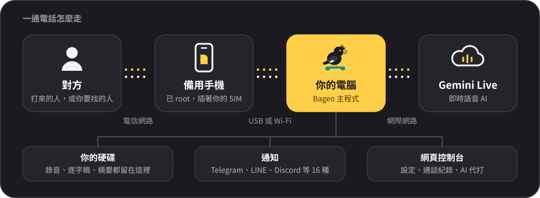

  

  <a href="README.md">English</a> · <strong>繁體中文</strong> · <a href="README.zh-CN.md">简体中文</a> · <a href="README.ja.md">日本語</a> · <a href="README.ko.md">한국어</a> · <a href="README.es.md">Español</a> · <a href="README.fr.md">Français</a> · <a href="README.de.md">Deutsch</a> · <a href="README.pt.md">Português</a>

  <strong>AI 接電話、替你打電話的 AI 電話助理（Gemini Live＋你自己的門號）</strong> 
  自架、開源。一支插著你 SIM 卡、已 root 的備用 Android 手機，電腦上的一個程式，加上你自己的 Gemini 金鑰。

  
  
  
  

<table>
  <tr>
    <td width="25%" align="center" valign="top">
       
      <strong>接電話</strong> 
      響一聲就接，講話像真人，等對方說再見才掛。
    </td>
    <td width="25%" align="center" valign="top">
       
      <strong>擋詐騙</strong> 
      認出推銷和詐騙電話，裝成問題超多的客人，最長纏住對方 30 分鐘。
    </td>
    <td width="25%" align="center" valign="top">
       
      <strong>代打電話</strong> 
      寫一句話交代，它就替你打；拿不準會先問你。
    </td>
    <td width="25%" align="center" valign="top">
       
      <strong>會講九種語言</strong> 
      繁中、簡中、英、日、韓、西、法、德、葡語都通；對方換語言，它就跟著換。
    </td>
  </tr>
</table>

名字取自八哥（bāgē）：一種會學身邊的人講話的鳥。

## 玩玩看：猜猜八哥怎麼回

點開一通電話，再一句一句點下去。 示範對話，不是真實通話錄音。

<strong>包裹來電</strong>　包裹到了，但你正忙。

 

> <strong>對方</strong>：你的包裹到了。

八哥怎麼回？

 

> <strong>八哥</strong>：你好，我是 AI 助理，幫忙接電話。包裹需要本人簽收嗎？
>
> <strong>對方</strong>：需要，今天下午五點前都能再配送。

然後呢？

 

> <strong>八哥</strong>：我會轉告，請本人再跟你確認時間。

<strong>你收到的重點：</strong> 包裹需本人簽收，下午五點前可再配送；等你確認時間。

<strong>推銷電話</strong>　「有個超優惠方案」打來了。

 

> <strong>對方</strong>：有一筆低利貸款，今天就能辦！

八哥會掛掉嗎？

 

> <strong>八哥</strong>：利息是月息還是年息？
>
> <strong>對方</strong>：先提供你的身分資料。

八哥會給嗎？

 

> <strong>八哥</strong>：先說說手續費怎麼算？每個月要付多少？

<strong>你收到的重點：</strong> 一項個資都沒給，問題倒是越問越多。這樣最長可以纏住對方 30 分鐘。

<strong>代打訂位</strong>　交代一句，少打一通。

 

> <strong>你交代</strong>：幫我訂明晚四位，七點或七點半都可以。

八哥怎麼開口？

 

> <strong>八哥</strong>：你好，我是 AI 助理，想訂明晚七點四位。
>
> <strong>餐廳</strong>：七點滿了，七點半可以。

八哥會答應嗎？

 

> <strong>八哥</strong>：七點半也可以，麻煩訂四位，謝謝。
>
> <strong>餐廳</strong>：好的，明晚七點半四位。

<strong>你收到的重點：</strong> 明晚 19:30、四位，在你交代的範圍內。超出範圍的事，它會先問你。

## 詐騙打來？八哥陪他慢慢聊

  

AI 一確定對方是推銷或詐騙，就變成一個有興趣、反應慢、愛問細節的客人：一直問、故意把數字聽錯，最長纏住對方 30 分鐘，一項真實資料都不給。你會收到錄音、逐字稿和一段摘要。正常電話不會被誤傷：銀行核對刷卡、診所、快遞、家人。陪聊模式預設開啟，一個開關就能關掉。[三道防線怎麼判斷](docs/zh-TW/FEATURES.md#擋推銷與詐騙電話加上陪聊模式)

## 懶得打電話？寫一句話就好

  

訂位、改期、問店家有沒有貨或幾點開門，都可以交代。對方提到你沒交代的事，AI 會先在畫面上問你；它絕不自己答應任何事：你來不及回，它就說會跟你確認，然後客氣收尾。[AI 代打的完整說明](docs/zh-TW/FEATURES.md#ai-代打替你打電話)

## 外國人打來？八哥會講九種語言

  

AI 的語音、內建提示詞（簡短通用的基本寫法，可依自己的情況與風格自訂）、網頁控制台、手機 App 和通知，九種語言都有。雙卡手機每張 SIM 卡可以各設主要語言；國外號碼打來，就用那一國的語言開場；對方中途改講別的語言，AI 也跟著換。逐字稿保留原文，每句附上翻成你通知語言的對照。[語言與雙卡的完整說明](docs/zh-TW/FEATURES.md#九種語言雙卡逐字稿附翻譯)

## 運作方式

  

手機只負責接通電話，其他事都在你自己的電腦上處理。手機還在響，AI 就已經連上，所以接起後約 **0.43 秒**開口（實測中位數）。一通電話的完整過程：[架構](docs/zh-TW/ARCHITECTURE.md)。

## 為什麼選 Bageo

| | 架在 SIP 線路或虛擬號碼上的 AI 電話服務 | Bageo |
|---|---|---|
| **號碼** | 服務商給的號碼，或把你的來電轉接過去 | 你原本的門號，AI 撥出時顯示的也是它 |
| **費用** | 月費或按分鐘計費 | 沒有平台月費，只付 Gemini 用量和電信門號費 |
| **資料** | 放在服務商的伺服器 | 你硬碟上 `data/` 資料夾裡的一般檔案 |
| **代價** | 註冊帳號就能用 | 要一支已 root 的備用 Android 手機，和一台一直開著的電腦 |

## 還會這些

<table>
  <tr>
    <td width="33%" align="center" valign="top">
       
      <strong>預約等你點頭</strong> 
      開啟行程預約後，對方想約時間會先進待處理事項，等你決定，AI 再傳簡訊或回電通知對方。
    </td>
    <td width="33%" align="center" valign="top">
       
      <strong>認得誰打來</strong> 
      通訊錄可以從 vCard、Excel、PDF、名片照片匯入。每個人可以分成一般聯絡人、白名單、黑名單或陪聊名單。
    </td>
    <td width="33%" align="center" valign="top">
       
      <strong>一鍵切回一般手機</strong> 
      備用機隨時可以切回普通手機自己接，再切回 AI 接聽。
    </td>
  </tr>
  <tr>
    <td width="33%" align="center" valign="top">
       
      <strong>聽起來像真的在講電話</strong> 
      可以墊背景音：居家、辦公室、街邊、夜市等 12 種。
    </td>
    <td width="33%" align="center" valign="top">
       
      <strong>32 種通知管道</strong> 
      每通電話結束，摘要會送到 Telegram、LINE、Discord 等管道。可以直接在通知裡按按鈕處理，也能在聊天室下指令。
    </td>
    <td width="33%" align="center" valign="top">
       
      <strong>資料留在自己手上</strong> 
      錄音和逐字稿都是你硬碟上的一般檔案，不用跟我們註冊帳號。
    </td>
  </tr>
</table>

每一項的完整說明：[功能總覽](docs/zh-TW/FEATURES.md)。

## 需要準備什麼

1. **一支備用 Android 手機**，插著你的 SIM 卡，用 Magisk 或 KernelSU root，Android 10 以上。實測過 Google Pixel 7、7a、8、9。
2. **一台電腦**，需要接電話的時段開著：Windows 10/11、macOS、Linux 或 Docker。
3. **一條 USB 線**（也可以用 Wi-Fi）。
4. **一把 Gemini API 金鑰**，到 [Google AI Studio](https://aistudio.google.com/apikey) 取得，Google 依用量計費。

## 快速開始

手機已經 root 好的話，從下載到 AI 接起第一通電話，大約 3 分鐘。

1. **下載**：從 [Releases](https://github.com/h4lo-void/bageo-call/releases) 下載適合你系統的檔案：Windows 用 `bageo-call-<version>-windows-x64-setup.exe`，macOS 用 `bageo-call-<version>-macos-arm64.dmg`（Apple 晶片）或 `bageo-call-<version>-macos-x64.dmg`（Intel），Linux 用 `bageo-call-<version>-linux-x64.tar.gz`。使用 Docker 也可直接拉取現成映像 `bageo/bageo-call` 或 `ghcr.io/h4lo-void/bageo-call`。用 Docker 時，手機用控制台產生的配對碼、以 IP 位址連線，見[手機設定 → Wi-Fi](docs/zh-TW/PHONE.md#wi-fi)。
2. **安裝並啟動**：Windows 按兩下 `setup.exe` 安裝，再點桌面上的「Bageo」捷徑。macOS 打開 `.dmg`，把 Bageo 拖進「應用程式」，再點一下它。Linux 解壓縮後執行 `./start.sh`。控制台會打開在 <http://localhost:8787/>；設好控制台密碼後，這台電腦與同一個 Wi-Fi 下的裝置也能用 <http://bageo.local/> 開啟。
3. **填好基本設定**：在「**設定**」填入 Gemini API 金鑰、你的名字和語言，按 ▶ 試聽各個聲音，挑一個。
4. **準備手機**（只要一次）：在 Magisk 或 KernelSU 安裝模組 `bageo-phone-module-<version>.zip`，重新開機，打開 **Bageo** App 把檢查清單做完，接上 USB。
5. **打一通試試**：用另一支手機撥它的號碼，響一聲，AI 就接了。

卡住了？每個步驟的詳細說明：[開始使用](docs/zh-TW/GETTING_STARTED.md) · [手機設定](docs/zh-TW/PHONE.md)。

## 文件

| | |
|---|---|
| **上手** | [開始使用](docs/zh-TW/GETTING_STARTED.md) · [手機設定](docs/zh-TW/PHONE.md) · [疑難排解與常見問題](docs/zh-TW/TROUBLESHOOTING.md) |
| **使用** | [功能總覽](docs/zh-TW/FEATURES.md) · [聊天室指令與通知互動](docs/zh-TW/CHAT_COMMANDS.md) · [撰寫提示詞](docs/zh-TW/PROMPTS.md) · [設定參考](docs/zh-TW/SETTINGS.md) · [通知](docs/zh-TW/NOTIFICATIONS.md) |
| **深入** | [架構](docs/zh-TW/ARCHITECTURE.md) · [API](docs/zh-TW/API.md) · [MCP](docs/zh-TW/MCP.md) · [發展藍圖](docs/zh-TW/ROADMAP.md) · [更新紀錄](CHANGELOG.md) · [`android/`（英文）](android/README.md) · [`tools/sms_forward/`（英文）](tools/sms_forward/README.md) |
| **法律** | [隱私、安全與法律](docs/zh-TW/PRIVACY_AND_LEGAL.md) · [法律免責聲明與使用限制](LEGAL.md) · [雙重授權與商業授權](COMMERCIAL_LICENSE.md) · [全專案技術與資安審計報告](AUDIT_REPORT.md) |

**測試狀態**：超過 1,400 個自動化測試、234 通模擬通話（28 種語言），並在 Pixel 7、7a、9 實機測過。[詳細狀態](docs/zh-TW/FEATURES.md#測試狀態)。其他手機和語言的使用回報最有幫助，請見 [CONTRIBUTING.md](CONTRIBUTING.md)（英文）。

## 常見問題

<strong>AI 可以用我原本的門號接電話嗎？</strong>

可以，這正是 Bageo 的用途。把 SIM 卡放進一支已 root 的備用 Android 手機，AI 就用你的號碼接電話、也從這個號碼撥出。想讓 SIM 卡留在主力手機，也可以把沒接的來電轉接到備用機的號碼：你的手機先響，沒接的才交給 AI（這時 AI 代打和回電顯示的是備用機的號碼）。

<strong>一定要 root 嗎？iPhone 可以用嗎？</strong>

一定要 root，iPhone 不行。Android 只允許有特權的系統 App 錄下通話並把聲音播進通話，所以手機需要 Magisk 或 KernelSU 才能安裝 Bageo 模組；iOS 完全不允許。

<strong>支援哪些手機？</strong>

實測過 Google Pixel 7、7a、8、9，需要 Android 10 以上。其他已 root 的手機，要它的音訊硬體層允許 App 錄下通話並把聲音播進通話才能用；不允許的話，電話會接起來，但有一方聽不到聲音。見[支援哪些手機](docs/zh-TW/PHONE.md#支援哪些手機)。

<strong>要花多少錢？</strong>

個人與開源社群免費使用（`AGPL-3.0-only`；若需閉源商用或商業代管請[取得商業授權](COMMERCIAL_LICENSE.md)）。AI 處理的每通電話（不論來電或撥出），Google 都會依用量收 Gemini Live 的語音費用；摘要只是送到 Gemini 最便宜模型的一小段文字。試聽聲音和拒接語音都是預錄的，不花錢。另外就是電信門號費和電腦的電費；想設上限，可以在 Google 帳號裡設預算。

<strong>讓 AI 接電話合法嗎？</strong>

要看你和通話對象在哪裡。通話錄音、揭露 AI 身分、自動撥出的電話，各有各的規定。「AI 助理」身分第一句話就會表明是 AI；「本人」身分則直接以你的身分講話、不會表明是 AI。開始使用前，請先讀[隱私、安全與法律](docs/zh-TW/PRIVACY_AND_LEGAL.md)。

<strong>可以離線、不用 Google 嗎？</strong>

不行。即時語音用的是 Gemini Live，需要網路和 Gemini 金鑰。摘要可以透過 Ollama 用本機模型（見[摘要與行事曆](docs/zh-TW/SETTINGS.md#摘要與行事曆)）；完全本機的語音流程不在支援的設定裡（見[發展藍圖](docs/zh-TW/ROADMAP.md)）。

## 請負責任地使用

- **各地法律不同。** 通話錄音、以及讓 AI 在沒有告知的情況下跟人講話，在很多地方都受到限制。「AI 助理」接聽身分一開口就表明是 AI；以助理身分代打時，AI 會自稱是你的助理；選「本人」時則直接以你的身分講話、不主動或被問時表明是 AI。請先弄清楚你和通話對象所在地的規定。
- **AI 不做任何承諾。** 它絕不答應付款、訂金、合約、密碼或驗證碼，預約也要等你決定。但它畢竟是 AI：摘要和代打結果請務必看過。
- **緊急狀況不要依賴它。** AI 代打絕不會撥緊急電話。
- **Root 會讓保固失效，也可能出問題。** 請用備用手機。

## 授權與法律責任聲明

本專案採用<strong>雙重授權（Dual Licensing）</strong>模式發佈（著作權所有 © 2026 **h4lo-void**，見 [LICENSING.md](LICENSING.md)）：

- **社群開源授權：** [GNU Affero 通用公共授權條款第 3.0 版（僅限 `AGPL-3.0-only`）](LICENSE) 及 [LICENSING.md](LICENSING.md) 所列第 7 條附加條款——個人與開源社群免費使用；任何修改版本只要供他人透過網路或電話線路互動，即須依第 13 條免費公開完整衍生原始碼。
- **取得商業授權：** 若企業、電信／雲端總機營運商、客服中心或硬體廠商不願依 `AGPL-3.0-only` 開源，可向原作者洽購書面商業授權，詳見 [**雙重授權與商業授權條款（COMMERCIAL_LICENSE.md）**](COMMERCIAL_LICENSE.md)。

**免責聲明與使用須知：** 本專案為自架軟體，按「現狀（AS IS）」提供且不附任何擔保；作者不維運任何服務，軟體也不會將資料傳回給作者。部署者須自行負責遵守當地通話錄音、AI 揭露與自動撥號相關法律，並自負手機 Root 與資費帳單風險。使用前請詳閱 [**法律免責聲明與使用須知（LEGAL.md）**](LEGAL.md)、[隱私、安全與法律](docs/zh-TW/PRIVACY_AND_LEGAL.md) 及 [v1.0 AI 輔助內部審查筆記](AUDIT_REPORT.md)（`gemini-4-carbon`，非第三方審計）。第三方授權聲明（含 OpenCC `Apache-2.0` 字典）見 [NOTICE.md](NOTICE.md)。本專案與 Google LLC 無關；Pixel、Android 與 Gemini 為 Google LLC 之商標。

<!-- SPDX-FileCopyrightText: h4lo-void <https://github.com/h4lo-void/bageo-call> -->
