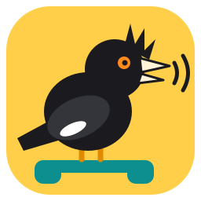
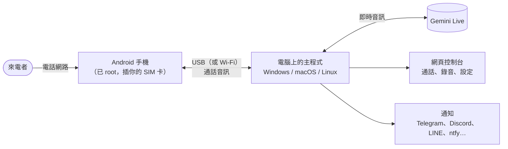

  

# Myna

**用 AI 語音接聽你真正的手機號碼，專為 Google Pixel 手機開發。** 一支插著你 SIM 卡的備用 Android 手機負責接起來電；電腦上的一個小程式讓 Gemini Live 的語音跟對方對話、把通話錄下來、寫一段簡短的摘要，再傳給你（Telegram、Discord、LINE、ntfy 等等）。

不需要 SIP 線路、不用租電話號碼、沒有平台月費：用的是你自己的 SIM 卡、你自己的電腦、你自己的 API 金鑰。

Myna 就是八哥，一種會學主人講話的鳥，台灣也有原生的八哥。這一隻住在你的電話線上，用你的方式幫你接電話。

[English](README.md) · **繁體中文** · [简体中文](README.zh-CN.md)

## 功能

- **每通來電都接**：響一聲就接，聲音自然、幾乎沒有延遲（手機還在響的時候，AI 就先準備好了）。
- **兩種接聽方式**：「AI 助理」（會說自己是 AI，幫你記下留言），或「本人」（照你平常的方式講話；有人認真問起時，還是會承認自己是 AI）。
- **真正的對話**：對方可以插話，停頓也應付得來；對方講完了電話才結束，不是時間到就掛。
- **推銷與詐騙電話**：客氣地拒絕；或者——如果你想要——盡量陪他聊下去，浪費他的時間。
- **拒接號碼**：這些號碼打來只會聽到一小段「無法接通」的語音，完全不會用到 AI。
- **每通電話結束後**：錄音、完整逐字稿、四行摘要（誰打來、什麼事、AI 怎麼回、你要處理什麼）；通話中講定了日期的話，還會附上行事曆建議（點一下就加入 Google 日曆，或下載 `.ics`）。
- **通知**：可以同時傳到 Telegram、Discord、Slack / Mattermost、LINE、ntfy、Gotify、Bark、Pushover、WeCom、DingTalk、Feishu / Lark、ServerChan、Matrix、電子郵件（Gmail）、Apprise，或你自己的 webhook（n8n、Zapier、Home Assistant…），任意搭配。
- **你的資料**：AI 可以拿來回答的事實（包裹放哪裡、營業時間）；沒寫在裡面的，它不可以自己編。
- **語言**：AI 會講英文、繁體中文（台灣）、簡體中文、日文、韓文、西班牙文、法文、德文和葡萄牙文；網頁控制台和手機 App 也翻譯成同樣這九種語言。
- **背景音**：墊在 AI 的聲音後面（居家、辦公室、街邊…），聽起來不會像在錄音室裡。
- **所有東西都留在你的電腦上**：錄音、逐字稿和設定都放在程式旁邊的資料夾裡。只有即時音訊會送到 Gemini、逐字稿會送到摘要模型、摘要會送到你設定的通知服務。

## 需要準備什麼

| | |
|---|---|
| **一支備用的 Android 手機**，有 SIM 卡 | 已 root（Magisk 或 KernelSU）。**實測過：Pixel 7、7a、8、9。** 其他已 root 的手機也許能用——要看手機的音訊硬體層；風險自負。這支手機會變成一台專門接電話的機器（鈴聲和撥號程式都會被接管）。 |
| **一台電腦**，需要接電話的時段要一直開著 | Windows 10/11、macOS 或 Linux。一台迷你電腦或舊筆電就綽綽有餘。 |
| **一條 USB 線** | 手機透過 USB 跟電腦溝通（也可以用 Wi-Fi）。 |
| **一把 Google Gemini API 金鑰** | 到 [Google AI Studio](https://aistudio.google.com/apikey) 取得。Live 音訊由 Google 依用量計費；請查看他們目前的價格。 |

## 快速開始

1. **取得程式。** 從 [Releases](https://github.com/h4lo-void/myna-call/releases) 頁面下載適合你系統的套件並解壓縮——或者 clone 這個 repository（這樣就需要安裝 [Rust](https://rustup.rs)；啟動腳本會自己建置）。
2. **啟動。** Windows：按兩下 `start.cmd`。macOS：按兩下 `start.command`。Linux：`./start.sh`。如果沒有 `adb`（Google 的 Android platform-tools），腳本會詢問要不要下載，接著打開網頁控制台 <http://localhost:8787/>。
3. **填好基本設定**：在網頁控制台填入你的 Gemini API 金鑰、你的名字、語言、接聽身分（AI 助理或本人）。按 ▶ 試聽各個聲音，挑一個。
4. **準備手機**（只要做一次）：在 Magisk / KernelSU 裡安裝發行版附的模組（`pixelcallai_uplink-<version>.zip`），重新開機，打開 **Myna** App，把檢查清單一項一項完成。開啟 USB 偵錯，把手機接上電腦，並在「允許 USB 偵錯嗎？」的視窗按允許。→ [手機設定](docs/zh-TW/PHONE.md)（手機 App 0.2.0 還沒在實機上測過，刷入前請先看下面的「專案現況」。）
5. **檢查，然後打一通。** 網頁控制台的「系統」頁會顯示手機「已連上主程式」。用另一支手機撥這支手機的號碼：響一聲後 AI 接聽，通話會連同錄音和摘要出現在控制台裡。
6. **加上通知**（「設定 → 通知」），按「傳送測試」。

每個步驟的詳細說明：[開始使用](docs/zh-TW/GETTING_STARTED.md)。

## 讓它講話像你

內建的提示詞不用調整就能用。想讓 AI 照**你**的方式講話，也不必自己動手寫提示詞：

1. 打開「設定 → 提示詞」，找到「不想自己寫？」，按「**複製訪談提示詞**」（也可以從 [`docs/prompts/`](docs/prompts/) 取得）。
2. 貼到 ChatGPT、Claude、Gemini 或其他任何聊天 AI。它會問你大約十個問題——你怎麼講話、誰會打給你、哪些事絕對不能答應。
3. 把它寫好的提示詞貼到「自訂提示詞」，把它給的「資料」貼到「AI 可以回答的資料」。儲存。下一通電話就會用上。

更多說明：[撰寫提示詞](docs/zh-TW/PROMPTS.md)。

## 文件

| | |
|---|---|
| [開始使用](docs/zh-TW/GETTING_STARTED.md) | 在 Windows / macOS / Linux 上安裝、第一通電話 |
| [手機設定](docs/zh-TW/PHONE.md) | Root 模組、App 檢查清單、USB 與 Wi-Fi、還原 |
| [撰寫提示詞](docs/zh-TW/PROMPTS.md) | 接聽方式、訪談提示詞、資料、範例 |
| [通知](docs/zh-TW/NOTIFICATIONS.md) | 每種服務怎麼設定；webhook 的內容格式 |
| [設定參考](docs/zh-TW/SETTINGS.md) | 每一項設定與啟動選項 |
| [疑難排解與常見問題](docs/zh-TW/TROUBLESHOOTING.md) | 遇到問題的時候 |
| [隱私、安全與法律](docs/zh-TW/PRIVACY_AND_LEGAL.md) | 哪些東西會離開你的電腦；錄音與揭露 AI 身分的規定 |
| [API](docs/zh-TW/API.md) | 網頁控制台的 REST 端點、手機通訊協定 |
| [架構](docs/zh-TW/ARCHITECTURE.md) | 各個部分怎麼組合在一起 |
| [發展藍圖](docs/zh-TW/ROADMAP.md) | 已經有的、還沒有的、社群想要的 |
| [`android/`](android/README.md) | 建置手機 App 與模組（英文） |
| [`tools/sms_forward/`](tools/sms_forward/README.md) | 選用：把手機收到的簡訊轉發到你的通知（英文） |

## 專案現況——請務必閱讀

這個專案原本是一個人自用的系統，運作了好幾個月之後才開放出來。請留意哪些部分經過實際驗證、哪些還沒有：

- **每天在真實通話中使用：** 繁體中文（台灣）、「本人」接聽方式、Pixel 7 / 7a / 8 / 9、對推銷／詐騙電話陪聊拖時間、拒接號碼、錄音與摘要、Telegram 通知。
- **開源版新增、尚未在真實通話中試過：** 其他所有語言、「AI 助理」接聽方式、主程式在 macOS 和 Linux 上自行管理 USB、Telegram 以外的通知服務（它們的請求只依照各服務文件記載的格式做過單元測試，沒有用真實帳號測過）、行事曆建議、手機 App 0.2 版的設定畫面、Docker 映像檔，以及發行流程（release workflow）。
- **手機 App 0.2.0 還沒在實機上跑過。** 每天在用的手機裝的仍是前一版 App。0.2.0 可以建置，但還沒有人把它裝到手機上實際接過電話。請刷在備用手機上，並先看過[還原步驟](docs/zh-TW/PHONE.md#還原)。
- **發行版裡的模組是用臨時金鑰簽的。** 第一次安裝沒有問題；如果之後的版本改用別的金鑰簽，安裝新版前要先移除模組並重新開機。

非常歡迎回報問題，請附上主程式的日誌，並說明你原本預期的結果。詳見 [CONTRIBUTING.md](CONTRIBUTING.md)（英文）。

## 請負責任地使用

- **各地法律不同。** 通話錄音、以及讓 AI 在沒有告知的情況下跟人講話，在很多地方都受到限制。預設的接聽方式會表明自己是 AI。請先弄清楚你和來電者所在的地方適用哪些規定。
- **AI 不做任何承諾。** 它被指示絕不答應付款、合約、密碼或約定時間——但它畢竟是 AI：摘要請務必看過。
- **緊急電話和任何要緊的事**，都不應該依賴這套系統。
- **Root 手機**會讓保固失效，也可能出問題。請用備用手機。

詳見[隱私、安全與法律](docs/zh-TW/PRIVACY_AND_LEGAL.md)。

## 授權

[MIT](LICENSE)。內附的音效為 CC0；有一支安裝腳本採用 GPL-3.0——詳見 [NOTICE.md](NOTICE.md)（英文）。本專案與 Google 沒有關聯；Pixel 是 Google LLC 的商標。
