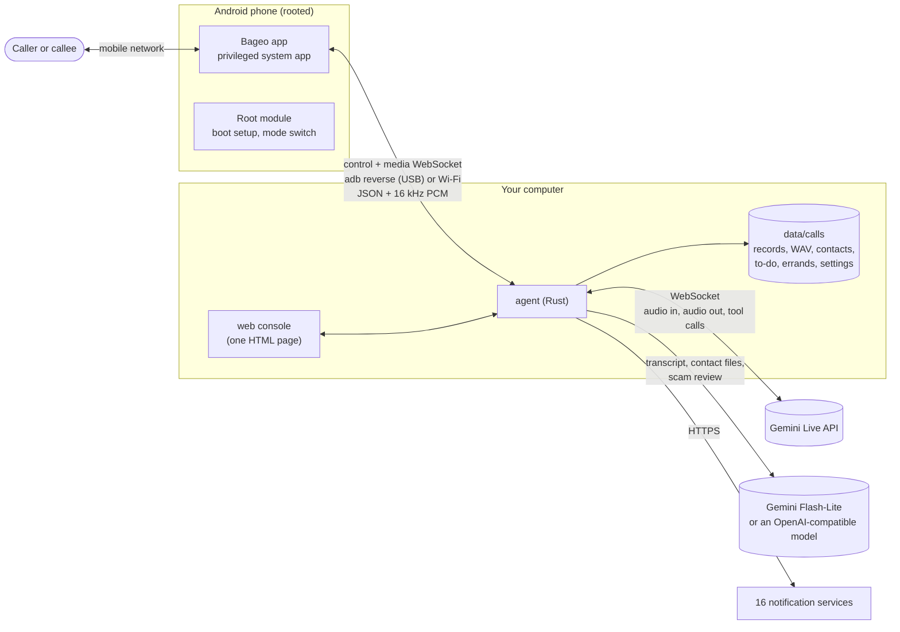

# Architecture

Bageo has three parts: a phone app with a root module that turns a spare
Android phone into a call box, one Rust program on your computer (the
*agent*) that holds all the logic, and a web console compiled into that
program. There is no database, no message broker and no cloud service of the
project's own.



## The pieces

| Piece | Where | Role |
|---|---|---|
| **Phone app** | [`android/`](../../android) | Answers or places the call silently, captures the other side's voice, plays the AI's voice into the call, reports the SIM of each call, sends texts on request. Holds no logic about the conversation. |
| **Root module** | `android/magisk/pixelcallai_uplink` | Installs the app as a privileged system app, sets the phone up as a call box at every boot, and runs the root helper that switches between AI phone and normal phone. |
| **Agent** | [`crates/agent`](../../crates/agent) | Everything else: the call state machine, the Gemini Live sessions, recording, summaries, contacts, appointments, errands, notifications, the web console and its API, the USB link to the phones. |
| **Web console** | `crates/agent/static/calls.html` | One self-contained page compiled into the agent, in nine languages. |
| **SMS forwarder** | [`tools/sms_forward`](../../tools/sms_forward) | Optional, separate Python script that forwards the phone's incoming texts. |

### Agent modules

| Module | What it does |
|---|---|
| `main.rs` | Start-up, the phone WebSocket endpoints, the incoming-call state machine, the after-call pipeline. |
| `gemini_live.rs` | One Live session per call: audio relay, echo check, interruption, hang-up rules, sales detection and the switch to Stall Mode, session renewal, the special modes for AI call-backs and errands (wait for the callee, ringback filter, tool calls). |
| `prompts.rs`, `locale.rs` | The system prompt of each call, assembled per language and answer style; the phrases each language uses and listens for. |
| `stall_review.rs` | The second look before Stall Mode: a small model classifies the call as `scam_or_sales`, `normal`, `ivr_recording` or `too_early`, within 1.5 s. |
| `appointments.rs` | The `propose_appointment` tool on normal calls, the to-do items it creates, Accept / Decline, the text or AI call-back that tells the caller, and the shared outbound queue. |
| `callback.rs` | The phones' control connections: `place_call`, `send_sms` and their results, routed to the right phone. |
| `errands.rs` | AI errands: number checks, phone and SIM choice (`SimBook`), the errand script and `ask_owner`, live captions, what you type during the call, the structured result. |
| `contacts.rs` | The contact list, number matching however a number is written, import from vCard / CSV / TSV / text / `.xlsx` / `.docx` and through Gemini for PDFs and pictures, vCard export. |
| `phone_region.rs` | Which country a number belongs to, read the way the SIM that took the call reads it; the SIM country each phone reported. |
| `calendar.rs` | Calendar suggestions and the "add to calendar" links for Google, Outlook.com, Microsoft 365, Yahoo and `.ics`. |
| `deepseek.rs` | The after-call summary over Gemini or any OpenAI-compatible API (the name is historical), translations of lines said in another language, the result of an errand. |
| `tasks.rs` | The store behind *To do*. |
| `notify.rs`, `gmail.rs`, `tg_inbound.rs` | The 16 notification channels, e-mail over SMTP, and Telegram button presses. |
| `calls.rs`, `calls_http.rs` | Call records, recordings and transcripts; the web console's REST API. |
| `settings_store.rs` | Settings from `.env` plus what the console saved, applied without a restart. |
| `usb_bridge.rs` | Keeps `adb reverse` up for every USB phone and starts the app's call service. |
| `mdns.rs` | Answers `bageo.local` on the local network (multicast DNS), so the console opens without knowing the computer's IP. |
| `adpcm.rs`, `voice_preview.rs`, `ambience.rs` | The 1,080 bundled voice clips in IMA ADPCM, voice previews and "not available" announcements, the twelve background sounds. |

## One incoming call, step by step

1. **Idle.** Each phone keeps a *control* WebSocket open to the agent. On USB
   the app dials `ws://127.0.0.1:8765` on the phone; `adb reverse`, kept up by
   `usb_bridge.rs`, carries that to the agent's port.
2. **Ringing.** The app reports `incoming` with the caller's number and the SIM
   it came in on. The agent decides:
   - a blocked number is hung up on while it rings, or picked up for the
     recorded announcement, and never reaches Gemini;
   - otherwise it answers with an `answer_plan` (ring for *n* ms, 3 s by
     default) and, with *ring pre-warm*, opens the Gemini Live session right
     away. The prompt is assembled now: your prompt or the built-in one, status
     note, notes, who is calling if the number is in your contacts, the other
     names callers use for you, the language rules for this SIM and this
     number, the appointment tool when appointments are on, and the fixed
     rules (see [Writing the prompt](PROMPTS.md#what-the-ai-is-told-on-every-call)).
     The model generates its opening line, which is held back until pick-up.
3. **Pick-up.** The app answers and opens a *media* WebSocket. Caller audio
   flows up as 60 ms PCM frames; the agent adopts the pre-warmed session,
   releases the opening line (measured median: about 0.43 s from pick-up), and
   from then on relays audio both ways. A phone that reports the SIM only at
   pick-up can change the opening language; the prepared line is then dropped
   and the AI answers a moment later in the right language.
4. **Conversation** (`gemini_live.rs`). The agent
   - normalises the quiet call audio and checks, in the first seconds, whether
     the phone's capture contains the AI's own voice. That decides whether the
     caller may interrupt (about 0.8 s of speech; short "mm" sounds do not
     count) and how the background sound is mixed;
   - streams the caller to Gemini, which detects turn ends itself by default,
     and Gemini's audio back to the phone, mixed with the background sound;
   - on a Taiwanese SIM taking a call from abroad, keeps the AI quiet until the
     carrier's recorded warning has finished;
   - reads Gemini's transcripts of both sides to drive the few rules that are
     not left to the model: whether the caller is leaving (a goodbye at the end
     of what they said), whether the call is a sales pitch or scam (keyword
     score → `stall_review.rs` → Stall Mode on a fresh session), a nudge when
     the line goes quiet, a wrap-up before the longest call length;
   - answers the model's `propose_appointment` call on a task of its own, so
     the audio never waits for it;
   - replaces the Live session with a fresh one carrying the transcript every
     few minutes, because a Live connection has a limited lifetime.
5. **Hang-up.** When the caller's last words were a goodbye, or the AI said
   goodbye and the line stayed quiet for 6 s, the agent sends `hangup`. A
   recorded voice menu gets no answer and is hung up on after a few seconds of
   quiet. If the AI never produced audio (no key, service down) it hangs up at
   once rather than leave the caller in silence.
6. **Afterwards** (`main.rs`, `deepseek.rs`, `appointments.rs`,
   `notify.rs`). The recording is finalised (mixed, caller only, AI only), the
   transcript goes to the summary model, the four-line summary is saved next
   to the call and sent to every notification channel. Each appointment the
   caller asked for becomes a *To do* item (none from sales or scam calls).
   Lines said in another language are translated in the background and added
   to the notes when they arrive, so the notification never waits for them.

## One outgoing call: an AI errand or an appointment call-back

Both kinds share one outbound route in `appointments.rs`: one call to a number
at a time, `place_call` only to the phone (and SIM) chosen for it, and the
script applied only to the call that phone reports for that task. An incoming
call from the same number never gets the outbound script.

1. **The request.** An errand comes from `POST /calls/api/errands` (the
   *Errands* page or **Ask AI to call** on a contact); a call-back from
   **Accept** / **Decline** with *AI call-back* on a *To do* item or its
   Telegram card.
2. **Number checks.** Errands refuse emergency numbers, short codes (7 digits
   or fewer), premium-rate numbers and numbers written after an international
   call prefix (`00`, `011`, Taiwan's `01x` / `00x`, Japan's `010`); numbers
   abroad are written with `+`. Call-backs go only to the caller's own number,
   only within the answering SIM's country, never to toll-free, premium or short
   numbers.
3. **Phone and SIM.** An errand picks a phone in AI mode that has a SIM of the
   number's country. The agent learns each phone's SIMs (subscription id and
   country) from the calls it reports, and from a `sims` list in its control
   hello, and keeps them in `phone_sims.json`. A phone whose SIMs it has never
   heard of takes no errand (`sim_unknown`). A call-back goes out on the phone
   and SIM that took the original call.
4. **Dialing.** The agent sends `place_call` with the checked number in E.164
   form and the SIM to use. When the call's media hello reports a different SIM,
   or none, the agent hangs up before the AI starts (`wrong_sim`) and forgets
   that SIM on that phone. A cancelled errand is never dialed; a call that still
   starts after a cancel is hung up at once.
5. **Waiting for a person.** The AI does not say "Hello?" into the ringback.
   The agent passes only silence to Gemini until the callee has picked up and
   spoken (at least 400 ms of voice, with the 350–520 Hz ringback filtered out).
   Nobody for 70 s means no answer; a carrier's "not in service" recording is
   hung up on at once; an errand waits out a voice menu for up to 90 s.
6. **The conversation.**
   - A **call-back** says who is calling, gives your answer once (the time and
     what it is about, or a polite no) in the language of the original call,
     says goodbye and ends.
   - An **errand** follows its script: say whom it calls for, settle what the
     errand allows on its own, and call `ask_owner` for anything else. The call
     blocks on the answer: if the console asked for the live view in the last
     6 s, the question shows there for up to 40 s; otherwise, or on timeout,
     the AI is told that none of its own options may be taken, asks the other
     side which ones would work, and closes politely. What you type during the
     call (`say`) reaches the AI as an instruction. Every note reminds the AI
     to keep the call's language, numbers included. An errand call lasts at most
     10 minutes, with a wrap-up at 9:30.
7. **Afterwards.** A call-back's outcome goes on its *To do* item, with
   one notification titled "📞 AI call-back". An errand's transcript, task and
   questions go to the summary model, which returns `{outcome, summary,
   details, follow_up, options, event}`. Anything the AI agreed to on a question
   you did not answer turns the outcome into `need_owner`. You get one 📞
   notification with the contact's name or the number; **Call again** and
   **Reply, and have the AI call again** (`follow_up_of`, carrying the last
   lines of the earlier call) are yours to press.

## Where the model gets tools, and where it does not

On an ordinary call the voice has no slow lookups behind it: the model cannot
search the web or read a calendar mid-sentence, it is told so, and it is told
never to say "let me check". Everything that needs judgement happens after the
call, with you reading the summary.

Two features give the model a tool, each under a strict state machine in the
agent:

- `propose_appointment` (normal calls with appointments on, never in Stall
  Mode): records the requested time and topic. The AI only promises to get
  back to the caller; nothing is confirmed until you press **Accept**, and only
  the first decision counts.
- `ask_owner` (errand calls only): blocks the AI until you answer or the
  question times out; a result that settled an unanswered question becomes
  `need_owner`.

Deterministic rules around the model handle what must not go wrong: when to
hang up, when to stop a blocked caller, never leaving a caller in silence,
which numbers may be dialed and from which SIM.

## Languages

`locale.rs` holds, per language, the short phrases the model is shown (how one
answers the phone, how one says goodbye), the words the hang-up and sales-call
rules listen for, the speech-recognition hint, and the notification labels.
`prompts.rs` builds the system prompt: Traditional Chinese uses the prompts the
project was tuned with on real calls, Simplified Chinese a converted copy, and
every other language one set of English instructions that names the language to
speak and quotes that language's phrases. The opening language follows the
caller's number and the SIM's main language; every prompt tells the AI to follow
the caller into another language. Adding a language means adding one `Phrases`
block and its entry in the web console's dictionary.

## Storage

```text
data/calls/
  config/settings.json              what the web console saved (keys in plain text)
  index.json                        the call list
  2026-11-14/<call id>*.wav         recordings: mixed, caller only, AI only
  2026-11-14/<call id>_notes.json   summary, transcript, translations, calendar suggestion
  contacts.json                     your contacts
  tasks/index.json, tasks/<id>.json the to-do items (appointments)
  errands.json                      AI errands, the newest 500
  phone_sims.json                   the SIMs each phone has reported
  voice_preview/                    cached voice samples and announcements
```

Plain JSON and WAV files, no database; delete or back up at will. Every write
goes to a temporary file first and is then renamed over the old one. An
unreadable `errands.json` or `phone_sims.json` is moved aside rather than
overwritten.

## Design choices

- **Speech to speech.** One model hears and speaks, so latency and interruption
  come from the model, not from a chain of speech-to-text, LLM and
  text-to-speech.
- **Your SIM, your phone.** No SIP trunk and no cloud telephony: the phone
  protocol is small and documented in [API](API.md), so another front end
  could stand in for the phone.
- **One process.** Nothing else to install, keep alive or secure.
- **Fail closed on the risky paths.** A doubtful scam review counts as a scam
  (the caller is kept talking, not let through); an unknown SIM takes no
  errand; an appointment waits for you.

## Older code paths

The agent grew out of a menu-based system (recorded greeting, DTMF, hold
music, voicemail, a Tencent TRTC bridge, a Whisper / LLM / Piper pipeline).
That code is still in `main.rs` and its own modules, switched off by default
and without its recordings. It is kept for now because it is interleaved with
the live path; removing it cleanly is on the [roadmap](ROADMAP.md).
