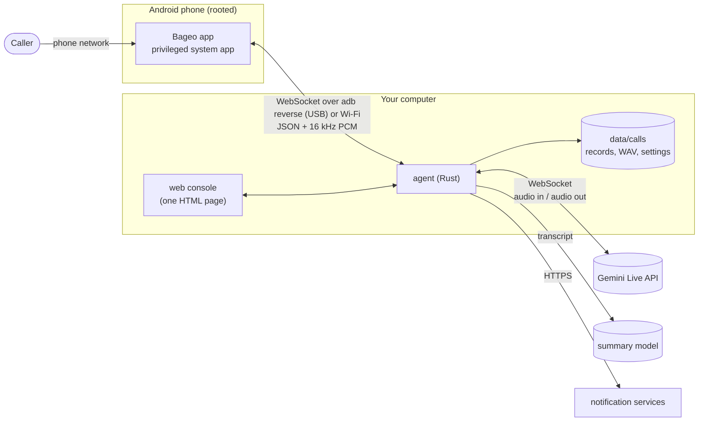

# Architecture



## The pieces

| Piece | Where | Role |
|---|---|---|
| **Phone app** | [`android/`](../../android) | Answers the call silently, captures the caller's voice, plays the AI's voice into the call. Holds no logic about the conversation. |
| **Root module** | `android/magisk/pixelcallai_uplink` | Installs the app as a privileged system app and sets the phone up as a call box at every boot. |
| **Agent** | [`crates/agent`](../../crates/agent) | Everything else: the call state machine, the Gemini Live session, recording, summaries, notifications, the web console and its API, and the USB link to the phones. One program, no database. |
| **Web console** | `crates/agent/static/calls.html` | A single self-contained page compiled into the agent. |
| **SMS forwarder** | [`tools/sms_forward`](../../tools/sms_forward) | Optional, separate Python script. |

## One call, step by step

1. **Idle.** Each phone keeps a *control* WebSocket open to the agent. On USB
   the app dials `ws://127.0.0.1:8765` on the phone; `adb reverse` — kept up by
   the agent's USB manager (`usb_bridge.rs`) — carries that to the agent's port.
2. **Ringing.** The app reports `incoming` with the caller's number. The agent
   decides: a blocked number is picked up at once to be hung up on; otherwise it
   answers with an `answer_plan` (ring for *n* ms) and — *ring pre-warm* —
   opens the Gemini Live session right away and has the model generate its
   opening line, held back until pick-up.
3. **Pick-up.** The app answers and opens a *media* WebSocket. Caller audio
   flows up as 60 ms PCM frames; the agent adopts the pre-warmed session,
   releases the opening line, and from then on relays audio both ways.
4. **Conversation** (`gemini_live.rs`). The agent
   - normalises the quiet call audio and checks, in the first seconds, whether
     the phone's capture contains the AI's own voice (echo) — which decides
     whether the caller may interrupt and how the background sound is mixed;
   - streams the caller to Gemini (which detects turn ends itself, by default)
     and Gemini's audio back to the phone, mixed with the background sound;
   - reads Gemini's transcripts of both sides to drive the few rules that are
     not left to the model: when the caller is leaving (goodbye words at the
     end of what they said), whether the call is a sales pitch or scam (keyword
     score → switch to the stalling prompt on a fresh session), a nudge when
     the line goes quiet, a wrap-up before the longest call length;
   - replaces the Live session with a fresh one carrying the transcript every
     few minutes, because a Live connection has a limited lifetime.
5. **Hang-up.** When the caller's last words were a goodbye — or the AI said
   goodbye and the caller stays silent — the agent sends `hangup`. If the AI
   never produced audio (no key, service down) it hangs up at once rather than
   leave the caller in silence.
6. **Afterwards** (`main.rs`, `deepseek.rs`, `calendar.rs`, `notify.rs`). The
   recording is finalised, the transcript goes to the summary model, the
   summary (and a calendar suggestion, if the call fixed a date) is saved next
   to the call and sent to every notification channel.

## Languages

`locale.rs` holds, per language, the short phrases the model is shown (how one
answers the phone, how one says goodbye), the words the hang-up and sales-call
rules listen for, and the notification labels. `prompts.rs` builds the system
prompt: Traditional Chinese uses the prompts the project was tuned with,
Simplified Chinese a converted copy, and every other language one set of
English instructions that names the language to speak and quotes that
language's phrases. Adding a language means adding one `Phrases` block and its
entry in the web console's dictionary.

## Storage

```text
data/calls/
  config/settings.json          what the web console saved (keys in plain text)
  index.json                    the call list
  2026-11-12/<call id>*.wav     recordings: mixed, caller only, AI only
  2026-11-12/<call id>_notes.json   summary, transcript, calendar suggestion
  voice_preview/                cached voice samples and announcements
```

Plain files, no database; delete or back up at will.

## What is deliberately simple

- **No tools behind the voice.** The model cannot look anything up or perform
  actions during a call; it is told so, and told not to pretend. Everything
  that needs judgement happens afterwards, with you reading the summary.
- **Deterministic rules around the model** for the things that must not go
  wrong: when to hang up, when to stop a blocked caller, never leaving a caller
  in silence.
- **One process.** No message broker, no separate services to keep alive.

## Older code paths

The agent grew out of a menu-based system (recorded greeting, DTMF, hold
music, voicemail, a Tencent TRTC bridge, a Whisper / LLM / Piper pipeline,
Telegram task cards). That code is still in `main.rs` and its own modules,
switched off by default and without its recordings. It is kept for now because
it is interleaved with the live path; removing it cleanly is on the roadmap.
