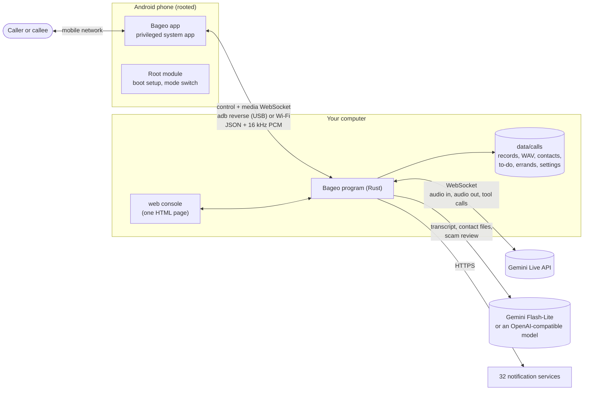
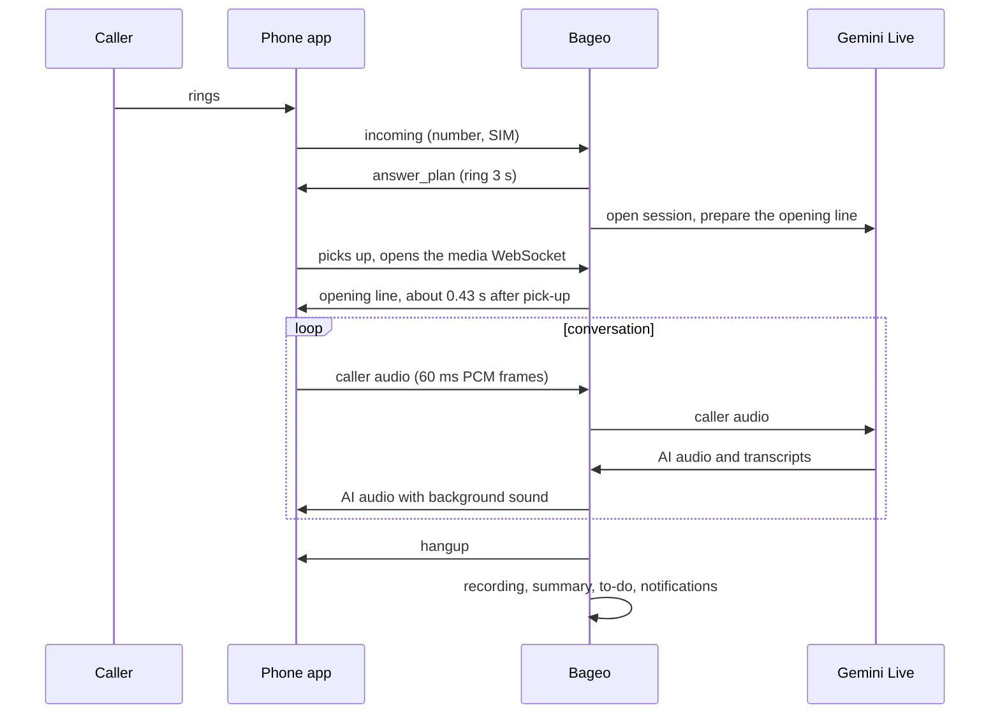

# How Bageo works: architecture of a self-hosted AI phone assistant

Bageo lets an AI answer and place calls on your real phone number. This page
follows one call from the ring on a rooted Android phone, through one Rust
program on your computer, to Gemini Live and back, and names the file that
handles each step. Read it before you change the code, debug a call, or put
another front end in place of the phone.

## The big picture

Bageo has three parts. There is no database, no message broker and no cloud
service of the project's own.

1. **A spare Android phone** (rooted, with your SIM) runs the Bageo app and a
   root module. It answers, dials and carries audio. It makes no decisions.
2. **The Bageo program** is one Rust program on your computer. It holds all
   the logic: when to answer, the Gemini Live session, the hang-up and scam
   rules, summaries, contacts, appointments, errands and notifications.
3. **The web console** is one HTML page compiled into the Bageo program, in
   nine languages.



## The pieces

| Piece | Where | Role |
|---|---|---|
| **Phone app** | [`android/`](../../android) | Answers or places the call silently, captures the other side's voice, plays the AI's voice into the call, reports the SIM of each call, sends texts on request. No conversation logic. Details: [phone-side architecture](../../android/ARCHITECTURE.md). |
| **Root module** | `android/magisk/pixelcallai_uplink` | Installs the app as a privileged system app, sets the phone up as a call box at every boot, and runs the root helper behind the AI phone / [normal phone](PHONE.md#normal-phone-mode) switch. |
| **Bageo program** | [`crates/agent`](../../crates/agent) | Everything else: the call state machine, Gemini Live sessions, recording, summaries, contacts, appointments, errands, notifications, the web console and its API, the USB link to the phones. |
| **Web console** | `crates/agent/static/calls.html` | One self-contained page compiled into the Bageo program. |
| **Bageo Status** | [`desktop/`](../../desktop) | Optional desktop tray / menu-bar app (Tauri 2, included in the Windows installer and macOS `.dmg`) that starts Bageo in the background and shows status, call, SMS and summary notifications. |
| **SMS forwarder** | [`tools/sms_forward`](../../tools/sms_forward) | Optional, separate Python script that forwards the phone's incoming texts. |

### Modules of the Bageo program

| Module | What it does |
|---|---|
| `main.rs` | Start-up, the phone WebSocket endpoints, the incoming-call state machine, ring pre-warm, the after-call pipeline. |
| `gemini_live.rs` | One Live session per call: audio relay, echo check, interruptions, hang-up rules, sales detection and the switch to Stall Mode, session renewal, and the outbound modes (wait for the callee, ringback filter, tool calls). |
| `prompts.rs`, `locale.rs` | The system prompt of each call, built per language and answer style; the phrases each language says and listens for. |
| `closing.rs` | Local closing state machine across 26 language word sets: detects pre-closings, farewells, resumptions and greetings that also mean goodbye. |
| `scenario.rs`, `preflight.rs` | Call-situation hints (courier, bank charge check, wrong number, …) and errand preflight question/ladder extraction. |
| `stall_review.rs` | The second look before Stall Mode: `gemini-flash-lite-latest` labels the call `scam_or_sales`, `normal`, `ivr_recording` or `too_early` within 1.5 s, naming the kind of call from the scam database and how sure it is. |
| `scam_db.rs` | The sales and scam database (`data/scam_db.json`: 46 kinds of call, keywords in 27 languages, number hints), your additions in `config/scam_db.local.json`, and the marks per number. |
| `appointments.rs` | The appointment tools on normal calls, the to-do items they create, Accept / Decline, the text or AI call-back that tells the caller, and the shared outbound queue. |
| `urgent_call.rs`, `urgency.rs` | Urgent caller detection across languages and the trial 3-way conference merge (`add_call`) for forwarded calls. |
| `callback.rs` | The phones' control connections: `place_call`, `send_sms` and their results, routed to the right phone. |
| `errands.rs` | AI errands: number checks, phone and SIM choice (`SimBook`), the errand script and `ask_owner`, live captions, what you type during the call, the structured result. |
| `contacts.rs` | The contact list; number matching however a number is written; import from vCard, CSV, TSV, text, `.xlsx` and `.docx`, and through Gemini for PDFs and pictures; vCard export. |
| `phone_region.rs` | Which country a number belongs to, read the way the answering SIM reads it; the SIM country each phone reported. |
| `calendar.rs` | Calendar suggestions and "add to calendar" links for Google, Outlook.com, Microsoft 365, Yahoo and `.ics`. |
| `summary.rs` | The after-call summary over Gemini or any OpenAI-compatible API, translations of lines said in another language, the result of an errand. |
| `tasks.rs` | The store behind **To do**. |
| `sms_store.rs` | Stored text messages, grouped into conversations, and replies sent back through the phone. |
| `notify.rs`, `gmail.rs`, `tg_inbound.rs` | The 32 notification channels, e-mail over SMTP, Telegram button presses. |
| `control/` | Remote chat commands and natural-language parsing across Telegram, Discord, Slack and Matrix. |
| `mcp.rs` | Built-in Model Context Protocol (`POST /mcp`) server and universal inbound command endpoint (`POST /calls/api/control/inbound`). |
| `calls.rs`, `calls_http.rs` | Call records, recordings and transcripts; the web console's REST API. |
| `backup.rs`, `backup_crypt.rs` | Scheduled and manual backups, selective export/import, and `.bageo` encryption (Argon2id + XChaCha20-Poly1305). |
| `settings_store.rs` | Settings from `.env` plus what the console saved, applied without a restart. |
| `lan.rs`, `phone_wifi.rs` | LAN access guard, `Host` check, password rate limiting, and the USB-to-Wi-Fi phone pairing key. |
| `usb_bridge.rs` | Keeps `adb reverse` up for every USB phone and starts the app's call service. |
| `mdns.rs` | Answers `bageo.local` on the local network (multicast DNS), so the console opens without knowing the computer's IP. |
| `log_text.rs` | Masks caller numbers and omits spoken words from logs unless `LOG_CALL_TEXT=1` is set. |
| `adpcm.rs`, `voice_preview.rs`, `ambience.rs` | The 1,080 bundled voice clips (IMA ADPCM), voice previews and the "not available" announcement, the 12 background sounds. |

## An incoming call, step by step



1. **Idle.** Each phone keeps a *control* WebSocket open to the Bageo program.
   - On USB, the app dials `ws://127.0.0.1:8765` on the phone, and
     `adb reverse` (kept up by `usb_bridge.rs`) carries it to the Bageo
     program.
   - Over [Wi-Fi](PHONE.md#wi-fi), the app connects to the address of the
     Bageo program directly.
2. **Ringing.** The app reports `incoming` with the caller's number and the
   SIM the call came in on. Bageo decides:
   - A Blacklist number is hung up on while it rings, or picked up for the
     recorded announcement. It never reaches Gemini.
   - Any other call gets an `answer_plan`: ring for `answer_ring_ms` (3 s by
     default, 8 s at most), then pick up.
   - With **Get the AI ready while the phone rings** (`gemini_ring_prewarm`),
     Bageo opens the Gemini Live session right away and builds the prompt. The
     model prepares its opening line, which is held back until pick-up.
   - The prompt holds your prompt or the built-in one, your status note and
     notes, the caller's name if the number is in your contacts, the other
     names callers use for you, the language rules for this SIM and number, the
     appointment tools when appointments are on, and the fixed rules (see
     [Writing the prompt](PROMPTS.md#what-the-ai-is-told-on-every-call)).
3. **Pick-up.** The app answers and opens a *media* WebSocket. Caller audio
   flows up in 60 ms PCM frames.
   - The Bageo program adopts the pre-warmed session and releases the opening
     line (measured median: about 0.43 s after pick-up).
   - Some phones report the SIM only at pick-up. If that changes the opening
     language, the prepared line is dropped and the AI answers a moment later
     in the right language.
4. **Conversation** (`gemini_live.rs`). Bageo:
   - boosts the quiet call audio and checks in the first seconds whether the
     phone's capture contains the AI's own voice. That decides whether the
     caller may interrupt (**Let the caller interrupt**: about 0.8 s of speech;
     a short "mm" does not count) and how the background sound is mixed;
   - streams the caller to Gemini, which detects the end of each turn itself by
     default, and sends Gemini's audio back mixed with the background sound;
   - on a Taiwanese SIM taking a call from abroad, keeps the AI quiet until the
     carrier's recorded warning has finished;
   - reads Gemini's transcripts of both sides to run the few rules that are
     not left to the model:
     - whether the caller is leaving (their last words are a goodbye);
     - whether this is a sales or scam call (keyword score, then
       `stall_review.rs`, then Stall Mode on a fresh session);
     - a nudge when the line goes quiet, and a wrap-up before the longest
       call length;
   - answers the model's appointment tool calls on a separate task, so the
     audio never waits;
   - replaces the Live session with a fresh one that carries the transcript
     (about every 8 minutes), because a Live connection has a limited lifetime.
5. **Hang-up.**
   - Bageo sends `hangup` when the caller's last words were a goodbye, or when
     the AI said goodbye and the line stayed quiet for 6 s.
   - A recorded voice menu gets no answer and is hung up on after 4 s of quiet
     (20 s at most).
   - If the AI never produced audio (no key, service down), the call is ended
     at once instead of leaving the caller in silence.
6. **Afterwards** (`main.rs`, `summary.rs`, `appointments.rs`,
   `notify.rs`).
   - The recording is saved three ways (mixed, caller only, AI only).
   - The transcript goes to the summary model, and the four-line summary is
     stored with the call and sent to every notification channel.
   - Each appointment the caller asked for becomes a **To do** item (never from
     sales or scam calls).
   - Lines in another language are translated in the background and added when
     ready, so the notification never waits for them.

> **Example: a sales call that never ends.** A caller offers a "free policy
> check-up". The keyword score crosses its line, `stall_review.rs` answers
> `scam_or_sales`, and a fresh Live session with the Stall Mode prompt
> takes over: the AI sounds interested, asks how the premium is worked out,
> and never gives out data or agrees to anything.

> If the caller has only said who they are, the review answers `too_early` and
> looks again after their next turn. When the review does not answer in time,
> only words that are a scam whoever says them (a code, ATM steps, a safe
> account) start the stalling at once. Otherwise the next turn is looked at,
> and after two failures in a row the keywords decide alone.

> Two caller turns into the stalling, one more look can let a wrongly judged
> caller go.

## An outgoing call: AI errand or call-back

Picture an errand like "Book a table for four tomorrow at 7; 7:30 is also
fine."

Errands and appointment call-backs share one outbound route in
`appointments.rs`:

- One call to a number at a time.
- `place_call` goes only to the phone and SIM chosen for it.
- The script applies only to the call that phone reports for that task. An
  incoming call from the same number never gets the outbound script.

1. **The request.**
   - An errand comes from `POST /calls/api/errands` (the **Errands** page, or
     **Ask AI to call** on a contact; see [the API](API.md#ai-errands)).
   - A call-back comes from **Accept** / **Decline** with **AI call-back**
     chosen on a **To do** item or its Telegram card (see
     [appointments](API.md#appointments-and-tasks)).
2. **Number checks.**
   - Errands refuse emergency numbers and other short codes (7 digits or
     fewer), premium-rate numbers, and numbers written after an international
     call prefix (`00`, `011`, Taiwan's `01x` / `00x`, Japan's `010`). Write
     numbers abroad with `+`.
   - Call-backs go only to the caller's own number, only within the answering
     SIM's country, and never to toll-free, premium-rate or short numbers.
3. **Phone and SIM.**
   - An errand picks a phone in AI mode that has a SIM of the number's country.
   - The Bageo program learns each phone's SIMs (subscription id and country)
     from the calls it reports and from the `sims` list in its control hello,
     and keeps them in `phone_sims.json`.
   - A phone whose SIMs it has never heard of takes no errand
     (`sim_unknown`).
   - A call-back goes out on the phone and SIM that took the original call.
4. **Dialing.**
   - The Bageo program sends `place_call` with the number in E.164 form and the
     SIM to use.
   - If the call's media hello reports another SIM, or none, Bageo hangs up
     before the AI speaks (`wrong_sim`) and forgets that SIM on that phone.
   - A cancelled errand is never dialed; a call that still starts after a
     cancel is hung up at once.
5. **Waiting for a person.** The AI does not say "Hello?" into the ringback.
   - Gemini gets only silence until the callee picks up and speaks (at least
     400 ms of voice, with the 350–520 Hz ringback filtered out).
   - Nobody for 70 s means no answer.
   - A carrier's "not in service" recording is hung up on at once; an errand
     waits out a voice menu for up to 90 s.
6. **The conversation.**
   - A **call-back** says who is calling, gives your answer once (the time and
     topic, or a polite no) in the language of the original call, says goodbye
     and ends.
   - An **errand** follows its script: say whom it calls for, settle what the
     errand allows, and call `ask_owner` for anything else. The call waits
     for the answer:
     - If the console had the live view open in the last 6 s, the question
       shows there for up to 40 s.
     - Otherwise, or on timeout, the AI is told it may not take any of its own
       options, asks the other side which ones would work, and closes politely.
     - What you type during the call (`say`) reaches the AI as an instruction.
     - Every note reminds the AI to keep the call's language, numbers
       included.
     - An errand lasts at most 10 minutes, with a wrap-up at 9:30.
7. **Afterwards.**
   - A call-back's outcome goes on its **To do** item, with one notification
     titled "AI call-back".
   - An errand's transcript, task and questions go to the summary model, which
     returns `{outcome, summary, details, follow_up, options, event}`.
   - If the AI agreed to something on a question you did not answer, the
     outcome becomes `need_owner`.
   - You get one notification with the contact's name or the number, and the
     errand offers **Call again** and **Reply, and have the AI call again**
     (`follow_up_of`, which carries the last lines of the earlier call).

## When the AI gets tools

On an ordinary call nothing slow sits behind the voice: the model cannot
search the web or read your calendar mid-sentence, it is told so, and it is
told never to say "let me check". Anything that needs judgement happens after
the call, when you read the summary.

Two features give the model tools, each held by a strict state machine in the
Bageo program:

- **Appointments** (normal calls with appointments on, never in Stall Mode):
  - `check_availability` always answers that the schedule cannot be seen on
    this call (`{"free": null}`), and the prompt tells the model not to call
    it.
  - `propose_appointment` records the requested time and topic.
  - The AI only promises to get back to the caller. Nothing is confirmed until
    you press **Accept**, and only the first decision counts.
- **Errands** (errand calls only):
  - `ask_owner` holds the AI until you answer or the question times out.
  - A result that settled an unanswered question becomes `need_owner`.

Fixed rules around the model handle what must not go wrong: when to hang up,
when to stop a blocked caller, never leaving a caller in silence, which
numbers may be dialed and from which SIM.

## Languages

`locale.rs` holds, per language:

- The short phrases the model is shown (how people answer the phone, how they
  say goodbye).
- The words the hang-up and sales rules listen for.
- The speech-recognition hint.
- The notification labels.

`prompts.rs` builds the system prompt:

- Each of the nine languages has its own concise built-in default prompt in that
  language (`short_text`), for both *AI assistant* and *As me*.
- Auxiliary instructions (stalling, nudges, fixed guard rules) come from
  Traditional Chinese, a converted Simplified Chinese copy, or a shared set of
  English instructions filled with that language's phrases.

The opening language follows the caller's number and the SIM's main language,
and every prompt tells the AI to follow the caller into another language.

To add a language, add one `Phrases` block, a `short_text` default prompt and
its entry in the web console's dictionary.

## Where your data lives

```text
data/calls/
  config/settings.json              what the web console saved (keys in plain text)
  index.json                        the call list
  2026-11-14/<call id>*.wav         recordings: mixed, caller only, AI only
  2026-11-14/<call id>_notes.json   summary, transcript, translations, calendar suggestion
  contacts.json                     your contacts
  tasks/index.json, tasks/<id>.json the to-do items (appointments)
  errands.json                      AI errands, the newest 500
  phone_sims.json                   the SIMs each phone has reported
  phone-pairing.key                 pairing key for phones over Wi-Fi
  sms/messages.json                 forwarded and replied text messages
  backups/                          scheduled, manual, before-import backups (.zip / .bageo)
  voice_preview/                    cached voice samples and announcements
```

Plain JSON and WAV files, no database. Every write goes to a temporary file
first and is then renamed over the old one. An unreadable `errands.json` or
`phone_sims.json` is moved aside rather than overwritten.

**Try it:** use **Settings → Backup & restore** in the console (with optional
password encryption), or copy the `data/calls` folder. Keep any copy private:
`settings.json` holds your API keys in plain text.

## Design choices

- **Speech to speech.** One model hears and speaks, so latency and
  interruptions come from the model, not from a chain of speech-to-text, LLM
  and text-to-speech.
- **Your SIM, your phone.** No SIP trunk and no cloud telephony. The phone
  protocol is small and documented in [API](API.md), so another front end
  could stand in for the phone.
- **One process.** Nothing else to install, keep alive or secure.
- **Fail closed on the risky paths.** Words that are a scam whoever says them
  keep the caller talking even when the review cannot answer; a phone with an unknown SIM
  takes no errand; an appointment waits for you.

## Older code paths

Bageo grew out of a menu-based system (recorded greeting, DTMF, hold
music, voicemail, a Tencent TRTC bridge, a Whisper / LLM / Piper pipeline).
That code is still in `main.rs` and its own modules, off by default and
without its recordings. It stays for now because it is interleaved with the
live path; removing it cleanly is on the [roadmap](ROADMAP.md).

<!-- SPDX-FileCopyrightText: h4lo-void <https://github.com/h4lo-void/bageo-call> -->
