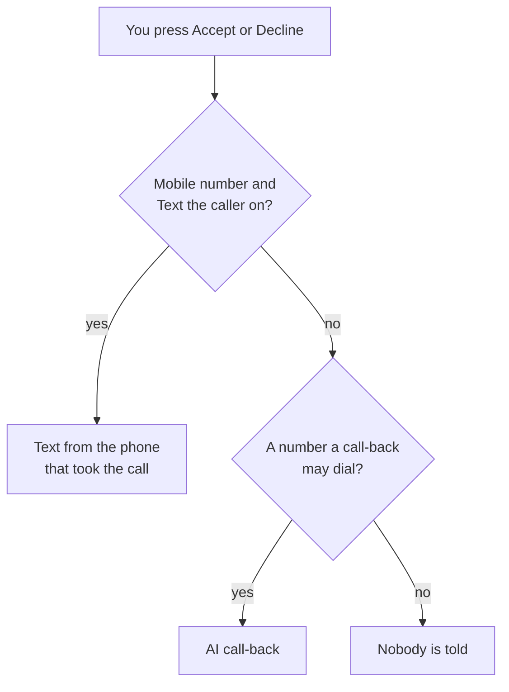

# Settings reference

Bageo is a self-hosted AI phone assistant that answers your real phone number with Gemini Live. This page lists every setting: how calls are picked up, how sales and scam calls are handled, where call summaries go, and how Bageo starts. Each table shows the default, so you can see at a glance what you changed.

Settings live in two places:

- **The web console** (the *Settings* tab): everything about answering calls. Saved to `data/calls/config/settings.json` and used from the next call on, with no restart.
- **Start-up options**: where Bageo listens, where data lives, the USB link. Read once at start from environment variables or from a `.env` file next to the start script (copy `.env.example`).

## Find it fast

| I want to… | Go to |
|---|---|
| Have the AI answer as me instead of as my assistant | [Basics](#basics) → *Answer style* |
| Answer calls on a US SIM in English while everything else stays in my language | [Basics](#basics) → *More options* → *Main language for each SIM* |
| Keep a scammer busy instead of hanging up | [Sales & scam calls](#sales--scam-calls) |
| Never hear from one number again | [Blacklist](#blocked-numbers-and-contact-lists) |
| Have the AI call a restaurant and book a table | [AI errands](#ai-errands) |
| Decide on meeting requests later and let the caller know | [Appointments](#appointments) |
| Open the console from my phone | [Using the console from other devices](#using-the-console-from-other-devices) |
| Keep copies of my settings, or move to a new computer | [Backup & restore](#backup--restore) |

## Settings in the web console

### Basics

The few things the AI needs before it can answer your phone.

| Setting | Default | What it does |
|---|---|---|
| Language | English | The language the AI speaks with callers, including its first line, the blocked-number announcement and the texts it sends callers. |
| Your name | empty | How callers refer to you. Fills `{owner}` wherever a prompt uses it. |
| Answer style | AI assistant | **AI assistant**: says it is an AI answering for you and takes a message. **As me**: answers as you, without agreeing to anything on your behalf. |
| Gemini API key | empty | Your key from Google AI Studio; the AI voice needs it. Stored on your computer only. |
| Voice | Charon | One of Gemini's built-in voices. **Preview** plays three sample lines in the language chosen above. |
| AI answers calls | on | Master switch. Off: calls are picked up and ended at once, with nothing said. To answer a phone yourself, switch it to a [normal phone](PHONE.md#normal-phone-mode) instead. |

*Language* can be English, 繁體中文 (Taiwan), 简体中文, 日本語, 한국어, Español, Français, Deutsch or Português.

**More options.** These five are folded under *More options* in Basics, and most people never change them:

| Setting | Default | What it does |
|---|---|---|
| Other names callers use for you | empty | One per line, up to 10: an English name, a nickname, how colleagues address you. When the AI hears one, it knows they mean you. |
| Language of notifications and summaries | Same as the AI's language | The language you read your notifications and summaries in. The AI keeps speaking the *Language* above with callers. |
| Main language for each SIM | none | Only for a phone with SIMs from more than one country: pick a SIM's country and the language its calls start in. |
| AI calls: call as | Your assistant | Who the AI says it is on calls it makes for you: **Your assistant** or **You in person**. Each errand can pick its own. |
| Live model | `gemini-3.8-live` | The Gemini Live model that talks on calls; you rarely need to change it. Models with "thinking" in the name (such as `gemini-3.8-live-extended-thinking`) answer more carefully and a little slower; see *Thinking level* under [Advanced](#advanced). |

Details for each:

- **Other names callers use for you**: this works in both answer styles, and with your own prompt too. Call summaries still write *Your name*. Saved as `owner_aliases` (a list).
- **Language of notifications and summaries**: notifications, call summaries (also in the call list), appointment cards and their results, and messages from the SMS forwarder use this language. Handy abroad: the AI answers in English, your notifications stay in 繁體中文. Switching the console's display language (top right) sets this to the same language.
- **Main language for each SIM**: e.g. *United States (US)* → English while *Language* stays 繁體中文; a Japanese number calling the US SIM still hears Japanese. Needs phone app 1.0 or later, which reports the SIM of each call. Saved as `sim_languages`, e.g. `{"us": "en"}`.
- **AI calls: call as**: who the AI says it is on the calls it makes from the **Errands** tab ([AI errands](#ai-errands)): **Your assistant** (it calls on your behalf, and admits to being an AI when sincerely asked) or **You in person** (it speaks as you). Saved as `errand_identity` (`assistant` / `owner`; anything else reads as `assistant`).

### How it answers

| Setting | Default | What it does |
|---|---|---|
| Ring before answering | 3 s | How long the caller hears ringing before the AI picks up: 0 (at once) to 8 seconds, in half seconds. The AI gets ready during the ring. |
| Answer hidden numbers | on | On: callers without caller ID get the AI like anyone else. Off: they hear a short "not available" announcement and the call ends. |
| Longest normal call | 5 min | 3 to 30 minutes. About 25 seconds before the limit the AI wraps up politely and hangs up. |
| Status note | off | One line about right now, up to 400 characters ("Deliveries: please leave the parcel at the front desk"). The AI mentions it only when it fits the call. |
| Background sound, Background volume | off, Medium | A quiet room tone under the AI's voice, so it sounds like someone picking up in a real place. Volume Quiet, Medium or Loud. |
| Forward to your phone: Turn on forwarding, how | off | Whether a call is put through to your phone, and how: *Don't answer: send to your phone* or *AI answers, puts you through if urgent* (`whitelist_mode`, which is `off` while the switch is off). A confirmation box comes first when you turn it on. The Whitelist tab on the **Contacts** page has the same setting. |
| Forward to your phone: Your own phone number | empty | The number the phone calls when something is urgent; it also appears in the notification (`whitelist_forward_number`). |
| Forward to your phone: Who can be forwarded | Whitelist | Whose calls are put through: **Whitelist** (`transfer_whitelist`), **Other contacts** (`transfer_contacts`) and **Numbers not in your contacts** (`transfer_others`, hidden numbers too). People on the Blacklist or the Stall list never are. |

With *Answer hidden numbers* off, the "not available" announcement uses your *Language* and the *Announcement voice*, like Blacklist calls. It comes recorded with Bageo, so no Gemini key is needed.

*Background sound* can be Office, Home, Street, Hospital, Ambulance passing, Typhoon, Thunderstorm, Construction site, Metro / subway, Night market, Firecrackers / festival or Driving. **Voice + background** and **Background only** play a sample.

*Forward to your phone* is off by default; while it is off the AI answers as usual and tells you afterwards. Once you turn on **Turn on forwarding** you can pick one of two ways, for the callers ticked under **Who can be forwarded**:

- **Don't answer: send to your phone** (`direct`): this phone doesn't answer; your carrier forwards the call to your number, the AI stays silent, and you get a notification at once. First switch the phone to normal phone and dial `**67*your number#` to turn on forward-when-busy, or callers reach voicemail.
- **AI answers, puts you through if urgent** (`emergency`): the AI answers first and alerts you right away. If the caller says it is urgent, it asks them to hold and calls you, and once you pick up you talk to them directly. If you don't answer, the AI says you'll call back. Without your number, you only get the alert.

**Who can be forwarded.** Only the Whitelist is ticked at first, so nothing changes until you tick more. **Other contacts** adds everyone else in your contacts. **Numbers not in your contacts** adds everyone else, hidden numbers included; a stranger saying it is urgent may be a scam, so turn it on only if you need it.

Two limits apply to urgent calls. Once a call is judged sales or scam, you get no urgent alert and no call (a call to you that is already ringing goes on). A number not in your contacts gets you called at most once every 30 minutes, and hidden numbers share that allowance; after that the AI tells the caller you will call back and you only get the alert.

**Before you turn on forwarding.** A confirmation box appears each time you turn on **Turn on forwarding**, and it only turns on after you pick **I understand, turn it on**; Cancel or Esc leaves it off. The box says the five points below.

1. The AI can get it wrong: it may not call you about something truly urgent, or may call you when it isn't.
2. This does not replace emergency services. If a life is at risk, the caller should call the local emergency number directly.
3. The call to you is made from this phone's SIM. Your carrier charges as usual; international or roaming calls may cost more.
4. After you are put through, the call is recorded according to your settings. You are responsible for following local laws about telling people they are recorded.
5. The call to you may not get through. You use this at your own risk; Bageo and its developers are not liable for any loss.

**More options.** These three are folded under *More options* in How it answers, and most people never change them:

| Setting | Default | What it does |
|---|---|---|
| Get the AI ready while the phone rings | on | Recommended: the AI speaks the moment the call connects. Off: callers wait 1 to 3 seconds for the first word. |
| Let the caller interrupt | on | The AI stops talking when the caller cuts in. Used only on phones that do not pick up the AI's own voice, checked at the start of every call (see [which phones](PHONE.md#which-phones)). |
| Let Gemini decide when the caller has finished | on | Recommended: Gemini's own voice detection decides when it is the AI's turn. Off: a simpler loudness rule built into Bageo decides. |

*Get the AI ready while the phone rings* connects to Gemini and prepares the first words before pick-up. It costs one short Gemini session even when the caller hangs up while it rings.

**The caller's language.** *Reply in the caller's language* is on by default: when a caller clearly speaks another language, or asks whether you speak one, the AI switches to it. Turn it off to keep the AI in your *Language* on every call. It is saved as `reply_in_caller_language`.

**Calls from abroad and the carrier's warning.** Taiwan's carriers play a recorded fraud warning at the start of every call from abroad. When a Taiwanese SIM takes a call from another country (a `+…` or `00…` number with another country code), the AI waits for that warning to end: it speaks once the line goes quiet, or after 7.5 seconds at most, and says its opening line only once.

Calls on any other SIM (say, the US SIM of a dual-SIM phone) carry no warning, so the AI answers at once. This is automatic.

With a phone app older than 1.0, a call from abroad is a `+…` number whose country code is not yours ([`COUNTRY_CODE`](#country-calling-code)).

### Sales & scam calls

As soon as the caller's words show a sales pitch or a scam, the AI turns into an interested but slow customer: it asks how everything works, one detail after another. It never gives out data and never agrees to anything, and it keeps them on the line until they hang up or the time limit is reached.

For example, a caller opens with a "pre-approved loan", or claims to be from your bank's security team and needs a code.

| Setting | Default | What it does |
|---|---|---|
| Keep them talking | on | The stalling described above. Off: the AI declines and ends the call. |
| Longest such call | 30 min | 3 to 30 minutes. Longer calls use more of your Gemini quota. |
| Model for these calls | `gemini-3.8-live` | The model a call switches to once it is judged sales or scam. Empty = keep the call's own model. |
| Check every call for sales and scams | on | On: a low-cost model reads what the caller has said, so new scripts, other languages and garbled words are caught too. Off: only calls that use known sales or scam words are checked. |

**How a call is judged.**

- Words from the built-in scam database (46 kinds of sales and scam calls, keywords in 27 languages) start a second look by a low-cost model.
- With *Check every call for sales and scams* on, calls without such words get a look too, at most three times a call.
- The model names the kind of call and how sure it is; an unsure answer waits for the caller's next turn.
- When the model does not answer in time, only requests that are a scam whoever makes them (a verification code, ATM steps, gift cards, remote access, a "safe account") start the stalling at once. Otherwise the next turn is looked at, and after two failures in a row the keywords decide alone.
- Two caller turns into the stalling, one more look can let a wrongly judged caller go back to a normal conversation.
- Saved contacts and numbers you marked *It was not* are left alone, unless they ask for those scam-only things.

On a call's page, *Sales / scam check* shows what the call was judged and which kind. *It was a scam*, *It was sales* and *It was not* mark the number, and its next calls are judged with your mark (hidden numbers are not remembered).

Your own words and numbers go in `config/scam_db.local.json` in the data folder. It is read again when it changes, and a missing or broken file changes nothing:

```json
{
  "keywords": [
    {"text": "會員續約專線", "lang": "zh-TW", "typology": "general_promotion", "weight": 2},
    {"text": "read me the six digits", "lang": "en", "typology": "otp_theft", "weight": 2, "hard": true}
  ],
  "numbers": [
    {"number": "0223456789", "verdict": "safe", "note": "building management"},
    {"number": "+15550100", "verdict": "scam", "typology": "irs_ssa_impersonation"}
  ]
}
```

`weight` is 1 (counts only with other words) or 2 (clear on its own); `hard` counts only for a kind of call that is a scam whoever asks. `typology` must be one of the built-in kinds in `crates/agent/data/scam_db.json`; entries Bageo cannot place are skipped and named in its log.

### Prompt

How the AI talks. The built-in prompt is a short general baseline; add your own situation and style so the AI sounds more like you. To write your own, see [Writing the prompt](PROMPTS.md).

- *Your own prompt*: saved separately for *AI assistant* and *As me* (empty = built-in); **Show the built-in prompt** shows it.
- *Notes the AI may answer from*: facts callers may ask about, one per line, up to 6,000 characters.
- The interview prompt: lets ChatGPT, Claude or Gemini write a prompt with you.

### Blocked numbers and contact lists

Call screening at its bluntest: calls from numbers on the **Blacklist** never reach the AI or Gemini. They still appear in the call list and send a "blocked number" notification.

The Blacklist is one of the lists on the **Contacts** tab, with **Contacts, Whitelist, and Stall list** (`kind`: `contact`, `whitelist`, `blacklist`, `stall`). Add a contact and set its list to Blacklist; the note is your reason. Only a Blacklist number may end with `*`, which blocks every number that starts with those digits, e.g. `0800*` (at least three digits, not counting leading zeros).

| Setting | Default | What it does |
|---|---|---|
| When someone on the Blacklist calls | Hang up while it rings | On the **Blacklist** tab of **Contacts**, saved as soon as you pick it: hang up while it rings, or answer, play "not available" and hang up. |
| Announcement voice | Same as the AI's voice | Under **Settings → Blocked-call announcement**: the voice of that announcement; hidden numbers hear it too. Every voice comes recorded in every language, so it costs no Gemini quota; **Preview the announcement** plays it. |

Write numbers the way they show up in the call list; `+…` forms match too once your country calling code is known ([`COUNTRY_CODE`](#country-calling-code)).

Blocked numbers saved by older versions (`reject_numbers`) move onto the Blacklist the first time Bageo starts. A number that is already an ordinary contact's makes that contact a Blacklist one (its note gets the reason when it has none); one on the Whitelist or Stall list stays there; the others become new contacts named after the reason, or after the number. The old list stays in the settings file as it was, so an older version still has it, but Bageo no longer reads it once the move is saved.

*When someone on the Blacklist calls* is saved as `reject_mode`:

- **Hang up while it rings** (`decline`): the call never connects.
- **Answer, play "not available", then hang up** (`announce`): a short "the number you have dialed is not available" in your *Language*; the caller sees the call connect for a few seconds.
- A phone app too old to decline picks up and announces either way.

Try it: open a call in the call list and press **Block this number** (it joins the Blacklist), or tap the signed **Block / Stall / Whitelist** buttons in any notification channel to classify the caller in one tap.

### AI errands

The **Errands** tab has the AI make a call for you. Booking a table for four looks like this:

1. Pick a contact or type a number.
2. Write what to get done and what you can accept: "book a table for 4 tomorrow at 7 pm; 7:30 to 8 is fine too".
3. Choose *Call as* and, if you like, the *Number to call from*, then press **Start the call**.
4. Follow the live captions. You can type an instruction for the AI, answer a question it asks you, or **Hang up**.

Afterwards the errand shows the result (Done, Partly done, Not done, Your decision needed, No answer, Voicemail, Failed) with details, the next step, the time agreed, a link to the call record and **Call again**. When the other side offered choices, pick one and the AI calls back with it. You also get one notification.

During the call the AI reads every time, date, number or name back as a question and waits for a yes. Anything the other side never clearly confirmed is marked **Not confirmed by the other side** on the result and in the notification, so check it before you rely on it.

What it needs and how it behaves:

- A connected phone in AI mode with a SIM of the number's country. Current phone apps report their active SIMs automatically on connect and when SIMs change; calling the phone once is only needed for older apps or if Android has not reported the SIM (*This phone hasn't taken a call yet*).
- It never dials an emergency number, a short code (7 digits or fewer) or a premium-rate number; toll-free numbers are fine. Write numbers abroad with `+`; a number without `+` is one of your country.
- One call to a number at a time, shared with the AI call-backs of [appointments](#appointments). A busy phone makes the errand wait up to 10 minutes, and an earlier call to the same number up to 25 minutes.
- A call lasts 10 minutes at most (the AI wraps up at 9:30).
- The AI cannot press keys: it waits up to 90 seconds for a person in a voice menu, and hangs up at once on a carrier recording ("the number you dialed…").
- When something comes up that your instructions do not settle, the AI tells the other side it will check and asks you on the page (up to 40 seconds while you are watching). If you are not watching or do not answer, it agrees to nothing about it: it notes their options, says you will confirm and call back, and ends politely.
- It agrees to no payment, deposit or transfer, gives out no personal details beyond the errand, and redials only when you turn on **Redial until answered**.

The default for *Call as* is *AI calls: call as* under [Basics](#basics). Every rule, status and error code is in [API → AI errands](API.md#ai-errands).

### Notifications

| Setting | Default | What it does |
|---|---|---|
| Send notifications | on | Off: nothing is sent to any channel. |
| Channels | none | Telegram, Discord, LINE, ntfy, email, webhooks and more; every enabled channel gets every message. Set-up for each is in [Notifications](NOTIFICATIONS.md). |
| Address in notifications | empty (automatic) | Links in notifications (transcript, recording, buttons, calendar) open the console at this address. Empty = the address Bageo works out, usually `http://bageo.local/`, shown in grey in the field; to reach it from outside your home, type your own. Saved as `public_url`. |
| Commands from chat | off | Look up calls, have the AI call someone and handle your *To do* items from chat. Telegram, Discord, Slack and Matrix channels each have *Take commands from this chat* inside the channel; the fold-out section covers the environment-variable Telegram bot and shared limits. See [Chat commands](CHAT_COMMANDS.md). |

The fold-out *Commands from chat* settings are saved as `telegram_control`, `telegram_control_users`, `control_errands_per_hour` and `control_commands_per_minute`.

### Summary & calendar

After each call the AI writes a short summary. It uses your Gemini key, so normally there is nothing to set up.

| Setting | Default | What it does |
|---|---|---|
| Summary service | Gemini | Who writes the summaries and calendar suggestions: **Gemini** or **Another service**. |
| Another service: API base URL, Model, API key | empty | Fill in when you pick *Another service*. A model is required once a base URL is set; a local server needs no API key. |
| Suggest calendar events | on | When a call fixes a date (a delivery window, an appointment, a time someone will call back), the summary gets an **Add to calendar** link. Nothing is ever added to a calendar by itself. |
| Add to calendar | asked on first use | Not a field: the first press of **Add to calendar** asks which calendar to use, and remembers it. |

**Summary service**:

- **Gemini** (`gemini`): your Gemini key on Gemini's lowest-cost model, `gemini-flash-lite-latest`, with `gemini-flash-latest` as the fallback.
- **Another service** (`custom`): any OpenAI-compatible service, set in the next row.
- Saved as `summary_provider`. Without a Gemini key, *Gemini* works like *Another service*. Settings from older versions are converted automatically.

**Another service** fields:

- **API base URL**: the service's OpenAI-compatible address; examples are below.
- **Model**: required when a base URL is set.
- **API key**: shown only as a hint once saved; a local server needs none.
- With no base URL there is no service of its own: Gemini writes the summary when you have a Gemini key.
- Saved as `summary_api_base`, `summary_model` and `summary_api_key` (it holds the key of whatever service you use).

Base URL examples:

- OpenAI: `https://api.openai.com/v1` (e.g. `gpt-4o-mini`)
- OpenRouter: `https://openrouter.ai/api/v1`
- A local Ollama: `http://127.0.0.1:11434/v1`

**Add to calendar**:

- Choose Google Calendar, Outlook.com, Microsoft 365, Apple Calendar, Yahoo Calendar or an `.ics` download. The choice is remembered (`calendar_app`); **Pick another calendar** next to the button picks another.
- Notifications and Telegram replies link the same calendar.
- For Apple Calendar or `.ics` the link points to *Address in notifications* (no address, no link) and carries a key for that one file, never your password. No calendar account is connected to Bageo.
- With *Suggest calendar events* on, each call costs one extra request to the summary model.

#### Appointments

When a caller wants to set a time with you (a meeting, a visit, a call at a set time), the AI does not agree on the call. You decide later, and the caller hears your answer by text or by an AI call-back.

| Setting | Default | What it does |
|---|---|---|
| Appointments | Off | **Ask me first** (`confirm`) turns the flow below on. |
| Text the caller | off | Lets the phone that took the call text your answer, in your name, after you accept or decline. Texts go to mobile numbers only. |
| Default reply | Automatic | How the caller hears your answer unless you pick another way: **Automatic**, **Always a text** or **Always an AI call-back**. |

*Text the caller*:

- A text looks like this: "Hi, it's Alex. Sat, Nov 14, 3:00 PM works for me. See you then!"
- Only the time goes in, never what it is about: those are the caller's own words and could carry a link.
- Texts go to mobile numbers only: Taiwan mobiles, +1 numbers (not toll-free or 900) and other countries' mobiles. Needs a phone app that can send texts.

*Default reply*:

- **Automatic** follows the chart below.
- **Always a text** / **Always an AI call-back** use only that way, else nothing.
- It presets the choice under *To do*, is what a Telegram button press uses, and decides what the AI promises on the call.

How a request plays out:

1. **On the call.** The AI first asks the time back in full ("Thursday, November 19, at 4:30 pm, right?") and waits for a yes; a correction is asked back again. It never asks the caller to wait.
   Then it says it will check and text them back, or "call you back later" when the answer goes by call-back, or only "get back to you" when neither can reach them.
2. **After the call.** The request waits under **To do** at the top of the **Calls** tab (and in the call's details): who, what and when, how the caller hears your answer (**Text**, **AI call-back** or **Don't tell them**; a way that cannot reach the number is greyed out), and **Accept** / **Decline**.
3. **You decide.** The entry says what happened, in words: "Accepted, and the caller got a text", why a text did not go out, or how far the call-back got. An accepted one gets **Add to calendar**; a text that did not go out gets **Send the text again**.
4. **On the go.** With a Telegram bot set up and *Send notifications* on, you also get a card with **Accept** / **Decline**.

Set the Telegram bot with `TELEGRAM_BOT_TOKEN` and `TELEGRAM_CHAT_ID` (or `telegram_bot_token` / `telegram_chat_id` through `PUT /calls/api/settings`). A Telegram channel added in the console, like every other channel, gets a reminder with a link to the call.



*The Automatic default reply. A hidden number always ends at "Nobody is told".*

Rules that keep it safe:

- Only the first decision counts, wherever it is made (console, Telegram card or API).
- A back-up time the caller only mentions ("if not, the afternoon works too") does not replace the agreed one; a second, separate appointment on the same call gets its own decision.
- Never with sales or scam callers: when a call is judged one (during the call or by its summary; a bank's fraud desk or the police calling about fraud does not count), or the AI could not connect, nothing it agreed to counts and nothing waits for you.
- It works with both answer styles, and replaces the calendar suggestion for that call.
- A call-back only dials numbers of the answering SIM's own country with a real phone number's length (in Taiwan 8 to 9 digits after the 0): never toll-free (0800, +1 800 to 888), premium (0204, 0209, +1 900), short codes (165, 110) or numbers from abroad.

**How the AI call-back works:**

- It goes out from the phone and SIM that took the call (when that phone is connected), only to that caller's own number, one call-back per number at a time.
- The AI waits until the callee picks up and speaks (nobody for 70 seconds: no answer), says who is calling, gives your answer in the language of the original call, says goodbye once and hangs up.
- It is listed as *AI call-back*. *To do* shows how it went; one that could not be placed is also sent to your notification channels.
- Texts also go out from the SIM the call came in on, so a dual-SIM phone answers from the right number.

Times are the computer's local time (see [Time zone](#time-zone)). Without any key for the summary, the notification carries the caller's first words instead; the transcript is always in the console. Every appointment field and route is in [API → Appointments and tasks](API.md#appointments-and-tasks).

### Backup & restore

Bageo can back up your settings on its own, make a copy when you ask, and pack everything into one file for another computer. Backups stay on your computer: nothing is uploaded or sent anywhere, and Bageo does not update itself.

Backup files hold your keys, passwords and connections, unless you leave them out of an export. Connections are where notifications go and who can control Bageo remotely: the notification channels, the Telegram chat, the number calls are forwarded to and whether urgent calls are put through to it, the numbers Bageo may call back, the summary service and what AI tools may do over MCP. Keep backup files where only you can get them.

| Setting | Default | What it does |
|---|---|---|
| Automatic backup | every week | Off, every day, every week or every month. |
| Save backups to | default location | The full path of a folder. Empty: the `backups` folder inside Bageo's data folder (`data/calls/backups`). When you save, Bageo checks that it can write there. |
| Automatic backups to keep (*More options*) | 10 | 1 to 100. Only automatic backups count. |
| Include call records, recordings and texts (*More options*) | off | On: *Back up now* and automatic backups also hold call records, recordings, texts and *To do* items. The file gets much bigger. |
| Encrypt backup files (*More options*) | off | On: *Back up now*, automatic backups and "Before import" copies are encrypted with the backup password. |
| Backup password (*More options*) | empty | At least 8 characters; needed before encryption can be turned on. It is never shown again. If you forget it, these backups can't be opened, and Bageo can't recover them either. |

The six settings are saved as `backup_schedule`, `backup_dir`, `backup_keep`, `backup_include_calls`, `backup_encrypt` and `backup_password`. Automatic and manual backups always hold your settings, your keys, passwords and connections, contacts and lists, your own number notes and scam numbers, SIM card details, and AI errands.

The backup password is saved on this computer with your other settings, so automatic backups can use it. Encryption protects the copies that leave this computer: on an external drive, in a cloud folder or on a network folder. An export with only the settings leaves the password out.

- *Back up now* makes a copy right away.
- *Export settings* opens a list where you tick what to export: settings, keys, passwords and connections, contacts and lists, your own number notes and scam numbers, SIM card details, AI errands, call records and recordings, texts, and *To do* items. The first six are ticked at the start. Tick *Keys, passwords and connections* when you move to another computer; leave it off when you show your settings to someone. Call records, texts and *To do* items make the file much bigger. Without a console password, a file with keys only downloads when the console is open on the computer that runs Bageo. Tick *Encrypt this file with a password* and type a password twice (at least 8 characters) for an encrypted file. The file is named `bageo-export-YYYYMMDD-HHMMSS.zip`, or `.bageo` when it is encrypted.
- *Import settings* takes a backup or export (.zip, or .bageo when it is encrypted), or an older single settings file (.json). An encrypted file asks for its password first; after 5 wrong tries, choose the file again. From the older file only the settings come back, and the keys, passwords and connections too if it holds any.
- *Backup files* lists the latest 10 copies, each with *Restore*, *Download* and *Delete*. Encrypted copies are marked *Encrypted*. Restoring one uses the backup password saved here; if the copy was made with another password, the console asks for it. *Delete* asks first and cannot be undone; without a console password it works only on the computer that runs Bageo.

Before anything is restored, the console shows when the backup was made, which version it comes from, how big it is and what is inside, with a tick box for each item. All are ticked at the start, and items the file does not hold are not shown. Untick what you do not want back; *Restore* needs at least one. Bageo first saves your current settings as a separate file ("Before import"). If *Keys, passwords and connections* is not ticked, or the file has none, those on this computer stay as they are. If it is ticked, the ones the file holds replace these, and any the file does not have stay, so an older backup never takes away a password or key set since. Restoring a "Before import" file from the backup list puts the whole group back exactly as it was before that import, taking away everything the import brought. The console warns you first when the console password, where notifications go or who can control Bageo would change. The backup folder always stays as it is on this computer. A restore never shortens how long things are kept: *Days to keep records* and *Automatic backups to keep* only stay the same or get longer. To shorten them, change them in the console. Call records, texts and *To do* items are added to the ones you already have, and nothing is deleted. Nothing can be restored during a call: try again when it ends. If some changes need a restart, the console says so.

**How automatic backups run:**

- One is made once a full day, week or month has passed since the last one.
- A call in progress makes it wait until the call ends.
- If the computer was off at the time, the backup is made when Bageo starts again.
- If a backup fails, Bageo tries again every hour and sends you one notification.

**What is kept:**

- Automatic backups: only the newest ones, as many as *Automatic backups to keep*.
- "Before import" copies: the newest 5.
- Manual backups and exports: never deleted by Bageo.
- Any other file in the folder is left alone.

**Moving to a new computer:**

1. On the old computer, click *Export settings* and keep *Keys, passwords and connections* ticked, so you do not have to type them again. To bring call records along, also tick *Call records and recordings*, *Texts* and *To do items*.
2. Install Bageo on the new computer.
3. Open the console and click *Import settings*, pick the file, and confirm with *Restore*.
4. If the phones do not connect by themselves, plug each one in with USB once.

### Advanced

| Setting | Default | What it does |
|---|---|---|
| Days to keep records | 15 | Calls and their recordings, text messages, AI errands and *To do* items older than this are deleted automatically (1 to 365). A change takes effect at once. Saved as `retention_days`; `CALLS_RETENTION_DAYS` only sets the default. |
| Thinking level | Low | For Live models with "thinking" in their name only: Low, Medium or High. Low answers fastest. Saved as `gemini_thinking_level`. |
| Console password | empty | Once set, the console and the API ask for the password (the browser remembers it). Needed to open the console on your phone or another computer. A new password needs at least 8 characters; after 10 wrong ones in a row, another device waits a minute. Saved as `ui_password`. |
| Let other AI tools connect (MCP) | off | Lets AI tools such as Claude or ChatGPT look up your calls and *To do* items. Leave it off if you do not need it. |
| Network name | `bageo` | The name phones and computers on your network can use instead of the IP: `http://bageo.local/`. Letters, digits and hyphens; empty, `off`, `0`, `none` or `false` turns it off. |
| Phones can also connect over Wi-Fi | On | A phone plugged in by USB once keeps working over Wi-Fi after you unplug it. Turning it off applies at once and disconnects the phones on Wi-Fi. Stored as `phone_wifi`; `PHONE_WIFI` only sets the default. See [Phone setup → Wi-Fi](PHONE.md#wi-fi). |

**Pair phones again** (under the switch above) replaces the pairing key: every phone on Wi-Fi is disconnected and must be plugged in by USB once more.

The first time you open the console without a password, it offers to set one.

*Let other AI tools connect (MCP)* is a fold-out section: a built-in Model Context Protocol server at `POST /mcp`. See [MCP](MCP.md). It has five fields:

- *Turn on MCP* (`mcp_enabled`): turn it on and set the token below, or it does nothing. The address is the console's address plus `/mcp`.
- *Token* (`mcp_token`): enter this token (a Bearer token) in the AI tool.
- *May it ask the AI to place calls?* (`mcp_calls`): *No (look up only)*, *Yes, but ask me in a chat first* or *Yes, call right away*. Asking first needs a chat with commands turned on.
- *Most AI calls per hour* (`mcp_errands_per_hour`): counted across all AI tools, 0 to 30.
- *Allowed websites* (`mcp_allowed_origins`): needed only for web-based AI tools, one address per line, e.g. `https://app.example`. Otherwise leave it empty.

Left empty, *Address in notifications* (under *Notifications*) is filled in by itself. With `AGENT_HOST` not set (the default) it is `http://<network name>.local/` while Bageo answers that name, `http://<network name>.local:8787/` when port 80 cannot be opened, else the computer's network address; with `AGENT_HOST=0.0.0.0` it always carries `:8787`.

With the console on this computer only (`AGENT_HOST=127.0.0.1`), notifications carry no links; inside Docker, set it yourself. *System → About* shows the address in use.

Bageo answers the *Network name* itself (multicast DNS, UDP port 5353) while the console is open to your network (including the default, with `AGENT_HOST` not set) or *Phones can also connect over Wi-Fi* is on, but not inside a container. On macOS the system's Bonjour answers it instead (Bageo starts `dns-sd` for it).

If the system keeps that port to itself, the log shows a line starting with `mDNS:` and links use the IP address. Older Android phones that cannot open `.local` names can use the IP address or the QR code under *System → About*.

*Country calling code* is set at start-up; see [Country calling code](#country-calling-code).

### Not shown in the console

A few settings have no field. Set them in `settings.json` or with `PUT /calls/api/settings` (see [API](API.md)):

| Key | What it does |
|---|---|
| `country_code` | Your country calling code; see [Country calling code](#country-calling-code). |
| `name_corrections` | Names speech-to-text keeps getting wrong, one `wrong=right` per entry (e.g. `Jon=John`): fixed in transcripts and summaries. First-run default `NAME_CORRECTIONS`, comma separated. |
| `device_labels` | Your own names for phones: the id a phone reports → the label shown in notifications and the console, e.g. `{"pixel-10123": "Work phone"}`. Wins over the model name the phone reports. |
| `goodbye_hangup_delay_ms` | How long Bageo waits after the AI's goodbye before hanging up, in milliseconds (200 to 15000). At the default 2000 each region uses its own wait, about 1.2 to 2.5 seconds, chosen by the SIM's country and else by the call's language; any other value is used for every call. |

## Start-up options

Set as environment variables or in `.env`. All are optional; a real environment variable wins over the same line in `.env`.

In Docker, only the variables listed under `environment:` in `docker-compose.yml` reach Bageo (`CALLS_UI_TOKEN`, `DEVICE_TOKEN`, `PUBLIC_URL`, `CALLS_RETENTION_DAYS`, `TZ`). Add a line there for any other variable you need.

The image itself sets `AGENT_HOST=0.0.0.0`, `ASSETS_DIR=/app/assets`, `CALLS_DATA_DIR=/data/calls` and `USB_BRIDGE=off`.

### Network and access

| Variable | Default | Meaning |
|---|---|---|
| `AGENT_HOST` | *(not set)* | Address to listen on. Not set = the console is open to your network (`AGENT_PORT` and port 80) and other devices get in once a console password is set; phones keep their own Wi-Fi port. `127.0.0.1` = this computer only. `0.0.0.0` = everything open on every network interface. |
| `AGENT_PORT` | `8787` | Port of the web console and of the phones' connection. |
| `CONSOLE_PORT_80` | *(on)* | With `AGENT_HOST` not set, the console also answers at port 80, so its address needs no `:8787`. `off` = never. When port 80 is taken or not allowed, the log says so in one line and the console stays at `AGENT_PORT`. |
| `CALLS_UI_TOKEN` | *(empty)* | Password for the web console and API. Send as `?token=…`, `Authorization: Bearer …` or `X-Calls-Token`. **Set it to open the console from other devices**; the console's *Console password* does the same. |
| `DEVICE_TOKEN` | *(empty)* | Phones that do not come through USB must connect with `…/ws?token=<this>`. **Set it whenever `AGENT_HOST` is set to anything but `127.0.0.1`.** |
| `PUBLIC_URL` | *(empty)* | Same as *Address in notifications* (under [Notifications](#notifications)); the web console's value wins. Empty = automatic (see [Advanced](#advanced)). |
| `MDNS_NAME` | `bageo` | Same as *Network name*: the console answers at `http://<this>.local/` on your network. The web console's value wins. |
| `PHONE_WIFI_PORT` | `AGENT_PORT` + 1 (`8788`) | Port phones use over Wi-Fi. Opened on all network interfaces only while `AGENT_HOST` is not set or `127.0.0.1`; it serves only the phones' connection (no console) and always needs the pairing key or `DEVICE_TOKEN`. `0` = never. |

Phones on USB are exempt from `DEVICE_TOKEN` (the USB tunnel ends on the computer itself).

An empty `MDNS_NAME`, `off`, `0`, `none` or `false` turns it off. On Windows an empty value counts as not set, so write `MDNS_NAME=off`.

### Using the console from other devices

With `AGENT_HOST` not set (the default of the installers), phones and computers on the same Wi-Fi open the console at `http://bageo.local/` once you open the console on this computer and set a console password. Until then other devices only see "Set a password first".

To open everything to your network instead (phones then connect on `AGENT_PORT` too), put this in `.env`:

```ini
AGENT_HOST=0.0.0.0
CALLS_UI_TOKEN=choose-a-long-random-string
DEVICE_TOKEN=another-long-random-string
```

Open `http://bageo.local:8787/?token=choose-a-long-random-string` (or the computer's IP, e.g. `http://192.0.2.10:8787/?token=…`) once; the page remembers the password.

*System → About* shows the address with a QR code to scan with your phone, and how to add the console to your home screen.

The first time, Windows asks whether to allow Bageo on the network: choose *Private networks*. When other devices still cannot open it, see [Troubleshooting](TROUBLESHOOTING.md#faq).

If this computer is on a VPN that sends all traffic through the tunnel, Bageo may take the VPN's address for the name, the links and the phones' Wi-Fi address. Set `AGENT_HOST` to the computer's LAN IP (e.g. `AGENT_HOST=192.0.2.10`); the name, the links and the phones then use that address (phones then connect on `AGENT_PORT`).

The connection is plain HTTP: fine on a home network you trust, not for the open internet. To reach the console from outside, use a VPN (WireGuard, Tailscale) or a reverse proxy with HTTPS and its own login; do not forward the port.

**Reaching it from outside (reverse proxy).** First set a console password, then enter the outside address (for example `https://calls.example.org/`) under *Address in notifications*; links in notifications then use it. Bageo accepts only this computer's own names and addresses and the host of that address, so any other domain is refused. Use HTTPS on the proxy and point it at port 80 or 8787 of this computer. Everything that comes through a proxy counts as another device: without a password it does not open, and wrong passwords slow down, then wait a minute after 10 within a minute.

### Data and recordings

| Variable | Default | Meaning |
|---|---|---|
| `CALLS_DATA_DIR` | `data/calls` | Call records, recordings, settings and contacts. Relative to the folder Bageo starts in; in the container `/data/calls`. |
| `CALLS_RETENTION_DAYS` | `15` | Default for the days records are kept (1–365); change it in the console under *Advanced*. |
| `CALLS_RECORD` | `true` | `false`: no call records and no recordings are kept at all. |
| `ASSETS_DIR` | *(searched)* | Folder with the bundled sounds. Otherwise `assets` next to the program is used; in the container `/app/assets`. |

### Time zone

| Variable | Default | Meaning |
|---|---|---|
| `TZ` | *(the computer's own)* | Time zone of the times in notifications, of "today" in the call list and of calendar suggestions. A zone name such as `Asia/Taipei`, `Europe/Berlin` or `America/New_York`. |

Times in notifications look like `Nov 13, 08:09`, written the way your language writes dates. Set `TZ` only when the computer Bageo runs on is not in your zone. The current time is in `/health` as `local_time`.

In Docker the container takes the host's zone from the mounted `/etc/localtime` (Linux hosts); put `TZ=Asia/Taipei` in `.env` for another zone.

On Docker Desktop for Windows or macOS, remove the `/etc/localtime` line from `docker-compose.yml` and set `TZ` in `.env`; otherwise the container runs on UTC. Leave `TZ` out rather than empty: an empty `TZ` means UTC.

### Phones on USB

Bageo keeps `adb reverse` up and starts the phone app by itself.

| Variable | Default | Meaning |
|---|---|---|
| `USB_BRIDGE` | `on` | `off`: Bageo does not run `adb` at all (Wi-Fi phones, containers, or another computer has the phones). |
| `ADB_BIN` | *(searched)* | Full path of `adb`. Search order otherwise: `platform-tools/` next to the program, `ANDROID_HOME`, the usual SDK folders, then `adb` on the `PATH`. |
| `ADB_SERIALS` | *(all)* | Only manage these phones (serials from `adb devices`, comma separated). |
| `USB_PHONE_PORT` | `8765` | The port the app dials on the phone. Change it only together with the app's address. |
| `USB_BRIDGE_INTERVAL_SEC` | `15` | How often the USB link is checked, in seconds (5–300). |

If several versions of `adb` are installed, pin one with `ADB_BIN`: different versions restart each other's server and drop the phones.

### Country calling code

`COUNTRY_CODE` is your own country's calling code, digits only, without `+` (`1`, `44`, `81`; up to four digits). Bageo uses it to read a number written without a country code: the Blacklist (so `+44 20…` matches the national form the phone reports), contacts, and AI errands.

A caller from another country is transcribed with their country's language first (or, when the AI does not speak it, with the language detected), so their goodbye is not lost.

Empty = `886` when *Language* is 繁體中文, else none. Set it only when your language does not point to a single country (English, Spanish, …).

It is not in the web console; besides the environment variable, `country_code` in `settings.json` or `PUT /calls/api/settings` sets it.

A `country_code` in `settings.json`, even an empty one, wins over `COUNTRY_CODE`; delete that line to use the environment variable again.

### First-run defaults

To pre-fill a fresh install from `.env` or Docker, these set the starting value of a console setting; once you save it in the console, the console's value wins.

| Variable | Console setting | Default |
|---|---|---|
| `GEMINI_API_KEY` | Gemini API key | *(empty)* |
| `SUMMARY_API_KEY` | API key of *Another service* (summary) | *(empty; its older name `DEEPSEEK_API_KEY` is still read)* |
| `APP_LANGUAGE` | Language | `en` (also `zh-TW`, `zh-CN`, `ja`, `ko`, `es`, `fr`, `de`, `pt`) |
| `NOTIFY_LANGUAGE` | Language of notifications and summaries | *(empty = same as `APP_LANGUAGE`)* |
| `OWNER_NAME` | Your name | *(empty)* |
| `OWNER_ALIASES` | Other names callers use for you | *(empty; comma separated)* |
| `ANSWER_STYLE` | Answer style | `assistant` (or `persona` = As me) |

Everything else is changed in the console; the first-run default of every setting is in [`settings_store.rs`](../../crates/agent/src/settings_store.rs).

Notification routes you can set the same way. They are used in addition to the console's channels (see [Notifications](NOTIFICATIONS.md)):

| Variable | Meaning |
|---|---|
| `TELEGRAM_BOT_TOKEN`, `TELEGRAM_CHAT_ID` | A Telegram bot and the chat it writes to. |
| `NOTIFY_WEBHOOK_URL` | A JSON webhook, without a token. |
| `NOTIFY_GATEWAY_URL`, `NOTIFY_GATEWAY_TAG` | An Apprise API base address and its tag (default `normal`). |

### Start script

`BAGEO_NO_SHORTCUT=1` keeps the start script from putting the "Bageo Console" shortcut on the desktop, like `-NoShortcut` (`start.ps1`) or `--no-shortcut` (`start.sh`).

### Logging

`RUST_LOG` (default `agent=info`): set `agent=debug` for more detail in the log.

`LOG_CALL_TEXT` (default off): the log only says how many characters were said on a call, like `<12 chars>`. Set `LOG_CALL_TEXT=1` to write the words themselves into the log. Turn it on only while you are troubleshooting, and off again afterwards.

<!-- SPDX-FileCopyrightText: h4lo-void <https://github.com/h4lo-void/bageo-call> -->
