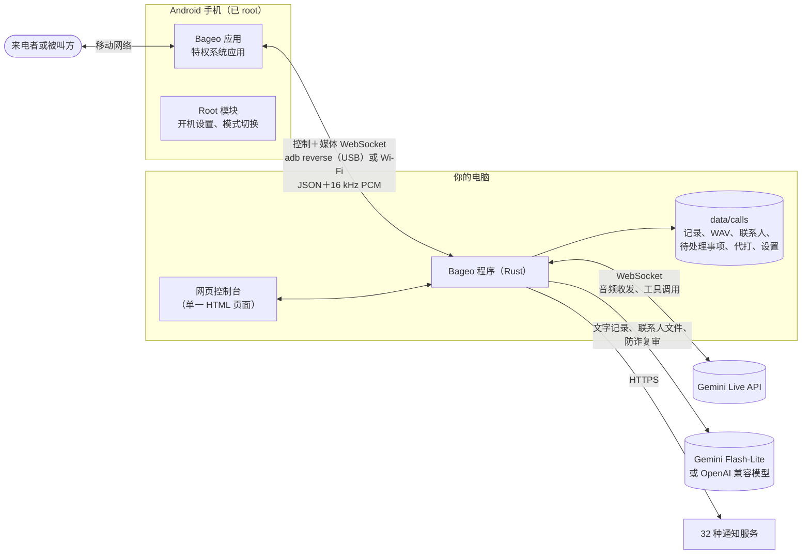
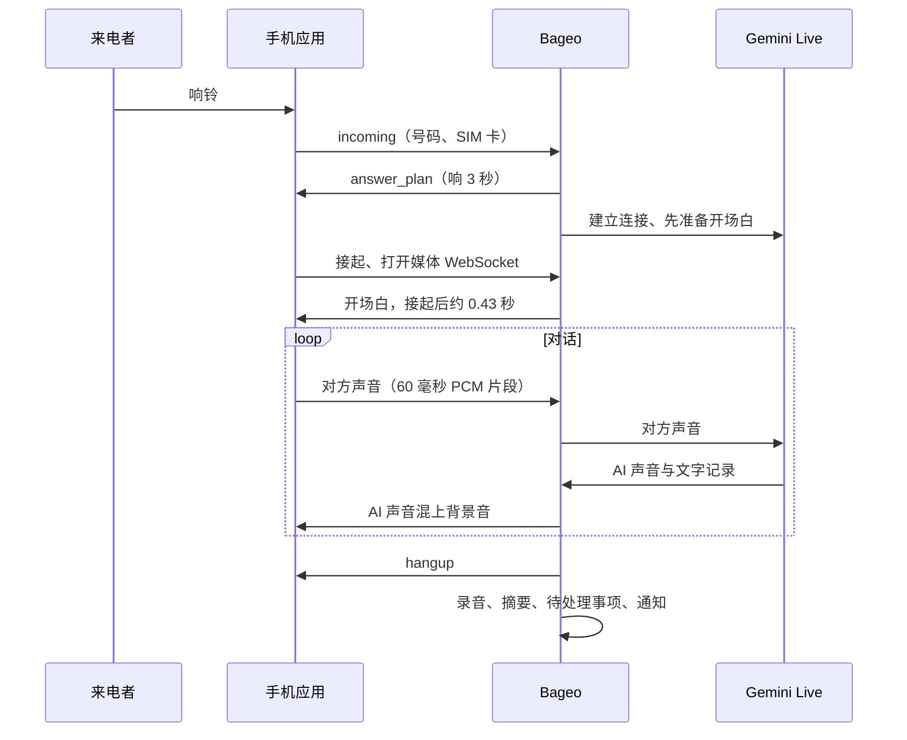

# Bageo 是怎么工作的：自托管 AI 电话助理的架构

Bageo 让 AI 用你的真实号码接电话、打电话。这一页跟着一通电话走一遍：从已 root 的 Android 手机响铃，经过你电脑上的一个 Rust 程序，到 Gemini Live 再回来，并标出每一步由哪个文件负责。要改代码、排查一通电话出了什么问题，或想用别的前端取代手机，先读这页。

## 全貌

Bageo 由三个部分组成，没有数据库、没有消息队列，也没有项目自己的云服务。

1. **一部备用 Android 手机**（已 root，插着你的 SIM 卡），装 Bageo 应用和 root 模块。它负责接电话、拨号、传声音，不做任何决定。
2. **Bageo 程序**：你电脑上的一个 Rust 程序，所有逻辑都在这里——什么时候接、Gemini Live 连接、挂断与防诈规则、摘要、联系人、日程预约、AI 代打、通知。
3. **网页控制台**：编译进 Bageo 程序的单一 HTML 页面，九种语言。



## 各个部分

| 部分 | 位置 | 作用 |
|---|---|---|
| **手机应用** | [`android/`](../../android) | 安静地接起或拨出电话、采集对方的声音、把 AI 的声音播进通话、报告每通电话用的 SIM 卡、按指令发短信。不包含任何对话逻辑。详见[手机端架构](../../android/ARCHITECTURE.md)（英文）。 |
| **Root 模块** | `android/magisk/pixelcallai_uplink` | 把应用装成特权系统应用，每次开机把手机设置成专门接电话的设备，并运行“AI 接听／[普通手机](PHONE.md#普通手机模式)”切换背后的 root 小程序。 |
| **Bageo 程序** | [`crates/agent`](../../crates/agent) | 其余所有事情：通话状态机、Gemini Live 连接、录音、摘要、联系人、日程预约、AI 代打、通知、网页控制台与 API、和手机的 USB 连接。 |
| **网页控制台** | `crates/agent/static/calls.html` | 编译进 Bageo 程序的单一页面。 |
| **Bageo Status** | [`desktop/`](../../desktop) | 可选的桌面托盘／菜单栏程序（Tauri 2，含于 Windows 安装包与 macOS `.dmg`），在后台启动 Bageo 并显示状态、来电、短信与摘要通知。 |
| **短信转发器** | [`tools/sms_forward`](../../tools/sms_forward) | 可选、独立的 Python 脚本，转发手机收到的短信。 |

### Bageo 程序的模块

| 模块 | 负责 |
|---|---|
| `main.rs` | 启动、手机的 WebSocket 接口、来电状态机、响铃预热、通话结束后的处理流程。 |
| `gemini_live.rs` | 每通电话一条 Live 连接：音频转发、回声检查、插话、挂断规则、推销检测与切换到陪聊模式、连接续接，以及拨出用的模式（等对方接起、回铃音过滤、工具调用）。 |
| `prompts.rs`、`locale.rs` | 按语言和接听身份组装每通电话的系统提示词；每种语言要说和要听的语句。 |
| `closing.rs` | 跨 26 种语言词表的本地挂断状态机：判断准备挂断、道别语、继续说话与兼作问候的道别词。 |
| `scenario.rs`、`preflight.rs` | 来电场景小提示（快递、银行核对刷卡、打错电话…）与代打拨出前补问／可接受时间整理。 |
| `stall_review.rs` | 进入陪聊前的复审：`gemini-flash-lite-latest` 在 1.5 秒内把通话判为 `scam_or_sales`、`normal`、`ivr_recording` 或 `too_early`，并说出是数据库里哪一种话术、有多确定。 |
| `scam_db.rs` | 推销与诈骗数据库（`data/scam_db.json`：46 种话术类型、27 种语言的关键词、号码提示）、你在 `config/scam_db.local.json` 加的内容，以及每个号码的标记。 |
| `appointments.rs` | 普通通话的预约工具、由它们生成的待处理事项、同意／不同意、用短信或 AI 回拨告诉对方，以及共用的拨出队列。 |
| `urgent_call.rs`、`urgency.rs` | 多语言急事检测，以及转接来电试验用的三方通话合并（`add_call`）。 |
| `callback.rs` | 手机的控制连接：`place_call`、`send_sms` 及其结果，发到正确的手机。 |
| `errands.rs` | AI 代打：号码检查、选择手机与 SIM 卡（`SimBook`）、代打脚本与 `ask_owner`、实时字幕、通话中你输入的内容、结构化结果。 |
| `contacts.rs` | 通讯录；无论号码怎么写都能匹配；从 vCard、CSV、TSV、纯文本、`.xlsx`、`.docx` 导入，PDF 与图片交给 Gemini 读；导出 vCard。 |
| `phone_region.rs` | 判断号码属于哪个国家（按接这通电话的 SIM 卡的规则解读）；每部手机报告的 SIM 卡国家。 |
| `calendar.rs` | 日历建议，以及 Google、Outlook.com、Microsoft 365、Yahoo、`.ics` 的“添加到日历”链接。 |
| `summary.rs` | 通话后的摘要，走 Gemini 或任何 OpenAI 兼容 API；其他语言句子的翻译；代打的结果。 |
| `tasks.rs` | “待处理事项”背后的存储。 |
| `sms_store.rs` | 按号码分组保存的短信对话，以及通过手机发出的回复。 |
| `notify.rs`、`gmail.rs`、`tg_inbound.rs` | 32 种通知渠道、通过 SMTP 发邮件、Telegram 按钮。 |
| `control/` | Telegram、Discord、Slack 与 Matrix 的远程指令与自然语言解析。 |
| `mcp.rs` | 内置 Model Context Protocol（`POST /mcp`）服务器，以及跨平台通用指令接口（`POST /calls/api/control/inbound`）。 |
| `calls.rs`、`calls_http.rs` | 通话记录、录音与文字记录；网页控制台的 REST API。 |
| `backup.rs`、`backup_crypt.rs` | 定时与手动备份、选择性导出／导入，以及 `.bageo` 加密（Argon2id + XChaCha20-Poly1305）。 |
| `settings_store.rs` | `.env` 加上控制台保存的设置，修改后无需重启。 |
| `lan.rs`、`phone_wifi.rs` | 局域网访问把关、`Host` 头检查、猜密码限速，以及 USB 转 Wi-Fi 的手机配对密钥。 |
| `usb_bridge.rs` | 为每部 USB 手机维持 `adb reverse`，并启动应用的通话服务。 |
| `mdns.rs` | 在局域网响应 `bageo.local`（multicast DNS），不知道电脑 IP 也能打开控制台。 |
| `log_text.rs` | 遮罩来电号码，且默认不把通话内容写进日志（除非设 `LOG_CALL_TEXT=1`）。 |
| `adpcm.rs`、`voice_preview.rs`、`ambience.rs` | 1,080 个内置语音文件（IMA ADPCM）、声音试听与“无法接通”语音、12 种背景音。 |

## 一通来电的完整过程



1. **待机。** 每部手机都和 Bageo 程序保持一条*控制* WebSocket。
   - 走 USB：应用在手机上连接 `ws://127.0.0.1:8765`，由 `usb_bridge.rs` 维持的 `adb reverse` 转到 Bageo 程序。
   - 走 [Wi-Fi](PHONE.md#wi-fi)：应用直接连接 Bageo 程序的地址。
2. **响铃。** 应用报告 `incoming`，附带来电号码和接这通电话的 SIM 卡。Bageo 决定：
   - 黑名单号码在响铃时直接挂断，或接起播放预录语音，完全不会用到 Gemini。
   - 其他电话返回一个 `answer_plan`：响 `answer_ring_ms`（默认 3 秒、最多 8 秒）再接。
   - 打开“**响铃时先让 AI 准备好**”（`gemini_ring_prewarm`）时，Bageo 立刻建立 Gemini Live 连接并组装提示词，模型先把开场白准备好，等接起再放出来。
   - 提示词包含：你的或内置的提示词、你的状态留言与资料、号码在通讯录里时附上对方是谁、别人怎么称呼你、这张 SIM 卡和这个号码适用的语言规则、日程预约开启时的预约工具，以及固定底线（见[编写提示词](PROMPTS.md)）。
3. **接起。** 应用接起电话并打开一条*媒体* WebSocket，对方的声音以 60 毫秒的 PCM 片段往上发。
   - Bageo 程序接手预热好的连接、放出开场白（实测从接起算中位数约 0.43 秒）。
   - 有些手机接起时才报告 SIM 卡。如果因此要换开场语言，就丢掉准备好的那句，AI 稍后用正确的语言开口。
4. **对话**（`gemini_live.rs`）。Bageo 会：
   - 把音量偏小的通话声音放大，并在头几秒检测手机收音里有没有 AI 自己的声音。这决定对方能不能插话（“**对方可以打断 AI**”：说满约 0.8 秒；“嗯”这种短声不算），以及背景音怎么混；
   - 把对方的声音流式发给 Gemini（默认由 Gemini 自己判断对方说完没有），再把 Gemini 的声音混上背景音发回手机；
   - 台湾 SIM 卡接到国际来电时，让 AI 等运营商的预录提示播完再开口；
   - 读取 Gemini 双方的文字记录，执行少数不交给模型的规则：
     - 对方是不是要结束了（最后一句是道别）。
     - 这通是不是推销或诈骗（关键词分数 → `stall_review.rs` → 新建连接进入陪聊模式）。
     - 线路安静时提醒，到最长通话时间前收尾。
   - 预约工具调用由独立的任务处理，声音不必等它；
   - 大约每 8 分钟换一条带着文字记录的新 Live 连接，因为 Live 连接有存活时间上限。
5. **挂断。**
   - 对方最后一句是道别，或 AI 道别后线路安静 6 秒，Bageo 就发送 `hangup`。
   - 预录语音菜单不回应，安静 4 秒后挂断（最多 20 秒）。
   - 如果 AI 一直没出声（没有密钥、服务故障），就立即结束通话，不让对方对着一片安静。
6. **之后**（`main.rs`、`summary.rs`、`appointments.rs`、`notify.rs`）。
   - 录音保存成三份（整通、只有对方、只有 AI）。
   - 文字记录发给摘要模型，四行摘要保存在通话旁边并发到每个通知渠道。
   - 对方提出的每一条预约都变成一项“**待处理事项**”（推销或诈骗电话不会产生）。
   - 其他语言的句子在后台翻译，译好再补进记录，通知不必等它。

> **例子：一通挂不掉的推销电话。** 对方说要帮你做“免费保单体检”，关键词分数过线，`stall_review.rs` 返回 `scam_or_sales`。一条带着陪聊提示词的新 Live 连接接手：AI 装作有兴趣、追问保费怎么算，绝不给信息、不答应任何事。

> 如果对方只报了自己是谁，复审返回 `too_early`，等他下一句说完再判一次。复审没在时限内回答时，只有不管谁说都是诈骗的话（验证码、操作 ATM、安全账户）会立刻开始陪聊；其他情况等下一句再看，连续失败两次才只靠关键词。

> 陪聊开始后对方再说两句，会再看一次，误判的来电可以放回正常应对。

## 一通拨出：AI 代打或预约回拨

想象一件代打：“帮我订明天 7 点 4 位，7 点半也可以。”

AI 代打和预约回拨共用 `appointments.rs` 里同一条拨出路线：

- 同一个号码一次只打一通。
- `place_call` 只发到指定的手机和 SIM 卡。
- 脚本只套用在那部手机为这项任务报告的那通电话上。同一个号码打进来的电话，绝不会拿到拨出用的脚本。

1. **发起。**
   - 代打来自 `POST /calls/api/errands`（“**AI 代打**”页面，或联系人旁的“**请 AI 打**”；见 [API](API.md#ai-代打)）。
   - 回拨来自“**待处理事项**”或 Telegram 卡片上选了“**AI 回拨**”的“**同意**／**不同意**”（见[日程预约](API.md#日程预约与任务)）。
2. **号码检查。**
   - 代打拒绝紧急电话和其他短号码（7 位及以下）、高额付费电话，以及写在国际冠码后面的号码（`00`、`011`、台湾的 `01x`／`00x`、日本的 `010`）。国外号码请用 `+` 写。
   - 回拨只打给对方本人的号码，只限接听 SIM 卡的国内号码，绝不打免费、增值或短号码。
3. **手机与 SIM 卡。**
   - 代打会挑一部处于 AI 接听模式、并且有号码所属国家 SIM 卡的手机。
   - Bageo 程序从手机报告的通话、以及控制连接 hello 里的 `sims` 列表，学到每部手机的 SIM 卡（subscription id 与国家），保存在 `phone_sims.json`。
   - 从没报告过 SIM 卡的手机不接代打（`sim_unknown`）。
   - 回拨则用原来接那通电话的手机和 SIM 卡拨出。
4. **拨号。**
   - Bageo 程序发送 `place_call`，附带 E.164 格式的号码和要用的 SIM 卡。
   - 如果这通电话的媒体 hello 报告的是另一张卡、或没有报告，Bageo 会在 AI 开口前挂断（`wrong_sim`），并忘掉那部手机上的那张卡。
   - 已取消的代打绝不会拨出；取消后仍然接通的电话会立即挂断。
5. **等真人。** AI 不会对着回铃音说“喂？”。
   - 对方接起并开口之前（至少 400 毫秒人声，滤掉 350–520 Hz 的回铃音），Gemini 只收到静音。
   - 70 秒都没人出声就算没接。
   - 运营商“空号”录音立即挂断；代打遇到语音菜单最多等 90 秒。
6. **对话。**
   - **回拨**：说明是谁打来的，用原来那通电话的语言把你的答复说一次（时间和事由，或礼貌地拒绝），道别后结束。
   - **代打**：按脚本进行——说明替谁打、交办允许的范围内自己决定、其他事调用 `ask_owner`。通话会等这个答案：
     - 控制台在最近 6 秒内开着实时画面的话，问题会在那里显示最多 40 秒。
     - 否则或超时，AI 会被告知不能采用自己提出的任何选项，改问对方哪些可以，然后礼貌收尾。
     - 通话中你输入的内容（`say`）会作为指示交给 AI。
     - 每条提示都会提醒 AI 保持这通电话的语言，数字也一样。
     - 一通代打最长 10 分钟，9 分 30 秒开始收尾。
7. **之后。**
   - 回拨的结果记在它的待处理事项上，并发一条标题为“AI 回拨”的通知。
   - 代打的文字记录、交办和问答发给摘要模型，返回 `{outcome, summary, details, follow_up, options, event}`。
   - 你没回答的问题如果 AI 先答应了，结果改为 `need_owner`（要你决定）。
   - 你会收到一条带联系人名字或号码的通知，代打记录上有“**再打一次**”和“**回复后请 AI 再打**”（`follow_up_of`，带上前一通的最后几句）可以点。

## AI 什么时候有工具

普通通话时，声音背后没有任何慢速的外部查询：模型不能在说话中途上网或读日历，它也被告知这一点，并且绝不说“我查一下”。需要判断的事都在通话后由你看摘要处理。

只有两个功能给模型工具，各自受 Bageo 里严格的状态机管控：

- **日程预约**（开启日程预约的普通通话，陪聊模式绝不会有）：
  - `check_availability` 一律回答这通电话看不到日程（`{"free": null}`），提示词也要求模型不要调用它。
  - `propose_appointment` 记下对方要的时间和事由。
  - AI 只承诺会回复对方；你按“**同意**”之前什么都不算数，而且只有第一个决定有效。
- **AI 代打**（只在代打通话中）：
  - `ask_owner` 让 AI 等到你回答或问题超时。
  - 结果如果敲定了你没回答的问题，就变成 `need_owner`。

不能出错的事由模型外围的固定规则处理：什么时候挂断、什么时候挡下黑名单号码、绝不让对方对着一片安静、哪些号码可以拨、用哪张 SIM 卡拨。

## 语言

`locale.rs` 为每种语言保存：

- 给模型看的短句（怎么接电话、怎么道别）。
- 挂断与推销规则要听的词。
- 语音识别的语言提示。
- 通知的标签。

`prompts.rs` 组装系统提示词：

- 九种语言各自都有用该语言写好的精简默认提示词（`short_text`），涵盖“AI 助理”和“本人”两种身份。
- 其余辅助系统指令（陪聊剧本、催促、固定底线）则使用繁体中文、转换后的简体中文版本，或共用的英文模板搭配该语言的语句。

开场语言由来电号码和 SIM 卡的主要语言决定，每份提示词都要求 AI 跟着对方换语言。

要新增一种语言，就加一个 `Phrases` 块、一组 `short_text` 默认提示词，再在网页控制台的字典里加一份翻译。

## 数据存在哪里

```text
data/calls/
  config/settings.json              网页控制台保存的设置（密钥为明文）
  index.json                        通话列表
  2026-11-14/<通话 id>*.wav         录音：整通、只有对方、只有 AI
  2026-11-14/<通话 id>_notes.json   摘要、文字记录、翻译、日历建议
  contacts.json                     你的联系人
  tasks/index.json、tasks/<id>.json 待处理事项（日程预约）
  errands.json                      AI 代打，保留最新 500 条
  phone_sims.json                   每部手机报告过的 SIM 卡
  phone-pairing.key                 手机 Wi-Fi 连接的配对密钥
  sms/messages.json                 转发与回复的短信
  backups/                          定时、手动与导入前备份（.zip / .bageo）
  voice_preview/                    缓存的声音示例与语音
```

都是普通的 JSON 和 WAV 文件，没有数据库。每次写入都先写临时文件，再重命名覆盖旧文件。无法读取的 `errands.json` 或 `phone_sims.json` 会被移到一旁，不会被覆盖。

**试试看：** 可以直接用控制台的“**设置 → 备份与还原**”（支持密码加密），或复制 `data/calls` 文件夹。任何备份请自己保管好：`settings.json` 里的 API 密钥是明文。

## 设计取舍

- **语音对语音。** 同一个模型听也说，延迟和插话由模型处理，而不是靠语音转文字、LLM、文字转语音串起来的一条链。
- **你的 SIM 卡、你的手机。** 不用 SIP 中继，也不用云通信服务。手机通信协议很小，写在 [API](API.md) 里，其他前端也可以取代手机。
- **单一进程。** 没有其他东西要安装、保活或加固。
- **有风险的路径一律保守。** 听到不管谁说都是诈骗的话，复审答不出来也照样陪聊；SIM 卡不明的手机不接代打；预约一定等你决定。

## 旧代码路径

Bageo 是从一套菜单式系统演变来的（预录问候、DTMF、等待音乐、语音留言、腾讯 TRTC 桥接、Whisper／LLM／Piper 流程）。那些代码还在 `main.rs` 和各自的模块里，默认关闭，也不附带录音。暂时保留是因为它和现行路径交织在一起；干净地移除它列在[路线图](ROADMAP.md)上。

<!-- SPDX-FileCopyrightText: h4lo-void <https://github.com/h4lo-void/bageo-call> -->
