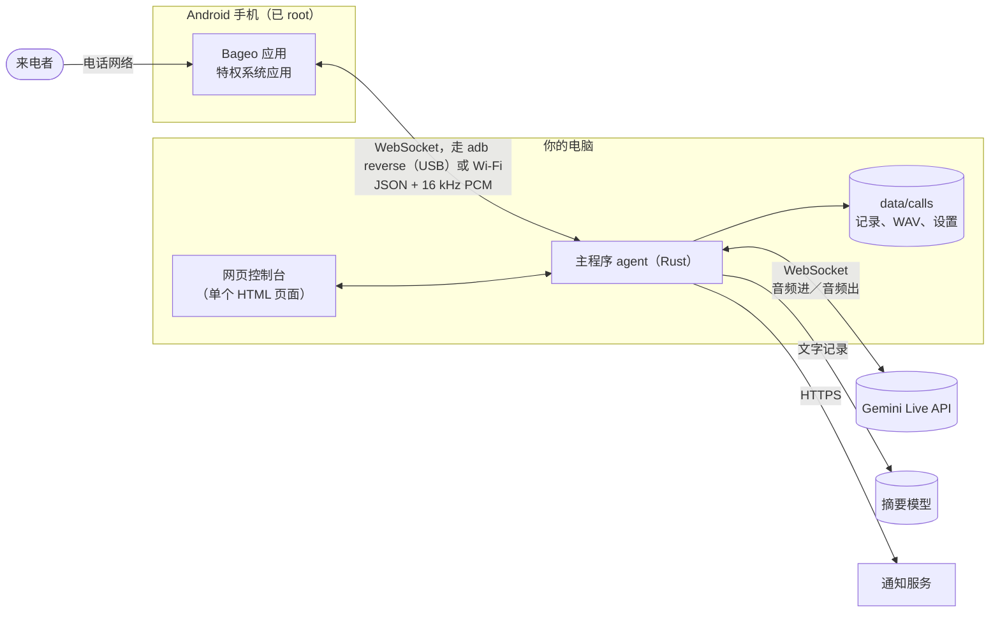

# 架构



## 组成部分

| 部分 | 位置 | 作用 |
|---|---|---|
| **手机应用** | [`android/`](../../android) | 悄无声息地接起电话、采集对方的声音、把 AI 的声音播放到通话里。不包含任何和对话有关的逻辑。 |
| **Root 模块** | `android/magisk/pixelcallai_uplink` | 把应用安装为特权系统应用，并在每次开机时把手机设置成专门接电话的机器。 |
| **主程序（agent）** | [`crates/agent`](../../crates/agent) | 其余所有事情：通话状态机、Gemini Live 会话、录音、摘要、通知、网页控制台及其 API，以及和手机之间的 USB 连接。单个程序，没有数据库。 |
| **网页控制台** | `crates/agent/static/calls.html` | 一个自包含的单页面，编译进主程序里。 |
| **短信转发工具** | [`tools/sms_forward`](../../tools/sms_forward) | 可选的独立 Python 脚本。 |

## 一通电话的完整过程

1. **待命。** 每部手机都和主程序保持一条“control”WebSocket。走 USB 时，应用连接的是手机上的 `ws://127.0.0.1:8765`；`adb reverse`——由主程序的 USB 管理器（`usb_bridge.rs`）维持——会把它转到主程序的端口上。
2. **响铃。** 应用上报 `incoming` 并带上来电号码。主程序做出决定：拦截号码会被立刻接起来、以便挂断；其他来电则回复一个 `answer_plan`（响铃 *n* 毫秒），并且——“响铃预热”（ring pre-warm）——立刻开启 Gemini Live 会话，让模型先生成开场白，留到接通时才放出去。
3. **接通。** 应用接听并打开一条“media”WebSocket。对方的音频以 60 ms 的 PCM 帧向上发送；主程序接手那个预热好的会话、放出开场白，从这时起双向转发音频。
4. **对话**（`gemini_live.rs`）。主程序会
   - 把音量偏小的通话音频做归一化，并在最初几秒检查手机采集到的声音里有没有 AI 自己的声音（回声）——这决定了对方能不能插话，以及背景音怎么混；
   - 把对方的声音流式发送给 Gemini（默认由 Gemini 自己检测一轮发言何时结束），再把 Gemini 的音频混上背景音后发回手机；
   - 读取 Gemini 对双方的文字记录，用来驱动少数不交给模型决定的规则：对方什么时候要离开（他说的话以道别语结尾）、这通电话是不是推销或诈骗（关键词计分 → 在一个新会话上切换到陪聊拖时间的提示词）、线路安静下来时推一把、快到最长通话时间前收尾；
   - 每隔几分钟把 Live 会话换成一个带着文字记录的新会话，因为 Live 连接的存活时间有限。
5. **挂断。** 当对方最后说的话是道别——或者 AI 说了再见而对方保持沉默——主程序会发送 `hangup`。如果 AI 始终没有产生音频（没有密钥、服务不可用），它会立刻挂断，而不是让对方面对一片沉默。
6. **事后**（`main.rs`、`deepseek.rs`、`calendar.rs`、`notify.rs`）。录音完成收尾，文字记录发给摘要模型，摘要（以及日历建议，如果通话中约定了日期）保存在该通话旁边，并发到每一个通知渠道。

## 语言

`locale.rs` 为每种语言保存：给模型看的短语（接电话怎么说、怎么说再见）、挂断规则和推销电话规则要监听的词，以及通知的标签。`prompts.rs` 负责构建系统提示词：繁体中文用的是这个项目实际调校时使用的提示词，简体中文是转换过来的版本，其他每种语言则共用一套英文指令，其中指明要说哪种语言，并引用该语言的短语。添加一种语言，就是加一个 `Phrases` 块，以及它在网页控制台字典里的对应条目。

## 存储

```text
data/calls/
  config/settings.json          what the web console saved (keys in plain text)
  index.json                    the call list
  2026-11-12/<call id>*.wav     recordings: mixed, caller only, AI only
  2026-11-12/<call id>_notes.json   summary, transcript, calendar suggestion
  voice_preview/                cached voice samples and announcements
```

纯文件，没有数据库；想删除还是备份都随你。

## 有意保持简单的地方

- **声音背后没有工具。** 模型在通话中没办法查任何东西，也不能执行任何操作；它被告知了这一点，也被告知不要假装。所有需要判断的事都发生在事后，由你阅读摘要来处理。
- **在模型外面套一层确定性的规则**，处理那些绝对不能出错的事：什么时候挂断、什么时候拦下被拦截号码的来电、绝不让对方面对一片沉默。
- **单个进程。** 没有消息代理（message broker），也没有其他需要保持运行的独立服务。

## 旧的代码路径

主程序是从一套菜单式系统发展而来的（预录问候语、DTMF、等待音乐、语音留言、Tencent TRTC 桥接、Whisper / LLM / Piper 流水线、Telegram 任务卡片）。那些代码还留在 `main.rs` 和各自的模块里，默认关闭，也不带录音文件。目前暂时保留，是因为它和现行路径交织在一起；把它干净地移除已经列在路线图上。
