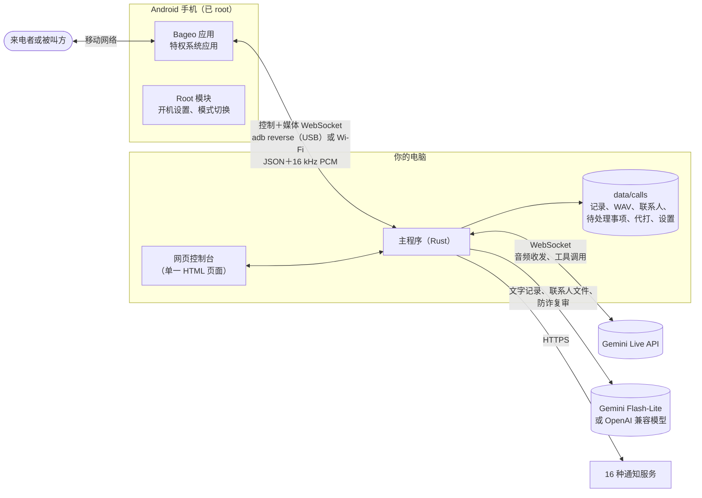

# 架构

Bageo 由三个部分组成：一个手机应用加 root 模块，把备用 Android 手机变成专门接打电话的设备；电脑上的一个 Rust 程序（“主程序”，agent），所有逻辑都在这里；以及编译进这个程序的网页控制台。没有数据库、没有消息队列，也没有项目自己的云服务。



## 各个部分

| 部分 | 位置 | 作用 |
|---|---|---|
| **手机应用** | [`android/`](../../android) | 安静地接起或拨出电话、采集对方的声音、把 AI 的声音播进通话、报告每通电话用的 SIM 卡、按指令发短信。不包含任何对话逻辑。 |
| **Root 模块** | `android/magisk/pixelcallai_uplink` | 把应用安装为特权系统应用，每次开机把手机设置成接电话的设备，并运行切换“AI 接听／普通手机”的 root 小程序。 |
| **主程序** | [`crates/agent`](../../crates/agent) | 其余所有事情：通话状态机、Gemini Live 连接、录音、摘要、联系人、日程预约、AI 代打、通知、网页控制台与 API、和手机的 USB 连接。 |
| **网页控制台** | `crates/agent/static/calls.html` | 编译进主程序的单一页面，九种语言。 |
| **短信转发器** | [`tools/sms_forward`](../../tools/sms_forward) | 可选、独立的 Python 脚本，转发手机收到的短信。 |

### 主程序的模块

| 模块 | 负责 |
|---|---|
| `main.rs` | 启动、手机的 WebSocket 接口、来电状态机、通话结束后的处理流程。 |
| `gemini_live.rs` | 每通电话一个 Live 连接：音频转发、回声检查、插话、挂断规则、推销检测与切换到陪聊模式、连接续接，以及 AI 回拨和代打的特殊模式（等对方接起、回铃音过滤、工具调用）。 |
| `prompts.rs`、`locale.rs` | 按语言和接听身份组装每通电话的系统提示词；每种语言要说和要听的语句。 |
| `stall_review.rs` | 进入陪聊前的复审：小模型在 1.5 秒内把通话判为 `scam_or_sales`、`normal`、`ivr_recording` 或 `too_early`。 |
| `appointments.rs` | 普通通话的 `propose_appointment` 工具、由它生成的待处理事项、同意／不同意、用短信或 AI 回拨告诉对方，以及共用的拨出队列。 |
| `callback.rs` | 手机的控制连接：`place_call`、`send_sms` 及其结果，发到正确的手机。 |
| `errands.rs` | AI 代打：号码检查、选择手机与 SIM 卡（`SimBook`）、代打脚本与 `ask_owner`、实时字幕、通话中你输入的内容、结构化结果。 |
| `contacts.rs` | 通讯录、无论号码怎么写都能匹配、从 vCard／CSV／TSV／纯文本／`.xlsx`／`.docx` 导入，PDF 与图片交给 Gemini，导出 vCard。 |
| `phone_region.rs` | 判断号码属于哪个国家（按接这通电话的 SIM 卡的规则解读）；记住每部手机报告的 SIM 卡国家。 |
| `calendar.rs` | 日历建议，以及 Google、Outlook.com、Microsoft 365、Yahoo、`.ics` 的“添加到日历”链接。 |
| `deepseek.rs` | 通话后的摘要，走 Gemini 或任何 OpenAI 兼容 API（文件名是历史遗留）；其他语言句子的翻译；代打的结果。 |
| `tasks.rs` | “待处理事项”背后的存储。 |
| `notify.rs`、`gmail.rs`、`tg_inbound.rs` | 16 种通知渠道、通过 SMTP 发邮件、Telegram 按钮。 |
| `calls.rs`、`calls_http.rs` | 通话记录、录音与文字记录；网页控制台的 REST API。 |
| `settings_store.rs` | `.env` 加上控制台保存的设置，修改后无需重启。 |
| `usb_bridge.rs` | 为每部 USB 手机维持 `adb reverse`，并启动应用的通话服务。 |
| `mdns.rs` | 在局域网响应 `bageo.local`（multicast DNS），不知道电脑 IP 也能打开控制台。 |
| `adpcm.rs`、`voice_preview.rs`、`ambience.rs` | 1,080 个 IMA ADPCM 内置语音文件、声音试听与“无法接通”语音、12 种背景音。 |

## 一通来电的完整过程

1. **待机。** 每部手机都和主程序保持一条*控制* WebSocket。走 USB 时，应用在手机上连接 `ws://127.0.0.1:8765`，由 `usb_bridge.rs` 维持的 `adb reverse` 把它转到主程序的端口。
2. **响铃。** 应用报告 `incoming`，附带来电号码和接这通电话的 SIM 卡。主程序决定：
   - 拦截号码在响铃时直接挂断，或接起播放预录语音，完全不会用到 Gemini；
   - 其他电话则返回一个 `answer_plan`（响 *n* 毫秒，默认 3 秒），并通过*响铃预热*立即建好 Gemini Live 连接。提示词此时组装完成：你的或内置的提示词、状态留言、资料、号码在通讯录里的话是谁打来的、别人怎么称呼你、这张 SIM 卡和这个号码适用的语言规则、日程预约开启时的预约工具，以及固定底线（见[编写提示词](PROMPTS.md)）。模型先把开场白生成好，等接起再放出来。
3. **接起。** 应用接起电话并打开一条*媒体* WebSocket。对方的声音以 60 毫秒的 PCM 帧上传；主程序接管预热好的连接、放出开场白（实测从接起算中位数约 0.43 秒），之后双向转发音频。有些手机接起时才报告 SIM 卡，如果因此要换开场语言，就丢掉准备好的那句，AI 稍后用正确的语言开口。
4. **对话**（`gemini_live.rs`）。主程序会：
   - 把音量偏小的通话声音调整好，并在头几秒检查手机收音里有没有 AI 自己的声音。这决定对方能不能插话（说满约 0.8 秒；“嗯”这种短声不算），以及背景音怎么混；
   - 把对方的声音流式发给 Gemini（默认由 Gemini 自己判断对方说完没有），再把 Gemini 的声音混上背景音发回手机；
   - 台湾 SIM 卡接到国际来电时，让 AI 等运营商的预录提示播完再开口；
   - 读取 Gemini 双方的文字记录，执行少数不交给模型的规则：对方是不是要结束了（他说的话以道别结尾）、这通是不是推销或诈骗（关键词分数 → `stall_review.rs` → 新建连接进入陪聊模式）、线路安静时提醒、到最长通话时间前收尾；
   - 用独立的任务处理模型的 `propose_appointment` 调用，音频不必等它；
   - 每隔几分钟换一条带着文字记录的新 Live 连接，因为 Live 连接有存活时间上限。
5. **挂断。** 对方最后一句是道别，或 AI 道别后线路安静 6 秒，主程序就发送 `hangup`。预录语音菜单不回应，安静几秒后挂断。如果 AI 一直没出声（没有密钥、服务故障），就立即挂断，不让对方对着一片安静。
6. **之后**（`main.rs`、`deepseek.rs`、`appointments.rs`、`notify.rs`）。录音收尾（整通、只有对方、只有 AI），文字记录发给摘要模型，四行摘要保存在通话旁边并发到每个通知渠道。对方提出的每一条预约都变成一项待处理事项（推销或诈骗电话不会产生）。其他语言的句子在后台翻译，译好再补进记录，通知不必等它。

## 一通拨出：AI 代打或预约回拨

两种拨出共用 `appointments.rs` 里同一条拨出路线：同一个号码一次一通，`place_call` 只发到指定的手机（和 SIM 卡），脚本只套用在那部手机为这项任务报告的那通电话上。同一个号码打进来的电话，绝不会拿到拨出用的脚本。

1. **发起。** 代打来自 `POST /calls/api/errands`（“AI 代打”页面或联系人旁的“请 AI 打”）；回拨来自待处理事项或 Telegram 卡片上选了“AI 回拨”的“同意／不同意”。
2. **号码检查。** 代打拒绝紧急电话、短号码（7 位及以下）、高额付费电话，以及写在国际冠码后面的号码（`00`、`011`、台湾的 `01x`／`00x`、日本的 `010`）；国外号码请用 `+` 写。回拨只打给对方本人的号码，只限接听 SIM 卡的国内号码，绝不打免费、增值或特殊号码。
3. **手机与 SIM 卡。** 代打会挑一部处于 AI 接听模式、并且有号码所属国家 SIM 卡的手机。主程序从手机报告的通话、以及控制连接 hello 里的 `sims` 列表，学到每部手机的 SIM 卡（subscription id 与国家），保存在 `phone_sims.json`。从没报告过 SIM 卡的手机不接代打（`sim_unknown`）。回拨则用原来接那通电话的手机和 SIM 卡拨出。
4. **拨号。** 主程序发送 `place_call`，附带检查过的 E.164 号码和要用的 SIM 卡。如果这通电话的媒体 hello 报告的是另一张卡、或没有报告，主程序会在 AI 开始前挂断（`wrong_sim`），并忘掉那部手机上的那张卡。已取消的代打绝不会拨出；取消后仍然接通的电话会立即挂断。
5. **等真人。** AI 不会对着回铃音说“喂？”。对方接起并开口之前（至少 400 毫秒人声，滤掉 350–520 Hz 的回铃音），主程序只给 Gemini 发静音。70 秒都没人出声就算没接；运营商“空号”录音立即挂断；代打遇到语音菜单最多等 90 秒。
6. **对话。**
   - **回拨**：说明是谁打来的，用原来那通电话的语言把你的答复说一次（时间和事由，或礼貌地拒绝），道别后结束。
   - **代打**：按脚本进行——说明替谁打、交办允许的范围内自己决定、其他事调用 `ask_owner`。通话会等这个答案：控制台在最近 6 秒内打开过实时画面的话，问题会在那里显示最多 40 秒；否则或超时，AI 会被告知不能采用自己提出的任何选项，改问对方哪些可以，然后礼貌收尾。通话中你输入的内容（`say`）会作为指示交给 AI。每条提示都会提醒 AI 保持这通电话的语言，数字也一样。一通代打最长 10 分钟，9 分 30 秒开始收尾。
7. **之后。** 回拨的结果记在它的待处理事项上，并发一条标题为“📞 AI 回拨”的通知。代打的文字记录、交办和问答会发给摘要模型，返回 `{outcome, summary, details, follow_up, options, event}`。你没回答的问题如果 AI 先答应了，结果一律改为 `need_owner`（要你决定）。你会收到一条带联系人名字或号码的 📞 通知；要不要“**再打一次**”或“**回复后请 AI 再打**”（`follow_up_of`，带上前一通的最后几句）由你决定。

## 模型什么时候有工具、什么时候没有

普通通话时，声音背后没有任何慢速的外部查询：模型不能在说话中途上网或读日历，它也被告知这一点，并且绝不说“我查一下”。所有需要判断的事都在通话后由你看摘要处理。

只有两个功能给模型工具，而且各自受主程序里严格的状态机管控：

- `propose_appointment`（日程预约开启时的普通通话，陪聊模式绝不会有）：记下对方要的时间和事由。AI 只承诺会回复对方；你按“同意”之前什么都不算数，而且只有第一个决定有效。
- `ask_owner`（只在代打通话中）：让 AI 等到你回答或问题超时；结果如果敲定了你没回答的问题，就变成 `need_owner`。

不能出错的事由模型外围的固定规则处理：什么时候挂断、什么时候挡下拦截号码、绝不让对方对着一片安静、哪些号码可以拨、用哪张 SIM 卡拨。

## 语言

`locale.rs` 为每种语言保存：给模型看的短句（怎么接电话、怎么道别）、挂断与推销规则要听的词、语音识别的语言提示，以及通知的标签。`prompts.rs` 组装系统提示词：繁体中文用项目在真实通话中调好的提示词，简体中文用转换后的版本，其他语言共用一套英文指示，指明要说哪种语言并引用该语言的语句。开场语言由来电号码和 SIM 卡的主要语言决定；每份提示词都要求 AI 跟着对方换语言。新增一种语言，就是加一个 `Phrases` 块，再在网页控制台的字典里加一份翻译。

## 数据存放

```text
data/calls/
  config/settings.json              网页控制台保存的设置（密钥为明文）
  index.json                        通话列表
  2026-11-14/<通话 id>*.wav         录音：整通、只有对方、只有 AI
  2026-11-14/<通话 id>_notes.json   摘要、文字记录、翻译、日历建议
  contacts.json                     你的联系人
  tasks/index.json、tasks/<id>.json 待处理事项（日程预约）
  errands.json                      AI 代打，保留最新 500 条
  phone_sims.json                   每部手机报告过的 SIM 卡
  voice_preview/                    缓存的声音示例与语音
```

都是普通的 JSON 和 WAV 文件，没有数据库；删除或备份都随你。每次写入都先写临时文件再重命名覆盖旧文件。无法读取的 `errands.json` 或 `phone_sims.json` 会被移到一旁，不会被覆盖。

## 设计取舍

- **语音对语音。** 同一个模型听也说，延迟和插话由模型处理，而不是靠语音转文字、LLM、文字转语音串起来的一条链。
- **你的 SIM 卡、你的手机。** 不用 SIP 中继也不用云通信服务；手机通信协议很小，写在 [API](API.md) 里，其他前端也可以取代手机。
- **单一进程。** 没有其他东西要安装、保活或加固。
- **有风险的路径一律保守。** 复审结果不确定就当成诈骗（继续陪聊，不放行）；不认识的 SIM 卡不接代打；预约一定等你决定。

## 旧代码路径

主程序是从一套菜单式系统演变来的（预录问候、DTMF、等待音乐、语音留言、腾讯 TRTC 桥接、Whisper／LLM／Piper 流程）。那些代码还在 `main.rs` 和各自的模块里，默认关闭，也不附带录音。暂时保留是因为它和现行路径交织在一起；干净地移除它列在[路线图](ROADMAP.md)上。
