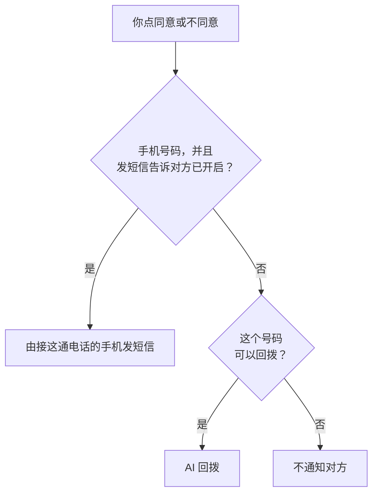

# 设置参考

Bageo 是自托管的 AI 电话助理，用 Gemini Live 让 AI 接电话，接的是你自己的真实号码。这一页列出它的全部设置：电话怎么接、哪些推销、骚扰和诈骗电话要拦下或陪他聊、通话摘要发到哪里，以及主程序怎么启动。每张表都附上默认值，一眼就能看出哪些地方你改过。

设置放在两个地方：

- **网页控制台**（“设置”标签页）：所有和接电话有关的项目。保存到 `data/calls/config/settings.json`，下一通电话就生效，不用重启。
- **启动选项**：主程序在哪里监听、数据放在哪里、USB 连接。只在启动时读取一次，来源是环境变量，或启动脚本旁边的 `.env` 文件（从 `.env.example` 复制一份）。

## 快速找到设置

| 我想… | 去这里 |
|---|---|
| 让 AI 以我本人的身份接，不说自己是助理 | [基本设置](#基本设置) →“接听身份” |
| 打进美国卡的电话用英文接，其他照旧 | [基本设置](#基本设置) →“各 SIM 卡的主要语言” |
| 遇到诈骗电话不直接挂，拖住他的时间 | [推销与诈骗电话](#推销与诈骗电话) |
| 某个号码再也不要打进来 | [拦截号码](#拦截号码) |
| 让 AI 打给餐厅订位 | [AI 代打](#ai-代打) |
| 对方想约时间，我晚点决定再回复他 | [日程预约](#日程预约) |
| 用手机打开控制台 | [从其他设备使用控制台](#从其他设备使用控制台) |

## 网页控制台里的设置

### 基本设置

AI 要能替你接电话，先把这几项填好。

| 设置 | 默认 | 作用 |
|---|---|---|
| 语言 | English | AI 跟来电者说话用的语言：它说的话、第一句话、拦截号码的语音，以及发给来电者的短信。English、繁體中文（台湾）、简体中文、日本語、한국어、Español、Français、Deutsch、Português。 |
| 通知和摘要的语言 | 与 AI 说话的语言相同 | 给你看的文字用的语言：通知、通话摘要（通话记录里也是）、预约卡片和决定结果、短信转发的消息。人在国外时很方便：AI 用英文接电话，通知照样是简体中文。在网页右上角切换显示语言时，这里也会跟着改成同一种语言。 |
| 各 SIM 卡的主要语言 | 无 | 手机里有不同国家的 SIM 卡时使用：选 SIM 卡的国家，和打进那张卡的电话要用的开场语言，例如“美国 (US)”→ English，“语言”仍是简体中文。日本号码打进美国卡，仍然用日语。需要手机 App 1.0 以上，它会上报每通电话是哪张卡接的。保存为 `sim_languages`，例如 `{"us": "en"}`。 |
| 你的名字 | 空 | 来电的人怎么称呼你。提示词里写 `{owner}` 的地方都会换成它。 |
| 其他人怎么叫你 | 空 | 一行一个，最多 10 个：英文名、绰号、同事对你的叫法。AI 听到这些名字就知道是在找你，两种接听身份都一样，自己改过提示词也一样。通话摘要仍然写“你的名字”。保存为 `owner_aliases`（列表）。 |
| 接听身份 | AI 助理 | **AI 助理**：说明自己是替你接电话的 AI，帮你记下留言。**本人**：以你的身份接听，被认真问是不是真人时仍会承认是 AI。 |
| AI 代打默认身份 | 助理 | AI 从“AI 代打”标签页替你打电话（见 [AI 代打](#ai-代打)）时说自己是谁：**助理**（说是替你打来的）或**本人**（以你的身份说话）。每次交办还可以另外选；两种被认真问是不是真人时都会承认是 AI。保存为 `errand_identity`（`assistant`／`owner`，其他值一律按 `assistant` 处理）。 |
| Gemini API 密钥 | 空 | 你从 Google AI Studio 获取的密钥，AI 说话需要它。只保存在你的电脑上。 |
| Live 模型 | `gemini-3.8-live` | 在电话上说话的 Gemini Live 模型。名称里有“thinking”的模型（例如 `gemini-3.8-live-extended-thinking`）回答更谨慎，也稍慢一点；见[高级](#高级)里的“思考程度”。 |
| 声音 | Charon | Gemini 内置的声音之一。点“**试听**”会用上面选的语言说三句示例。 |
| 由 AI 接听来电 | 开 | 总开关。关：来电仍会被接起来，然后立刻挂断，什么都不说。想让某部手机正常响铃、自己接，请把它切成[普通手机](PHONE.md#普通手机模式)。 |

### 接听方式

| 设置 | 默认 | 作用 |
|---|---|---|
| 响多久再接 | 3 秒 | 对方听到响铃多久 AI 才接：0（马上接）到 8 秒，以半秒为单位。AI 利用这段时间做准备。 |
| 响铃时先让 AI 准备好 | 开 | 接起来之前就先连上 Gemini、准备好第一句话，电话一接通 AI 就开口。即使对方在响铃时就挂断，也会用掉一次短暂的 Gemini 连接。关：对方要等 1 到 3 秒才听到第一句。 |
| 未显示号码也接听 | 开 | 开：没有显示号码的来电，和其他人一样交给 AI。关：和拦截号码一样，用你的“语言”和“拒接语音的声音”播一句“无法接通”再挂断。这句话已经内置录好，不需要 Gemini 密钥。 |
| 对方可以打断 AI | 开 | 对方插话时 AI 会停下来。只在收音不会收回 AI 自己声音的手机上使用，每通电话开头自动检查（见[支持哪些手机](PHONE.md#支持哪些手机)）。 |
| 让 Gemini 判断对方什么时候说完 | 开 | 建议开启：由 Gemini 自己的语音检测判断什么时候轮到 AI 说话。关：改用主程序里更简单的音量规则。 |
| 普通电话最长 | 5 分钟 | 3 到 30 分钟。到上限前大约 25 秒，AI 会礼貌收尾并挂断。 |
| 状态留言 | 关 | 一行关于“现在”的说明，最多 400 字（“快递请放在前台”）。只有和这通电话有关时 AI 才会提。 |
| 背景音、背景音量 | 关、中 | 垫在 AI 声音后面的轻微环境音，听起来像真有人在某个地方接电话：办公室、家里、街边、医院、救护车经过、台风天、雷雨、工地、地铁、夜市、鞭炮／节庆、开车中。音量有小、中、大。点“**声音＋背景音**”或“**只听背景音**”可以试听。 |

**对方说别的语言。** 这不用设置：对方明显在说另一种语言，或问你会不会说某种语言时，AI 会切换过去。

**境外来电与运营商警示语。** 台湾的运营商会在每通境外来电一开始播放一段预录的防诈骗警示语。台湾 SIM 卡接到其他国家的号码（`+…` 或 `00…` 开头、国家代码不是台湾）时，AI 会等这段警示语播完：线路安静下来就开口，最多等 7.5 秒，开场白也只说一次。其他 SIM 卡（例如双卡手机上的美国卡）接到的电话没有这段警示语，AI 会马上开口。这是自动判断的，不用设置。手机 App 1.0 以前的版本，“境外来电”就是国家代码和你不同的 `+…` 号码（见[国际电话区号](#国际电话区号)）。

### 推销与诈骗电话

对方一开口就是“恭喜您的贷款已预审通过”，或自称银行风控人员要你报验证码。只要对方的话显示这是推销或诈骗，AI 就变成一个有兴趣但反应很慢的客户：怎么申请、怎么计算，一条一条慢慢问。它绝不给资料、绝不答应任何事，一直聊到对方自己挂断，或到了时间上限。

| 设置 | 默认 | 作用 |
|---|---|---|
| 陪他聊、拖时间 | 开 | 上面说的拖时间。关：AI 会婉拒并结束通话。 |
| 这类电话最长 | 30 分钟 | 3 到 30 分钟。聊得越久，用掉的 Gemini 额度越多。 |
| 这类电话用的模型 | `gemini-3.8-live` | 判定为推销或诈骗后，这通电话改用的模型。留空 = 沿用这通电话原本的模型。 |
| 没有推销或诈骗字眼的电话也检查 | 开 | 用低成本模型读对方说的内容，每通最多三次，新话术、其他语言、语音转文字写错的字也能抓到。关：只有用到已知推销或诈骗字眼的电话才检查。 |

**怎么判断。** 内置诈骗数据库（42 种推销与诈骗话术、19 种语言的关键词）里的词会让低成本模型再看一次；开了上面的设置，没有这些词的电话也会被看。模型会说出是哪一种话术、有多确定，不确定就等对方下一句再看。模型没在时限内回答时，只有不管谁要都是诈骗的要求（报验证码、操作 ATM、买点卡、装远程软件、转到“安全账户”）会立刻开始陪聊；其他情况等下一句再看，连续失败两次才只靠关键词。开始陪聊后对方再说两句，会再看一次，误判的来电可以放回正常应对。联系人和你标为“不是”的号码不会被拖住，除非他们要的正是上面那些只有诈骗才会要的东西。

通话页的“推销／诈骗判断”会显示这通的判断与话术类型；点“是诈骗”“是推销”“不是”会记在这个号码上，它之后打来会参考你的标记（未显示号码不会被记住）。你自己的词和号码写在数据文件夹里的 `config/scam_db.local.json`，改了会自动重读，文件不存在或写错都不影响运行：

```json
{
  "keywords": [
    {"text": "會員續約專線", "lang": "zh-TW", "typology": "general_promotion", "weight": 2},
    {"text": "read me the six digits", "lang": "en", "typology": "otp_theft", "weight": 2, "hard": true}
  ],
  "numbers": [
    {"number": "0223456789", "verdict": "safe", "note": "building management"},
    {"number": "+15550100", "verdict": "scam", "typology": "irs_ssa_impersonation"}
  ]
}
```

`weight` 是 1（要搭配其他词才算）或 2（单独出现就算）；`hard` 只对不管谁要都是诈骗的话术类型有效。`typology` 要用 `crates/agent/data/scam_db.json` 里的内置类型；放不进去的条目会跳过，并在日志里写明原因。

### 提示词

决定 AI 怎么说话；内置提示词大多数人直接用就好。“自定义提示词”（留空 = 内置，点“**查看内置提示词**”可以看内容）、“AI 可以回答的资料”（来电者可能会问的事，一行一条，最多 6,000 字），以及让 ChatGPT、Claude 或 Gemini 陪你写提示词的访谈提示词，见[编写提示词](PROMPTS.md)。

### 拦截号码

最直接的来电筛选：名单上的号码打来，完全不会用到 AI 和 Gemini。通话列表里照样有记录，也会发出“拒接号码来电”通知。

| 设置 | 默认 | 作用 |
|---|---|---|
| 号码、原因 | 空 | 一行一个号码，原因可不填。号码结尾加 `*` 可以拦下以这几位开头的所有号码（至少四位，例如 `0800*`）。号码照通话列表里显示的样子写；知道你的国家代码时（[`COUNTRY_CODE`](#国际电话区号)），`+…` 的写法也能对上。 |
| 拒接方式 | 响铃时直接挂断（不接通） | 保存为 `reject_mode`。**响铃时直接挂断（不接通）**（`decline`）：电话不会接通。**接起播“无法接通”再挂断**（`announce`）：用你的“语言”播一小段“此号码目前无法接通”，对方会看到电话接通几秒钟。太旧、不会拒接的手机 App 两种方式都会接起来播语音。 |
| 拒接语音的声音 | 跟 AI 的声音一样 | 这段语音用的声音（未显示号码也听这段）。每个声音的每种语言都已经预先录好，不会用到 Gemini 额度。点“**试听语音**”可以听。 |

试试看：在通话列表打开一通电话，点“**拦截这个号码**”，一步就把对方加进名单。

### AI 代打

“AI 代打”标签页让 AI 替你打电话。以订四个人的位子为例：

1. 选联系人或输入号码。
2. 写下要办的事和你能接受的范围：“明天晚上 7 点订 4 位；7 点半到 8 点也可以”。
3. 选“用什么身份打”，想指定的话再选“用哪部手机打”，点“**开始打**”。
4. 看“实时字幕”跟进通话。你可以打字交代 AI、回答它问你的问题，或点“**挂断**”。

结束后那一条会显示结果（办好了、办好一部分、没办成、要你决定、没接、语音信箱、失败），附上细节、下一步、谈定的时间、通话记录链接和“**再打一次**”。对方给了几个选项时，选一个，AI 就会打回去回复。你也会收到一条通知。

需要什么、会怎么做：

- 一部已连接、处于 AI 模式、有该国 SIM 卡的手机。主程序从手机接过的电话得知它有哪些 SIM 卡，所以新手机要先接过一通电话（否则会提示“这部手机还没接过电话”）。
- 绝不拨紧急号码、7 位以下的短号和增值付费号码；免费电话可以拨。境外号码请加 `+`；没有 `+` 的号码一律当成本国号码。
- 同一个号码一次只打一通，和[日程预约](#日程预约)的 AI 回拨共用排队。手机通话中时最多等 10 分钟，等同一个号码的前一通电话结束最多等 25 分钟。一通最长 10 分钟（9 分半开始收尾）。AI 不能按键：遇到语音菜单最多等 90 秒等真人，遇到运营商录音（“您拨打的号码…”）直接挂断。
- 遇到你没交代清楚的事，AI 会先跟对方说要确认一下，再到页面上问你（你正在看时最多等 40 秒）。你没在看或没回答，它对这件事什么都不答应：记下对方的选项、说你确认后再回电，然后礼貌收尾。
- 不答应付款、定金、转账，不给交办以外的个人信息，也不会自己重拨。

“用什么身份打”的默认值是[基本设置](#基本设置)里的“AI 代打默认身份”。完整规则、每一种状态和错误代码见 [API → AI 代打](API.md#ai-代打)。

### 通知

| 设置 | 默认 | 作用 |
|---|---|---|
| 发送通知 | 开 | 关：什么都不会发到任何渠道。 |
| 通知渠道 | 无 | Telegram、Discord、LINE、ntfy、电子邮件、Webhook 等等；每个启用的渠道都会收到每一条消息。各渠道怎么配置见[通知](NOTIFICATIONS.md)。 |
| 这个控制台的地址 | 空（自动） | 放进通知链接的地址，例如 `http://192.0.2.10:8787`。 |
| 局域网名称 | `bageo` | 同一网络里的手机、电脑可以用来代替 IP 的名字：`http://bageo.local:8787/`。只能用英文字母、数字和连字符；留空、`off`、`0`、`none` 或 `false` = 关闭。 |

“这个控制台的地址”留空时，只要控制台对局域网开放（`AGENT_HOST=0.0.0.0`）就会自动填：主程序在应答局域网名称时用 `http://<局域网名称>.local:8787/`，否则用这台电脑的局域网 IP。控制台只有这台电脑能打开时，通知不带链接；在 Docker 里请自己设置。“系统 → 关于”会显示当前使用的地址。

“局域网名称”由主程序自己应答（多播 DNS，UDP 5353 端口），只在控制台对局域网开放时启用，容器里不会启动。系统不让出这个端口时，日志里会出现一行以 `mDNS:` 开头的信息，链接改用 IP。打不开 `.local` 名称的旧 Android 手机，可以用“系统 → 关于”里的 IP 地址或二维码。

### 摘要与日历

每通电话结束后，AI 会写一段简短摘要。它用你的 Gemini 密钥，通常什么都不用设置。

| 设置 | 默认 | 作用 |
|---|---|---|
| 摘要服务 | Gemini | 保存为 `summary_provider`。**Gemini**（`gemini`）：用你的 Gemini 密钥和 Gemini 最便宜的模型 `gemini-flash-lite-latest`，不行再退到 `gemini-flash-latest`。**其他服务**（`custom`）：任何兼容 OpenAI 的服务，在下一行设置。没有 Gemini 密钥时，选 Gemini 和选其他服务效果相同。日历建议也用同一个服务。旧版的设置会自动转换。 |
| 其他服务：API 地址、模型、API 密钥 | 空 | **API 地址**：服务兼容 OpenAI 的地址，例如 DeepSeek `https://api.deepseek.com/v1`（模型 `deepseek-chat`）、OpenAI `https://api.openai.com/v1`（例如 `gpt-4o-mini`）、OpenRouter `https://openrouter.ai/api/v1`，或本机的 Ollama `http://127.0.0.1:11434/v1`。**模型**：填了 API 地址就必须填。**API 密钥**：保存后只显示提示；本机服务器不需要。不填 API 地址时：填了 API 密钥就用 DeepSeek，否则用 Gemini。保存为 `summary_api_base`、`summary_model` 和 `deepseek_api_key`（存的是你所用服务的密钥）。 |
| 建议日历日程 | 开 | 通话中说定了日期（送货时段、预约、对方约好几点回电），摘要就附上“**添加到日历**”链接。每通电话会多向摘要模型发一次请求。不会自己把任何东西加进日历。 |
| 添加到日历 | 第一次点时询问 | 不是一个字段：第一次点“**添加到日历**”会问要加到哪个日历（Google 日历、Outlook.com、Microsoft 365、Apple 日历、Yahoo 日历，或下载 `.ics`），之后就记住（`calendar_app`），按钮旁的“**换一个日历**”可以改。通知和 Telegram 回复带的也是同一个日历的链接。选 Apple 日历或 `.ics` 时，链接指向“这个控制台的地址”（没填就不带），带的是只能打开这个文件的密钥，而不是你的访问 token。主程序不连接任何日历账号。 |

#### 日程预约

对方想跟你约时间（见面、来访、约好时间通电话）时，AI 不会在电话上答应。你晚点再决定，对方会通过短信或 AI 回拨得知结果。

| 设置 | 默认 | 作用 |
|---|---|---|
| 日程预约 | 关闭 | 选“**先问我**”（`confirm`）就启用下面的流程。 |
| 发短信告诉对方 | 关 | 你点同意或不同意后，让接这通电话的手机以你的名义给对方发短信，例如“您好，我是小明。约在11月14日（周六）15:00没问题，到时见。”短信只写时间，不写约的是什么事：那是来电者自己说的话，可能被塞进网址。只发给手机号码：台湾手机、+1 号码（免费和 900 除外），以及其他国家的手机。手机 App 要能发短信。 |
| 默认回复方式 | 自动（按号码判断） | 你没另外选时，对方怎么得知结果。**自动**按下面的流程图判断；**一律发短信**／**一律 AI 回拨**只用那一种，不行就不通知。它决定“待处理事项”预选的方式、Telegram 按钮用的方式，以及 AI 在电话上怎么说。 |

一次预约怎么走完：

1. **电话上。** AI 不会让对方等。它会说“我确认一下，晚点发短信回你”；要用回拨告知时说“晚点再打给你”，两种都联系不到对方时只说“再回复你”。
2. **通话后。** 预约出现在“**通话**”标签页顶部的“**待处理事项**”（以及这通电话的详情里）：谁、什么事、什么时间，选择怎么告诉对方（**发短信**、**AI 回拨**或**不通知对方**；这个号码用不了的方式会变灰），再点“**同意**”或“**不同意**”。
3. **你决定后。** 那一条会用大白话写出结果：“已同意，已发短信给对方”、短信没发出的原因，或 AI 回拨进行到哪一步。同意的会出现“**添加到日历**”；短信没发出的会有“**重发短信**”。
4. **人在外面。** 用 `TELEGRAM_BOT_TOKEN` 和 `TELEGRAM_CHAT_ID`（或通过 `PUT /calls/api/settings` 的 `telegram_bot_token`／`telegram_chat_id`）指定 Telegram Bot、“发送通知”也开着时，还会收到带“**同意**”／“**不同意**”按钮的卡片。在控制台添加的 Telegram 渠道和其他渠道一样，只收到附通话链接的提醒。



*“自动”默认回复方式的判断。未显示号码一律走到“不通知对方”。*

保证安全的规则：

- 只有第一次决定算数，不管是在控制台、Telegram 卡片还是 API 上决定。
- 对方只是随口提的备选时间（“不行的话下午也可以”）不会覆盖谈好的时间；同一通电话里另外约的第二件事会分开、各自决定。
- 推销、诈骗电话一律不约：一通电话被判定为这类电话（通话中判定或由摘要判定；银行反诈、警察通知这类电话不算），或 AI 连不上时，谈好的都不算数，也不会等你处理。
- 两种接听身份都能用；有预约的那通电话不再另外生成日历建议。
- AI 回拨只拨打和接听 SIM 卡同一个国家、长度像普通电话的号码（台湾是 0 后面 8～9 位）；免费电话（0800、+1 800～888）、增值号码（0204、0209、+1 900）、特殊号码（165、110）和境外号码都不回拨。

**AI 回拨**从接这通电话的手机和 SIM 卡拨出（那部手机在线时），只打给那位来电者自己的号码，同一个号码一次一通。AI 等对方接起来出声（70 秒都没人出声就算没接），说明是谁打来、用原来那通电话的语言告诉对方结果，说一次再见就挂断。这通电话在通话记录里标为“AI 回拨”。“待处理事项”会显示回拨进度；拨不出去时也会发到你的通知渠道。短信同样从那通电话打进来的 SIM 卡发出，双卡手机会用正确的号码回复。

时间一律是这台电脑的本地时间（见[时区](#时区)）。完全没有可以写摘要的密钥时，通知会改放对方开头说的几句话；逐字稿一定可以在控制台看到。预约的所有字段与 API 见 [API → 日程预约与任务](API.md#日程预约与任务)。

### 高级

| 设置 | 默认 | 作用 |
|---|---|---|
| 思考程度 | 低 | 只适用于名称里有“thinking”的 Live 模型：低、中、高。“低”回话最快。保存为 `gemini_thinking_level`。 |

“国际电话区号”改在启动时设置，见[国际电话区号](#国际电话区号)。

### 控制台里没有的设置

有几个设置没有字段，请在 `settings.json` 里改，或用 `PUT /calls/api/settings`（见 [API](API.md)）：

| 键 | 作用 |
|---|---|
| `country_code` | 你的国际电话区号；见[国际电话区号](#国际电话区号)。 |
| `name_corrections` | 语音转文字老是听错的名字，每条一个 `错的=对的`（例如 `黄先生=王先生`）：逐字稿和摘要会自动改正。首次运行的默认值是 `NAME_CORRECTIONS`，用逗号分隔。 |
| `device_labels` | 你给手机起的名字：手机上报的 id → 通知和控制台显示的名称，例如 `{"pixel-10123": "工作机"}`。优先于手机自己上报的型号。 |

## 启动选项

用环境变量或在 `.env` 里设置。全部都是可选的；同一个变量，真正的环境变量优先于 `.env` 里的那一行。

用 Docker 时，只有 `docker-compose.yml` 的 `environment:` 下列出的变量会传进主程序（`CALLS_UI_TOKEN`、`DEVICE_TOKEN`、`PUBLIC_URL`、`CALLS_RETENTION_DAYS`、`TZ`），镜像本身则设置了 `AGENT_HOST=0.0.0.0`、`ASSETS_DIR=/app/assets`、`CALLS_DATA_DIR=/data/calls` 和 `USB_BRIDGE=off`。其他要用的变量，请自己在那里加一行。

### 网络与访问

| 变量 | 默认值 | 含义 |
|---|---|---|
| `AGENT_HOST` | `127.0.0.1` | 监听的地址。`127.0.0.1` = 只有这台电脑。`0.0.0.0` = 所有网络接口。 |
| `AGENT_PORT` | `8787` | 网页控制台和手机连接用的端口。 |
| `CALLS_UI_TOKEN` | *（空）* | 网页控制台和 API 的密码。用 `?token=…`、`Authorization: Bearer …` 或 `X-Calls-Token` 传递。**只要 `AGENT_HOST` 不是 `127.0.0.1`，就必须设置。** |
| `DEVICE_TOKEN` | *（空）* | 不是通过 USB 连进来的手机，必须用 `…/ws?token=<this>` 连接（`<this>` 换成这个值）。**只要 `AGENT_HOST` 不是 `127.0.0.1`，就必须设置。** 走 USB 的手机不受此限（USB 通道的终点就是这台电脑本身）。 |
| `PUBLIC_URL` | *（空）* | 等同“这个控制台的地址”；以网页控制台里的值为准。留空 = 自动（见[通知](#通知)）。 |
| `MDNS_NAME` | `bageo` | 等同“局域网名称”：在你的网络上用 `http://<这个值>.local:8787/` 打开控制台。留空、`off`、`0`、`none` 或 `false` = 关闭；Windows 上空值会被当成没设置，请写 `MDNS_NAME=off`。以网页控制台里的值为准。 |

### 从其他设备使用控制台

默认只有这台电脑自己能打开控制台。要从你的手机或家里网络上的另一台电脑访问，在 `.env` 写：

```ini
AGENT_HOST=0.0.0.0
CALLS_UI_TOKEN=choose-a-long-random-string
DEVICE_TOKEN=another-long-random-string
```

先打开一次 `http://bageo.local:8787/?token=choose-a-long-random-string`（或用这台电脑的 IP，例如 `http://192.0.2.10:8787/?token=…`），页面会记住 token。“系统 → 关于”会显示地址和二维码，用手机扫一下就能打开，也写了怎么把控制台添加到主屏幕。

如果这台电脑连着“所有流量都走 VPN”的 VPN，主程序可能会把 VPN 的地址当成局域网名称和链接的地址。请把 `AGENT_HOST` 设成这台电脑的局域网 IP（例如 `AGENT_HOST=192.0.2.10`），局域网名称和链接就会用这个地址。

这条连接是未加密的 HTTP：在你信任的家庭网络里没问题，但不适合开放的互联网。要从外面访问，请用 VPN（WireGuard、Tailscale），或带 HTTPS 和独立登录机制的反向代理；不要做端口转发。

### 数据与录音

| 变量 | 默认值 | 含义 |
|---|---|---|
| `CALLS_DATA_DIR` | `data/calls` | 通话记录、录音、设置和通讯录。相对于主程序启动时所在的文件夹；容器里是 `/data/calls`。 |
| `CALLS_RETENTION_DAYS` | `7` | 超过这个天数的通话会被删除，记录和音频都删（1–3650）。 |
| `CALLS_RECORD` | `true` | `false`：完全不保留通话记录和录音。 |
| `ASSETS_DIR` | *（自动查找）* | 存放附带音效的文件夹。没设置时用程序旁边的 `assets`；容器里是 `/app/assets`。 |

### 时区

| 变量 | 默认值 | 含义 |
|---|---|---|
| `TZ` | *（这台电脑自己的）* | 通知里的时间（例如 `11月13日 08:09`，日期按你设置的语言写）、通话列表的“今天”、日历建议使用的时区。填时区名称，例如 `Asia/Taipei`、`Europe/Berlin`、`America/New_York`。只有运行主程序的电脑和你不在同一个时区时才需要设置。当前时间看 `/health` 的 `local_time`。 |

用 Docker 时，容器从挂载进来的 `/etc/localtime` 获取主机的时区（Linux 主机）；要用别的时区就在 `.env` 写 `TZ=Asia/Taipei`。Windows 或 macOS 的 Docker Desktop 请把 `docker-compose.yml` 里 `/etc/localtime` 那一行删掉，改在 `.env` 设置 `TZ`；否则容器用 UTC。`TZ` 不要设成空字符串：空的 `TZ` 表示 UTC。

### USB 连接的手机

主程序会自己维持 `adb reverse`，并启动手机上的 App。

| 变量 | 默认值 | 含义 |
|---|---|---|
| `USB_BRIDGE` | `on` | `off`：主程序完全不运行 `adb`（Wi-Fi 手机、容器，或手机插在另一台电脑上）。 |
| `ADB_BIN` | *（自动查找）* | `adb` 的完整路径。没设置时的查找顺序：程序旁边的 `platform-tools/`、`ANDROID_HOME`、常见的 SDK 文件夹，最后是 `PATH` 上的 `adb`。装了好几个版本时请在这里固定用一个：不同版本会互相重启对方的 server，导致手机断开。 |
| `ADB_SERIALS` | *（全部）* | 只管理这些手机（`adb devices` 列出的序列号，用逗号分隔）。 |
| `USB_PHONE_PORT` | `8765` | App 在手机上连接的端口。要改的话，必须连同 App 里的地址一起改。 |
| `USB_BRIDGE_INTERVAL_SEC` | `15` | 多久检查一次 USB 连接，单位秒（5–300）。 |

### 国际电话区号

`COUNTRY_CODE` 是你自己国家的国际电话区号，只填数字、不带 `+`（`1`、`44`、`81`；最多四位）。主程序用它解读没写国家代码的号码：拦截号码（写成 `+44 20…` 的才能对上手机上报的国内格式）、通讯录与 AI 代打。其他国家打来的电话，对方的话会先用那国的语言转成文字（AI 不会那国语言时，交给语音识别自己判断），道别才不会漏掉。

留空时，“语言”是繁體中文就当作 `886`，其他语言就没有。只有语言对应不到单一国家（例如英语、西班牙语）时才需要设置。网页控制台没有这一项；除了环境变量，也可以用 `settings.json` 的 `country_code` 或 `PUT /calls/api/settings` 设置。`settings.json` 里有 `country_code` 时（空的也算）以它为准，`COUNTRY_CODE` 不会生效；要改回用环境变量，就把那一行删掉。

### 首次运行的默认值

想用 `.env` 或 Docker 预先填好新安装的设置时，这些变量决定控制台设置的初始值；在控制台保存过之后，以控制台的值为准。

| 变量 | 控制台设置 | 默认值 |
|---|---|---|
| `GEMINI_API_KEY` | Gemini API 密钥 | *（空）* |
| `APP_LANGUAGE` | 语言 | `en`（还有 `zh-TW`、`zh-CN`、`ja`、`ko`、`es`、`fr`、`de`、`pt`） |
| `NOTIFY_LANGUAGE` | 通知和摘要的语言 | *（空 = 与 `APP_LANGUAGE` 相同）* |
| `OWNER_NAME` | 你的名字 | *（空）* |
| `OWNER_ALIASES` | 其他人怎么叫你 | *（空；用逗号分隔）* |
| `ANSWER_STYLE` | 接听身份 | `assistant`（或 `persona` = 本人） |

其他设置都在控制台改，每一项首次运行的默认值见 [`settings_store.rs`](../../crates/agent/src/settings_store.rs)。

通知路径也可以这样设置，会在控制台的渠道之外额外使用（见[通知](NOTIFICATIONS.md)）：

| 变量 | 含义 |
|---|---|
| `TELEGRAM_BOT_TOKEN`、`TELEGRAM_CHAT_ID` | Telegram Bot 和它要发送到的聊天。 |
| `NOTIFY_WEBHOOK_URL` | JSON webhook，不带 token。 |
| `NOTIFY_GATEWAY_URL`、`NOTIFY_GATEWAY_TAG` | Apprise API 的基础地址和 tag（默认 `normal`）。 |

### 启动脚本

`BAGEO_NO_SHORTCUT=1`：启动脚本不在桌面放“Bageo Console”快捷方式，等同 `-NoShortcut`（`start.ps1`）或 `--no-shortcut`（`start.sh`）。

### 日志

`RUST_LOG`（默认 `agent=info`）：设成 `agent=debug` 可以在日志里看到更多细节。
