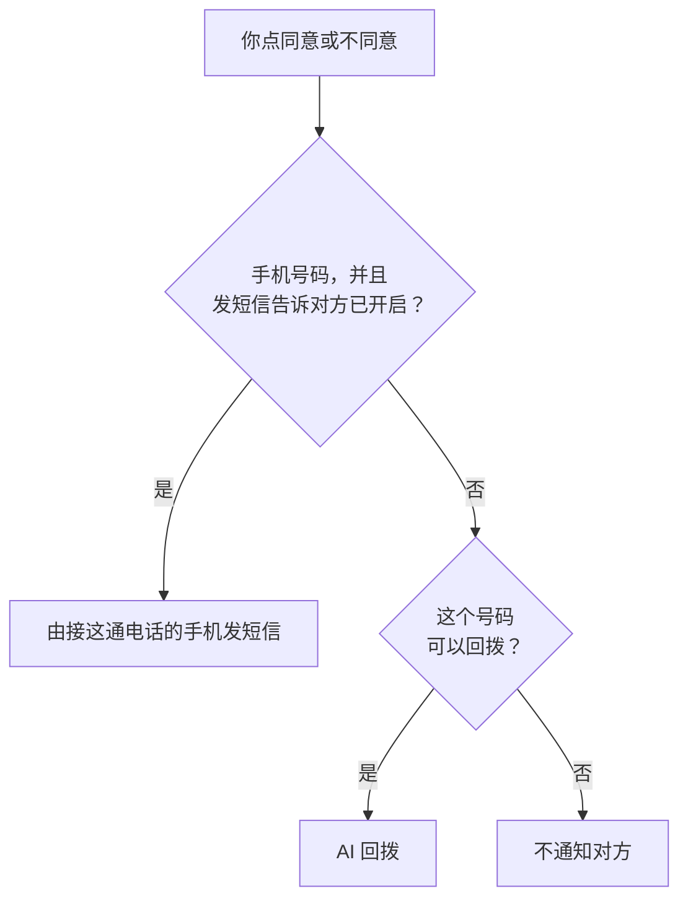

# 设置参考

Bageo 是自托管的 AI 电话助理，用 Gemini Live 替你接真实号码的电话。这一页列出全部设置：电话怎么接、推销、骚扰和诈骗电话怎么处理、通话摘要发到哪里，以及 Bageo 怎么启动。每张表都附默认值，一眼就能看出哪些地方你改过。

设置放在两个地方：

- **网页控制台**（“设置”标签页）：所有和接电话有关的项目。保存到 `data/calls/config/settings.json`，下一通电话就生效，不用重启。
- **启动选项**：Bageo 在哪里监听、数据放在哪里、USB 连接。只在启动时读取一次，来源是环境变量，或启动脚本旁边的 `.env` 文件（从 `.env.example` 复制一份）。

## 快速找到设置

| 我想… | 去这里 |
|---|---|
| 让 AI 以我本人的身份接，不说自己是助理 | [基本设置](#基本设置) →“接听身份” |
| 打进美国卡的电话用英文接，其他照旧 | [基本设置](#基本设置) →“更多选项”→“各 SIM 卡的主要语言” |
| 遇到诈骗电话不直接挂，拖住他的时间 | [推销与诈骗电话](#推销与诈骗电话) |
| 某个号码再也不要打进来 | [黑名单](#拦截号码与联系人名单) |
| 让 AI 打给餐厅订位 | [AI 代打](#ai-代打) |
| 对方想约时间，我晚点决定再回复他 | [日程预约](#日程预约) |
| 用手机打开控制台 | [从其他设备使用控制台](#从其他设备使用控制台) |
| 备份设置，或换新电脑 | [备份与还原](#备份与还原) |

## 网页控制台里的设置

### 基本设置

AI 要能替你接电话，先把这几项填好。

| 设置 | 默认 | 作用 |
|---|---|---|
| 语言 | English | AI 跟来电者说话用的语言，包括它的第一句话、拒接语音和发给来电者的短信。 |
| 你的名字 | 空 | 来电的人怎么称呼你。提示词里写 `{owner}` 的地方都会换成它。 |
| 接听身份 | AI 助理 | **AI 助理**：说明自己是替你接电话的 AI，帮你记下留言。**本人**：以你的身份接听，不会替你答应任何事。 |
| Gemini API 密钥 | 空 | 你从 Google AI Studio 获取的密钥，AI 说话需要它。只保存在你的电脑上。 |
| 声音 | Charon | Gemini 内置的声音之一。点“**试听**”会用上面选的语言说三句示例。 |
| 由 AI 接听来电 | 开 | 总开关。关：来电会被接起来再马上挂断，什么都不说；想自己接电话，请改用[普通手机](PHONE.md#普通手机模式)。 |

“语言”可以选 English、繁體中文（台湾）、简体中文、日本語、한국어、Español、Français、Deutsch、Português。

**更多选项。** 下面五项收在“基本设置”的“更多选项”里，大部分人不用改：

| 设置 | 默认 | 作用 |
|---|---|---|
| 其他人怎么叫你 | 空 | 一行一个，最多 10 个：英文名、绰号、同事对你的叫法。AI 听到这些名字就知道是在找你。 |
| 通知和摘要的语言 | 与 AI 说话的语言相同 | 你收到的通知和摘要用这个语言，AI 跟来电者说话的语言不受影响。 |
| 各 SIM 卡的主要语言 | 无 | 手机里有不同国家的 SIM 卡时才需要：选 SIM 卡的国家，和打进那张卡的电话要用的开场语言。 |
| AI 代打默认身份 | 助理 | AI 替你打电话时默认用的身份：**助理**或**本人**。每次交办还可以另外选。 |
| Live 模型 | `gemini-3.8-live` | 在电话上说话的 Gemini Live 模型，通常不用改。名称里有“thinking”的模型（例如 `gemini-3.8-live-extended-thinking`）回答更谨慎，也稍慢一点；见[高级](#高级)里的“思考程度”。 |

各项的细节：

- **其他人怎么叫你**：两种接听身份都一样，自己改过提示词也一样。通话摘要仍然写“你的名字”。保存为 `owner_aliases`（列表）。
- **通知和摘要的语言**：通知、通话摘要（通话记录里也是）、预约卡片和决定结果、短信转发的消息都用这个语言。人在国外时很方便：AI 用英文接电话，通知照样是简体中文。在网页右上角切换显示语言时，这里也会跟着改成同一种语言。
- **各 SIM 卡的主要语言**：例如“美国 (US)”→ English，“语言”仍是简体中文；日本号码打进美国卡，仍然用日语。需要手机 App 1.0 以上，它会上报每通电话是哪张卡接的。保存为 `sim_languages`，例如 `{"us": "en"}`。
- **AI 代打默认身份**：AI 从“AI 代打”标签页替你打电话（见 [AI 代打](#ai-代打)）时说自己是谁：**助理**（说是替你打来的，被认真问是不是真人时会表明是 AI 助理）或**本人**（以你的身份说话）。保存为 `errand_identity`（`assistant`／`owner`，其他值一律按 `assistant` 处理）。

### 接听方式

| 设置 | 默认 | 作用 |
|---|---|---|
| 响多久再接 | 3 秒 | 对方听到响铃多久 AI 才接：0（马上接）到 8 秒，以半秒为单位。AI 利用这段时间做准备。 |
| 未显示号码也接听 | 开 | 开：没有显示号码的来电和其他人一样交给 AI。关：播一句“无法接通”再挂断。 |
| 普通电话最长 | 5 分钟 | 3 到 30 分钟。到上限前大约 25 秒，AI 会礼貌收尾并挂断。 |
| 状态留言 | 关 | 一行关于“现在”的说明，最多 400 字（“快递请放在前台”）。只有和这通电话有关时 AI 才会提。 |
| 背景音、背景音量 | 关、中 | 垫在 AI 声音后面的轻微环境音，听起来像真有人在某个地方接电话。音量有小、中、大。 |
| 转接到你的手机：开启转接、转接方式 | 关闭 | 要不要把来电转到你的手机，以及怎么转：“不接，直接转到你的手机”或“AI 先接，有急事才转给你”（`whitelist_mode`，关闭时是 `off`）。打开前会先看免责说明。“联系人”页的白名单标签也能设置。 |
| 转接到你的手机：你自己的手机号码 | 空 | 有急事时手机会拨这个号码找你，通知里也会显示（`whitelist_forward_number`）。 |
| 转接到你的手机：谁打来可以转 | 白名单 | 哪些人打来可以转：**白名单**（`transfer_whitelist`）、**其他联系人**（`transfer_contacts`）、**不在联系人里的号码**（`transfer_others`，包括未显示号码）。黑名单和陪聊名单里的人不会转。 |

“未显示号码也接听”关闭时，那句“无法接通”用你的“语言”和“拒接语音的声音”播出，和黑名单一样。这句话已经内置录好，不需要 Gemini 密钥。

“背景音”可选：办公室、家里、街边、医院、救护车经过、台风天、雷雨、工地、地铁、夜市、鞭炮／节庆、开车中。点“**声音＋背景音**”或“**只听背景音**”可以试听。

“转接到你的手机”默认关闭，关着时 AI 照常接听，事后通知你。打开“开启转接”后可以选两种转接方式，只对“谁打来可以转”勾选的人生效：

- **不接，直接转到你的手机**（`direct`）：这部手机不接，由运营商把电话转到你的号码，AI 不出声，并马上通知你。要先把手机切到「普通手机」，拨 `**67*你的号码#` 开好遇忙转移，没开的话对方会进语音信箱。
- **AI 先接，有急事才转给你**（`emergency`）：AI 先接听，对方说有急事时，会马上通知你，并请他稍等、用这部手机打给你；你接起来就能直接跟他说，你没接，AI 会说你会尽快回电。要填好你的号码才会打给你，没填就只通知。

**谁打来可以转。** 一开始只勾白名单，没有另外勾选就和以前一样。勾“其他联系人”会加上联系人里的其他人；勾“不在联系人里的号码”会加上其他所有人，包括未显示号码。陌生人说有急事也可能是诈骗，需要时再打开。

有急事时另有两条限制。这通电话已经被判定是推销或诈骗，就不会通知你、也不会打给你（已经在拨给你的那通照常）。不在联系人里的号码，30 分钟内最多打给你一次，未显示号码共用这一次；超过了 AI 会跟对方说你会尽快回电，你只收到通知。

**开启转接前要知道的事。** 打开“开启转接”时会先弹出确认框，每次都要点“我了解，开启”才会打开，点取消或按 Esc 就保持关闭。确认框的内容是下面五点。

1. AI 可能判断错：真的急事可能没打给你，不急的事也可能打给你。
2. 这不能取代报警或叫救护车。有生命危险时，请对方直接打当地的紧急电话。
3. 打给你的电话由这部手机的 SIM 卡拨出，运营商照常收费，国际或漫游可能更贵。
4. 转给你之后的通话会按你的设置录音。录音前要不要先告知对方，请依当地法律自行处理。
5. 可能拨不通或接不起来。使用这个功能造成的任何损失由你自行承担，Bageo 及开发者不负任何责任。

**更多选项。** 下面三项收在“接听方式”的“更多选项”里，大部分人不用改：

| 设置 | 默认 | 作用 |
|---|---|---|
| 响铃时先让 AI 准备好 | 开 | 建议开启：电话一接通 AI 就开口。关：对方要等 1 到 3 秒才听到第一句。 |
| 对方可以打断 AI | 开 | 对方插话时 AI 会停下来。只在收音不会收回 AI 自己声音的手机上使用，每通电话开头自动检查（见[支持哪些手机](PHONE.md#支持哪些手机)）。 |
| 让 Gemini 判断对方什么时候说完 | 开 | 建议开启：由 Gemini 自己的语音检测判断什么时候轮到 AI 说话。关：改用 Bageo 内置、比较简单的音量规则。 |

“响铃时先让 AI 准备好”会在接起来之前先连上 Gemini、准备好第一句话。即使对方在响铃时就挂断，也会用掉一次短暂的 Gemini 连接。

**对方说别的语言。**“用对方的语言回答”默认是开的：对方明显在说另一种语言，或问你会不会说某种语言时，AI 会切换过去。关掉的话，每通电话 AI 都保持用你选的“语言”。保存为 `reply_in_caller_language`。

**境外来电与运营商警示语。** 台湾的运营商会在每通境外来电一开始播放一段预录的防诈骗警示语。台湾 SIM 卡接到其他国家的号码（`+…` 或 `00…` 开头、国家代码不是台湾）时，AI 会等这段警示语播完：线路安静下来就开口，最多等 7.5 秒，开场白也只说一次。

其他 SIM 卡（例如双卡手机上的美国卡）接到的电话没有这段警示语，AI 会马上开口。这是自动判断的，不用设置。

手机 App 1.0 以前的版本，“境外来电”就是国家代码和你不同的 `+…` 号码（见[国际电话区号](#国际电话区号)）。

### 推销与诈骗电话

只要对方的话显示这是推销或诈骗，AI 就变成一个有兴趣但反应很慢的客户：怎么申请、怎么计算，一条一条慢慢问。它绝不给资料、绝不答应任何事，一直聊到对方自己挂断，或到了时间上限。

例如对方一开口就是“恭喜您的贷款已预审通过”，或自称银行风控人员要你报验证码。

| 设置 | 默认 | 作用 |
|---|---|---|
| 陪他聊、拖时间 | 开 | 上面说的拖时间。关：AI 会婉拒并结束通话。 |
| 这类电话最长 | 30 分钟 | 3 到 30 分钟。聊得越久，用掉的 Gemini 额度越多。 |
| 这类电话用的模型 | `gemini-3.8-live` | 判定为推销或诈骗后，这通电话改用的模型。留空 = 沿用这通电话原本的模型。 |
| 每通电话都检查是不是推销或诈骗 | 开 | 开：用低成本模型读对方说的内容，新话术、其他语言、语音转文字写错的字也能抓到。关：只检查出现已知推销或诈骗字眼的电话。 |

**怎么判断。**

- 内置诈骗数据库（46 种推销与诈骗话术、27 种语言的关键词）里的词，会让低成本模型再看一次。
- 开了“每通电话都检查是不是推销或诈骗”，没有这些词的电话也会被看，每通最多三次。
- 模型会说出是哪一种话术、有多确定；不确定就等对方下一句再看。
- 模型没在时限内回答时，只有不管谁要都是诈骗的要求（报验证码、操作 ATM、买点卡、装远程软件、转到“安全账户”）会立刻开始陪聊。其他情况等下一句再看，连续失败两次才只靠关键词。
- 开始陪聊后对方再说两句，会再看一次；误判的来电可以放回正常应对。
- 联系人和你标为“不是”的号码不会被拖住，除非他们要的正是上面那些只有诈骗才会要的东西。

通话页的“推销／诈骗判断”会显示这通的判断与话术类型。点“是诈骗”“是推销”“不是”会记在这个号码上，它之后打来会参考你的标记（未显示号码不会被记住）。

你自己的词和号码写在数据文件夹里的 `config/scam_db.local.json`，改了会自动重读，文件不存在或写错都不影响运行：

```json
{
  "keywords": [
    {"text": "會員續約專線", "lang": "zh-TW", "typology": "general_promotion", "weight": 2},
    {"text": "read me the six digits", "lang": "en", "typology": "otp_theft", "weight": 2, "hard": true}
  ],
  "numbers": [
    {"number": "0223456789", "verdict": "safe", "note": "building management"},
    {"number": "+15550100", "verdict": "scam", "typology": "irs_ssa_impersonation"}
  ]
}
```

`weight` 是 1（要搭配其他词才算）或 2（单独出现就算）；`hard` 只对不管谁要都是诈骗的话术类型有效。`typology` 要用 `crates/agent/data/scam_db.json` 里的内置类型；放不进去的条目会跳过，并在日志里写明原因。

### 提示词

决定 AI 怎么说话。内置的是简短的通用基本说法；写上你自己的情况与风格，AI 会更贴合你的需要。要自己写的话见[编写提示词](PROMPTS.md)。

- “自定义提示词”：“AI 助理”与“本人”分开保存（留空 = 内置），点“**查看内置提示词**”可以看内容。
- “AI 可以回答的资料”：来电者可能会问的事，一行一条，最多 6,000 字。
- 访谈提示词：让 ChatGPT、Claude 或 Gemini 陪你写提示词。

### 拦截号码与联系人名单

最直接的来电筛选：**黑名单**上的号码打来，完全不会用到 AI 和 Gemini。通话列表里照样有记录，也会发出“黑名单来电”通知。

黑名单是“**联系人**”页的四种名单之一：普通联系人、白名单、黑名单（拒接）、陪聊名单（一接起就陪聊）。保存为 `kind`：`contact`、`whitelist`、`blacklist`、`stall`。新增联系人、名单选黑名单就行，备注就是原因。只有黑名单的号码可以在结尾加 `*`，拦下同一个开头的所有号码，例如 `0800*`（开头的 0 不算，至少三位）。

| 设置 | 默认 | 作用 |
|---|---|---|
| 黑名单打来时 | 响铃时直接挂断（不接通） | 在“联系人”页的“黑名单”标签，选了就保存：直接挂断，或接起来播一句“无法接通”再挂断。 |
| 拒接语音的声音 | 跟 AI 的声音一样 | 在“设置 → 拒接语音”：这段语音用的声音，未显示号码也听这段。每个声音的每种语言都已预先录好，不会用到 Gemini 额度；点“**试听语音**”可以听。 |

号码照通话列表里显示的样子写；知道你的国家代码时（[`COUNTRY_CODE`](#国际电话区号)），`+…` 的写法也能对上。

旧版保存在设置里的拦截号码（`reject_numbers`）会在 Bageo 第一次启动时搬进黑名单。号码已经是某位普通联系人的，就把那位改成黑名单（没有备注才补上原因）；在白名单或陪聊名单上的保持原样；其他的新增为联系人，名字用原因，没有原因就用号码。旧列表原样留在设置文件里，退回旧版时还在；搬好之后 Bageo 就不再读它。

“黑名单打来时”保存为 `reject_mode`：

- **响铃时直接挂断（不接通）**（`decline`）：电话不会接通。
- **接起播“无法接通”再挂断**（`announce`）：用你的“语言”播一小段“此号码目前无法接通”，对方会看到电话接通几秒钟。
- 太旧、不会拒接的手机 App，两种方式都会接起来播语音。

试试看：在通话列表打开一通电话点“**拦截这个号码**”（会加进黑名单），或在任何通知渠道点一下通话摘要下方的“**黑名单 / 陪聊 / 白名单**”签名按钮，一步就把对方归类。

### AI 代打

“AI 代打”标签页让 AI 替你打电话。以订四个人的位子为例：

1. 选联系人或输入号码。
2. 写下要办的事和你能接受的范围：“明天晚上 7 点订 4 位；7 点半到 8 点也可以”。
3. 选“用什么身份打”，想指定的话再选“用哪个号码打”，点“**开始打**”。
4. 看“实时字幕”跟进通话。你可以打字交代 AI、回答它问你的问题，或点“**挂断**”。

结束后那一条会显示结果（办好了、办好一部分、没办成、要你决定、没接、语音信箱、失败），附上细节、下一步、谈定的时间、通话记录链接和“**再打一次**”。对方给了几个选项时，选一个，AI 就会打回去回复。你也会收到一条通知。

通话中 AI 会把时间、日期、号码、名字用问句复诵，等对方说对。对方没有明确确认的项目，结果和通知里会标“**未经对方确认**”，用之前先自己确认。

需要什么、会怎么做：

- 一部已连接、处于 AI 模式、有该国 SIM 卡的手机。新版手机 App 会在连接和换卡时自动上报 SIM 卡；只有旧版 App 或 Android 还没报出 SIM 时才要先接过一通电话（否则会提示“这部手机还没接过电话”）。
- 绝不拨紧急号码、7 位以下的短号和增值付费号码；免费电话可以拨。境外号码请加 `+`；没有 `+` 的号码一律当成本国号码。
- 同一个号码一次只打一通，和[日程预约](#日程预约)的 AI 回拨共用排队。手机通话中时最多等 10 分钟，等同一个号码的前一通电话结束最多等 25 分钟。
- 一通最长 10 分钟（9 分半开始收尾）。
- AI 不能按键：遇到语音菜单最多等 90 秒等真人，遇到运营商录音（“您拨打的号码…”）直接挂断。
- 遇到你没交代清楚的事，AI 会先跟对方说要确认一下，再到页面上问你（你正在看时最多等 40 秒）。你没在看或没回答，它对这件事什么都不答应：记下对方的选项、说你确认后再回电，然后礼貌收尾。
- 不答应付款、定金、转账，不给交办以外的个人信息；只有打开“拨到通”才会重拨。

“用什么身份打”的默认值是[基本设置](#基本设置)里的“AI 代打默认身份”。完整规则、每一种状态和错误代码见 [API → AI 代打](API.md#ai-代打)。

### 通知

| 设置 | 默认 | 作用 |
|---|---|---|
| 发送通知 | 开 | 关：什么都不会发到任何渠道。 |
| 通知渠道 | 无 | Telegram、Discord、LINE、ntfy、电子邮件、Webhook 等等；每个启用的渠道都会收到每一条消息。各渠道怎么配置见[通知](NOTIFICATIONS.md)。 |
| 通知里的地址 | 空（自动） | 通知里的链接（逐字稿、录音、按钮、日历）用这个地址打开控制台。留空＝用 Bageo 算出来的地址，多半是 `http://bageo.local/`，输入框里的灰字就是；要从外面访问时填你自己的地址。保存为 `public_url`。 |
| 在聊天室操作 | 关 | 在聊天室查通话记录、让 AI 代打、处理待处理事项。Telegram、Discord、Slack 与 Matrix 渠道各自的设置里都有“在这个聊天室接受指令”；下方的折叠区块则设置环境变量指定的 Telegram Bot 与共用上限。见[在聊天室操作](CHAT_COMMANDS.md)。 |

下方“在聊天室操作”折叠区块里的细项保存为 `telegram_control`、`telegram_control_users`、`control_errands_per_hour`、`control_commands_per_minute`。

### 摘要与日历

每通电话结束后，AI 会写一段简短摘要。它用你的 Gemini 密钥，通常什么都不用设置。

| 设置 | 默认 | 作用 |
|---|---|---|
| 摘要服务 | Gemini | 决定摘要和日历建议由谁来写：**Gemini** 或**其他服务**。 |
| 其他服务：API 地址、模型、API 密钥 | 空 | 选“其他服务”时填写。填了 API 地址就必须填模型；API 密钥本机服务器不需要。 |
| 建议日历日程 | 开 | 通话中说定了日期（送货时段、预约、对方约好几点回电），摘要就附上“**添加到日历**”链接。不会自己把任何东西加进日历。 |
| 添加到日历 | 第一次点时询问 | 不是一个字段：第一次点“**添加到日历**”会问你要加到哪个日历，之后就记住。 |

**摘要服务**：

- **Gemini**（`gemini`）：用你的 Gemini 密钥和 Gemini 最便宜的模型 `gemini-flash-lite-latest`，不行再退到 `gemini-flash-latest`。
- **其他服务**（`custom`）：任何兼容 OpenAI 的服务，在下一行设置。
- 保存为 `summary_provider`。没有 Gemini 密钥时，选 Gemini 和选其他服务效果相同。旧版的设置会自动转换。

**其他服务**的字段：

- **API 地址**：服务兼容 OpenAI 的地址，例子在下面。
- **模型**：填了 API 地址就必须填。
- **API 密钥**：保存后只显示提示；本机服务器不需要。
- 不填 API 地址时没有自己的服务：有 Gemini 密钥就由 Gemini 写摘要。
- 保存为 `summary_api_base`、`summary_model` 和 `summary_api_key`（存的是你所用服务的密钥）。

API 地址的例子：

- OpenAI：`https://api.openai.com/v1`（例如 `gpt-4o-mini`）
- OpenRouter：`https://openrouter.ai/api/v1`
- 本机的 Ollama：`http://127.0.0.1:11434/v1`

**添加到日历**：

- 可选 Google 日历、Outlook.com、Microsoft 365、Apple 日历、Yahoo 日历，或下载 `.ics`。记住的选择保存为 `calendar_app`，按钮旁的“**换一个日历**”可以改。
- 通知和 Telegram 回复带的也是同一个日历的链接。
- 选 Apple 日历或 `.ics` 时，链接指向“通知里的地址”（没有地址就不带），带的是只能打开这个文件的密钥，不是你的密码。Bageo 不连接任何日历账号。
- “建议日历日程”开着时，每通电话会多向摘要模型发一次请求。

#### 日程预约

对方想跟你约时间（见面、来访、约好时间通电话）时，AI 不会在电话上答应。你晚点再决定，对方会通过短信或 AI 回拨得知结果。

| 设置 | 默认 | 作用 |
|---|---|---|
| 日程预约 | 关闭 | 选“**先问我**”（`confirm`）就启用下面的流程。 |
| 发短信告诉对方 | 关 | 你点同意或不同意后，让接这通电话的手机以你的名义给对方发短信，只发给手机号码。 |
| 默认回复方式 | 自动（按号码判断） | 你没另外选时，对方怎么得知结果：**自动**、**一律发短信**或**一律 AI 回拨**。 |

“发短信告诉对方”：

- 短信像这样：“您好，我是小明。约在11月14日（周六）15:00没问题，到时见。”
- 短信只写时间，不写约的是什么事：那是来电者自己说的话，可能被塞进网址。
- 只发给手机号码：台湾手机、+1 号码（免费和 900 除外），以及其他国家的手机。手机 App 要能发短信。

“默认回复方式”：

- **自动**按下面的流程图判断。
- **一律发短信**／**一律 AI 回拨**只用那一种，不行就不通知。
- 它决定“待处理事项”预选的方式、Telegram 按钮用的方式，以及 AI 在电话上怎么说。

一次预约怎么走完：

1. **电话上。** AI 先用问句把时间完整复诵一次（“是 11 月 19 号星期四下午 4 点半，对吗？”），等对方说对；对方更正就再问一次。AI 不会让对方等。
   接着它说“我确认一下，晚点发短信回你”；要用回拨告知时说“晚点再打给你”；两种都联系不到对方时只说“再回复你”。
2. **通话后。** 预约出现在“**通话**”标签页顶部的“**待处理事项**”（以及这通电话的详情里）：谁、什么事、什么时间，选择怎么告诉对方（**发短信**、**AI 回拨**或**不通知对方**；这个号码用不了的方式会变灰），再点“**同意**”或“**不同意**”。
3. **你决定后。** 那一条会用大白话写出结果：“已同意，已发短信给对方”、短信没发出的原因，或 AI 回拨进行到哪一步。同意的会出现“**添加到日历**”；短信没发出的会有“**重发短信**”。
4. **人在外面。** 设置好 Telegram Bot、“发送通知”也开着时，还会收到带“**同意**”／“**不同意**”按钮的卡片。

Telegram Bot 用 `TELEGRAM_BOT_TOKEN` 和 `TELEGRAM_CHAT_ID` 指定（或通过 `PUT /calls/api/settings` 的 `telegram_bot_token`／`telegram_chat_id`）。在控制台添加的 Telegram 渠道和其他渠道一样，只收到附通话链接的提醒。



*“自动”默认回复方式的判断。未显示号码一律走到“不通知对方”。*

保证安全的规则：

- 只有第一次决定算数，不管是在控制台、Telegram 卡片还是 API 上决定。
- 对方只是随口提的备选时间（“不行的话下午也可以”）不会覆盖谈好的时间；同一通电话里另外约的第二件事会分开、各自决定。
- 推销、诈骗电话一律不约：一通电话被判定为这类电话（通话中判定或由摘要判定；银行反诈、警察通知这类电话不算），或 AI 连不上时，谈好的都不算数，也不会等你处理。
- 两种接听身份都能用；有预约的那通电话不再另外生成日历建议。
- AI 回拨只拨打和接听 SIM 卡同一个国家、长度像普通电话的号码（台湾是 0 后面 8～9 位）；免费电话（0800、+1 800～888）、增值号码（0204、0209、+1 900）、特殊号码（165、110）和境外号码都不回拨。

**AI 回拨**的做法：

- 从接这通电话的手机和 SIM 卡拨出（那部手机在线时），只打给那位来电者自己的号码，同一个号码一次一通。
- AI 等对方接起来出声（70 秒都没人出声就算没接），说明是谁打来、用原来那通电话的语言告诉对方结果，说一次再见就挂断。
- 这通电话在通话记录里标为“AI 回拨”。“待处理事项”会显示回拨进度；拨不出去时也会发到你的通知渠道。
- 短信同样从那通电话打进来的 SIM 卡发出，双卡手机会用正确的号码回复。

时间一律是这台电脑的本地时间（见[时区](#时区)）。完全没有可以写摘要的密钥时，通知会改放对方开头说的几句话；逐字稿一定可以在控制台看到。预约的所有字段与 API 见 [API → 日程预约与任务](API.md#日程预约与任务)。

### 备份与还原

Bageo 可以自己定期备份设置、让你随时手动备份，也能把全部设置打包成一个文件，换电脑时带走。备份只存在你的电脑上，不会上传或发送到任何地方，Bageo 也不会自己更新。

备份文件里有密钥、密码和连接（导出时可以不放）。连接是指通知要发到哪里、谁可以远程控制 Bageo：通知渠道、Telegram 聊天、转接用的号码和急事要不要直接转过去、Bageo 可以回拨哪些号码、摘要服务，以及 AI 工具通过 MCP 能做的事。备份文件要放在只有自己拿得到的地方。

| 设置 | 默认 | 作用 |
|---|---|---|
| 自动备份 | 每周 | 不自动备份、每天、每周或每月。 |
| 存到哪里 | 默认位置 | 填文件夹的完整路径。留空就存在 Bageo 文件夹（`data/calls`）下面的 `backups`。保存时 Bageo 会先确认写得进去。 |
| 自动备份保留几份（“更多选项”） | 10 | 1 到 100，只算自动备份。 |
| 连通话记录、录音和短信一起备份（“更多选项”） | 关 | 开：“立即备份”和自动备份也会放进通话记录、录音、短信和待处理事项，文件会大很多。 |
| 备份文件加密（“更多选项”） | 关 | 开：“立即备份”、自动备份和“导入前”那份都用备份密码加密。 |
| 备份密码（“更多选项”） | 留空 | 至少 8 个字符，要先设好才能开加密。保存后不会再显示。忘记密码就打不开这些备份，Bageo 也救不回来。 |

这六项保存为 `backup_schedule`、`backup_dir`、`backup_keep`、`backup_include_calls`、`backup_encrypt`、`backup_password`。自动备份和手动备份一律有：设置、密钥、密码和连接、联系人与名单、自己记的号码和诈骗号码、SIM 卡资料，以及 AI 代打。

备份密码跟其他设置一起存在这台电脑，自动备份才用得到。加密保护的是离开这台电脑的那份：放到移动硬盘、云端或网络文件夹的备份。只导出设置时不会带出这个密码。

- “立即备份”：马上做一份。
- “导出设置”：先列出项目让你勾选：设置、密钥、密码和连接、联系人与名单、自己记的号码和诈骗号码、SIM 卡资料、AI 代打、通话记录与录音、短信、待处理事项。一开始勾前六项。换电脑要勾选“密钥、密码和连接”；给别人看设置时不要勾选。通话记录、短信和待处理事项会让文件大很多。没设控制台密码时，含密钥的文件只能在运行 Bageo 的这台电脑上打开控制台下载。勾选“用密码加密这个文件”并输入两次密码（至少 8 个字符），就会得到加密的文件。文件名是 `bageo-export-YYYYMMDD-HHMMSS.zip`，加密的是 `.bageo`。
- “导入设置”：选一个备份文件或导出文件（.zip，加密的是 .bageo），或旧版单独的设置文件（.json）；加密的文件会先要你输入密码，错 5 次要重新选文件；旧版设置文件只会还原设置，里面有密钥、密码和连接的话也会还原。
- “备份文件”：列出最新 10 份，每份可以“还原”“下载”或“删除”。加密的会标“已加密”。还原时会用这台存的备份密码打开；如果那份是用别的密码做的，会请你输入。删除前会先确认，删了就找不回来；没设控制台密码时，只能在运行 Bageo 的这台电脑上删除。

还原之前，控制台会先列出备份时间、来自哪个版本、文件多大、里面有什么，每一项都有勾选框。一开始全部勾选，文件里没有的项目不会出现。不想还原的就取消勾选；至少要勾一项才能点“还原”。Bageo 会先把现在的设置另存一份（类型是“导入前”）。没勾“密钥、密码和连接”，或文件里本来就没有的话，这台电脑现有的都会保留。勾了的话，文件里有填的会换掉这台的，文件里没有的就保留这台的，所以从比较旧的备份还原，不会拿掉后来才设的密码或密钥。只有从备份列表还原“导入前”那份时，这一组会完全回到导入前的样子，导入带进来的会全部拿掉。控制台密码、通知要发到哪里、谁可以远程控制会变的话，控制台会先提醒。备份文件夹一律保持这台电脑的设置。还原不会缩短保留天数：“记录保留几天”和“自动备份保留几份”只会保持或变长，要缩短请在控制台自己改。通话记录、短信和待处理事项是加进现有的，不会删掉任何东西。通话中要等通话结束才能还原。有些设置要重新打开 Bageo 才全部生效，界面会提醒。

**自动备份怎么进行：**

- 距离上一份满一天、一周或一个月，才会做下一份。
- 正在通话就等通话结束。
- 电脑当时关机的话，下次 Bageo 启动时补做。
- 备份失败会每小时重试一次，并通知你一次。

**留多少份：**

- 自动备份：只留最新的几份，份数看“自动备份保留几份”。
- “导入前”的备份：留最新 5 份。
- 手动备份和导出：Bageo 不会自动删。
- 文件夹里其他的文件不会动。

**换电脑：**

1. 旧电脑点“导出设置”，保持勾选“密钥、密码和连接”，新电脑就不用重新输入。要连通话记录一起带走，再勾“通话记录与录音”、“短信”和“待处理事项”。
2. 新电脑装好 Bageo。
3. 打开控制台，点“导入设置”，选那个文件，再点“还原”。
4. 手机没有自动连上的话，每台用 USB 插一次。

### 高级

| 设置 | 默认 | 作用 |
|---|---|---|
| 记录保留几天 | 15 | 通话和录音、短信、AI 代打和待处理事项，超过这个天数就自动删除（1 到 365），改了立刻生效。保存为 `retention_days`；`CALLS_RETENTION_DAYS` 只决定默认值。 |
| 思考程度 | 低 | 只适用于名称里有“thinking”的 Live 模型：低、中、高。“低”回话最快。保存为 `gemini_thinking_level`。 |
| 控制台密码 | 空 | 设置后，打开控制台和调用 API 都要输入密码（浏览器会记住）。要用手机或别的电脑打开控制台，必须设置。新设置的密码至少 8 个字符；其他设备连续输错 10 次要等 1 分钟。保存为 `ui_password`。 |
| 让其他 AI 工具连进来（MCP） | 关 | 让 Claude、ChatGPT 这类 AI 工具查你的通话和待处理事项。用不到就不用开。 |
| 局域网名称 | `bageo` | 同一网络里的手机、电脑可以用来代替 IP 的名字：`http://bageo.local/`。只能用英文字母、数字和连字符；留空、`off`、`0`、`none` 或 `false` = 关闭。 |
| 手机也能用 Wi-Fi 连接 | 开 | 手机用 USB 连过一次后，拔掉线也能继续用 Wi-Fi 连接。关掉立即生效，用 Wi-Fi 的手机会断开。存为 `phone_wifi`；`PHONE_WIFI` 只决定默认值。见[手机设置 → Wi-Fi](PHONE.md#wi-fi)。 |

开关下面的“重新配对手机”会换一组新的配对码：用 Wi-Fi 的手机全部断开，每台都要再用 USB 连一次。

第一次打开控制台、还没设置密码时，会问你要不要设置。

“让其他 AI 工具连进来（MCP）”是一个折叠区块，内置于 `POST /mcp` 的 Model Context Protocol 服务器，细节见 [MCP](MCP.md)。里面有五个字段：

- “开启 MCP”（`mcp_enabled`）：要打开、也设好 Token 才会生效。连接地址是控制台地址加上 `/mcp`。
- “Token”（`mcp_token`）：在 AI 工具里填这组 Token（Bearer token）。
- “可以让 AI 代打电话吗”（`mcp_calls`）：“不可以（只能查看）”“可以，但先在聊天室问我”“可以，直接打”三选一。选“先问我”要有一个开启下指令的聊天室。
- “每小时最多代打几通”（`mcp_errands_per_hour`）：所有 AI 工具加起来算，0 到 30。
- “允许的网站”（`mcp_allowed_origins`）：只有网页版的 AI 工具需要，一行填一个网址，例如 `https://app.example`。其他情况留空。

“通知里的地址”（在“通知”那一区）留空时会自动填。没设 `AGENT_HOST`（默认）时，Bageo 在应答局域网名称就用 `http://<局域网名称>.local/`，80 端口打不开时用 `http://<局域网名称>.local:8787/`，没有局域网名称就用这台电脑的局域网 IP；设了 `AGENT_HOST=0.0.0.0` 时一律带 `:8787`。

控制台只有这台电脑能打开时（`AGENT_HOST=127.0.0.1`），通知不带链接；在 Docker 里请自己设置。“系统 → 关于”会显示当前使用的地址。

“局域网名称”由 Bageo 自己应答（多播 DNS，UDP 5353 端口），在控制台对局域网开放（包括没设 `AGENT_HOST` 的默认情况）、或“手机也能用 Wi-Fi 连接”开着时启用，容器里不会启动。macOS 上改由系统的 Bonjour 应答（Bageo 会启动 `dns-sd`）。

系统不让出这个端口时，日志里会出现一行以 `mDNS:` 开头的信息，链接改用 IP。打不开 `.local` 名称的旧 Android 手机，可以用“系统 → 关于”里的 IP 地址或二维码。

“国际电话区号”改在启动时设置，见[国际电话区号](#国际电话区号)。

### 控制台里没有的设置

有几个设置没有字段，请在 `settings.json` 里改，或用 `PUT /calls/api/settings`（见 [API](API.md)）：

| 键 | 作用 |
|---|---|
| `country_code` | 你的国际电话区号；见[国际电话区号](#国际电话区号)。 |
| `name_corrections` | 语音转文字老是听错的名字，每条一个 `错的=对的`（例如 `黄先生=王先生`）：逐字稿和摘要会自动改正。首次运行的默认值是 `NAME_CORRECTIONS`，用逗号分隔。 |
| `device_labels` | 你给手机起的名字：手机上报的 id → 通知和控制台显示的名称，例如 `{"pixel-10123": "工作机"}`。优先于手机自己上报的型号。 |
| `goodbye_hangup_delay_ms` | AI 道别后等多久才挂断，单位毫秒（200～15000）。保持默认 2000 时，各地区用自己的等待时间，约 1.2～2.5 秒，先看 SIM 卡的国家，没有就看通话语言；改成其他数字，每通电话都用你设的。 |

## 启动选项

用环境变量或在 `.env` 里设置。全部都是可选的；同一个变量，真正的环境变量优先于 `.env` 里的那一行。

用 Docker 时，只有 `docker-compose.yml` 的 `environment:` 下列出的变量会传进 Bageo（`CALLS_UI_TOKEN`、`DEVICE_TOKEN`、`PUBLIC_URL`、`CALLS_RETENTION_DAYS`、`TZ`）。其他要用的变量，请自己在那里加一行。

镜像本身设置了 `AGENT_HOST=0.0.0.0`、`ASSETS_DIR=/app/assets`、`CALLS_DATA_DIR=/data/calls` 和 `USB_BRIDGE=off`。

### 网络与访问

| 变量 | 默认值 | 含义 |
|---|---|---|
| `AGENT_HOST` | *（不设）* | 监听的地址。不设 = 控制台对同一个网络开放（`AGENT_PORT` 和 80 端口），其他设备要先设置控制台密码才进得去；手机照旧走自己的 Wi-Fi 端口。`127.0.0.1` = 只有这台电脑。`0.0.0.0` = 所有网络接口全部开放。 |
| `AGENT_PORT` | `8787` | 网页控制台和手机连接用的端口。 |
| `CONSOLE_PORT_80` | *（开）* | 没设 `AGENT_HOST` 时，控制台也开在 80 端口，地址才能省掉 `:8787`。`off` = 不开。80 端口被占用或没有权限时，日志记一行，控制台照常在 `AGENT_PORT`。 |
| `CALLS_UI_TOKEN` | *（空）* | 网页控制台和 API 的密码。用 `?token=…`、`Authorization: Bearer …` 或 `X-Calls-Token` 传递。**要从其他设备打开控制台就必须设置**；也可以在控制台设置“控制台密码”。 |
| `DEVICE_TOKEN` | *（空）* | 不是通过 USB 连进来的手机，必须用 `…/ws?token=<this>` 连接（`<this>` 换成这个值）。**`AGENT_HOST` 设成 `127.0.0.1` 以外的地址时，就必须设置。** |
| `PUBLIC_URL` | *（空）* | 等同[通知](#通知)里的“通知里的地址”；以网页控制台里的值为准。留空 = 自动（见[高级](#高级)）。 |
| `MDNS_NAME` | `bageo` | 等同“局域网名称”：用 `http://<这个值>.local/` 打开控制台。以网页控制台里的值为准。 |
| `PHONE_WIFI_PORT` | `AGENT_PORT` + 1（`8788`） | 手机走 Wi-Fi 时连接的端口。只在没设 `AGENT_HOST` 或设成 `127.0.0.1` 时另外在所有网络接口上打开；只给手机连接用（打不开控制台），一定要带配对码或 `DEVICE_TOKEN`。`0` = 不打开。 |

走 USB 的手机不受 `DEVICE_TOKEN` 限制，因为 USB 通道的终点就是这台电脑本身。

`MDNS_NAME` 留空、`off`、`0`、`none` 或 `false` = 关闭。Windows 上空值会被当成没设置，请写 `MDNS_NAME=off`。

### 从其他设备使用控制台

没设 `AGENT_HOST`（安装版的默认）时，同一个 Wi-Fi 下的手机和电脑用 `http://bageo.local/` 就能打开控制台：先在这台电脑打开控制台、设置好控制台密码就行。还没设置密码时，其他设备只会看到“请先设置密码”。

要把所有东西都对局域网开放（例如手机也改连 `AGENT_PORT`），在 `.env` 写：

```ini
AGENT_HOST=0.0.0.0
CALLS_UI_TOKEN=choose-a-long-random-string
DEVICE_TOKEN=another-long-random-string
```

先打开一次 `http://bageo.local:8787/?token=choose-a-long-random-string`（或用这台电脑的 IP，例如 `http://192.0.2.10:8787/?token=…`），页面会记住密码。

“系统 → 关于”会显示地址和二维码，用手机扫一下就能打开，也写了怎么把控制台添加到主屏幕。

Windows 第一次会弹出“允许访问”的窗口，请选“专用网络”允许。其他设备打不开时，见[故障排查](TROUBLESHOOTING.md#常见问题)。

如果这台电脑连着“所有流量都走 VPN”的 VPN，Bageo 可能会把 VPN 的地址当成局域网名称、链接和手机 Wi-Fi 连接的地址。请把 `AGENT_HOST` 设成这台电脑的局域网 IP（例如 `AGENT_HOST=192.0.2.10`），局域网名称、链接和手机就会用这个地址（这时手机改连 `AGENT_PORT`）。

这条连接是未加密的 HTTP：在你信任的家庭网络里没问题，但不适合开放的互联网。要从外面访问，请用 VPN（WireGuard、Tailscale），或带 HTTPS 和独立登录机制的反向代理；不要做端口转发。

**从外面访问（反向代理）**：先设置好控制台密码，再把外部地址（例如 `https://calls.example.org/`）填进“通知里的地址”，通知里的链接就会用它。Bageo 只接受这台电脑自己的名称和地址，以及这个地址的主机，没填的域名会被拦下。代理请用 HTTPS，转到这台电脑的 80 或 8787 端口。经过代理进来的都算其他设备：没设密码打不开，连续输错密码会先变慢，1 分钟内错 10 次要等 1 分钟。

### 数据与录音

| 变量 | 默认值 | 含义 |
|---|---|---|
| `CALLS_DATA_DIR` | `data/calls` | 通话记录、录音、设置和通讯录。相对于 Bageo 启动时所在的文件夹；容器里是 `/data/calls`。 |
| `CALLS_RETENTION_DAYS` | `15` | 记录保留天数的默认值（1–365），控制台的“高级”可改。 |
| `CALLS_RECORD` | `true` | `false`：完全不保留通话记录和录音。 |
| `ASSETS_DIR` | *（自动查找）* | 存放附带音效的文件夹。没设置时用程序旁边的 `assets`；容器里是 `/app/assets`。 |

### 时区

| 变量 | 默认值 | 含义 |
|---|---|---|
| `TZ` | *（这台电脑自己的）* | 通知里的时间、通话列表的“今天”、日历建议使用的时区。填时区名称，例如 `Asia/Taipei`、`Europe/Berlin`、`America/New_York`。 |

通知里的时间长得像 `11月13日 08:09`，日期按你设置的语言写。只有运行 Bageo 的电脑和你不在同一个时区时才需要设置 `TZ`。当前时间看 `/health` 的 `local_time`。

用 Docker 时，容器从挂载进来的 `/etc/localtime` 获取主机的时区（Linux 主机）；要用别的时区就在 `.env` 写 `TZ=Asia/Taipei`。

Windows 或 macOS 的 Docker Desktop 请把 `docker-compose.yml` 里 `/etc/localtime` 那一行删掉，改在 `.env` 设置 `TZ`；否则容器用 UTC。`TZ` 不要设成空字符串：空的 `TZ` 表示 UTC。

### USB 连接的手机

Bageo 会自己维持 `adb reverse`，并启动手机上的 App。

| 变量 | 默认值 | 含义 |
|---|---|---|
| `USB_BRIDGE` | `on` | `off`：Bageo 完全不运行 `adb`（Wi-Fi 手机、容器，或手机插在另一台电脑上）。 |
| `ADB_BIN` | *（自动查找）* | `adb` 的完整路径。没设置时依次查找：程序旁边的 `platform-tools/`、`ANDROID_HOME`、常见的 SDK 文件夹，最后是 `PATH` 上的 `adb`。 |
| `ADB_SERIALS` | *（全部）* | 只管理这些手机（`adb devices` 列出的序列号，用逗号分隔）。 |
| `USB_PHONE_PORT` | `8765` | App 在手机上连接的端口。要改的话，必须连同 App 里的地址一起改。 |
| `USB_BRIDGE_INTERVAL_SEC` | `15` | 多久检查一次 USB 连接，单位秒（5–300）。 |

装了好几个版本的 `adb` 时，请用 `ADB_BIN` 固定用一个：不同版本会互相重启对方的 server，导致手机断开。

### 国际电话区号

`COUNTRY_CODE` 是你自己国家的国际电话区号，只填数字、不带 `+`（`1`、`44`、`81`；最多四位）。Bageo 用它解读没写国家代码的号码：黑名单（写成 `+44 20…` 的才能对上手机上报的国内格式）、通讯录与 AI 代打。

其他国家打来的电话，对方的话会先用那国的语言转成文字（AI 不会那国语言时，交给语音识别自己判断），道别才不会漏掉。

留空时，“语言”是繁體中文就当作 `886`，其他语言就没有。只有语言对应不到单一国家（例如英语、西班牙语）时才需要设置。

网页控制台没有这一项；除了环境变量，也可以用 `settings.json` 的 `country_code` 或 `PUT /calls/api/settings` 设置。

`settings.json` 里有 `country_code` 时（空的也算）以它为准，`COUNTRY_CODE` 不会生效；要改回用环境变量，就把那一行删掉。

### 首次运行的默认值

想用 `.env` 或 Docker 预先填好新安装的设置时，这些变量决定控制台设置的初始值；在控制台保存过之后，以控制台的值为准。

| 变量 | 控制台设置 | 默认值 |
|---|---|---|
| `GEMINI_API_KEY` | Gemini API 密钥 | *（空）* |
| `SUMMARY_API_KEY` | 其他服务（摘要）的 API 密钥 | *（空；旧名 `DEEPSEEK_API_KEY` 仍可读）* |
| `APP_LANGUAGE` | 语言 | `en`（还有 `zh-TW`、`zh-CN`、`ja`、`ko`、`es`、`fr`、`de`、`pt`） |
| `NOTIFY_LANGUAGE` | 通知和摘要的语言 | *（空 = 与 `APP_LANGUAGE` 相同）* |
| `OWNER_NAME` | 你的名字 | *（空）* |
| `OWNER_ALIASES` | 其他人怎么叫你 | *（空；用逗号分隔）* |
| `ANSWER_STYLE` | 接听身份 | `assistant`（或 `persona` = 本人） |

其他设置都在控制台改，每一项首次运行的默认值见 [`settings_store.rs`](../../crates/agent/src/settings_store.rs)。

通知路径也可以这样设置，会在控制台的渠道之外额外使用（见[通知](NOTIFICATIONS.md)）：

| 变量 | 含义 |
|---|---|
| `TELEGRAM_BOT_TOKEN`、`TELEGRAM_CHAT_ID` | Telegram Bot 和它要发送到的聊天。 |
| `NOTIFY_WEBHOOK_URL` | JSON webhook，不带 token。 |
| `NOTIFY_GATEWAY_URL`、`NOTIFY_GATEWAY_TAG` | Apprise API 的基础地址和 tag（默认 `normal`）。 |

### 启动脚本

`BAGEO_NO_SHORTCUT=1`：启动脚本不在桌面放“Bageo Console”快捷方式，等同 `-NoShortcut`（`start.ps1`）或 `--no-shortcut`（`start.sh`）。

### 日志

`RUST_LOG`（默认 `agent=info`）：设成 `agent=debug` 可以在日志里看到更多细节。

`LOG_CALL_TEXT`（默认关）：日志只记通话里说了多少个字，像 `<12 chars>`。设成 `LOG_CALL_TEXT=1` 才会把通话中说的话写进日志。只在排查问题时开，查完就关掉。

<!-- SPDX-FileCopyrightText: h4lo-void <https://github.com/h4lo-void/bageo-call> -->
