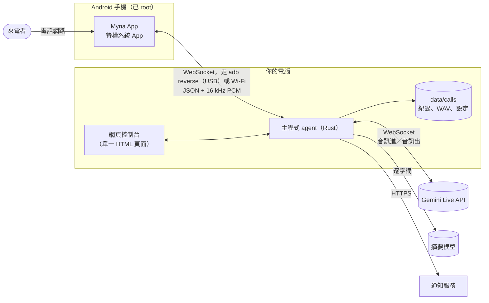

# 架構



## 組成

| 部分 | 位置 | 角色 |
|---|---|---|
| **手機 App** | [`android/`](../../android) | 無聲地接起電話、擷取對方的聲音、把 AI 的聲音播進通話。不含任何跟對話有關的邏輯。 |
| **Root 模組** | `android/magisk/pixelcallai_uplink` | 把 App 安裝成特權系統 App，並在每次開機時把手機設定成專門接電話的機器。 |
| **主程式（agent）** | [`crates/agent`](../../crates/agent) | 其他所有事情：通話狀態機、Gemini Live 連線、錄音、摘要、通知、網頁控制台及其 API，以及跟手機之間的 USB 連線。單一程式，沒有資料庫。 |
| **網頁控制台** | `crates/agent/static/calls.html` | 單一、自成一體的頁面，編譯進主程式裡。 |
| **簡訊轉發工具** | [`tools/sms_forward`](../../tools/sms_forward) | 選用的獨立 Python 腳本。 |

## 一通電話的完整過程

1. **待命。** 每支手機都對主程式維持一條「control」WebSocket。走 USB 時，App 連的是手機上的 `ws://127.0.0.1:8765`；`adb reverse`——由主程式的 USB 管理器（`usb_bridge.rs`）維持——會把它接到主程式的連接埠。
2. **響鈴。** App 回報 `incoming` 並附上來電號碼。主程式做出決定：拒接號碼會立刻接起來、以便掛斷；其他來電則回覆一個 `answer_plan`（響鈴 *n* 毫秒），並且——「響鈴預熱」（ring pre-warm）——立刻開啟 Gemini Live 連線，讓模型先產生開場白，保留到接起來才放出去。
3. **接起。** App 接聽並開啟一條「media」WebSocket。對方的音訊以 60 ms 的 PCM 訊框往上送；主程式接手那條預熱好的連線、放出開場白，從這時起雙向轉送音訊。
4. **對話**（`gemini_live.rs`）。主程式會
   - 把音量偏小的通話音訊正規化，並在最初幾秒檢查手機擷取到的聲音裡有沒有 AI 自己的聲音（回音）——這決定了對方能不能插話，以及背景音怎麼混；
   - 把對方的聲音串流給 Gemini（預設由 Gemini 自己偵測一輪發言何時結束），再把 Gemini 的音訊混上背景音後送回手機；
   - 讀取 Gemini 對雙方的逐字稿，用來驅動少數不交給模型決定的規則：對方什麼時候要離開（他說的話結尾有道別語）、這通電話是不是推銷或詐騙（關鍵字計分 → 在一條新連線上切換到陪聊拖時間的提示詞）、線上安靜下來時推一把、快到最長通話時間前收尾；
   - 每隔幾分鐘把 Live 連線換成一條帶著逐字稿的新連線，因為 Live 連線的存續時間有限。
5. **掛斷。** 當對方最後說的話是道別——或 AI 說了再見而對方保持安靜——主程式會送出 `hangup`。如果 AI 始終沒有產生音訊（沒有金鑰、服務掛了），它會立刻掛斷，而不是讓對方面對一片沉默。
6. **事後**（`main.rs`、`deepseek.rs`、`calendar.rs`、`notify.rs`）。錄音完成收尾，逐字稿送到摘要模型，摘要（以及行事曆建議，如果通話中講定了日期）存在該通話旁邊，並傳到每一個通知管道。

## 語言

`locale.rs` 為每種語言存放：給模型看的短語（接電話怎麼說、怎麼說再見）、掛斷規則和推銷電話規則要聽的字詞，以及通知的標籤。`prompts.rs` 負責組出系統提示詞：繁體中文用的是這個專案實際調校時使用的提示詞，簡體中文是轉換過來的版本，其他每種語言則共用一套英文指示，裡面指明要講哪種語言，並引用該語言的短語。新增一種語言，就是加一個 `Phrases` 區塊，以及它在網頁控制台字典裡的對應項目。

## 儲存

```text
data/calls/
  config/settings.json          what the web console saved (keys in plain text)
  index.json                    the call list
  2026-11-12/<call id>*.wav     recordings: mixed, caller only, AI only
  2026-11-12/<call id>_notes.json   summary, transcript, calendar suggestion
  voice_preview/                cached voice samples and announcements
```

純檔案，沒有資料庫；要刪除或備份都隨你。

## 刻意保持簡單的地方

- **聲音背後沒有工具。** 模型在通話中沒辦法查任何東西，也不能執行任何動作；它被告知這一點，也被告知不要假裝。所有需要判斷的事都發生在事後，由你讀摘要來處理。
- **在模型外面包一層確定性的規則**，處理那些絕對不能出錯的事：什麼時候掛斷、什麼時候擋下拒接號碼的來電、絕不讓對方面對一片沉默。
- **單一行程。** 沒有訊息代理（message broker），也沒有其他需要維持運作的獨立服務。

## 舊的程式路徑

主程式是從一套選單式系統發展而來的（預錄問候語、DTMF、等候音樂、語音留言、Tencent TRTC 橋接、Whisper / LLM / Piper 管線、Telegram 任務卡片）。那些程式碼還留在 `main.rs` 和各自的模組裡，預設關閉，也不含錄音檔。目前暫時保留，是因為它和現行路徑交織在一起；把它乾淨地移除已列在發展藍圖上。
