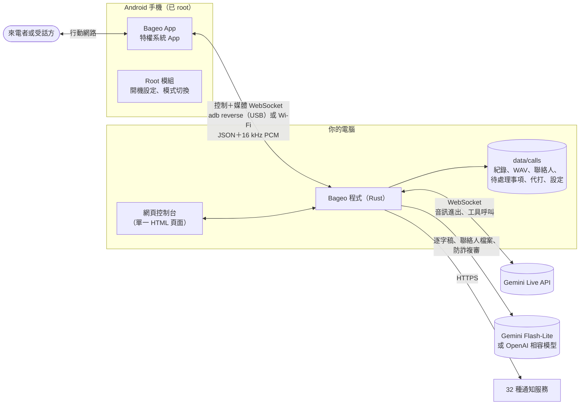
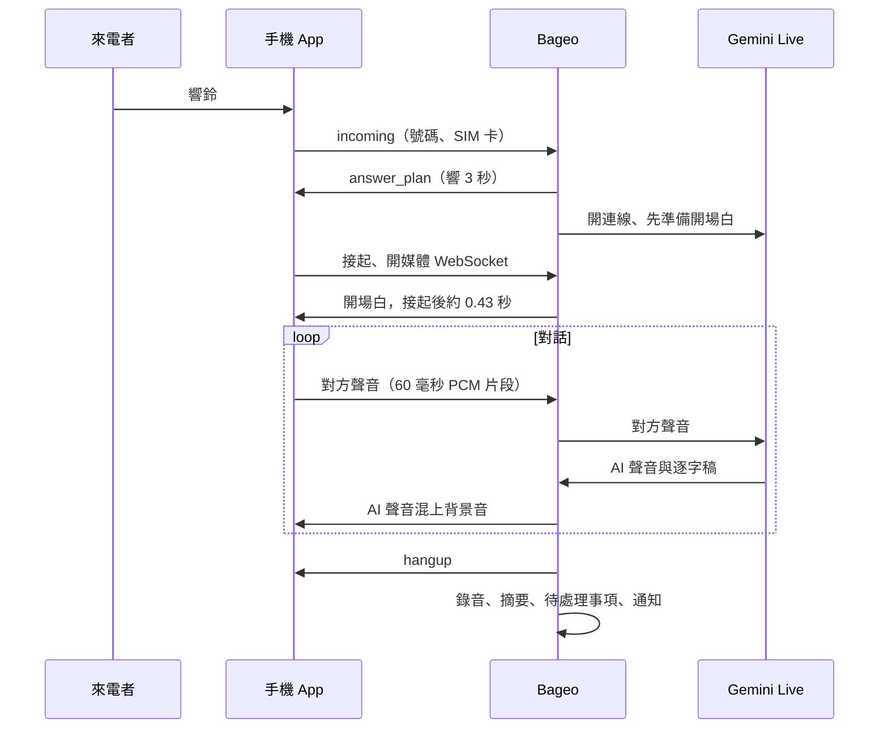

# Bageo 怎麼運作：自架 AI 電話助理的架構

Bageo 讓 AI 用你的真實門號接電話、打電話。這一頁跟著一通電話走一遍：從已 root 的 Android 手機響鈴，經過你電腦上的一個 Rust 程式，到 Gemini Live 再回來，並標出每一步由哪個檔案負責。要改程式、查一通電話出了什麼事，或想用別的前端取代手機，先讀這頁。

## 全貌

Bageo 由三個部分組成，沒有資料庫、沒有訊息佇列，也沒有專案自己的雲端服務。

1. **一支備用 Android 手機**（已 root，插著你的 SIM 卡），裝 Bageo App 和 root 模組。它負責接電話、撥號、傳聲音，不做任何決定。
2. **Bageo 程式**：你電腦上的一個 Rust 程式，所有邏輯都在這裡——什麼時候接、Gemini Live 連線、掛斷與防詐規則、摘要、聯絡人、行程預約、AI 代打、通知。
3. **網頁控制台**：編譯進 Bageo 程式的單一 HTML 頁面，九種語言。



## 各個部分

| 部分 | 位置 | 角色 |
|---|---|---|
| **手機 App** | [`android/`](../../android) | 安靜地接起或撥出電話、收對方的聲音、把 AI 的聲音播進通話、回報每通電話用的 SIM 卡、依指示發簡訊。不含任何對話邏輯。細節見[手機端架構](../../android/ARCHITECTURE.md)（英文）。 |
| **Root 模組** | `android/magisk/pixelcallai_uplink` | 把 App 裝成特權系統 App，每次開機把手機設定成專門接電話的機器，並執行「AI 接聽／[一般手機](PHONE.md#一般手機模式)」切換背後的 root 小程式。 |
| **Bageo 程式** | [`crates/agent`](../../crates/agent) | 其他所有事：通話狀態機、Gemini Live 連線、錄音、摘要、聯絡人、行程預約、AI 代打、通知、網頁控制台與 API、跟手機的 USB 連線。 |
| **網頁控制台** | `crates/agent/static/calls.html` | 編譯進 Bageo 程式的單一頁面。 |
| **Bageo Status** | [`desktop/`](../../desktop) | 選用的桌面系統列／選單列程式（Tauri 2，含於 Windows 安裝檔與 macOS `.dmg`），在背景帶起 Bageo 並顯示狀態、來電、簡訊與摘要通知。 |
| **簡訊轉發器** | [`tools/sms_forward`](../../tools/sms_forward) | 選用、獨立的 Python 腳本，轉發手機收到的簡訊。 |

### Bageo 程式的模組

| 模組 | 負責 |
|---|---|
| `main.rs` | 啟動、手機的 WebSocket 端點、來電狀態機、響鈴預熱、通話結束後的處理流程。 |
| `gemini_live.rs` | 每通電話一條 Live 連線：音訊轉送、回音檢查、插話、掛斷規則、推銷偵測與切換到陪聊模式、連線續接，以及撥出用的模式（等對方接起、回鈴音過濾、工具呼叫）。 |
| `prompts.rs`、`locale.rs` | 依語言和接聽身分組出每通電話的系統提示詞；每種語言要講和要聽的語句。 |
| `closing.rs` | 跨 26 種語言詞表的本地端掛斷狀態機：判斷準備掛斷、道別語、繼續講話與兼作問候的道別詞。 |
| `scenario.rs`、`preflight.rs` | 來電情境小提示（快遞、銀行核對刷卡、打錯電話…）與代打撥出前補問／可接受時間整理。 |
| `stall_review.rs` | 進入陪聊前的複審：`gemini-flash-lite-latest` 在 1.5 秒內把通話判成 `scam_or_sales`、`normal`、`ivr_recording` 或 `too_early`，並說出是資料庫裡哪一種話術、有多確定。 |
| `scam_db.rs` | 推銷與詐騙資料庫（`data/scam_db.json`：46 種話術類型、27 種語言的關鍵字、號碼提示）、你在 `config/scam_db.local.json` 加的內容，以及每個號碼的標記。 |
| `appointments.rs` | 一般通話的預約工具、由它們產生的待處理事項、同意／不同意、用簡訊或 AI 回電告訴對方，以及共用的撥出佇列。 |
| `urgent_call.rs`、`urgency.rs` | 多語言急事偵測，以及轉接來電試驗用的三方通話合併（`add_call`）。 |
| `callback.rs` | 手機的控制連線：`place_call`、`send_sms` 和它們的結果，送到正確的手機。 |
| `errands.rs` | AI 代打：號碼檢查、挑手機與 SIM 卡（`SimBook`）、代打腳本與 `ask_owner`、即時字幕、通話中你打的字、結構化結果。 |
| `contacts.rs` | 通訊錄；不管號碼怎麼寫都能比對；從 vCard、CSV、TSV、純文字、`.xlsx`、`.docx` 匯入，PDF 與圖片交給 Gemini 讀；匯出 vCard。 |
| `phone_region.rs` | 判斷號碼屬於哪個國家（照接這通電話的 SIM 卡的讀法）；每支手機回報的 SIM 卡國家。 |
| `calendar.rs` | 行事曆建議，以及 Google、Outlook.com、Microsoft 365、Yahoo、`.ics` 的「加入行事曆」連結。 |
| `summary.rs` | 通話後的摘要，走 Gemini 或任何 OpenAI 相容 API；其他語言句子的翻譯；代打的結果。 |
| `tasks.rs` | 「待處理事項」背後的儲存。 |
| `sms_store.rs` | 依號碼分組儲存的簡訊對話，以及透過手機送出的回覆。 |
| `notify.rs`、`gmail.rs`、`tg_inbound.rs` | 32 種通知管道、透過 SMTP 寄信、Telegram 按鈕。 |
| `control/` | Telegram、Discord、Slack 與 Matrix 的遠端指令與自然語言解析。 |
| `mcp.rs` | 內建 Model Context Protocol（`POST /mcp`）伺服器，以及跨平台通用指令接口（`POST /calls/api/control/inbound`）。 |
| `calls.rs`、`calls_http.rs` | 通話紀錄、錄音與逐字稿；網頁控制台的 REST API。 |
| `backup.rs`、`backup_crypt.rs` | 自動與手動備份、勾選匯出／匯入，以及 `.bageo` 加密（Argon2id + XChaCha20-Poly1305）。 |
| `settings_store.rs` | `.env` 加上控制台存的設定，改了不用重新啟動。 |
| `lan.rs`、`phone_wifi.rs` | 區網存取把關、`Host` 標頭檢查、猜密碼限速，以及 USB 轉 Wi-Fi 的手機配對金鑰。 |
| `usb_bridge.rs` | 為每支 USB 手機維持 `adb reverse`，並啟動 App 的通話服務。 |
| `mdns.rs` | 在區網回應 `bageo.local`（multicast DNS），不知道電腦 IP 也能打開控制台。 |
| `log_text.rs` | 遮罩來電號碼，且預設不把通話內容寫進日誌（除非設 `LOG_CALL_TEXT=1`）。 |
| `adpcm.rs`、`voice_preview.rs`、`ambience.rs` | 1,080 個內建語音檔（IMA ADPCM）、聲音試聽與「無法接通」語音、12 種背景音。 |

## 一通來電的完整過程



1. **待機。** 每支手機都跟 Bageo 程式保持一條*控制* WebSocket。
   - 走 USB：App 在手機上連 `ws://127.0.0.1:8765`，由 `usb_bridge.rs` 維持的 `adb reverse` 轉到 Bageo 程式。
   - 走 [Wi-Fi](PHONE.md#wi-fi)：App 直接連 Bageo 程式的位址。
2. **響鈴。** App 回報 `incoming`，附上來電號碼和接這通電話的 SIM 卡。Bageo 決定：
   - 黑名單號碼在響鈴時直接掛斷，或接起播預錄語音，完全不會碰到 Gemini。
   - 其他電話回一個 `answer_plan`：響 `answer_ring_ms`（預設 3 秒、最多 8 秒）再接。
   - 開著「**響鈴時先讓 AI 準備好**」（`gemini_ring_prewarm`）時，Bageo 立刻開好 Gemini Live 連線並組好提示詞，模型先把開場白準備好，等接起再放出來。
   - 提示詞包含：你的或內建的提示詞、你的狀態留言與資料、號碼在通訊錄裡時附上對方是誰、別人怎麼叫你、這張 SIM 卡和這個號碼適用的語言規則、行程預約開著時的預約工具，以及固定底線（見[撰寫提示詞](PROMPTS.md)）。
3. **接起。** App 接起電話並開一條*媒體* WebSocket，對方的聲音以 60 毫秒的 PCM 片段往上送。
   - Bageo 程式接手預熱好的連線、放出開場白（實測從接起算中位數約 0.43 秒）。
   - 有些手機接起時才回報 SIM 卡。如果因此要換開場語言，就丟掉準備好的那句，AI 晚一點用對的語言開口。
4. **對話**（`gemini_live.rs`）。Bageo 會：
   - 把音量偏小的通話聲音放大，並在頭幾秒檢查手機收音裡有沒有 AI 自己的聲音。這決定對方能不能插話（「**對方可以打斷 AI**」：講滿約 0.8 秒；「嗯」這種短聲不算），以及背景音怎麼混；
   - 把對方的聲音串流給 Gemini（預設由 Gemini 自己判斷對方講完沒），再把 Gemini 的聲音混上背景音送回手機；
   - 台灣 SIM 卡接到國外來電時，讓 AI 等電信的預錄提示播完再開口；
   - 讀 Gemini 雙方的逐字稿，執行少數不交給模型的規則：
     - 對方是不是要結束了（最後一句是道別）。
     - 這通是不是推銷或詐騙（關鍵字分數 → `stall_review.rs` → 開新連線進入陪聊模式）。
     - 線上安靜時提醒，到最長通話時間前收尾。
   - 預約工具呼叫由獨立的工作處理，聲音不用等它；
   - 大約每 8 分鐘換一條帶著逐字稿的新 Live 連線，因為 Live 連線有存活時間上限。
5. **掛斷。**
   - 對方最後一句是道別，或 AI 道別後線上安靜 6 秒，Bageo 就送出 `hangup`。
   - 預錄語音選單不回應，安靜 4 秒後掛斷（最多 20 秒）。
   - 如果 AI 一直沒出聲（沒有金鑰、服務掛了），就立刻結束通話，不讓對方對著一片安靜。
6. **之後**（`main.rs`、`summary.rs`、`appointments.rs`、`notify.rs`）。
   - 錄音存成三份（整通、只有對方、只有 AI）。
   - 逐字稿送到摘要模型，四行摘要存在通話旁邊並送到每個通知管道。
   - 對方提出的每一筆預約都變成一項「**待處理事項**」（推銷或詐騙電話不會產生）。
   - 其他語言的句子在背景翻譯，翻好再補進紀錄，通知不用等它。

> **例子：一通掛不掉的推銷電話。** 對方說要幫你做「免費保單健檢」，關鍵字分數過線，`stall_review.rs` 回 `scam_or_sales`。一條帶著陪聊提示詞的新 Live 連線接手：AI 裝作有興趣、追問保費怎麼算，絕不給資料、不答應任何事。

> 如果對方只報了自己是誰，複審回 `too_early`，等他下一句講完再判一次。複審沒在時限內回答時，只有不管誰說都是詐騙的話（驗證碼、操作 ATM、安全帳戶）會立刻開始陪聊；其他情況等下一句再看，連續失敗兩次才只靠關鍵字。

> 陪聊開始後對方再講兩句，會再看一次，誤判的來電可以放回正常應對。

## 一通撥出：AI 代打或預約回電

想像一件代打：「幫我訂明天 7 點 4 位，7 點半也可以。」

AI 代打和預約回電共用 `appointments.rs` 裡同一條撥出路線：

- 同一個號碼一次只打一通。
- `place_call` 只送到指定的手機和 SIM 卡。
- 腳本只套用在那支手機為這項工作回報的那通電話上。同一個號碼打進來的電話，絕不會拿到撥出用的腳本。

1. **發起。**
   - 代打來自 `POST /calls/api/errands`（「**AI 代打**」頁面，或聯絡人旁的「**請 AI 打**」；見 [API](API.md#ai-代打)）。
   - 回電來自「**待處理事項**」或 Telegram 卡片上選了「**AI 回電**」的「**同意**／**不同意**」（見[行程預約](API.md#行程預約與任務)）。
2. **號碼檢查。**
   - 代打拒絕緊急電話和其他短碼（7 碼以下）、高額付費電話，以及寫在國際冠碼後面的號碼（`00`、`011`、台灣的 `01x`／`00x`、日本的 `010`）。國外號碼請用 `+` 寫。
   - 回電只打給對方本人的號碼，只限接聽 SIM 卡的國內號碼，絕不打免付費、加值或短碼。
3. **手機與 SIM 卡。**
   - 代打會挑一支在 AI 接聽模式、而且有號碼所屬國家 SIM 卡的手機。
   - Bageo 程式從手機回報的通話、以及控制連線 hello 裡的 `sims` 清單，學到每支手機的 SIM 卡（subscription id 與國家），存在 `phone_sims.json`。
   - 從來沒回報過 SIM 卡的手機不接代打（`sim_unknown`）。
   - 回電則用原本接那通電話的手機和 SIM 卡撥出。
4. **撥號。**
   - Bageo 程式送出 `place_call`，附上 E.164 格式的號碼和要用的 SIM 卡。
   - 如果這通電話的媒體 hello 回報的是別張卡、或沒有回報，Bageo 會在 AI 開口前掛斷（`wrong_sim`），並忘掉那支手機上的那張卡。
   - 已取消的代打絕不會撥出；取消後仍接通的電話會立刻掛斷。
5. **等真人。** AI 不會對著回鈴音說「喂？」。
   - 對方接起並開口之前（至少 400 毫秒人聲，濾掉 350–520 Hz 的回鈴音），Gemini 只收到靜音。
   - 70 秒都沒人出聲就算沒接。
   - 電信「空號」錄音立刻掛斷；代打碰到語音選單最多等 90 秒。
6. **對話。**
   - **回電**：說是誰打來的，用原本那通電話的語言把你的答覆講一次（時間和事由，或客氣地婉拒），道別後結束。
   - **代打**：照腳本走——說明替誰打、交辦允許的範圍內自己決定、其他事呼叫 `ask_owner`。通話會等這個答案：
     - 控制台在最近 6 秒內開著即時畫面的話，問題會在那裡顯示最多 40 秒。
     - 否則或逾時，AI 會被告知不能採用自己提出的任何選項，改問對方哪些可以，然後禮貌收尾。
     - 通話中你打的字（`say`）會當成指示交給 AI。
     - 每則提示都會提醒 AI 維持這通電話的語言，數字也一樣。
     - 一通代打最長 10 分鐘，9 分 30 秒開始收尾。
7. **之後。**
   - 回電的結果記在它的待處理事項上，並發一則標題為「AI 回電」的通知。
   - 代打的逐字稿、交辦和問答送到摘要模型，回傳 `{outcome, summary, details, follow_up, options, event}`。
   - 你沒回答的問題如果 AI 先答應了，結果改成 `need_owner`（要你決定）。
   - 你會收到一則附聯絡人名字或號碼的通知，代打紀錄上有「**再打一次**」和「**回覆後請 AI 再打**」（`follow_up_of`，帶上前一通最後幾句）可以按。

## AI 什麼時候有工具

一般通話時，聲音背後沒有任何慢速的外部查詢：模型不能在講話中途上網或讀行事曆，它也被告知這一點，並且絕不說「我查一下」。需要判斷的事都在通話後由你看摘要處理。

只有兩個功能給模型工具，各自受 Bageo 裡嚴格的狀態機管控：

- **行程預約**（開啟行程預約的一般通話，陪聊模式絕不會有）：
  - `check_availability` 一律回答這通電話看不到行程（`{"free": null}`），提示詞也要求模型不要呼叫它。
  - `propose_appointment` 記下對方要的時間和事由。
  - AI 只承諾會回覆對方；你按「**同意**」之前什麼都不算數，而且只有第一個決定有效。
- **AI 代打**（只有代打通話）：
  - `ask_owner` 讓 AI 等到你回答或問題逾時。
  - 結果如果敲定了你沒回答的問題，就變成 `need_owner`。

不能出錯的事由模型外圍的固定規則處理：什麼時候掛斷、什麼時候擋下黑名單號碼、絕不讓對方對著一片安靜、哪些號碼可以撥、用哪張 SIM 卡撥。

## 語言

`locale.rs` 為每種語言保存：

- 給模型看的短句（怎麼接電話、怎麼道別）。
- 掛斷與推銷規則要聽的字。
- 語音辨識的語言提示。
- 通知的標籤。

`prompts.rs` 組系統提示詞：

- 九種語言各自都有用該語言寫好的精簡預設提示詞（`short_text`），涵蓋「AI 助理」與「本人」兩種身分。
- 其餘輔助系統指示（陪聊劇本、催促、固定底線）則使用繁體中文、轉成簡體的中文版本，或共用的英文範本搭配該語言的語句。

開場語言依來電號碼和 SIM 卡的主要語言決定，每份提示詞都要求 AI 跟著對方換語言。

要新增一種語言，就加一個 `Phrases` 區塊、一組 `short_text` 預設提示詞，再在網頁控制台的字典加一份翻譯。

## 資料存在哪裡

```text
data/calls/
  config/settings.json              網頁控制台存的設定（金鑰為明文）
  index.json                        通話清單
  2026-11-14/<通話 id>*.wav         錄音：整通、只有對方、只有 AI
  2026-11-14/<通話 id>_notes.json   摘要、逐字稿、翻譯、行事曆建議
  contacts.json                     你的聯絡人
  tasks/index.json、tasks/<id>.json 待處理事項（行程預約）
  errands.json                      AI 代打，保留最新 500 筆
  phone_sims.json                   每支手機回報過的 SIM 卡
  phone-pairing.key                 手機 Wi-Fi 連線的配對金鑰
  sms/messages.json                 轉發與回覆的簡訊
  backups/                          排程、手動與匯入前備份（.zip / .bageo）
  voice_preview/                    快取的聲音範例與語音
```

都是一般的 JSON 和 WAV 檔，沒有資料庫。每次寫入都先寫暫存檔，再改名蓋過舊檔。讀不懂的 `errands.json` 或 `phone_sims.json` 會被移到旁邊，不會被覆蓋。

**試試看：** 可直接用控制台的「**設定 → 備份與還原**」（支援密碼加密），或複製 `data/calls` 資料夾。任何備份都要自己收好：`settings.json` 裡的 API 金鑰是明文。

## 設計取捨

- **語音對語音。** 同一個模型聽也講，延遲和插話由模型處理，不是靠語音轉文字、LLM、文字轉語音串成的一條鏈。
- **你的 SIM 卡、你的手機。** 不用 SIP 線路，也不用雲端電話服務。手機通訊協定很小，寫在 [API](API.md) 裡，其他前端也可以取代手機。
- **單一程式。** 沒有其他東西要安裝、維持運作或保護。
- **有風險的路徑一律保守。** 聽到不管誰說都是詐騙的話，複審答不出來也照樣陪聊；SIM 卡不明的手機不接代打；預約一定等你決定。

## 舊程式路徑

Bageo 是從一套選單式系統演變來的（預錄問候、DTMF、保留音樂、語音留言、騰訊 TRTC 橋接、Whisper／LLM／Piper 流程）。那些程式碼還在 `main.rs` 和各自的模組裡，預設關閉，也不附錄音。暫時保留是因為它和現行路徑交錯在一起；乾淨地移除它列在[發展藍圖](ROADMAP.md)上。

<!-- SPDX-FileCopyrightText: h4lo-void <https://github.com/h4lo-void/bageo-call> -->
