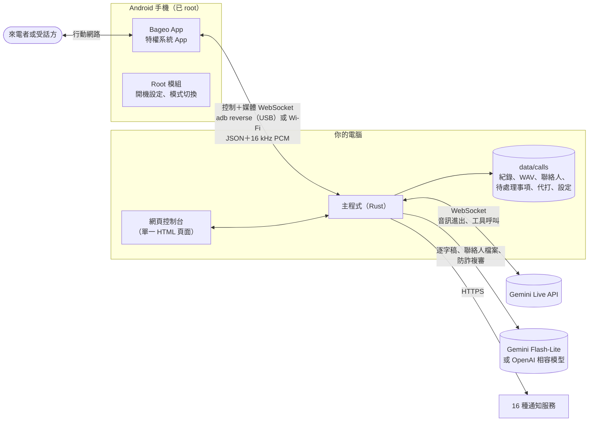

# 架構

Bageo 由三個部分組成：一個手機 App 加 root 模組，把備用 Android 手機變成專門接打電話的機器；電腦上的一個 Rust 程式（「主程式」，agent），所有邏輯都在這裡；以及編譯進這個程式的網頁控制台。沒有資料庫、沒有訊息佇列，也沒有專案自己的雲端服務。



## 各個部分

| 部分 | 位置 | 角色 |
|---|---|---|
| **手機 App** | [`android/`](../../android) | 安靜地接起或撥出電話、收對方的聲音、把 AI 的聲音播進通話、回報每通電話用的 SIM 卡、依指示發簡訊。不含任何對話邏輯。 |
| **Root 模組** | `android/magisk/pixelcallai_uplink` | 把 App 安裝成特權系統 App，每次開機把手機設定成接電話的機器，並執行切換「AI 接聽／一般手機」的 root 小程式。 |
| **主程式** | [`crates/agent`](../../crates/agent) | 其他所有事情：通話狀態機、Gemini Live 連線、錄音、摘要、聯絡人、行程預約、AI 代打、通知、網頁控制台與 API、跟手機的 USB 連線。 |
| **網頁控制台** | `crates/agent/static/calls.html` | 編譯進主程式的單一頁面，九種語言。 |
| **簡訊轉發器** | [`tools/sms_forward`](../../tools/sms_forward) | 選用、獨立的 Python 腳本，轉發手機收到的簡訊。 |

### 主程式的模組

| 模組 | 負責 |
|---|---|
| `main.rs` | 啟動、手機的 WebSocket 端點、來電狀態機、通話結束後的處理流程。 |
| `gemini_live.rs` | 每通電話一個 Live 連線：音訊轉送、回音檢查、插話、掛斷規則、推銷偵測與切換到陪聊模式、連線續接，以及 AI 回電與代打的特殊模式（等對方接起、回鈴音過濾、工具呼叫）。 |
| `prompts.rs`、`locale.rs` | 依語言和接聽身分組出每通電話的系統提示詞；每種語言要講和要聽的語句。 |
| `stall_review.rs` | 進入陪聊前的複審：小模型在 1.5 秒內把通話判成 `scam_or_sales`、`normal`、`ivr_recording` 或 `too_early`。 |
| `appointments.rs` | 一般通話的 `propose_appointment` 工具、由它產生的待處理事項、同意／不同意、用簡訊或 AI 回電告訴對方，以及共用的撥出佇列。 |
| `callback.rs` | 手機的控制連線：`place_call`、`send_sms` 和它們的結果，送到正確的手機。 |
| `errands.rs` | AI 代打：號碼檢查、挑手機與 SIM 卡（`SimBook`）、代打腳本與 `ask_owner`、即時字幕、通話中你打的字、結構化結果。 |
| `contacts.rs` | 通訊錄、不管號碼怎麼寫都能比對、從 vCard／CSV／TSV／純文字／`.xlsx`／`.docx` 匯入，PDF 與圖片交給 Gemini，匯出 vCard。 |
| `phone_region.rs` | 判斷號碼屬於哪個國家（照接這通電話的 SIM 卡的讀法）；記住每支手機回報的 SIM 卡國家。 |
| `calendar.rs` | 行事曆建議，以及 Google、Outlook.com、Microsoft 365、Yahoo、`.ics` 的「加入行事曆」連結。 |
| `deepseek.rs` | 通話後的摘要，走 Gemini 或任何 OpenAI 相容 API（檔名是歷史遺留）；其他語言句子的翻譯；代打的結果。 |
| `tasks.rs` | 「待處理事項」背後的儲存。 |
| `notify.rs`、`gmail.rs`、`tg_inbound.rs` | 16 種通知管道、透過 SMTP 寄信、Telegram 按鈕。 |
| `calls.rs`、`calls_http.rs` | 通話紀錄、錄音與逐字稿；網頁控制台的 REST API。 |
| `settings_store.rs` | `.env` 加上控制台存的設定，改了不用重新啟動。 |
| `usb_bridge.rs` | 為每支 USB 手機維持 `adb reverse`，並啟動 App 的通話服務。 |
| `mdns.rs` | 在區網回應 `bageo.local`（multicast DNS），不知道電腦 IP 也能打開控制台。 |
| `adpcm.rs`、`voice_preview.rs`、`ambience.rs` | 1,080 個 IMA ADPCM 內建語音檔、聲音試聽與「無法接通」語音、12 種背景音。 |

## 一通來電的完整過程

1. **待機。** 每支手機都跟主程式保持一條*控制* WebSocket。走 USB 時，App 在手機上連 `ws://127.0.0.1:8765`，由 `usb_bridge.rs` 維持的 `adb reverse` 把它轉到主程式的連接埠。
2. **響鈴。** App 回報 `incoming`，附上來電號碼和接這通電話的 SIM 卡。主程式決定：
   - 拒接號碼在響鈴時直接掛斷，或接起播預錄語音，完全不會碰到 Gemini；
   - 其他電話則回一個 `answer_plan`（響 *n* 毫秒，預設 3 秒），並透過*響鈴預熱*立刻開好 Gemini Live 連線。提示詞在這時組好：你的或內建的提示詞、狀態留言、資料、號碼在通訊錄裡的話是誰打來、別人怎麼叫你、這張 SIM 卡和這個號碼適用的語言規則、行程預約開啟時的預約工具，以及固定底線（見[撰寫提示詞](PROMPTS.md)）。模型先把開場白生成好，等接起再放出來。
3. **接起。** App 接起電話並開一條*媒體* WebSocket。對方的聲音以 60 毫秒的 PCM 片段往上送；主程式接手預熱好的連線、放出開場白（實測從接起算中位數約 0.43 秒），之後雙向轉送音訊。有些手機接起時才回報 SIM 卡，如果因此要換開場語言，就丟掉準備好的那句，AI 晚一點用對的語言開口。
4. **對話**（`gemini_live.rs`）。主程式會：
   - 把音量偏小的通話聲音調整好，並在頭幾秒檢查手機收音裡有沒有 AI 自己的聲音。這決定對方能不能插話（講滿約 0.8 秒；「嗯」這種短聲不算），以及背景音怎麼混；
   - 把對方的聲音串流給 Gemini（預設由 Gemini 自己判斷對方講完沒），再把 Gemini 的聲音混上背景音送回手機；
   - 台灣 SIM 卡接到國外來電時，讓 AI 等電信的預錄提示播完再開口；
   - 讀 Gemini 雙方的逐字稿，執行少數不交給模型的規則：對方是不是要結束了（他講的話以道別結尾）、這通是不是推銷或詐騙（關鍵字分數 → `stall_review.rs` → 開新連線進入陪聊模式）、線上安靜時提醒、到最長通話時間前收尾；
   - 用獨立的工作處理模型的 `propose_appointment` 呼叫，音訊不用等它；
   - 每隔幾分鐘換一條帶著逐字稿的新 Live 連線，因為 Live 連線有存活時間上限。
5. **掛斷。** 對方最後一句是道別，或 AI 道別後線上安靜 6 秒，主程式就送出 `hangup`。預錄語音選單不回應，安靜幾秒後掛斷。如果 AI 一直沒出聲（沒有金鑰、服務掛了），就立刻掛斷，不讓對方對著一片安靜。
6. **之後**（`main.rs`、`deepseek.rs`、`appointments.rs`、`notify.rs`）。錄音收尾（整通、只有對方、只有 AI），逐字稿送到摘要模型，四行摘要存在通話旁邊並送到每個通知管道。對方提出的每一筆預約都變成一項待處理事項（推銷或詐騙電話不會產生）。其他語言的句子在背景翻譯，翻好再補進紀錄，通知不用等它。

## 一通撥出：AI 代打或預約回電

兩種撥出共用 `appointments.rs` 裡同一條撥出路線：同一個號碼一次一通，`place_call` 只送到指定的手機（和 SIM 卡），腳本只套用在那支手機為這項工作回報的那通電話上。同一個號碼打進來的電話，絕不會拿到撥出用的腳本。

1. **發起。** 代打來自 `POST /calls/api/errands`（「AI 代打」頁面或聯絡人旁的「請 AI 打」）；回電來自待處理事項或 Telegram 卡片上選了「AI 回電」的「同意／不同意」。
2. **號碼檢查。** 代打拒絕緊急電話、短碼（7 碼以下）、高額付費電話，以及寫在國際冠碼後面的號碼（`00`、`011`、台灣的 `01x`／`00x`、日本的 `010`）；國外號碼請用 `+` 寫。回電只打給對方本人的號碼，只限接聽 SIM 卡的國內號碼，絕不打免付費、加值或特碼。
3. **手機與 SIM 卡。** 代打會挑一支 AI 接聽模式、而且有號碼所屬國家 SIM 卡的手機。主程式從手機回報的通話、以及控制連線 hello 裡的 `sims` 清單，學到每支手機的 SIM 卡（subscription id 與國家），存在 `phone_sims.json`。從來沒回報過 SIM 卡的手機不接代打（`sim_unknown`）。回電則用原本接那通電話的手機和 SIM 卡撥出。
4. **撥號。** 主程式送出 `place_call`，附上檢查過的 E.164 號碼和要用的 SIM 卡。如果這通電話的媒體 hello 回報的是別張卡、或沒有回報，主程式會在 AI 開始前掛斷（`wrong_sim`），並忘掉那支手機上的那張卡。已取消的代打絕不會撥出；取消後仍接通的電話會立刻掛斷。
5. **等真人。** AI 不會對著回鈴音說「喂？」。對方接起並開口之前（至少 400 毫秒人聲，濾掉 350–520 Hz 的回鈴音），主程式只送靜音給 Gemini。70 秒都沒人出聲就算沒接；電信「空號」錄音立刻掛斷；代打碰到語音選單最多等 90 秒。
6. **對話。**
   - **回電**：說是誰打來的，用原本那通電話的語言把你的答覆講一次（時間和事由，或客氣地婉拒），道別後結束。
   - **代打**：照腳本走——說明替誰打、交辦允許的範圍內自己決定、其他事呼叫 `ask_owner`。通話會等這個答案：控制台在最近 6 秒內有看即時畫面的話，問題會在那裡顯示最多 40 秒；否則或逾時，AI 會被告知不能採用自己提出的任何選項，改問對方哪些可以，然後禮貌收尾。通話中你打的字（`say`）會當成指示交給 AI。每則提示都會提醒 AI 維持這通電話的語言，數字也一樣。一通代打最長 10 分鐘，9 分 30 秒開始收尾。
7. **之後。** 回電的結果記在它的待處理事項上，並發一則標題為「📞 AI 回電」的通知。代打的逐字稿、交辦和問答會送到摘要模型，回傳 `{outcome, summary, details, follow_up, options, event}`。你沒回答的問題如果 AI 先答應了，結果一律改成 `need_owner`（要你決定）。你會收到一則附聯絡人名字或號碼的 📞 通知；要不要「**再打一次**」或「**回覆後請 AI 再打**」（`follow_up_of`，帶上前一通最後幾句）由你決定。

## 模型什麼時候有工具、什麼時候沒有

一般通話時，聲音背後沒有任何慢速的外部查詢：模型不能在講話中途上網或讀行事曆，它也被告知這一點，並且絕不說「我查一下」。所有需要判斷的事都在通話後由你看摘要處理。

只有兩個功能給模型工具，而且各自受主程式裡嚴格的狀態機管控：

- `propose_appointment`（行程預約開啟時的一般通話，陪聊模式絕不會有）：記下對方要的時間和事由。AI 只承諾會回覆對方；你按「同意」之前什麼都不算數，而且只有第一個決定有效。
- `ask_owner`（只有代打通話）：讓 AI 等到你回答或問題逾時；結果如果敲定了你沒回答的問題，就變成 `need_owner`。

不能出錯的事由模型外圍的固定規則處理：什麼時候掛斷、什麼時候擋下拒接號碼、絕不讓對方對著一片安靜、哪些號碼可以撥、用哪張 SIM 卡撥。

## 語言

`locale.rs` 為每種語言保存：給模型看的短句（怎麼接電話、怎麼道別）、掛斷與推銷規則要聽的字、語音辨識的語言提示，以及通知的標籤。`prompts.rs` 組系統提示詞：繁體中文用專案在真實通話中調好的提示詞，簡體中文用轉換過的版本，其他語言共用一套英文指示，指明要講哪種語言並引用那種語言的語句。開場語言依來電號碼和 SIM 卡的主要語言決定；每份提示詞都要求 AI 跟著對方換語言。新增一種語言，就是加一個 `Phrases` 區塊，再在網頁控制台的字典加一份翻譯。

## 資料存放

```text
data/calls/
  config/settings.json              網頁控制台存的設定（金鑰為明文）
  index.json                        通話清單
  2026-11-14/<通話 id>*.wav         錄音：整通、只有對方、只有 AI
  2026-11-14/<通話 id>_notes.json   摘要、逐字稿、翻譯、行事曆建議
  contacts.json                     你的聯絡人
  tasks/index.json、tasks/<id>.json 待處理事項（行程預約）
  errands.json                      AI 代打，保留最新 500 筆
  phone_sims.json                   每支手機回報過的 SIM 卡
  voice_preview/                    快取的聲音範例與語音
```

都是一般的 JSON 和 WAV 檔，沒有資料庫；要刪要備份都隨你。每次寫入都先寫暫存檔再改名蓋過舊檔。讀不懂的 `errands.json` 或 `phone_sims.json` 會被移到旁邊，不會被覆蓋。

## 設計取捨

- **語音對語音。** 同一個模型聽也講，延遲和插話由模型處理，不是靠語音轉文字、LLM、文字轉語音串成的一條鏈。
- **你的 SIM 卡、你的手機。** 不用 SIP 線路也不用雲端電話服務；手機通訊協定很小，寫在 [API](API.md) 裡，其他前端也可以取代手機。
- **單一程序。** 沒有其他東西要安裝、維持運作或保護。
- **有風險的路徑一律保守。** 複審結果不確定就當成詐騙（繼續陪聊，不放行）；不認識的 SIM 卡不接代打；預約一定等你決定。

## 舊程式路徑

主程式是從一套選單式系統演變來的（預錄問候、DTMF、保留音樂、語音留言、騰訊 TRTC 橋接、Whisper／LLM／Piper 流程）。那些程式碼還在 `main.rs` 和各自的模組裡，預設關閉，也不附錄音。暫時保留是因為它和現行路徑交錯在一起；乾淨地移除它列在[發展藍圖](ROADMAP.md)上。
