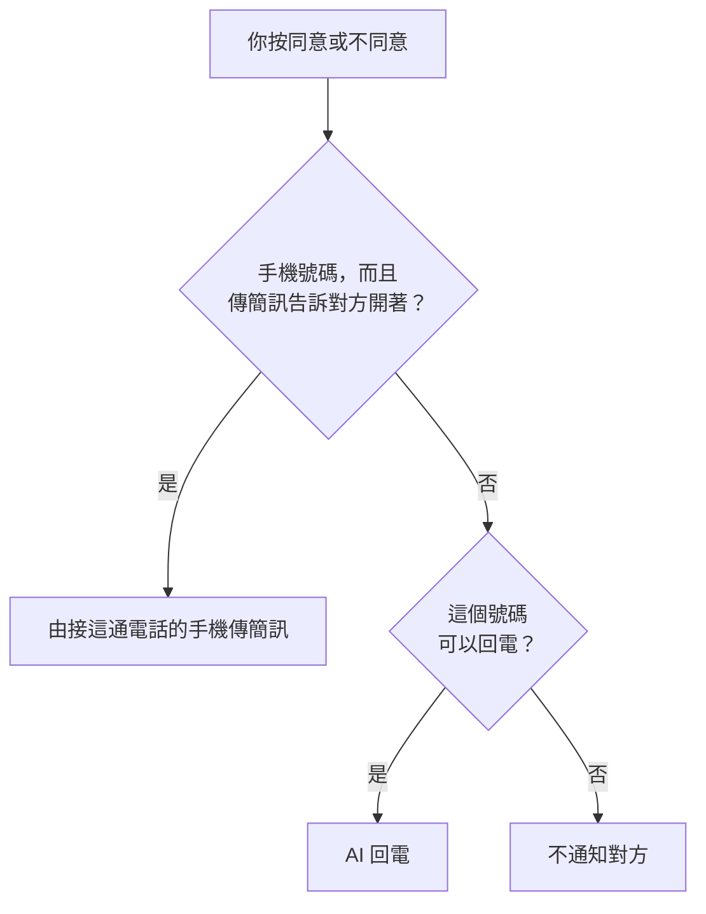

# 設定參考

Bageo 是自架的 AI 電話助理，用 Gemini Live 替你接真實門號的電話。這一頁列出所有設定：電話怎麼接、推銷和詐騙電話怎麼處理、通話摘要送到哪裡，以及 Bageo 怎麼啟動。每張表都附預設值，一眼就看得出哪些地方你改過。

設定放在兩個地方：

- **網頁控制台**（「設定」分頁）：所有跟接電話有關的項目。存到 `data/calls/config/settings.json`，下一通電話就生效，不用重新啟動。
- **啟動選項**：Bageo 在哪裡監聽、資料放哪裡、USB 連線。只在啟動時讀一次，來源是環境變數，或啟動腳本旁邊的 `.env` 檔（從 `.env.example` 複製一份）。

## 快速找到設定

| 我想要… | 去這裡 |
|---|---|
| 讓 AI 以我本人的身分接，不要說自己是助理 | [基本設定](#基本設定) →「接聽身分」 |
| 打進美國卡的電話用英文接，其他照舊 | [基本設定](#基本設定) →「更多選項」→「各 SIM 卡的主要語言」 |
| 遇到詐騙不要直接掛，拖住他的時間 | [推銷與詐騙電話](#推銷與詐騙電話) |
| 某個號碼再也不要打進來 | [黑名單](#拒接號碼與聯絡人名單) |
| 叫 AI 打給餐廳訂位 | [AI 代打](#ai-代打) |
| 對方想約時間，我晚點決定再回覆他 | [行程預約](#行程預約) |
| 用手機打開控制台 | [從其他裝置使用控制台](#從其他裝置使用控制台) |
| 備份設定，或換新電腦 | [備份與還原](#備份與還原) |

## 網頁控制台裡的設定

### 基本設定

AI 要能替你接電話，先把這幾項填好。

| 設定 | 預設 | 作用 |
|---|---|---|
| 語言 | English | AI 跟來電者講話用的語言，包括它的第一句話、拒接語音和傳給來電者的簡訊。 |
| 你的名字 | 空白 | 來電的人怎麼稱呼你。提示詞裡寫 `{owner}` 的地方都會換成它。 |
| 接聽身分 | AI 助理 | **AI 助理**：說自己是替你接電話的 AI，幫你記下留言。**本人**：以你的身分接聽，不會替你答應任何事。 |
| Gemini API 金鑰 | 空白 | 你從 Google AI Studio 取得的金鑰，AI 講話需要它。只存在你的電腦上。 |
| 聲音 | Charon | Gemini 內建的聲音之一。按「**試聽**」會用上面選的語言講三句範例。 |
| 由 AI 接聽來電 | 開 | 總開關。關：來電會被接起再馬上掛斷，什麼都不說；想自己接電話，請改用[一般手機](PHONE.md#一般手機模式)。 |

「語言」可以選 English、繁體中文（台灣）、简体中文、日本語、한국어、Español、Français、Deutsch、Português。

**更多選項。** 下面五項收在「基本設定」的「更多選項」裡，大部分人不用改：

| 設定 | 預設 | 作用 |
|---|---|---|
| 其他人怎麼叫你 | 空白 | 一行一個，最多 10 個：英文名字、綽號、同事對你的叫法。AI 聽到這些名字就知道是在找你。 |
| 通知和摘要的語言 | 跟 AI 講話的語言相同 | 你收到的通知和摘要用這個語言，AI 跟來電者講話的語言不受影響。 |
| 各 SIM 卡的主要語言 | 無 | 手機有不同國家的 SIM 卡時才需要：選 SIM 卡的國家，和打進那張卡的電話要用的開場語言。 |
| AI 代打預設身分 | 助理 | AI 替你打電話時預設用的身分：**助理**或**本人**。每次交辦還可以另外選。 |
| Live 模型 | `gemini-3.8-live` | 在電話上講話的 Gemini Live 模型，通常不用改。名稱有「thinking」的模型（例如 `gemini-3.8-live-extended-thinking`）回答比較謹慎，也稍微慢一點；見[進階](#進階)的「思考程度」。 |

各項的細節：

- **其他人怎麼叫你**：兩種接聽身分都一樣，自己改過提示詞也一樣。通話摘要還是寫「你的名字」。存成 `owner_aliases`（清單）。
- **通知和摘要的語言**：通知、通話摘要（通話紀錄裡也是）、預約卡片和決定結果、簡訊轉發的訊息都用這個語言。人在國外時很好用：AI 用英文接電話，通知照樣是繁體中文。在網頁右上角切換顯示語言時，這裡也會跟著改成同一種語言。
- **各 SIM 卡的主要語言**：例如「美國 (US)」→ English，「語言」還是繁體中文；日本號碼打進美國卡，還是用日文。需要手機 App 1.0 以上，它會回報每通電話是哪張卡接的。存成 `sim_languages`，例如 `{"us": "en"}`。
- **AI 代打預設身分**：AI 從「AI 代打」分頁替你打電話（見 [AI 代打](#ai-代打)）時說自己是誰：**助理**（說是替你打來的，被認真問是不是真人時會表明是 AI 助理）或**本人**（以你的身分講）。存成 `errand_identity`（`assistant`／`owner`，其他值一律當成 `assistant`）。

### 接聽方式

| 設定 | 預設 | 作用 |
|---|---|---|
| 響多久再接 | 3 秒 | 對方聽到響鈴多久 AI 才接：0（馬上接）到 8 秒，以半秒為單位。AI 利用這段時間準備。 |
| 未顯示號碼也接聽 | 開 | 開：沒有顯示號碼的來電跟其他人一樣交給 AI。關：播一句「無法接通」再掛斷。 |
| 一般電話最長 | 5 分鐘 | 3 到 30 分鐘。上限前大約 25 秒，AI 會客氣收尾並掛斷。 |
| 狀態留言 | 關 | 一行關於「現在」的說明，最多 400 字（「送貨的請把包裹放在管理室」）。只有跟這通電話有關時 AI 才會提。 |
| 背景音、背景音量 | 關、中 | 墊在 AI 聲音後面的輕微環境音，聽起來像真的有人在某個地方接電話。音量有小、中、大。 |
| 轉接到你的手機：開啟轉接、轉接方式 | 關閉 | 要不要把來電轉到你的手機，以及怎麼轉：「不接，直接轉到你的手機」或「AI 先接，有急事才轉給你」（`whitelist_mode`，關閉時是 `off`）。打開前會先看免責說明。「聯絡人」頁的白名單分頁也能設定。 |
| 轉接到你的手機：你自己的手機號碼 | 空白 | 有急事時手機會打這個號碼找你，通知裡也會顯示（`whitelist_forward_number`）。 |
| 轉接到你的手機：誰打來可以轉 | 白名單 | 哪些人打來可以轉：**白名單**（`transfer_whitelist`）、**其他聯絡人**（`transfer_contacts`）、**不在聯絡人裡的號碼**（`transfer_others`，包含未顯示號碼）。黑名單和陪聊名單的人不會轉。 |

「未顯示號碼也接聽」關閉時，那句「無法接通」用你的「語言」和「拒接語音的聲音」播出，跟黑名單一樣。這句話已經內建錄好，不需要 Gemini 金鑰。

「背景音」可選：辦公室、居家、街邊、醫院、救護車經過、颱風天、大雷雨、工地、捷運／地鐵、夜市、鞭炮／節慶、開車中。按「**聲音＋背景音**」或「**只聽背景音**」可以試聽。

「轉接到你的手機」預設關閉，關著時 AI 照常接聽，事後通知你。打開「開啟轉接」後可以選兩種轉接方式，只對「誰打來可以轉」勾選的人生效：

- **不接，直接轉到你的手機**（`direct`）：這支手機不接，由電信把電話轉到你的號碼，AI 不出聲，並馬上通知你。要先把手機切到「一般手機」，撥 `**67*你的號碼#` 開好忙線轉接，沒開的話對方會進語音信箱。
- **AI 先接，有急事才轉給你**（`emergency`）：AI 先接聽，對方說有急事時，會馬上通知你，並請他稍等、用這支手機打給你；你接起來就能直接跟他講，你沒接，AI 會說你會盡快回電。要填好你的號碼才會打給你，沒填就只通知。

**誰打來可以轉。** 一開始只勾白名單，沒有另外勾就跟以前一樣。勾「其他聯絡人」會加上聯絡人裡的其他人；勾「不在聯絡人裡的號碼」會加上其他所有人，包含未顯示號碼。陌生人說有急事也可能是詐騙，需要時再打開。

有急事時另有兩條限制。這通電話已經被判定是推銷或詐騙，就不會通知你、也不會打給你（已經在撥給你的那通照常）。不在聯絡人裡的號碼，30 分鐘內最多打給你一次，未顯示號碼共用這一次；超過了 AI 會跟對方說你會盡快回電，你只收到通知。

**開啟轉接前要知道的事。** 打開「開啟轉接」時會先跳出確認框，每次都要按「我了解，開啟」才會打開，按取消或 Esc 就維持關閉。確認框的內容是下面五點。

1. AI 可能判斷錯：真的急事可能沒打給你，不急的事也可能打給你。
2. 這不能取代報警或叫救護車。有生命危險時，請對方直接打當地的緊急電話。
3. 打給你的電話由這支手機的 SIM 卡撥出，電信照常收費，國際或漫遊可能更貴。
4. 轉給你之後的通話會照你的設定錄音。錄音前要不要先告知對方，請依當地法律自行處理。
5. 可能撥不通或接不起來。使用這個功能造成的任何損失由你自行負責，Bageo 及開發者不負任何責任。

**更多選項。** 下面三項收在「接聽方式」的「更多選項」裡，大部分人不用改：

| 設定 | 預設 | 作用 |
|---|---|---|
| 響鈴時先讓 AI 準備好 | 開 | 建議開啟：電話一接通 AI 就開口。關：對方要等 1 到 3 秒才聽到第一句。 |
| 對方可以打斷 AI | 開 | 對方插話時 AI 會停下來。只在收音不會收回 AI 自己聲音的手機上使用，每通電話開頭自動檢查（見[支援哪些手機](PHONE.md#支援哪些手機)）。 |
| 讓 Gemini 判斷對方什麼時候講完 | 開 | 建議開啟：由 Gemini 自己的語音偵測判斷什麼時候輪到 AI 講話。關：改用 Bageo 內建、比較簡單的音量規則。 |

「響鈴時先讓 AI 準備好」會在接起來之前先連上 Gemini、準備好第一句話。即使對方在響鈴時就掛斷，也會用掉一次短暫的 Gemini 連線。

**對方講別的語言。**「用對方的語言回答」預設是開的：對方明顯在講另一種語言，或問你會不會講某種語言時，AI 會切換過去。關掉的話，每通電話 AI 都維持用你選的「語言」。存成 `reply_in_caller_language`。

**國外來電與電信警語。** 台灣的電信業者會在每通國外來電一開始播一段預錄的防詐騙警語。台灣 SIM 卡接到別國號碼（`+…` 或 `00…` 開頭、國碼不是台灣）時，AI 會等這段警語播完：線路安靜下來就開口，最多等 7.5 秒，開場白也只講一次。

其他 SIM 卡（例如雙卡手機上的美國卡）接到的電話沒有這段警語，AI 會馬上開口。這是自動判斷的，不用設定。

手機 App 1.0 以前的版本，「國外來電」就是國碼跟你不同的 `+…` 號碼（見[國際電話國碼](#國際電話國碼)）。

### 推銷與詐騙電話

只要對方的話顯示這是推銷或詐騙，AI 就變成一個有興趣但反應很慢的客人：怎麼申請、怎麼計算，一條一條慢慢問。它絕不給資料、絕不答應任何事，一直聊到對方自己掛斷，或到了時間上限。

例如對方一開口就說「恭喜您貸款已預核准」，或自稱銀行風控人員要你報驗證碼。

| 設定 | 預設 | 作用 |
|---|---|---|
| 陪他聊、拖時間 | 開 | 上面說的拖時間。關：AI 會婉拒並結束通話。 |
| 這類電話最長 | 30 分鐘 | 3 到 30 分鐘。聊越久，用掉的 Gemini 額度越多。 |
| 這類電話用的模型 | `gemini-3.8-live` | 判定是推銷或詐騙後，這通電話改用的模型。留空 = 沿用這通電話原本的模型。 |
| 每通電話都檢查是不是推銷或詐騙 | 開 | 開：用低成本模型讀對方說的內容，新話術、其他語言、語音轉文字寫錯的字也抓得到。關：只檢查出現已知推銷或詐騙字眼的電話。 |

**怎麼判斷。**

- 內建詐騙資料庫（46 種推銷與詐騙話術、27 種語言的關鍵字）裡的字，會讓低成本模型再看一次。
- 開了「每通電話都檢查是不是推銷或詐騙」，沒有這些字的電話也會被看，每通最多三次。
- 模型會說出是哪一種話術、有多確定；不確定就等對方下一句再看。
- 模型沒在時限內回答時，只有不管誰要都是詐騙的要求（報驗證碼、操作 ATM、買點數卡、裝遠端軟體、轉到「安全帳戶」）會立刻開始陪聊。其他情況等下一句再看，連續失敗兩次才只靠關鍵字。
- 開始陪聊後對方再講兩句，會再看一次；誤判的來電可以放回正常應對。
- 聯絡人和你標為「不是」的號碼不會被拖住，除非他們要的正是上面那些只有詐騙才會要的東西。

通話頁的「推銷／詐騙判斷」會顯示這通的判斷與話術類型。按「是詐騙」「是推銷」「不是」會記在這個號碼上，它之後打來會參考你的標記（未顯示號碼不會被記住）。

你自己的字眼和號碼寫在資料夾裡的 `config/scam_db.local.json`，改了會自動重讀，檔案不存在或寫錯都不影響運作：

```json
{
  "keywords": [
    {"text": "會員續約專線", "lang": "zh-TW", "typology": "general_promotion", "weight": 2},
    {"text": "read me the six digits", "lang": "en", "typology": "otp_theft", "weight": 2, "hard": true}
  ],
  "numbers": [
    {"number": "0223456789", "verdict": "safe", "note": "building management"},
    {"number": "+15550100", "verdict": "scam", "typology": "irs_ssa_impersonation"}
  ]
}
```

`weight` 是 1（要搭配其他字才算）或 2（單獨出現就算）；`hard` 只對不管誰要都是詐騙的話術類型有效。`typology` 要用 `crates/agent/data/scam_db.json` 裡的內建類型；放不進去的項目會跳過，並在紀錄裡寫出原因。

### 提示詞

決定 AI 怎麼說話。內建的是簡短的通用基本說法；寫上你自己的情況與風格，AI 會更符合你的需要。要自己寫的話見[撰寫提示詞](PROMPTS.md)。

- 「自訂提示詞」：「AI 助理」與「本人」分開儲存（留空 = 內建），按「**查看內建提示詞**」可以看內容。
- 「AI 可以回答的資料」：來電者可能會問的事，一行一條，最多 6,000 字。
- 訪談提示詞：讓 ChatGPT、Claude 或 Gemini 陪你寫提示詞。

### 拒接號碼與聯絡人名單

最直接的來電過濾：**黑名單**上的號碼打來，完全不會用到 AI 和 Gemini。通話清單裡照樣有紀錄，也會送出「黑名單來電」通知。

黑名單是「**聯絡人**」頁的四種名單之一：一般聯絡人、白名單、黑名單（拒接）、陪聊名單（一接起就陪聊）。存成 `kind`：`contact`、`whitelist`、`blacklist`、`stall`。新增聯絡人、名單選黑名單就好，備註就是原因。只有黑名單的號碼可以在結尾加 `*`，拒接同一個開頭的所有號碼，例如 `0800*`（開頭的 0 不算，至少三碼）。

| 設定 | 預設 | 作用 |
|---|---|---|
| 黑名單打來時 | 響鈴時直接掛斷（不接通） | 在「聯絡人」頁的「黑名單」分頁，選了就存：直接掛斷，或接起來播一句「無法接通」再掛斷。 |
| 拒接語音的聲音 | 跟 AI 的聲音一樣 | 在「設定 → 拒接語音」：這段語音用的聲音，未顯示號碼也聽這段。每個聲音的每種語言都已預先錄好，不會用到 Gemini 額度；按「**試聽語音**」可以聽。 |

號碼照通話清單裡顯示的樣子寫；知道你的國碼時（[`COUNTRY_CODE`](#國際電話國碼)），`+…` 的寫法也對得上。

舊版存在設定裡的拒接號碼（`reject_numbers`）會在 Bageo 第一次啟動時搬進黑名單。號碼已經是某位一般聯絡人的，就把那位改成黑名單（沒有備註才補上原因）；在白名單或陪聊名單上的維持原樣；其他的新增成聯絡人，名字用原因，沒有原因就用號碼。舊清單原封不動留在設定檔，退回舊版時還在；搬好之後 Bageo 就不再看它。

「黑名單打來時」存成 `reject_mode`：

- **響鈴時直接掛斷（不接通）**（`decline`）：電話不會接通。
- **接起播「無法接通」再掛斷**（`announce`）：用你的「語言」播一小段「此號碼目前無法接通」，對方會看到電話接通幾秒鐘。
- 太舊、不會拒接的手機 App，兩種方式都會接起來播語音。

試試看：在通話清單打開一通電話按「**拒接這個號碼**」（會加進黑名單），或在任何通知管道點一下通話摘要下方的「**黑名單 / 陪聊 / 白名單**」簽章按鈕，一步就把對方歸類。

### AI 代打

「AI 代打」分頁讓 AI 替你打電話。以訂四個人的位子為例：

1. 選聯絡人或輸入號碼。
2. 寫下要辦的事和你能接受的範圍：「明天晚上 7 點訂 4 位；7 點半到 8 點也可以」。
3. 選「用什麼身分打」，想指定的話再選「用哪個號碼打」，按「**開始打**」。
4. 看「即時字幕」跟著通話進度。你可以打字交代 AI、回答它問你的問題，或按「**掛斷**」。

結束後那一筆會顯示結果（辦好了、辦好一部分、沒辦成、要你決定、沒接、語音信箱、失敗），加上細節、下一步、談定的時間、通話紀錄連結和「**再打一次**」。對方給了幾個選項時，選一個，AI 就會打回去回覆。你也會收到一則通知。

通話中 AI 會把時間、日期、號碼、名字用問句複誦，等對方說對。對方沒有明確確認的項目，結果和通知裡會標「**未經對方確認**」，用之前先自己確認。

需要什麼、會怎麼做：

- 一支連著、在 AI 模式、有該國 SIM 卡的手機。新版手機 App 會在連線和換卡時自動回報 SIM 卡；只有舊版 App 或 Android 還沒報出 SIM 時才要先接過一通電話（否則會提示「這支手機還沒接過電話」）。
- 絕不撥緊急號碼、7 碼以下的短碼和加值付費號碼；免付費電話可以撥。國外號碼請加 `+`；沒有 `+` 的號碼一律當成本國號碼。
- 同一個號碼一次只打一通，跟[行程預約](#行程預約)的 AI 回電共用排隊。手機通話中時最多等 10 分鐘，等同一個號碼的前一通電話結束最多等 25 分鐘。
- 一通最長 10 分鐘（9 分半開始收尾）。
- AI 不能按鍵：遇到語音選單最多等 90 秒等真人，遇到電信錄音（「您撥的號碼…」）直接掛斷。
- 遇到你沒交代清楚的事，AI 會先跟對方說要確認一下，再到頁面上問你（你正在看時最多等 40 秒）。你沒在看或沒回答，它對這件事什麼都不答應：記下對方的選項、說你確認後再回電，然後客氣收尾。
- 不答應付款、訂金、轉帳，不給交辦以外的個資；只有打開「撥到通」才會重撥。

「用什麼身分打」的預設值是[基本設定](#基本設定)的「AI 代打預設身分」。完整規則、每一種狀態和錯誤代碼見 [API → AI 代打](API.md#ai-代打)。

### 通知

| 設定 | 預設 | 作用 |
|---|---|---|
| 傳送通知 | 開 | 關：什麼都不會送到任何管道。 |
| 通知管道 | 無 | Telegram、Discord、LINE、ntfy、電子郵件、Webhook 等等；每個啟用的管道都會收到每一則訊息。各管道怎麼設定見[通知](NOTIFICATIONS.md)。 |
| 通知裡的網址 | 空白（自動） | 通知裡的連結（逐字稿、錄音、按鈕、行事曆）用這個網址打開控制台。留空＝用 Bageo 算出來的網址，多半是 `http://bageo.local/`，欄位裡的灰字就是；要從外面連進來時填你自己的網址。存成 `public_url`。 |
| 在聊天室操作 | 關 | 在聊天室查通話紀錄、叫 AI 代打、處理待處理事項。Telegram、Discord、Slack 與 Matrix 管道各自的設定裡都有「在這個聊天室接受指令」；下方的折疊區塊則設定環境變數指定的 Telegram Bot 與共用上限。見[在聊天室操作](CHAT_COMMANDS.md)。 |

下方「在聊天室操作」折疊區塊裡的細項存成 `telegram_control`、`telegram_control_users`、`control_errands_per_hour`、`control_commands_per_minute`。

### 摘要與行事曆

每通電話結束後，AI 會寫一段簡短摘要。它用你的 Gemini 金鑰，通常什麼都不用設定。

| 設定 | 預設 | 作用 |
|---|---|---|
| 摘要服務 | Gemini | 決定摘要和行事曆建議由誰來寫：**Gemini** 或**其他服務**。 |
| 其他服務：API 網址、模型、API 金鑰 | 空白 | 選「其他服務」時填寫。有填 API 網址就一定要填模型；API 金鑰本機伺服器不需要。 |
| 建議行事曆活動 | 開 | 通話中講定了日期（送貨時段、預約、對方說好幾點回電），摘要就附上「**加入行事曆**」連結。不會自己把任何東西加進行事曆。 |
| 加入行事曆 | 第一次按時詢問 | 不是一個欄位：第一次按「**加入行事曆**」會問你要加到哪個行事曆，之後就記住。 |

**摘要服務**：

- **Gemini**（`gemini`）：用你的 Gemini 金鑰和 Gemini 最便宜的模型 `gemini-flash-lite-latest`，不行再退到 `gemini-flash-latest`。
- **其他服務**（`custom`）：任何相容 OpenAI 的服務，在下一列設定。
- 存成 `summary_provider`。沒有 Gemini 金鑰時，選 Gemini 跟選其他服務一樣。舊版的設定會自動轉換。

**其他服務**的欄位：

- **API 網址**：服務相容 OpenAI 的位址，例子在下面。
- **模型**：有填 API 網址就一定要填。
- **API 金鑰**：存好後只顯示提示；本機伺服器不需要。
- 不填 API 網址時沒有自己的服務：有 Gemini 金鑰就由 Gemini 寫摘要。
- 存成 `summary_api_base`、`summary_model` 和 `summary_api_key`（裝的是你用的那家服務的金鑰）。

API 網址的例子：

- OpenAI：`https://api.openai.com/v1`（例如 `gpt-4o-mini`）
- OpenRouter：`https://openrouter.ai/api/v1`
- 本機的 Ollama：`http://127.0.0.1:11434/v1`

**加入行事曆**：

- 可選 Google 日曆、Outlook.com、Microsoft 365、Apple 日曆、Yahoo 日曆，或下載 `.ics`。記住的選擇存成 `calendar_app`，按鈕旁的「**換一個行事曆**」可以改。
- 通知和 Telegram 回覆附的也是同一個行事曆的連結。
- 選 Apple 日曆或 `.ics` 時，連結指向「通知裡的網址」（沒有網址就不附），帶的是只能開這個檔案的金鑰，不是你的密碼。Bageo 不連任何行事曆帳號。
- 「建議行事曆活動」開著時，每通電話會多向摘要模型發一次請求。

#### 行程預約

對方想跟你約時間（見面、來訪、約好時間通電話）時，AI 不會在電話上答應。你晚點再決定，對方會收到簡訊或 AI 回電告訴他結果。

| 設定 | 預設 | 作用 |
|---|---|---|
| 行程預約 | 關閉 | 選「**先問我**」（`confirm`）就啟用下面的流程。 |
| 傳簡訊告訴對方 | 關 | 你按同意或不同意後，讓接這通電話的手機以你的名義傳簡訊給對方，只傳給手機號碼。 |
| 預設回覆方式 | 自動（依號碼判斷） | 你沒另外選時，對方怎麼得知結果：**自動**、**一律傳簡訊**或**一律 AI 回電**。 |

「傳簡訊告訴對方」：

- 簡訊像這樣：「您好，我是小明。約在11/14（週六）15:00沒問題，到時見。」
- 簡訊只寫時間，不寫約的是什麼事：那是來電者自己說的話，可能被塞進網址。
- 只傳給手機號碼：台灣手機、+1 號碼（免付費和 900 除外），以及其他國家的手機。手機 App 要能傳簡訊。

「預設回覆方式」：

- **自動**照下面的流程圖判斷。
- **一律傳簡訊**／**一律 AI 回電**只用那一種，不行就不通知。
- 它決定「待處理事項」預先選好的方式、Telegram 按鈕用的方式，以及 AI 在電話上怎麼說。

一次預約怎麼跑完：

1. **電話上。** AI 先用問句把時間完整複誦一次（「是 11 月 19 號星期四下午 4 點半，對嗎？」），等對方說對；對方更正就再問一次。AI 不會叫對方等。
   接著它說「我確認一下，晚點再用簡訊回你」；用回電告知時說「晚點再打給你」；兩種都聯絡不到對方時只說「再回你」。
2. **通話後。** 預約出現在「**通話**」分頁最上方的「**待處理事項**」（和這通電話的詳情）：誰、什麼事、什麼時間，選擇怎麼告訴對方（**傳簡訊**、**AI 回電**或**不通知對方**；這個號碼用不了的方式會反灰），再按「**同意**」或「**不同意**」。
3. **你決定後。** 那一筆會用白話寫出結果：「已同意，已傳簡訊給對方」、簡訊沒傳出的原因，或 AI 回電進行到哪一步。同意的會出現「**加入行事曆**」；簡訊沒傳出的會有「**重傳簡訊**」。
4. **人在外面。** 設定好 Telegram Bot、「傳送通知」也開著時，會收到有「**同意**」／「**不同意**」按鈕的卡片。

Telegram Bot 用 `TELEGRAM_BOT_TOKEN` 和 `TELEGRAM_CHAT_ID` 指定（或透過 `PUT /calls/api/settings` 的 `telegram_bot_token`／`telegram_chat_id`）。在控制台新增的 Telegram 管道和其他管道一樣，只收到附通話連結的提醒。



*「自動」預設回覆方式的判斷。未顯示號碼一律走到「不通知對方」。*

讓它安全的規則：

- 只有第一次決定算數，不管是在控制台、Telegram 卡片或 API 上決定。
- 對方只是順口提的備案時間（「不行的話下午也可以」）不會蓋掉談好的時間；同一通電話另外約的第二件事會分開、各自決定。
- 推銷、詐騙電話一律不約：一通電話被判定是這類電話（通話中判定或由摘要判定；銀行防詐騙、警察通知這類電話不算），或 AI 連不上時，談好的都不算數，也不會等你處理。
- 兩種接聽身分都能用；有預約的那通電話不再另外產生行事曆建議。
- AI 回電只打給跟接聽 SIM 卡同一個國家、長度像一般電話的號碼（台灣是 0 後面 8～9 碼）；免付費（0800、+1 800～888）、加值（0204、0209、+1 900）、特殊號碼（165、110）和國外號碼都不回電。

**AI 回電**的做法：

- 從接這通電話的手機和 SIM 卡撥出（那支手機在線時），只打給那位來電者自己的號碼，同一個號碼一次一通。
- AI 等對方接起來出聲（70 秒都沒人出聲就算沒接），說明是誰打來、用原本那通電話的語言告訴對方結果，說一次再見就掛斷。
- 這通電話在通話紀錄標成「AI 回電」。「待處理事項」會顯示回電進度；撥不出去時也會送到你的通知管道。
- 簡訊同樣從那通電話打進來的 SIM 卡發出，雙卡手機會用對的號碼回覆。

時間一律是這台電腦的當地時間（見[時區](#時區)）。完全沒有可以寫摘要的金鑰時，通知會改放對方開頭說的幾句話；逐字稿一定可以在控制台看到。預約的所有欄位與 API 見 [API → 行程預約與任務](API.md#行程預約與任務)。

### 備份與還原

Bageo 可以自己定期備份設定、讓你隨時手動備份，也能把全部設定包成一個檔案，換電腦時帶走。備份只存在你的電腦上，不會上傳或送到任何地方，Bageo 也不會自己更新。

備份檔裡有金鑰、密碼和連線（匯出時可以不放）。連線是指通知要送去哪裡、誰可以遙控 Bageo：通知管道、Telegram 聊天、轉接用的號碼和急事要不要直接轉過去、Bageo 可以回撥哪些號碼、摘要服務，以及 AI 工具透過 MCP 能做的事。備份檔要放在只有自己拿得到的地方。

| 設定 | 預設 | 作用 |
|---|---|---|
| 自動備份 | 每週 | 不自動備份、每天、每週或每月。 |
| 存到哪裡 | 預設位置 | 填資料夾的完整路徑。空白就存在 Bageo 資料夾（`data/calls`）底下的 `backups`。存檔時 Bageo 會先確認寫得進去。 |
| 自動備份保留幾份（「更多選項」） | 10 | 1 到 100，只算自動備份。 |
| 連通話紀錄、錄音和簡訊一起備份（「更多選項」） | 關 | 開：「立即備份」和自動備份也會放進通話紀錄、錄音、簡訊和待處理事項，檔案會大很多。 |
| 備份檔加密（「更多選項」） | 關 | 開：「立即備份」、自動備份和「匯入前」那份都用備份密碼加密。 |
| 備份密碼（「更多選項」） | 空白 | 至少 8 個字元，要先設好才能開加密。存了就不會再顯示。忘記密碼就打不開這些備份，Bageo 也救不回來。 |

這六項存成 `backup_schedule`、`backup_dir`、`backup_keep`、`backup_include_calls`、`backup_encrypt`、`backup_password`。自動備份和手動備份一律有：設定、金鑰、密碼和連線、聯絡人與名單、自己記的號碼和詐騙號碼、SIM 卡資料，以及 AI 代打。

備份密碼跟其他設定一起存在這台電腦，自動備份才用得到。加密保護的是離開這台電腦的那份：放到外接硬碟、雲端或網路資料夾的備份。只匯出設定時不會帶出這個密碼。

- 「立即備份」：馬上做一份。
- 「匯出設定」：先列出項目讓你勾選：設定、金鑰、密碼和連線、聯絡人與名單、自己記的號碼和詐騙號碼、SIM 卡資料、AI 代打、通話紀錄與錄音、簡訊、待處理事項。一開始勾前六項。換電腦要勾「金鑰、密碼和連線」；給別人看設定時不要勾。通話紀錄、簡訊和待處理事項會讓檔案大很多。沒設控制台密碼時，含金鑰的檔案只能在執行 Bageo 的這台電腦上打開控制台下載。勾「用密碼加密這個檔案」並輸入兩次密碼（至少 8 個字元），就會得到加密的檔案。檔名是 `bageo-export-YYYYMMDD-HHMMSS.zip`，加密的是 `.bageo`。
- 「匯入設定」：選一個備份檔或匯出檔（.zip，加密的是 .bageo），或舊版單獨的設定檔（.json）；加密的檔案會先要你輸入密碼，錯 5 次要重新選檔；舊版設定檔只會還原設定，裡面有金鑰、密碼和連線的話也會還原。
- 「備份檔」：列出最新 10 份，每份可以「還原」「下載」或「刪除」。加密的會標「已加密」。還原時會用這台存的備份密碼打開；如果那份是用別的密碼做的，會請你輸入。刪除前會先問，刪了就救不回來；沒設控制台密碼時，只能在執行 Bageo 的這台電腦上刪。

還原之前，控制台會先列出備份時間、來自哪個版本、檔案多大、裡面有什麼，每一項都有勾選框。一開始全部勾選，檔案裡沒有的項目不會出現。不想還原的就取消勾選；至少要勾一項才能按「還原」。Bageo 會先把現在的設定另存一份（種類是「匯入前」）。沒勾「金鑰、密碼和連線」，或檔案裡本來就沒有的話，這台電腦現有的都會保留。有勾的話，檔案裡有填的會換掉這台的，檔案裡沒有的就保留這台的，所以從比較舊的備份還原，不會拿掉後來才設的密碼或金鑰。只有從備份清單還原「匯入前」那份時，這一組會完全回到匯入前的樣子，匯入帶進來的會全部拿掉。控制台密碼、通知要送去哪裡、誰可以遙控會變的話，控制台會先提醒。備份資料夾一律維持這台電腦的設定。還原不會縮短保留天數：「紀錄保留幾天」和「自動備份保留幾份」只會維持或變長，要縮短請在控制台自己改。通話紀錄、簡訊和待處理事項是加進現有的，不會刪掉任何東西。通話中要等通話結束才能還原。有些設定要重新開啟 Bageo 才全部生效，畫面會提醒。

**自動備份怎麼進行：**

- 距離上一份滿一天、一週或一個月，才會做下一份。
- 正在通話就等通話結束。
- 電腦當時關機的話，下次 Bageo 啟動時補做。
- 備份失敗會每小時重試一次，並通知你一次。

**留多少份：**

- 自動備份：只留最新的幾份，份數看「自動備份保留幾份」。
- 「匯入前」的備份：留最新 5 份。
- 手動備份和匯出：Bageo 不會自動刪。
- 資料夾裡其他的檔案不會動。

**換電腦：**

1. 舊電腦按「匯出設定」，保持勾選「金鑰、密碼和連線」，新電腦就不用重新輸入。要連通話紀錄一起帶走，再勾「通話紀錄與錄音」、「簡訊」和「待處理事項」。
2. 新電腦裝好 Bageo。
3. 打開控制台，按「匯入設定」，選那個檔案，再按「還原」。
4. 手機沒有自動連上的話，每支用 USB 插一次。

### 進階

| 設定 | 預設 | 作用 |
|---|---|---|
| 紀錄保留幾天 | 15 | 通話和錄音、簡訊、AI 代打和待處理事項，超過這個天數就自動刪除（1 到 365），改了立刻生效。存成 `retention_days`；`CALLS_RETENTION_DAYS` 只決定預設值。 |
| 思考程度 | 低 | 只適用於名稱有「thinking」的 Live 模型：低、中、高。「低」回話最快。存成 `gemini_thinking_level`。 |
| 控制台密碼 | 空白 | 設了以後，打開控制台和呼叫 API 都要輸入密碼（瀏覽器會記住）。要用手機或別台電腦打開控制台，一定要設。新設的密碼至少 8 個字元；其他裝置連續打錯 10 次要等 1 分鐘。存成 `ui_password`。 |
| 讓其他 AI 工具連進來（MCP） | 關 | 讓 Claude、ChatGPT 這類 AI 工具查你的通話和待處理事項。用不到就不用開。 |
| 區網名稱 | `bageo` | 同一個網路裡的手機、電腦可以用來代替 IP 的名字：`http://bageo.local/`。只能用英文字母、數字和連字號；留空、`off`、`0`、`none` 或 `false` = 關閉。 |
| 手機也能用 Wi-Fi 連 | 開 | 手機用 USB 接過一次後，拔掉線也能繼續用 Wi-Fi 連線。關掉立刻生效，用 Wi-Fi 的手機會斷線。存成 `phone_wifi`；`PHONE_WIFI` 只決定預設值。見[手機設定 → Wi-Fi](PHONE.md#wi-fi)。 |

開關下面的「重新配對手機」會換一組新的配對碼：用 Wi-Fi 的手機全部斷線，每支都要再用 USB 接一次。

第一次打開控制台、還沒設密碼時，會問你要不要設。

「讓其他 AI 工具連進來（MCP）」是一個折疊區塊，內建於 `POST /mcp` 的 Model Context Protocol 伺服器，細節見 [MCP](MCP.md)。裡面有五個欄位：

- 「開啟 MCP」（`mcp_enabled`）：要打開、也設好 Token 才會生效。連線網址是控制台網址加上 `/mcp`。
- 「Token」（`mcp_token`）：在 AI 工具裡填這組 Token（Bearer token）。
- 「可以叫 AI 代打電話嗎」（`mcp_calls`）：「不可以（只能查看）」「可以，但先在聊天室問我」「可以，直接打」三選一。選「先問我」要有一個開啟下指令的聊天室。
- 「每小時最多代打幾通」（`mcp_errands_per_hour`）：所有 AI 工具加起來算，0 到 30。
- 「允許的網站」（`mcp_allowed_origins`）：只有網頁版的 AI 工具需要，一行填一個網址，例如 `https://app.example`。其他情況留空。

「通知裡的網址」（在「通知」那一區）留空時會自動填。沒設 `AGENT_HOST`（預設）時，Bageo 有回應區網名稱就用 `http://<區網名稱>.local/`，80 埠打不開時用 `http://<區網名稱>.local:8787/`，沒有區網名稱就用這台電腦的區網 IP；設了 `AGENT_HOST=0.0.0.0` 時一律帶 `:8787`。

控制台只有這台電腦能開時（`AGENT_HOST=127.0.0.1`），通知不附連結；在 Docker 裡請自己設定。「系統 → 關於」會顯示目前用的網址。

「區網名稱」由 Bageo 自己回應（多播 DNS，UDP 5353 埠），在控制台對區網開放（包括沒設 `AGENT_HOST` 的預設情況）、或「手機也能用 Wi-Fi 連」開著時啟用，容器裡不會啟動。macOS 上改由系統的 Bonjour 回應（Bageo 會帶起 `dns-sd`）。

系統不讓出這個埠時，日誌會出現一行 `mDNS:` 開頭的訊息，連結改用 IP。打不開 `.local` 名稱的舊 Android 手機，可以用「系統 → 關於」裡的 IP 網址或 QR code。

「國際電話國碼」改在啟動時設定，見[國際電話國碼](#國際電話國碼)。

### 控制台沒有的設定

有幾個設定沒有欄位，請在 `settings.json` 裡改，或用 `PUT /calls/api/settings`（見 [API](API.md)）：

| 鍵 | 作用 |
|---|---|
| `country_code` | 你的國際電話國碼；見[國際電話國碼](#國際電話國碼)。 |
| `name_corrections` | 語音轉文字老是聽錯的名字，一筆一個 `錯的=對的`（例如 `黃先生=王先生`）：逐字稿和摘要會自動改正。第一次啟動的預設值是 `NAME_CORRECTIONS`，用逗號分隔。 |
| `device_labels` | 你替手機取的名字：手機回報的 id → 通知和控制台顯示的名稱，例如 `{"pixel-10123": "工作機"}`。優先於手機自己回報的型號。 |
| `goodbye_hangup_delay_ms` | AI 道別後等多久才掛斷，單位毫秒（200～15000）。維持預設 2000 時，各地區用自己的等待時間，約 1.2～2.5 秒，先看 SIM 卡的國家，沒有就看通話語言；改成其他數字，每通電話都用你設的。 |

## 啟動選項

用環境變數或在 `.env` 裡設定。全部都是選用的；同一個變數，真的環境變數優先於 `.env` 那一行。

用 Docker 時，只有 `docker-compose.yml` 的 `environment:` 底下列出的變數會傳進 Bageo（`CALLS_UI_TOKEN`、`DEVICE_TOKEN`、`PUBLIC_URL`、`CALLS_RETENTION_DAYS`、`TZ`）。其他要用的變數，請自己在那裡加一行。

映像檔本身設定了 `AGENT_HOST=0.0.0.0`、`ASSETS_DIR=/app/assets`、`CALLS_DATA_DIR=/data/calls` 和 `USB_BRIDGE=off`。

### 網路與存取

| 變數 | 預設值 | 意義 |
|---|---|---|
| `AGENT_HOST` | *（不設）* | 監聽的位址。不設 = 控制台對同一個網路開放（`AGENT_PORT` 和 80 埠），其他裝置要先設控制台密碼才進得去；手機照舊走自己的 Wi-Fi 連接埠。`127.0.0.1` = 只有這台電腦。`0.0.0.0` = 所有網路介面全部開放。 |
| `AGENT_PORT` | `8787` | 網頁控制台和手機連線用的連接埠。 |
| `CONSOLE_PORT_80` | *（開）* | 沒設 `AGENT_HOST` 時，控制台也開在 80 埠，網址才能省掉 `:8787`。`off` = 不開。80 埠被佔用或沒有權限時，日誌記一行，控制台照常在 `AGENT_PORT`。 |
| `CALLS_UI_TOKEN` | *（空）* | 網頁控制台和 API 的密碼。用 `?token=…`、`Authorization: Bearer …` 或 `X-Calls-Token` 傳送。**要從其他裝置打開控制台就一定要設定**；也可以在控制台設「控制台密碼」。 |
| `DEVICE_TOKEN` | *（空）* | 不是透過 USB 連進來的手機，必須用 `…/ws?token=<this>` 連線（`<this>` 換成這個值）。**`AGENT_HOST` 設成 `127.0.0.1` 以外的位址時，就一定要設定。** |
| `PUBLIC_URL` | *（空）* | 等同[通知](#通知)裡的「通知裡的網址」；以網頁控制台裡的值為準。留空 = 自動（見[進階](#進階)）。 |
| `MDNS_NAME` | `bageo` | 等同「區網名稱」：用 `http://<這個值>.local/` 打開控制台。以網頁控制台裡的值為準。 |
| `PHONE_WIFI_PORT` | `AGENT_PORT` + 1（`8788`） | 手機走 Wi-Fi 時連的連接埠。只在沒設 `AGENT_HOST` 或設成 `127.0.0.1` 時另外在所有網路介面上開；只給手機連線用（打不開控制台），一定要帶配對碼或 `DEVICE_TOKEN`。`0` = 不開。 |

走 USB 的手機不受 `DEVICE_TOKEN` 限制，因為 USB 通道的終點就是這台電腦本身。

`MDNS_NAME` 留空、`off`、`0`、`none` 或 `false` = 關閉。Windows 上空值會被當成沒設定，請寫 `MDNS_NAME=off`。

### 從其他裝置使用控制台

沒設 `AGENT_HOST`（安裝版的預設）時，同一個 Wi-Fi 的手機和電腦用 `http://bageo.local/` 就能打開控制台：先在這台電腦打開控制台、設好控制台密碼就行。還沒設密碼時，其他裝置只會看到「請先設密碼」。

要把所有東西都對區網開放（例如手機也改連 `AGENT_PORT`），在 `.env` 寫：

```ini
AGENT_HOST=0.0.0.0
CALLS_UI_TOKEN=choose-a-long-random-string
DEVICE_TOKEN=another-long-random-string
```

先打開一次 `http://bageo.local:8787/?token=choose-a-long-random-string`（或用這台電腦的 IP，例如 `http://192.0.2.10:8787/?token=…`），頁面會記住密碼。

「系統 → 關於」會顯示網址和 QR code，用手機掃就能打開，也寫了怎麼把控制台加到主畫面。

Windows 第一次會跳出「允許存取」的視窗，請選「私人網路」允許。其他裝置打不開時，見[疑難排解](TROUBLESHOOTING.md#常見問題)。

如果這台電腦連著「所有流量都走 VPN」的 VPN，Bageo 可能會把 VPN 的位址拿去當區網名稱、連結和手機 Wi-Fi 連線的位址。請把 `AGENT_HOST` 設成這台電腦的區網 IP（例如 `AGENT_HOST=192.0.2.10`），區網名稱、連結和手機就會用這個位址（這時手機改連 `AGENT_PORT`）。

這條連線是未加密的 HTTP：在你信任的家用網路裡沒問題，但不適合開放的網際網路。要從外面連進來，請用 VPN（WireGuard、Tailscale），或有 HTTPS 且自帶登入機制的反向代理；不要做連接埠轉發。

**從外面連進來（反向代理）**：先設好控制台密碼，再把外部網址（例如 `https://calls.example.org/`）填進「通知裡的網址」，通知裡的連結就會用它。Bageo 只接受這台電腦自己的名稱和位址，以及這個網址的主機，沒填的網域會被擋下。代理請用 HTTPS，轉到這台電腦的 80 或 8787 埠。經過代理連進來的都算其他裝置：沒設密碼打不開，連續打錯密碼會先變慢，1 分鐘內錯 10 次要等 1 分鐘。

### 資料與錄音

| 變數 | 預設值 | 意義 |
|---|---|---|
| `CALLS_DATA_DIR` | `data/calls` | 通話紀錄、錄音、設定和通訊錄。相對於 Bageo 啟動時所在的資料夾；容器裡是 `/data/calls`。 |
| `CALLS_RETENTION_DAYS` | `15` | 紀錄保留天數的預設值（1–365），控制台的「進階」可改。 |
| `CALLS_RECORD` | `true` | `false`：完全不保留通話紀錄和錄音。 |
| `ASSETS_DIR` | *（自動搜尋）* | 放內附音效的資料夾。沒設定時用程式旁邊的 `assets`；容器裡是 `/app/assets`。 |

### 時區

| 變數 | 預設值 | 意義 |
|---|---|---|
| `TZ` | *（這台電腦自己的）* | 通知裡的時間、通話清單的「今天」、行事曆建議用的時區。填時區名稱，例如 `Asia/Taipei`、`Europe/Berlin`、`America/New_York`。 |

通知裡的時間長得像 `11月13日 08:09`，日期照你設定的語言寫。只有跑 Bageo 的電腦跟你不在同一個時區時才要設 `TZ`。目前的時間看 `/health` 的 `local_time`。

用 Docker 時，容器從掛進來的 `/etc/localtime` 取得主機的時區（Linux 主機）；要用別的時區就在 `.env` 寫 `TZ=Asia/Taipei`。

Windows 或 macOS 的 Docker Desktop 請把 `docker-compose.yml` 裡 `/etc/localtime` 那一行刪掉，改在 `.env` 設 `TZ`；不然容器用 UTC。`TZ` 不要設成空字串：空的 `TZ` 代表 UTC。

### USB 上的手機

Bageo 會自己維持 `adb reverse`，並啟動手機上的 App。

| 變數 | 預設值 | 意義 |
|---|---|---|
| `USB_BRIDGE` | `on` | `off`：Bageo 完全不執行 `adb`（Wi-Fi 手機、容器，或手機插在另一台電腦上）。 |
| `ADB_BIN` | *（自動搜尋）* | `adb` 的完整路徑。沒設定時依序找：程式旁邊的 `platform-tools/`、`ANDROID_HOME`、常見的 SDK 資料夾，最後是 `PATH` 上的 `adb`。 |
| `ADB_SERIALS` | *（全部）* | 只管理這些手機（`adb devices` 列出的序號，用逗號分隔）。 |
| `USB_PHONE_PORT` | `8765` | App 在手機上連線的連接埠。要改的話，必須連同 App 裡的位址一起改。 |
| `USB_BRIDGE_INTERVAL_SEC` | `15` | 多久檢查一次 USB 連線，單位秒（5–300）。 |

裝了好幾個版本的 `adb` 時，請用 `ADB_BIN` 固定用一個：不同版本會互相重啟對方的 server，讓手機斷線。

### 國際電話國碼

`COUNTRY_CODE` 是你自己國家的國際電話國碼，只填數字、不含 `+`（`1`、`44`、`81`；最多四碼）。Bageo 用它解讀沒寫國碼的號碼：黑名單（寫成 `+44 20…` 的才對得上手機回報的國內格式）、通訊錄與 AI 代打。

別的國家打來的電話，對方的話會先用那國的語言轉成文字（AI 不會那國語言時，讓語音辨識自己判斷），道別才不會漏掉。

留空時，「語言」是繁體中文就當作 `886`，其他語言就沒有。只有語言對不到單一國家（例如英文、西班牙文）時才需要設。

網頁控制台沒有這一欄；除了環境變數，也可以用 `settings.json` 的 `country_code` 或 `PUT /calls/api/settings` 設定。

`settings.json` 裡有 `country_code` 時（空的也算）以它為準，`COUNTRY_CODE` 不會生效；要改回用環境變數，就把那一行刪掉。

### 第一次啟動的預設值

想用 `.env` 或 Docker 預先填好新安裝的設定時，這些變數決定控制台設定的初始值；在控制台存過之後，以控制台的值為準。

| 變數 | 控制台設定 | 預設值 |
|---|---|---|
| `GEMINI_API_KEY` | Gemini API 金鑰 | *（空）* |
| `SUMMARY_API_KEY` | 其他服務（摘要）的 API 金鑰 | *（空；舊名 `DEEPSEEK_API_KEY` 仍可讀）* |
| `APP_LANGUAGE` | 語言 | `en`（還有 `zh-TW`、`zh-CN`、`ja`、`ko`、`es`、`fr`、`de`、`pt`） |
| `NOTIFY_LANGUAGE` | 通知和摘要的語言 | *（空 = 跟 `APP_LANGUAGE` 相同）* |
| `OWNER_NAME` | 你的名字 | *（空）* |
| `OWNER_ALIASES` | 其他人怎麼叫你 | *（空；用逗號分隔）* |
| `ANSWER_STYLE` | 接聽身分 | `assistant`（或 `persona` = 本人） |

其他設定都在控制台改，每一項第一次啟動的預設值見 [`settings_store.rs`](../../crates/agent/src/settings_store.rs)。

通知路徑也可以這樣設定，會在控制台的管道之外額外使用（見[通知](NOTIFICATIONS.md)）：

| 變數 | 意義 |
|---|---|
| `TELEGRAM_BOT_TOKEN`、`TELEGRAM_CHAT_ID` | Telegram Bot 和它要傳到的聊天室。 |
| `NOTIFY_WEBHOOK_URL` | JSON webhook，不帶 token。 |
| `NOTIFY_GATEWAY_URL`、`NOTIFY_GATEWAY_TAG` | Apprise API 的基底位址和 tag（預設 `normal`）。 |

### 啟動腳本

`BAGEO_NO_SHORTCUT=1`：啟動腳本不在桌面放「Bageo Console」捷徑，等同 `-NoShortcut`（`start.ps1`）或 `--no-shortcut`（`start.sh`）。

### 日誌

`RUST_LOG`（預設 `agent=info`）：設成 `agent=debug` 可以在日誌看到更多細節。

`LOG_CALL_TEXT`（預設關）：日誌只記通話裡講了幾個字，像 `<12 chars>`。設成 `LOG_CALL_TEXT=1` 才會把通話中講的話寫進日誌。只在排查問題時開，查完就關掉。

<!-- SPDX-FileCopyrightText: h4lo-void <https://github.com/h4lo-void/bageo-call> -->
