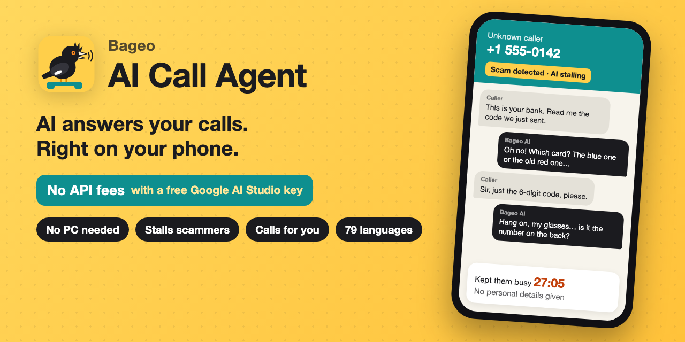
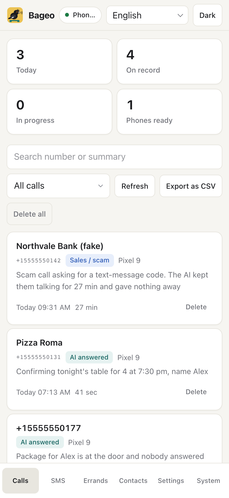
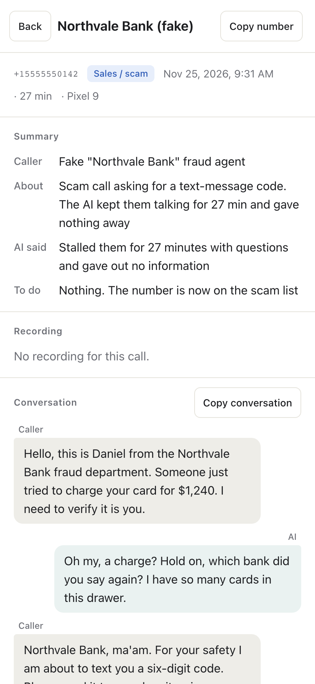
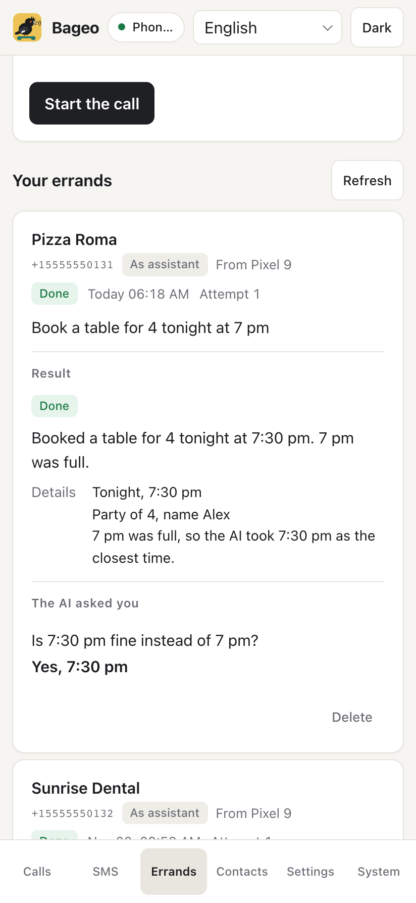
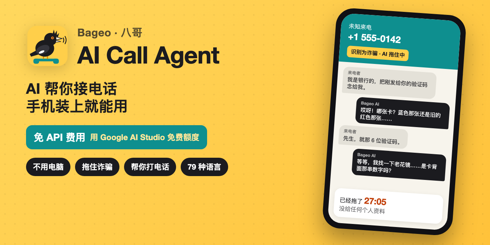
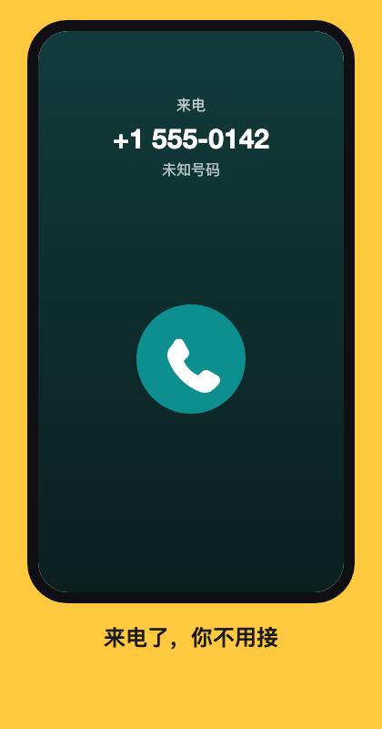
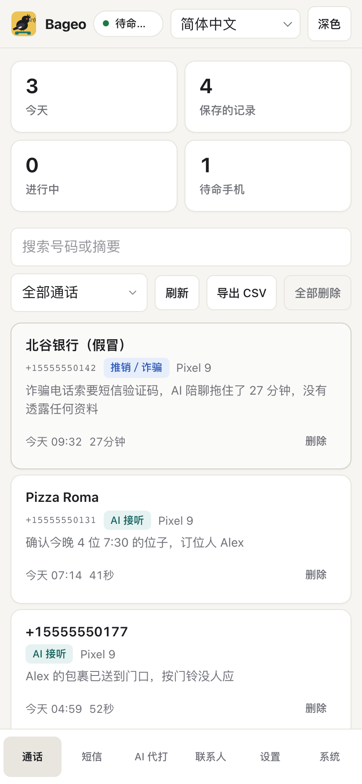
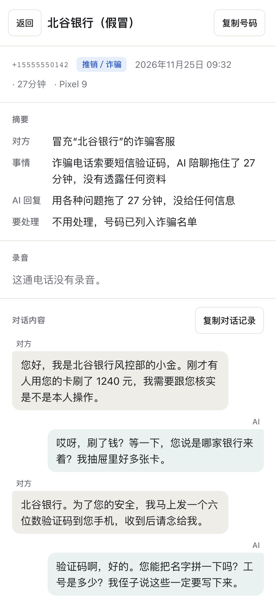

<a id="english"></a>

# Bageo AI Call Agent

**English** · [简体中文](#简体中文)

<p align="center">
  
</p>

Bageo lets an AI answer the calls to your own phone number. It runs entirely on a rooted Android phone, so you do not need a computer, and the AI can run on a free Gemini key.

> Tested on a Google Pixel 9 (Android 16) with KernelSU. If you have a spare phone, try it there first.

## What it does

- **Answers your calls.** It picks up after one ring and talks like a person.
- **Keeps scammers busy.** It spots sales and scam calls and stalls them for up to 30 minutes, without giving out any real details.
- **Makes calls for you.** Write one line, such as "book a table for 4 at 7 pm", and it makes the call. When it is unsure, it asks you on screen first.
- **Speaks many languages.** It speaks the languages Gemini supports and switches when the caller does. The app itself comes in 79 languages.
- **Tells you what happened.** After every call you get a short summary, the transcript and the recording, all kept on your phone.

You stay in charge. People on your Whitelist can ring you directly, you can take over any call the AI is handling, and one switch turns the phone back into a normal phone.

<p align="center">
  
</p>

## What it costs

The module is free. There is no subscription and no account with us. The AI uses your own Gemini key from [Google AI Studio](https://aistudio.google.com/apikey), and in our tests the free tier covered more than 10 calls a day.

Google sets the free limit and may change it. On the free tier Google may use what is sent to improve its products, so switch to a paid key if that matters to you.

## What you need

- A rooted Android phone (Android 10 or newer, arm64)
- A SIM that can make calls
- A Gemini key, free from [Google AI Studio](https://aistudio.google.com/apikey)
- Wi-Fi or mobile data during calls

## Install

1. Install this module in KernelSU Manager, then reboot.
2. Open **Bageo** and enter your Gemini key and your name.
3. Turn on **AI answers**, then call your number from another phone.

If the Bageo app is already installed as a normal app, uninstall it before step 1. If the computer-linked phone module (`pixelcallai_uplink`) is installed, this module replaces it automatically. Do not install both.

Download **bageo-phone-standalone**, not bageo-phone-module (that one is for Bageo on a computer).

## Turn it off

Switch to **Normal phone** in the app or with the Quick Settings tile. To remove Bageo, disable or remove the module in KernelSU Manager and reboot.

If the phone does not start normally, boot into safe mode, or run this from adb and reboot:

```
touch /data/adb/modules/bageo_ai_call_agent/disable
```

## Screenshots

The call list, a scam call that was stalled, and a call the AI made for you.

<p align="center">
  
  &nbsp;
  
  &nbsp;
  
</p>

## Before you use it

- Rules on recording calls and on letting an AI answer them differ from place to place. Check the rules where you live, and tell callers when the law requires it.
- Bageo talks like a person. If a caller sincerely asks, it says it is an AI.
- Calls are handled by Google Gemini under your own key. Recordings, transcripts and summaries are stored only on your phone.

## Source and license

Download the module from [Releases](https://github.com/h4lo-void/bageo-call/releases/latest): the file is `bageo-phone-standalone-<version>.zip`. Source code, full documentation and problem reports are all in [h4lo-void/bageo-call](https://github.com/h4lo-void/bageo-call).

License: AGPL-3.0-only. A commercial license is available.

---

# 简体中文

[English](#english) · **简体中文**

<p align="center">
  
</p>

Bageo 让 AI 替你接打到你自己号码的电话。它完全在一台已 root 的 Android 手机上运行，不用电脑，AI 用免费的 Gemini 密钥就能跑。

> 已在 Google Pixel 9（Android 16）+ KernelSU 上实测。有备用手机的话，建议先装在备用手机上试用。

## 功能

- **替你接电话。** 响一声就接，说话像真人。
- **拖住骗子。** 识别推销和诈骗电话，最长陪聊 30 分钟，不给出任何真实资料。
- **帮你打电话。** 写一句话，比如“订明晚 7 点 4 位”，它就替你打。拿不准时，会先在屏幕上问你。
- **会说多种语言。** Gemini 支持的语言它都能说，对方换语言它也跟着换。App 界面有 79 种语言。
- **告诉你发生了什么。** 每通电话结束后都有简短摘要、逐字稿和录音，全部留在你的手机上。

一切由你做主：白名单里的人来电可以直接响铃给你，AI 通话中你可以随时接手，一个开关就能切回一般手机。

<p align="center">
  
</p>

## 费用

模块免费，没有订阅，也不用注册我们的账号。AI 用的是你自己在 [Google AI Studio](https://aistudio.google.com/apikey) 申请的 Gemini 密钥。我们实测，免费额度每天接 10 通以上电话都够用。

免费额度的上限由 Google 决定，可能会调整。使用免费额度时，Google 可能会用传送的内容改进产品，介意的话请改用付费密钥。

## 需要什么

- 已 root 的 Android 手机（Android 10 以上，arm64）
- 能打电话的 SIM 卡
- Gemini 密钥，可在 [Google AI Studio](https://aistudio.google.com/apikey) 免费申请
- 通话时能上网（Wi-Fi 或移动数据）

## 安装

1. 在 KernelSU 管理器里安装本模块，然后重启。
2. 打开 **Bageo**，填入 Gemini 密钥和你的名字。
3. 打开 **AI 接听**，用另一部手机打给自己试试。

如果手机上装过一般版的 Bageo App，请在第 1 步之前先卸载。如果已经装了电脑连动版的手机模块（`pixelcallai_uplink`），本模块会自动替换它，两个不要同时装。

要下载的是 **bageo-phone-standalone**，不是 bageo-phone-module（那个要配合电脑用）。

## 关闭与卸载

在 App 里或用下拉快捷开关切回**一般手机**。要移除 Bageo，到 KernelSU 管理器停用或移除模块，然后重启。

如果手机无法正常开机，请进入安全模式，或用 adb 执行下面的命令后重启：

```
touch /data/adb/modules/bageo_ai_call_agent/disable
```

## 截图

通话记录、一通被拖住的诈骗电话、一通 AI 替你打的电话。

<p align="center">
  
  &nbsp;
  
  &nbsp;
  
</p>

## 使用前请了解

- 各地对通话录音和由 AI 接听电话的规定不同。请先了解当地法规，法律要求告知对方时请告知。
- Bageo 说话像真人。对方认真问的话，它会承认自己是 AI。
- 通话由你自己密钥下的 Google Gemini 处理。录音、逐字稿和摘要只保存在你的手机上。

## 源代码与许可

模块在 [Releases](https://github.com/h4lo-void/bageo-call/releases/latest) 下载，文件名是 `bageo-phone-standalone-<版本>.zip`。源代码、完整文档和问题反馈都在 [h4lo-void/bageo-call](https://github.com/h4lo-void/bageo-call)。

许可：AGPL-3.0-only，另提供商业授权。
